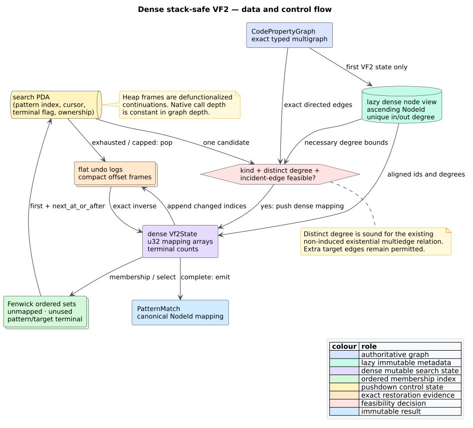

# ADR-0057: Represent VF2 search state as dense heap machines

- **Status:** Accepted
- **Date:** 2026-08-19
- **Scope:** feature-free `pattern::Vf2Matcher` and the graph metadata it reads

## Context

[`Vf2Matcher`](../components/patterns/vf2-matching.md) enumerates non-induced
subgraph monomorphisms in a deterministic depth-first order. Its previous
stack-safe control loop still paid avoidable costs at every search depth:

- six hash maps or sets represented mappings, unused nodes, and terminal
  fringes;
- each suspended search frame owned a freshly collected and sorted candidate
  vector; and
- terminal-set restoration owned nested vectors inside every undo frame.

The four-node path benchmark into a 4,096-node target spent most sampled time
collecting and sorting hash-set entries. That representation hid the fact that
the graph already has a stable, finite node universe. Optimizing this path must
preserve the exact public embedding sequence, positive-cap prefix, strict and
relaxed compatibility, directed multiedge semantics, disconnected patterns,
and constant native call depth.

## Decision

1. Lazily derive one immutable **dense node view** per CPG from ADR-0056's
   existing stable node index. Ascending `NodeId` defines index
   $`0,\ldots,|V|-1`$. Aligned arrays store stable ids and distinct directed
   predecessor/successor counts. Graphs that never invoke VF2 never construct
   this view.
2. Represent forward and reverse partial mappings with `Vec<u32>`. The checked
   value `u32::MAX` is the unmapped sentinel; graph admission rejects a dense
   domain that would consume it.
3. Represent each ordered node set with a membership bit vector and a
   [Fenwick tree](../GLOSSARY.md#fenwick-tree). `first` and
   `next_at_or_after` select members in $`O(\log |V|)`$ time without sorting,
   scanning a growing prefix, or allocating a candidate vector. Initially full
   sets store the complement so their tree starts zero-filled.
4. Keep terminal justification counts in dense `u32` arrays. A push appends
   changed indices to flat pattern/target delta logs; its compact undo frame
   stores only the pair and the two log offsets. Pop replays those suffixes as
   the exact inverse.
5. Make each search continuation a compact heap frame containing the chosen
   pattern index, next target cursor, terminal/full-set selector, and ownership
   bit. The explicit `Vec<Vf2SearchFrame>` is a pushdown automaton (PDA); no
   search-depth recursion is introduced.
6. Before incident-edge consistency, reject a pair when the pattern node has
   more distinct outgoing or incoming neighbours than the target node. This is
   a necessary, label-independent condition for the existing non-induced
   monomorphism. Count distinct endpoints rather than raw edges so parallel
   pattern edges retain their documented existential meaning.
7. Keep `Vf2State::candidate_pairs` as the public materialization boundary.
   Production search consumes the same canonical sequence through cursors.



*Figure — the lazy dense graph view feeds ordered sets and mapping arrays; a
cursor-only search PDA advances, pushes flat deltas, emits, and restores.
Source: [`diagrams/vf2-dense-state.puml`](../diagrams/vf2-dense-state.puml).*

## State transition contract

Let $`P`$ be the pattern, $`G`$ the target, and $`\mu`$ the current partial
injection. The production transition is:

```text
NEXT_OR_BACKTRACK(state, search):
    frame <- search.last
    target <- first eligible dense target at or after frame.cursor
    if no target exists:
        exhausted <- search.pop
        if exhausted owns a mapping: POP(state)
        return
    frame.cursor <- target + 1
    if kinds disagree: return
    if distinct_degree(pattern_node) exceeds distinct_degree(target): return
    if any already-mapped incident edge lacks a compatible target edge: return
    PUSH(state, pattern_node, target)
    if every pattern node is mapped:
        emit the mapping in ascending pattern NodeId order
        POP(state)
    else:
        search.push(cursor frame for the next canonical candidate sequence)
```

`PUSH` records the start of each flat terminal-delta suffix before incrementing
distinct-neighbour justification counts. `POP` truncates exactly those suffixes,
decrements the corresponding counts, clears both mapping cells, and restores
the pair to the initially full sets. This establishes a one-push/one-pop
invariant even when a result cap stops the machine with live child frames.

## Complexity

Let $`p=|V_P|`$, $`t=|V_G|`$, and $`d(v)`$ be distinct directed degree. Lazy
metadata construction costs $`O(p+t+|E_P|+|E_G|)`$ time and $`O(p+t)`$ retained
space after the ADR-0056 edge cache exists. Candidate successor selection and
set updates cost $`O(\log p+\log t)`$ per transition. Feasibility still scans
the candidate pattern node's incident exact edges.

The factorial search bound is unchanged: representation does not change the
NP-complete problem. Auxiliary state is $`O(p+t+|E_P|+|E_G|)`$ in the worst
case because flat terminal deltas can record each distinct incident endpoint
along a live branch. Search continuation storage is $`O(p)`$, not the previous
conservative $`O(pt)`$ candidate-vector bound. Native call-stack consumption is
$`O(1)`$ with respect to $`p`$, $`t`$, degree, and graph depth.

## Rejected alternatives

### Keep hash sets and optimize their hasher

Rejected. Profiling showed collection and sorting, not cryptographic hashing,
as the dominant work. A faster hasher cannot remove allocation, sorting, or
the wider entry representation.

### Scan a bit vector for the next member

Rejected. A disconnected deep pattern can repeatedly scan an already mapped
prefix, producing quadratic cursor work. The Fenwick selector makes this
boundary logarithmic and property-testable.

### Eagerly attach dense metadata to every graph

Rejected after measurement. Eager ids and degree arrays charged parser/corpus
workloads that never ran VF2. A first lazy-degree prototype still copied node
ids eagerly. Making the entire dense view lazy removed that cross-workload
cost.

### Reorder candidates with VF2++ or VF3 heuristics

Rejected for this change. Public capped matching promises a canonical prefix
based on ascending stable ids. A heuristic reorder would be an observable API
change and requires its own design and compatibility decision.

### Apply raw-degree or stronger induced-graph cuts

Rejected as unsound for current semantics. Parallel pattern edges require one
compatible target edge existentially, and extra target edges are allowed.
Distinct directed neighbour counts are the strongest added rule proved
necessary without changing those contracts. Classical terminal/new-node cuts
remain future work until proved against the non-induced typed multigraph model.

### Recover performance with recursion, a helper thread, or a larger stack

Rejected. These move failure rather than remove logical-depth dependence. Both
the search continuation and exact undo state remain typed heap data.

## Consequences

### Positive

- Production candidate traversal allocates no per-depth vector and performs no
  per-depth sort.
- Mapping membership, inverse lookup, fringe updates, and undo are dense,
  deterministic operations.
- Distinct-degree pruning rejects impossible pairs before exact edge scans
  without narrowing the existing match relation.
- The public result sequence and all positive-cap prefixes remain unchanged.
- A 100,000-node path match still completes on a 256 KiB native stack.

### Negative

- The first VF2 state for a graph pays lazy dense-view construction.
- Fenwick trees retain more bytes than plain bit vectors in exchange for
  logarithmic ordered selection.
- Dense domains are deliberately limited below `u32::MAX`; this is checked
  before conversion rather than silently truncating.
- `candidate_pairs` still allocates because its public return type owns a
  vector; only the internal search avoids that ownership boundary.

## Verification

The implementation is checked against an independent iterative exhaustive
injection oracle on generated labelled directed multigraphs, the previous
recursive bounded specification, insertion permutations on both graphs, cap
prefix laws, and an incompatible-node metamorphic extension. `DenseSet` is
compared after generated operations with an independent `BTreeSet`, including
every successor query. Examples pin self-loops, parallel edges, extra reverse
edges, disconnected patterns, compact frames, invalid pushes, exact undo, and
parser-built self-matches. Allocation, counters, controlled timings, rejected
eager variants, and falsification boundaries are recorded in
[scientific validation 52](../scientific/52-dense-vf2-validation.md).

## References

1. Cordella, L. P., Foggia, P., Sansone, C., and Vento, M. (2004). *A
   (Sub)Graph Isomorphism Algorithm for Matching Large Graphs.* IEEE
   Transactions on Pattern Analysis and Machine Intelligence 26(10). DOI:
   [10.1109/TPAMI.2004.75](https://doi.org/10.1109/TPAMI.2004.75).
2. Fenwick, P. M. (1994). *A New Data Structure for Cumulative Frequency
   Tables.* Software: Practice and Experience 24(3). DOI:
   [10.1002/spe.4380240306](https://doi.org/10.1002/spe.4380240306).
