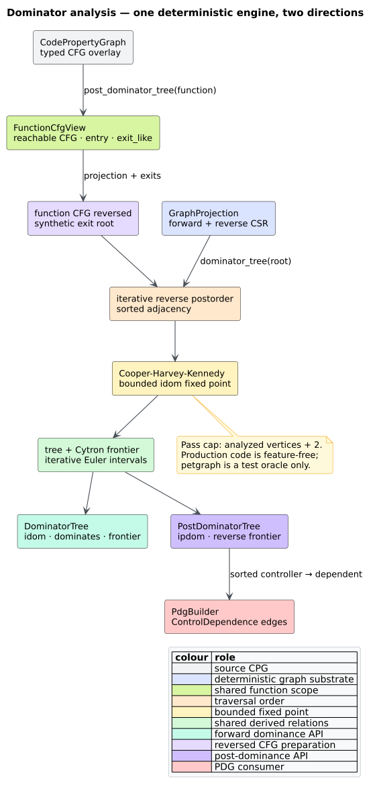

# ADR-0058: Run CHK over borrowed CSR and a synthetic-exit overlay

- **Status:** Accepted
- **Date:** 2026-08-22
- **Scope:** feature-free dominator/post-dominator analysis, shared function CFG scope, and PDG control dependence

## Context

[`dominator_tree`](../components/graph/dominator-analysis.md) and
`post_dominator_tree` already used a deterministic, bounded, stack-safe
Cooper–Harvey–Kennedy (CHK) fixed point. Profiling the H08 checkpoint showed
that replacing CHK with a more complex algorithm would attack the wrong cost:
the fixed-point core accounted for only 3.61% of sampled cycles. The public
boundaries instead copied both CSR directions into `Vec<Vec<u32>>`, built and
reversed another adjacency for post-dominance, allocated a temporary incoming
vector per frontier join, stored each frontier in a `BTreeSet`, and constructed
the canonical function projection twice.

The representation also hid one semantic defect. For root $`r`$, the defining
equation

```math
DF(x)=\{y\mid \exists p\in\operatorname{pred}(y):
x\operatorname{\ dom}p\land\neg(x\operatorname{\ sdom}y)\}
```

places $`r`$ in $`DF(r)`$ when an explicit self-loop or reachable backedge
enters $`r`$: $`r`$ dominates the predecessor but does not *strictly* dominate
itself. The former join-only walk omitted that case.

The change must preserve immediate dominators, post-dominators, infinite-region
modeling, canonical result order, the public `BTreeMap` result contract, the
$`|V|+2`$ convergence bound, and constant native-stack use.

## Decision

1. Represent CHK input with a private borrowed `DenseAdjacency`. Ordinary
   dominance borrows the forward and reverse CSR arrays already owned by
   `GraphProjection`; it copies no edge row.
2. Represent the reversed post-dominator graph as an **overlay**. The view swaps
   the two borrowed CSR directions, owns one sorted vector of synthetic-exit
   children, and owns one bit-packed marker indicating which real nodes have
   the synthetic root as an extra predecessor. It never materializes a second
   graph.
3. Discover nodes that cannot reach a modeled exit with an iterative reverse
   traversal over borrowed predecessor slices. Attach exactly those nodes and
   the explicit/structural exits to the synthetic root, preserving the previous
   total-tree semantics for infinite regions.
4. Keep reverse postorder and Euler traversal as explicit heap-resident
   pushdown automata. Their continuation frames contain a dense node and a
   successor cursor; graph depth never becomes native call depth.
5. Build dominance frontiers in flat vectors. Reiterate borrowed predecessor
   rows instead of collecting a temporary join vector, suppress same-join
   duplicates while that join is active, and heap-sort each final row. Treat
   the distinguished root as having an implicit external predecessor so one
   explicit incoming root edge receives the mathematically exact treatment.
6. Validate a function selector and compute its nested-function-aware AST scope
   directly. Use that set during CFG reachability instead of first constructing
   and then discarding a complete `cfg_projection`.
7. Convert dense results to public `BTreeMap` values in ascending dense
   `NodeId` order, and sort control-dependence edge output with the shared
   stack-safe binary-heap primitive.
8. Retain CHK. A Lengauer–Tarjan implementation is warranted only if a future
   controlled profile shows the fixed point—not result ownership or projection
   construction—to be the dominant cost.



*Figure — direct dominance borrows both CSR directions; post-dominance swaps
those directions and adds only a synthetic-root row/bit mask. Source:
[`diagrams/dominator-analysis.puml`](../diagrams/dominator-analysis.puml).*

## Literate algorithm

The post-dominator overlay is constructed without recursive traversal or edge
copying:

```text
POSTDOMINATOR_OVERLAY(projection, exits):
    can_reach_exit <- bit vector of |V| false values
    work <- exits in reverse canonical order
    while work is nonempty:
        node <- work.pop()
        if can_reach_exit[node]: continue
        can_reach_exit[node] <- true
        work.push_all(reverse(projection.predecessors(node)))

    virtual_children <- sorted_unique(
        exits union {node | not can_reach_exit[node]})
    virtual_parent[node] <- node is in virtual_children

    return view where
        successors(real)   = projection.predecessors(real)
        predecessors(real) = projection.successors(real)
                             plus virtual_exit when virtual_parent[real]
        successors(virtual_exit) = virtual_children
        predecessors(virtual_exit) = empty
```

CHK reads `successors` and `predecessors` through that view. The only
input-sized owned overlay state is $`O(V)`$; the existing CSR remains the single
owner of $`O(E)`$ adjacency.

## Complexity and stack bound

CHK retains its conservative $`O(VE)`$ worst-case time and $`O(V+E)`$
auxiliary-space bounds. The optimization removes an additional $`O(V+E)`$ edge
copy at the API boundary; it does not claim a better asymptotic fixed-point
bound. The post-dominator overlay adds $`O(V)`$ bits/indices, reverse
reachability is $`O(V+E)`$, and frontier construction retains its conservative
$`O(VE)`$ worst case.

All graph-depth continuations live in `Vec` values. Native call-stack use is
$`O(1)`$ with respect to graph depth, vertex count, edge count, and dominator
tree height.

## Rejected alternatives

### Replace CHK with Lengauer–Tarjan immediately

Rejected by measurement. The CHK core was a small minority of the profile;
the proposed replacement would add proof and maintenance surface while leaving
the dominant allocation boundaries intact.

### Keep materialized adjacency and tune allocation capacities

Rejected. Capacity tuning cannot remove copying of every edge direction or the
second reversed graph. Borrowed CSR expresses the actual ownership relation.

### Cache a function CFG projection inside the mutable CPG

Rejected for this change. It would require mutation invalidation and retained
per-function state when the duplicate build can be removed exactly by sharing
the existing AST scope set in one call.

### Restore recursive DFS or Euler traversal

Rejected. A larger stack or helper thread relocates the failure boundary;
explicit heap continuations establish the invariant directly.

### Ignore the root-frontier oracle discrepancy

Rejected. Weakening an independent oracle would preserve a standards-level
semantic defect. The production frontier now implements strict dominance at
the distinguished root exactly.

## Consequences

### Positive

- Direct dominance copies no CSR edges; post-dominance owns only its synthetic
  overlay.
- Frontier construction eliminates per-join vectors and tree-node allocation.
- The shared function CFG boundary builds one projection rather than two.
- Canonical public maps, post-dominator semantics, iteration bounds, and PDG
  edge order are unchanged except for the corrected direct root frontier.
- Four 100,000-node adversarial shapes complete on a 256 KiB native stack: a
  deep projection, a wide projection, an exit-plus-infinite-region CFG, and a
  function CFG with 99,999 real exits.

### Negative

- The private adjacency view has a synthetic-predecessor branch on each
  post-dominator predecessor iteration.
- Public result ownership still requires `BTreeMap` allocation; changing that
  observable type is outside this decision.
- CHK remains $`O(VE)`$ in the conservative worst case. This ADR removes
  measured representation overhead rather than claiming a new algorithmic
  bound.

## Verification

Every directed graph through four vertices (4,165 rooted graphs) is compared
with an independent vertex-removal dominance and frontier oracle. A second
4,164-graph exhaustive campaign compares exit-reachable post-dominator/control
dependence results with the former petgraph-based implementation. Four 256-case
properties cover vertex removal, petgraph immediate dominators, post-dominator
and PDG equivalence, and node/edge insertion permutations. Named cases pin
diamonds, loops, multiple backedges, an irreducible region, unreachable entries,
infinite regions, and root self/backedges.

Against the committed H08 checkpoint, the 2,048-stage diamond ladder improves
direct dominance by 15.06% and post-dominance by 11.71%. Parser-backed PDG
construction improves 29.76% on the small corpus and 27.09% on the medium
corpus. The retained-fixture headless profile reduces allocation blocks by
31.66%, cycles by 13.57%, and retired instructions by 15.88%. Full conditions,
counters, and falsification boundaries are recorded in
[scientific validation 53](../scientific/53-dominator-optimization-validation.md).

## References

1. Cooper, K. D., Harvey, T. J., Kennedy, K. (2001). *A Simple, Fast Dominance
   Algorithm.* Rice University Computer Science Technical Report TR-06-33870.
2. Cytron, R., Ferrante, J., Rosen, B. K., Wegman, M. N., Zadeck, F. K. (1991).
   *Efficiently Computing Static Single Assignment Form and the Control
   Dependence Graph.* ACM TOPLAS 13(4), 451–490. DOI:
   [10.1145/115372.115320](https://doi.org/10.1145/115372.115320).
3. Lengauer, T., Tarjan, R. E. (1979). *A Fast Algorithm for Finding Dominators
   in a Flowgraph.* ACM TOPLAS 1(1), 121–141. DOI:
   [10.1145/357062.357071](https://doi.org/10.1145/357062.357071).
