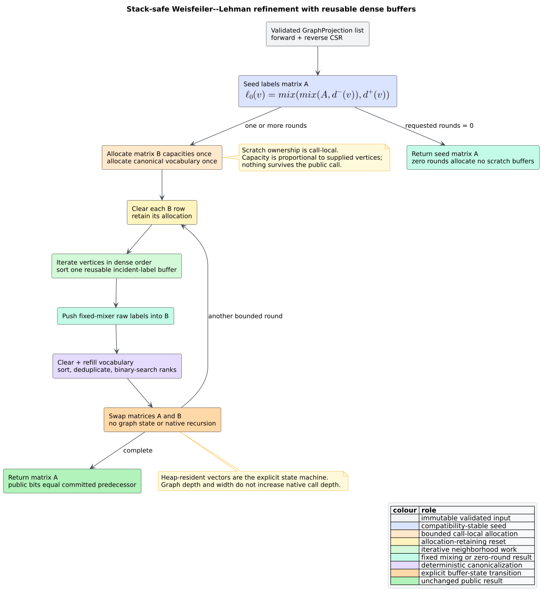

# ADR-0061: Reuse call-local WL refinement buffers

- **Status:** Accepted
- **Date:** 2026-08-22
- **Scope:** projection-level Weisfeiler--Lehman refinement, public label compatibility, stack-safe scratch ownership

## Context

[`wl_labels`](../components/graph/wl-analysis.md) computes bounded
Weisfeiler--Lehman (WL) color refinement over one or more validated graph
projections. A **refinement buffer** is a dense `Vec<u64>` containing one
round's label for each projection vertex. Before this decision, every round
allocated a new outer matrix, one dense vector per graph, and a flattened
canonical-vocabulary vector. Four rounds therefore allocated the same
capacity repeatedly even though graph shape is invariant during the call.

The public result is a numeric `Vec<u64>`. Its fixed mixer has exact regression
vectors and is shared by clone and vulnerability analyses. Optimizing the
kernel must therefore preserve every result bit, reject malformed input before
indexed access, keep the 16-round admission ceiling, and remain safe on deep or
wide graphs without mapping graph depth onto the native call stack.



*Figure -- complete buffer lifecycle. Source:
[`diagrams/wl-buffer-reuse.puml`](../diagrams/wl-buffer-reuse.puml).*

## Decision

1. Compute the seed matrix exactly as before and return it immediately for a
   zero-round request, without allocating refinement scratch state.
2. For one or more rounds, allocate one capacity-matched scratch vector per
   graph and one canonical-vocabulary vector sized for the total vertex count.
3. At each round, clear each scratch vector without releasing its allocation,
   push raw labels in dense order, clear and refill the vocabulary, assign the
   same sorted ranks, and swap current/scratch matrices.
4. Keep the incident-neighbor vector call-local and reuse it across every
   vertex and round, as before.
5. Retain `stable_wl_mix` unchanged. An isolated `FxHasher` prototype is
   rejected despite speed because raw-hash ordering participates in public
   rank values and the existing fixed operation sequence is the documented
   cross-release compatibility boundary.
6. Introduce no cache, global, thread-local, mutex, graph mutation, unsafe
   initialization, or recursion. All scratch allocations are owned by and
   dropped with one invocation.

## Literate algorithm

The two dense matrices form an explicit heap state machine. `CURRENT` is read
only during a round; `NEXT` is cleared and filled completely before the roles
are swapped.

```text
REFINE_WITH_REUSABLE_BUFFERS(graphs, requested_rounds):
    validate every graph before indexed access
    CURRENT <- directed-degree seed matrix
    rounds <- min(requested_rounds, 16)
    if rounds = 0:
        return CURRENT

    NEXT <- one empty capacity-matched vector per CURRENT row
    VOCABULARY <- empty vector with total-node capacity
    INCIDENT <- empty vector

    repeat rounds times:
        for each graph row in dense order:
            clear NEXT.row while retaining capacity
            for each vertex v:
                clear INCIDENT while retaining capacity
                append current successor and predecessor labels
                sort INCIDENT
                append fixed_mix(CURRENT[v], INCIDENT) to NEXT.row

        clear VOCABULARY while retaining capacity
        append every NEXT label; sort; deduplicate
        replace each NEXT label by its binary-searched rank
        swap CURRENT and NEXT

    return CURRENT
```

Every `NEXT` row is empty at round entry and receives exactly its graph's node
count before canonicalization. A swap cannot expose stale values because the
old `CURRENT` becomes `NEXT` and is cleared before its next write phase.

## Correctness argument

Let $`L_t`$ denote the predecessor's label matrix after round $`t`$, and
$`A_t`$ the retained implementation's current matrix. Seeding is unchanged, so
$`A_0=L_0`$. Assume $`A_t=L_t`$. Both implementations visit the same validated
CSR entries in the same dense order, sort the same incident-label multiset,
and fold it through the same fixed mixer. Their raw matrices are therefore
equal. Both construct the same sorted distinct vocabulary and replace every
raw value with the same binary-search rank, establishing
$`A_{t+1}=L_{t+1}`$. Induction proves exact equality for every admitted round.

Clearing changes vector length, not retained capacity. Since every element is
written through safe `push` before it is read, no stale or uninitialized value
can influence a result. All loops and state transitions are iterative, so
native stack use is constant with respect to graph depth and width.

## Resource bounds

For graph vertex counts $`n_1,\ldots,n_g`$, total vertices
$`N=\sum_i n_i`$, maximum incident degree $`d_{\max}`$, and bounded rounds
$`k\le 16`$, scratch memory remains $`O(N+d_{\max})`$. The retained
implementation allocates the next-label matrix and vocabulary once rather
than once per round; it does not retain memory across calls. Time complexity
remains

```math
O\!\left(k\left(N\log N+m+\sum_{v\in V}d(v)\log d(v)\right)\right).
```

The hard iteration limit does not cap graph size. Services accepting hostile
projections must still bound nodes, edges, and bytes before constructing the
projection.

## Alternatives considered

### Zero-fill scratch rows and overwrite by index

Rejected after measurement. It preserved results but wrote every scratch slot
once during zero initialization and again during refinement. The 8,192-node
Criterion cases regressed by about 1.3%. Clear-and-push retains capacity
without the redundant writes and improves all four isolated cases.

### Replace the fixed mixer with `FxHasher`

Rejected for semantic incompatibility. A 30-sample isolated experiment over
8,192 three-word signatures measured 8.315 microseconds for `FxHasher` versus
32.169 microseconds for the fixed mixer. However, changing raw digest order can
change public canonical ranks, exact fixtures, and downstream persisted
comparisons. Performance cannot silently redefine the API.

### Cache buffers globally or per thread

Rejected. Cross-call retention needs memory caps and reentrancy/lifetime
policy, can retain an adversarial graph's high-water capacity, and adds shared
state where one call-local allocation is sufficient.

### Use unsafe uninitialized vectors

Rejected. Safe capacity retention already improves latency and allocation
count. Uninitialized storage would add proof burden without addressing a
remaining measured bottleneck.

## Consequences

- Public labels, clone classes, similarities, malformed behavior, and ordering
  remain byte-for-byte equivalent to committed H11.
- Four-round calls remove nine allocations per projected graph comparison
  path while retaining the same asymptotic memory bound.
- Peak live memory is unchanged because both current and next labels must
  coexist during a round; the win is reduced allocation traffic and latency.
- Deep and wide 100,000-node projections complete on a 256 KiB native stack.
- The fixed mixer remains intentionally non-cryptographic; equal labels remain
  candidate evidence, not a security identity or isomorphism proof.

The complete example, property, compatibility, timing, allocation, counter,
and stack evidence is in [scientific validation 56](../scientific/56-wl-buffer-reuse-validation.md).

## References

1. Shervashidze, N., Schweitzer, P., van Leeuwen, E. J., Mehlhorn, K. M., and
   Borgwardt, K. M. (2011). *Weisfeiler-Lehman Graph Kernels.* Journal of
   Machine Learning Research 12(77), 2539--2561.
   [JMLR article and PDF](https://jmlr.org/papers/v12/shervashidze11a.html).
2. Knuth, D. E. (1984). *Literate Programming.* The Computer Journal 27(2),
   97--111. DOI:
   [10.1093/comjnl/27.2.97](https://doi.org/10.1093/comjnl/27.2.97).
