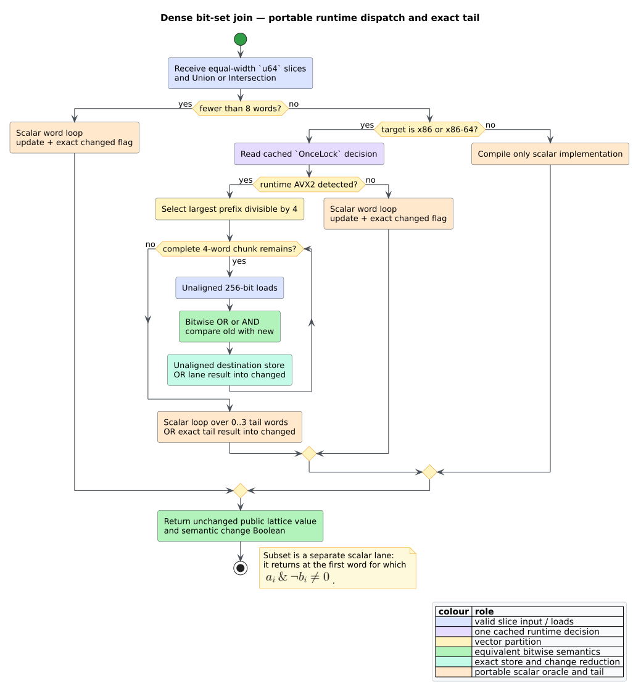
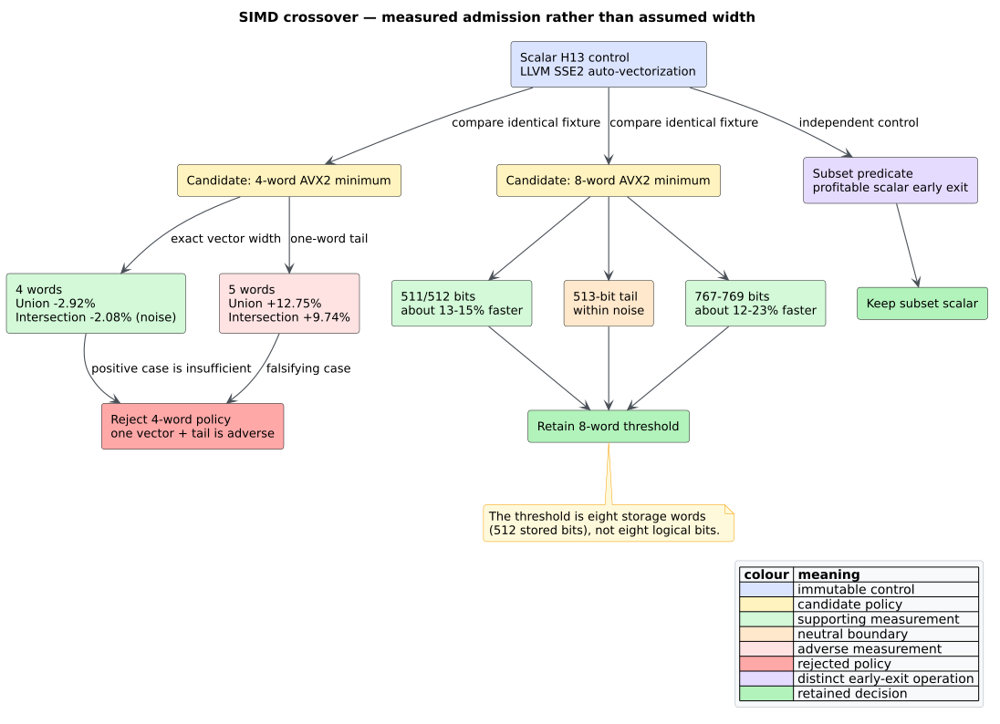

# ADR-0063: Runtime-dispatch dense bit-set kernels

- **Status:** Accepted
- **Date:** 2026-08-23
- **Scope:** dense data-flow joins, x86/x86-64 AVX2 dispatch, scalar fallback,
  measured crossover, unsafe-code boundary, stack safety

## Context

The monotone data-flow solver represents finite May and Must facts as dense
vectors of 64-bit words. A join repeatedly applies word-wise union or
intersection and must also report whether any word changed. Wide liveness and
expression analyses therefore execute a regular contiguous-memory kernel even
though their surrounding worklist, fact construction, and report
materialization remain irregular.

**Single instruction, multiple data** (SIMD) executes the same operation over
several lanes in one vector instruction. **Advanced Vector Extensions 2**
(AVX2) provides 256-bit integer vectors, so one instruction can transform four
`u64` words. That opportunity does not justify using SIMD everywhere:
dispatch, vector setup, equality reduction, and a scalar remainder can cost
more than they save on short slices. A correct design must also run on CPUs
without AVX2 and on non-x86 targets.



*Figure -- complete bit-set kernel dispatch. Source:
[`diagrams/bitset-kernel-dispatch.puml`](../diagrams/bitset-kernel-dispatch.puml).*

## Decision

Keep the public `BitSetDomain`, `MustBits`, and `Lattice` APIs unchanged. Route
their private word-wise union and intersection through one internal dispatcher:

1. use the scalar loop for fewer than eight words;
2. on x86 and x86-64, cache one runtime AVX2 feature decision in `OnceLock`;
3. use four-lane AVX2 chunks only when the width threshold and feature check
   both pass;
4. process every remainder of zero through three words with the scalar oracle;
5. use only the scalar implementation on every other architecture; and
6. retain subset testing as an early-exit scalar loop.

For destination words $`a_i`$ and source words $`b_i`$, union and intersection
must preserve both the updated words and the Boolean change result:

```math
a'_i = a_i \mathbin{\vert} b_i,
\qquad
\mathrm{changed}_{\cup} = \bigvee_i (a'_i \ne a_i),
```

```math
a'_i = a_i \mathbin{\&} b_i,
\qquad
\mathrm{changed}_{\cap} = \bigvee_i (a'_i \ne a_i).
```

The subset order remains:

```math
A \subseteq B \iff \forall i,\; a_i \mathbin{\&} \neg b_i = 0.
```

The AVX2 implementation compares each transformed vector with its original
destination, reduces the four lane equalities to one Boolean, stores the new
vector, and ORs that Boolean with the scalar-tail result. Unaligned loads and
stores operate directly on valid Rust slices; no copied staging buffer or
alignment precondition is introduced.

## Literate algorithm

```text
APPLY_DENSE_JOIN(destination, source, operation):
    require destination.length = source.length

    if destination.word_count < 8:
        return SCALAR_JOIN(destination, source, operation)

    kernel <- cached runtime AVX2 decision on x86/x86-64
              or Scalar on every other target
    if kernel = Scalar:
        return SCALAR_JOIN(destination, source, operation)

    changed <- false
    vector_words <- largest multiple of four not exceeding word_count
    for offset in 0, 4, 8, ... below vector_words:
        old  <- unaligned load of destination[offset .. offset + 4]
        rhs  <- unaligned load of source[offset .. offset + 4]
        next <- old OR rhs when operation = Union
                old AND rhs when operation = Intersection
        unaligned store next into destination[offset .. offset + 4]
        changed <- changed OR (next differs from old in any lane)

    tail_changed <- SCALAR_JOIN(
        destination[vector_words ..],
        source[vector_words ..],
        operation)
    return changed OR tail_changed
```

The dispatcher is a private implementation detail. Tests may select scalar or
the detected kernel through a panic-safe thread-local guard, but production
callers cannot force an unsupported instruction set.

## Correctness and safety boundary

Let $`V`$ be the largest prefix whose word count is divisible by four and
$`T`$ the remaining suffix. AVX2 applies the same bitwise truth table as the
scalar loop independently to every bit in $`V`$; the scalar oracle applies it
to every word in $`T`$. Since $`V`$ and $`T`$ are disjoint and cover the input,
the resulting vector equals a complete scalar evaluation. OR-reducing the
per-vector and tail change predicates equals existential reduction over all
words, so the returned Boolean is also identical.

The only `unsafe` functions are marked `#[target_feature(enable = "avx2")]`.
Their callers establish runtime AVX2 support. Slice validity establishes
initialized readable inputs, an exclusive writable destination, and exact
lengths; loop bounds admit only complete four-word loads and stores. The
unaligned intrinsics remove any stronger allocation-alignment assumption.
Focused Miri execution validates the scalar boundary and tails, while a native
AddressSanitizer campaign exercises the selected x86-64 kernel.

All iteration is explicit and flat. Runtime detection stores constant-size
process state, vector loops store constant-size register state, and tails use
ordinary loops. Fact width therefore affects heap allocation and iteration
count, never native call depth.

## Measured crossover

The retained threshold is evidence, not an architectural constant. At four
words, a vector improved the exact-width case, but a five-word input paid one
vector plus a one-word tail and regressed union by 12.75% and intersection by
9.74%. From eight words onward the measured cases were neutral or faster.
Subset remains scalar because its short-circuit can return before reading the
complete domain.



*Figure -- benchmark-gated crossover decision. Source:
[`diagrams/bitset-crossover-evidence.puml`](../diagrams/bitset-crossover-evidence.puml).*

## Alternatives considered

### Compile the whole crate for AVX2

Rejected. It would make the binary illegal on older x86 CPUs and would not
provide the required portable scalar behavior.

### Dispatch every width

Rejected. Short vectors cannot reliably amortize feature selection and tail
handling. The five-word regression is direct counter-evidence.

### Copy into aligned temporary vectors

Rejected. Slice-to-buffer copies add allocation or bandwidth cost and are
unnecessary because the AVX2 unaligned intrinsics accept the representation
already owned by `Vec<u64>`.

### Vectorize subset comparison

Rejected. A full-vector reduction discards the scalar loop's profitable early
exit. The dedicated benchmark retains subset as a control and did not identify
a justified replacement.

### Expose a public kernel or feature toggle

Rejected. The operation's semantics do not depend on a kernel, callers should
not be able to request an unsupported instruction set, and a compile-time
feature would multiply public configurations without semantic value.

### Use recursive chunk or tail decomposition

Rejected. Input width is untrusted. Flat loops are simpler and make constant
native call depth evident.

## Consequences

- On the measured AVX2 host, the matched primitive profile reduced elapsed
  time and cycles by about 48% and retired instructions by 63.39%, with
  byte-identical outputs and allocation counts.
- At 8,192 bits, Criterion improved union by 29.5--32.6% and intersection by
  21.9--24.6%; at 65,536 bits both improved by roughly 30--38%.
- Existing liveness families were neutral or modestly faster. A wide liveness
  profile remained dominated by fact construction, showing Amdahl's-law
  boundary rather than implying an end-to-end 48% gain.
- One runtime feature decision is retained per process on x86/x86-64. Other
  architectures remain entirely safe scalar code.
- Future vector kernels require the same differential, sanitizer, target-port,
  crossover, and end-to-end evidence before adoption.

Complete experimental detail is in
[scientific validation 58](../scientific/58-runtime-dispatched-bitset-validation.md).

## References

1. Intel Corporation. *Intel Intrinsics Guide: AVX2 integer bitwise
   intrinsics.* [Official reference](https://www.intel.com/content/www/us/en/docs/intrinsics-guide/index.html)
   (no DOI).
2. The Rust Project. *`std::arch` platform intrinsics and runtime feature
   detection.* [Official reference](https://doc.rust-lang.org/std/arch/index.html)
   (no DOI).
3. Amdahl, G. M. (1967). *Validity of the Single Processor Approach to
   Achieving Large Scale Computing Capabilities.* AFIPS Spring Joint Computer
   Conference, 483--485. DOI:
   [10.1145/1465482.1465560](https://doi.org/10.1145/1465482.1465560).
4. Knuth, D. E. (1984). *Literate Programming.* The Computer Journal 27(2),
   97--111. DOI:
   [10.1093/comjnl/27.2.97](https://doi.org/10.1093/comjnl/27.2.97).
