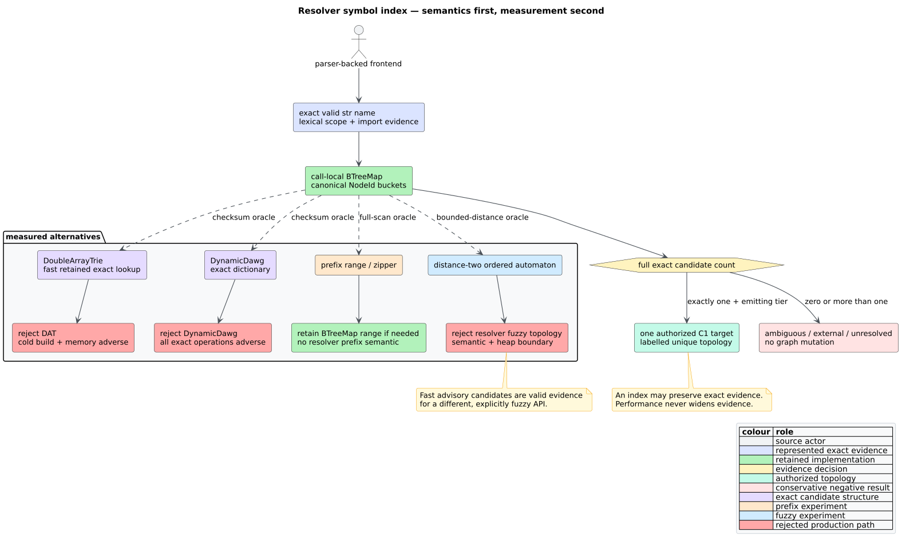
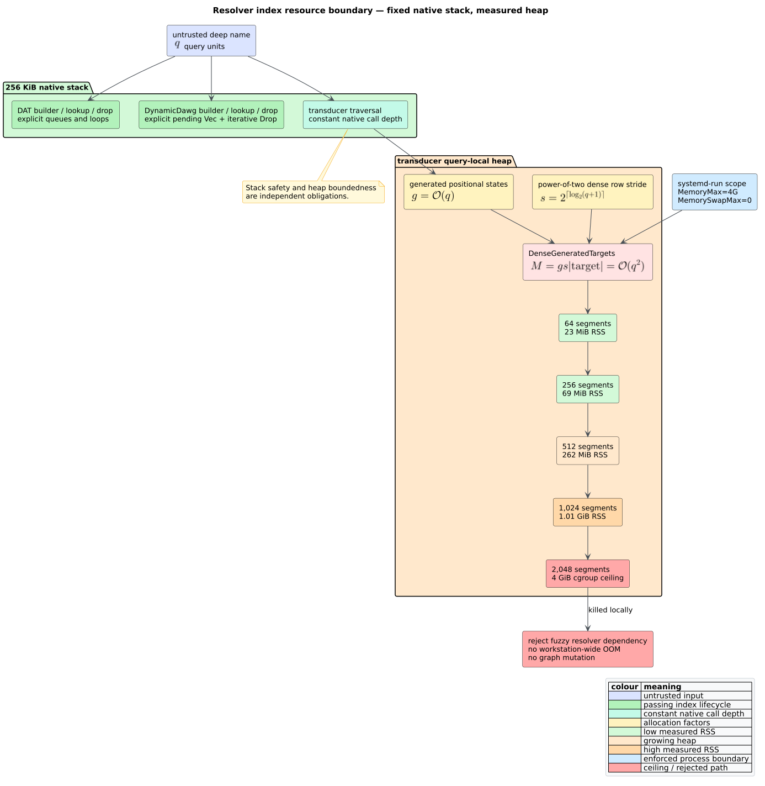

# ADR-0064: Retain the ordered exact resolver symbol index

- **Status:** Accepted
- **Date:** 2026-08-23
- **Scope:** call-target resolution, exact-name lookup, dependency admission,
  prefix and fuzzy non-semantics, deterministic ordering, resource safety

## Context

The evidence-bounded call resolver groups represented function declarations by
their exact source spelling. It searches the nearest lexical scope, represented
imports, and then the global bare-name table. Only a uniquely evidenced target
may change code property graph (CPG) topology. ADR-0006 fixes that semantic
boundary; an index may accelerate it but may not widen it.

The existing table is a `BTreeMap<String, SymbolCandidates>`. A **double-array
trie** (DAT) stores trie transitions in parallel integer arrays. A **directed
acyclic word graph** (DAWG) merges equivalent suffix languages. A Levenshtein
transducer intersects a dictionary with an edit-distance automaton. These
structures can accelerate particular query families, but construction,
ownership, ordering, and resource cost are part of a whole-resolver decision.



*Figure -- benchmark-gated index decision. Source:
[`diagrams/resolver-index-decision.puml`](../diagrams/resolver-index-decision.puml).*

## Decision

Retain the feature-free `BTreeMap` symbol table and do not add
`libdictenstein` or `liblevenshtein` to libcpg.

1. Names remain exact, case-sensitive Rust `str` values. libcpg performs no
   Unicode normalization, case folding, edit correction, or prefix expansion.
2. Candidate vectors remain sorted and deduplicated by `NodeId`; the separate
   pre-cap `total` remains the authority for ambiguity.
3. The index remains local to one `build_symbol_table`/`resolve_calls`
   invocation. There is no global cache, retained cross-graph index, or hidden
   invalidation protocol.
4. Prefix and fuzzy results cannot create topology because `ResolveConfig`
   defines neither semantic. An unresolved spelling remains unresolved.
5. The committed `resolve_calls` Criterion and headless profile workloads stay
   as regression controls. The rejected dependency prototypes and path
   dependencies are removed.

This is a complete confirmed-negative optimization result. There is no missing
production implementation behind the decision.

## Semantic contract before cost

For a call $`c`$, lexical scope $`s`$, and exact spelling $`n`$, let
$`E(s,n)`$ be the canonically ordered represented candidates. Resolution may
emit topology only when

```math
\lvert E(s,n) \rvert = 1
\quad\land\quad
\operatorname{tier}(c) \in T_{\mathrm{emit}},
```

where $`T_{\mathrm{emit}}`$ is the four C1 tiers documented by ADR-0006. A
prefix set $`P(s,n)`$ or edit-distance set $`F(s,n,d)`$ is not $`E(s,n)`$ and
cannot substitute for it. In particular,

```math
E(s,n)=\varnothing \not\Rightarrow
\operatorname{choose}(F(s,n,d)).
```

Imports and aliases enter the existing exact table under their represented
local binding. Duplicate declarations and overload-like same-name functions
remain ambiguous even when `max_candidates_per_name` retains only one node.
Invalid UTF-8 is outside the name API because graph names are valid `str`
values; no byte-to-text repair is performed.

## Measured decision

Every timed arm first asserted exact equality with an independent oracle. The
representative corpus contained 100,000 deterministic resolver-like names and
duplicate candidate buckets at regular intervals.

| Operation | Ordered control | Candidate | Candidate result |
|---|---:|---:|---:|
| DAT construction | 3.507 ms | 22.169 ms | 6.31 times slower |
| Eight exact passes | 170.204 ms | 80.323 ms | 52.8% faster |
| Eight absent passes | 15.511 ms | 7.789 ms | 49.8% faster |
| Prefix lookup, 100 prefixes | 0.369 ms ordered range | 3.206 ms DAT zipper | 8.70 times slower |
| DynamicDawg construction | 3.397 ms | 9.315 ms | 2.74 times slower |
| DynamicDawg eight exact passes | 171.483 ms | 331.430 ms | 1.93 times slower |
| DynamicDawg eight absent passes | 14.668 ms | 31.471 ms | 2.15 times slower |

For DAT exact lookup, let $`B_o`$ and $`B_d`$ be ordered and DAT build time,
and $`L_o`$ and $`L_d`$ be one exact pass. Retention would break even only when

```math
Q > \frac{B_d-B_o}{L_o-L_d} \approx 1.66
```

complete 100,000-query passes reuse one built index. The current resolver
builds one table and performs one lookup per call, not repeated complete passes
over an externally retained ownership epoch. Build plus one exact pass was
about 24.78 ms for the control and 32.21 ms for DAT, a 30% regression.

DAT also increased peak resident set size (RSS) from 42,164 KiB to 53,380 KiB.
Dynamic heap analysis measured 40,243,623 allocated bytes for the ordered
control and 73,080,165 bytes for DAT. DynamicDawg's paired 100,000-symbol run
peaked at 78,312 KiB RSS.

## Fuzzy and SIMD boundary

An ordered edit-distance automaton was about 880 times faster than an
independent bounded full scan for one 100,000-term, distance-two, top-64 query.
That is valuable algorithmic evidence for an explicitly fuzzy product, but it
does not authorize fuzzy call edges. The correct release-candidate API was also
not available as a version-only registry dependency.

Single instruction, multiple data (SIMD) results are operation-specific. The
current transducer uses a vectorized minimum for states with four through eight
positions. Its public edge-label SIMD helper has no production traversal
caller. Direct standard-distance SIMD on the resolver-like controls regressed
32-, 128-, and 512-byte cases by 24.14%, 1.84%, and 3.87%, respectively. Those
measurements do not negate positive packed-kernel or query-dispatch results in
`liblevenshtein`; they only reject a blanket SIMD justification for this
resolver.

## Correctness and resource findings

The published `libdictenstein` 0.2.0 DAT failed the independent 100,000-name
exact checksum. The current 4.0.0 release candidate is exact. Its two-phase
`StaticDATBuilder`, introduced in upstream commit `86e658c`, first accumulates
an ordinary trie and then assigns complete sibling sets collision-free. That
replaces the published incremental relocation path that could lose or
misaddress descendants during later collisions.

Current DAT and DynamicDawg construction, exact lookup, and destruction each
completed for a 4,096-segment name on a 256 KiB worker stack. Their builders,
walkers, and DynamicDawg drop path use explicit heap worklists.

The fuzzy transducer kept constant native call depth but failed the heap bound.
For a query of $`q`$ units, `DenseGeneratedTargets` rounds $`q+1`$ to a
power-of-two row stride and appends that entire row for every generated
positional state. An exact path can generate $`O(q)`$ states, so retained
targets are $`O(q^2)`$. RSS rose from 23 MiB at depth 64 to 1.01 GiB at depth
1,024; a `MemoryMax=4G`, no-swap systemd scope killed depth 2,048. The
dependency therefore lacks the bounded-memory contract required for untrusted
resolver names even though it is native-stack safe.



*Figure -- stack and heap resource boundary. Source:
[`diagrams/resolver-index-resource-boundary.puml`](../diagrams/resolver-index-resource-boundary.puml).*

## Alternatives considered

### Adopt DAT for exact lookup

Rejected. Lookup-only throughput improves after substantial reuse, but the
actual cold resolver regresses and memory grows. No ownership/invalidation
contract exists that would lawfully manufacture the required reuse.

### Adopt DAT for prefix lookup

Rejected. The existing ordered range is exact, canonically ordered, and 8.70
times faster on the representative prefix corpus.

### Adopt DynamicDawg

Rejected. It loses construction, exact-hit, and miss controls at 100,000
symbols and supplies no resolver semantic unavailable from the ordered map.

### Resolve an absent name with fuzzy top-k

Rejected. Performance cannot change an unresolved call into topology. The
public resolver has no edit metric, normalization, work cap, completeness
evidence, or advisory fuzzy result type.

### Add a path dependency to the sibling release candidate

Rejected. A local filesystem path is not a publishable libcpg boundary, the
registry release is both older and incorrect on the oracle, and the current
release candidate requires a newer toolchain contract.

### Replace the ordered map with a hand-written parser or trie

Rejected. Names already arrive from parser-backed frontends as graph
properties. Re-parsing or duplicating a trie would add syntax and ownership
surface without fixing the measured cost boundary.

## Consequences

- libcpg gains reproducible exact, unresolved, ambiguous, and deep resolver
  benchmarks plus causal headless profiles, without a runtime dependency.
- Exact resolution semantics, graph shape, serialized order, feature graph,
  minimum supported Rust version, and unsafe-code surface remain unchanged.
- Prefix and fuzzy measurements are retained as scientific evidence, not as
  hidden behavior.
- Every future index proposal is a new decision and must independently prove
  whole-resolver semantics, cold cost, ownership, bounded memory, and a
  publishable dependency. This ADR has no unfinished implementation.

Complete evidence is recorded in
[scientific validation 59](../scientific/59-resolver-symbol-index-validation.md)
and [Security 22](../security/22-resolver-symbol-index-boundary.md).

## References

1. Aoe, J. (1989). *An Efficient Digital Search Algorithm by Using a
   Double-Array Structure.* IEEE Transactions on Software Engineering 15(9),
   1066--1077. DOI:
   [10.1109/32.31365](https://doi.org/10.1109/32.31365).
2. Schulz, K. U., Mihov, S. (2002). *Fast String Correction with Levenshtein
   Automata.* International Journal on Document Analysis and Recognition 5,
   67--85. DOI:
   [10.1007/s10032-002-0082-8](https://doi.org/10.1007/s10032-002-0082-8).
3. Knuth, D. E. (1984). *Literate Programming.* The Computer Journal 27(2),
   97--111. DOI:
   [10.1093/comjnl/27.2.97](https://doi.org/10.1093/comjnl/27.2.97).
