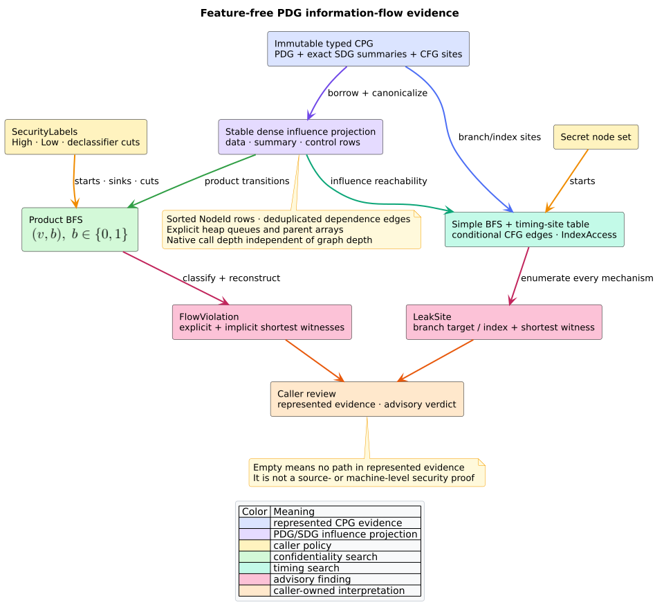

# ADR-0066: Keep PDG information-flow checks exact, deterministic, and advisory

- **Status:** Accepted
- **Date:** 2026-08-23
- **Scope:** information-flow control, non-interference, declassification,
  constant-time evidence, PDG/SDG composition, determinism, stack safety

## Context

The code property graph (CPG) already represents intraprocedural data and
control dependence and may carry caller-local system-dependence summary edges.
That evidence makes High-to-Low reachability inexpensive to query, but it does
not make the represented graph a complete operational semantics. The public
surface must therefore distinguish exact graph evidence from a whole-program
security proof.

The same distinction matters for timing. A branch controller or index access
that is reachable from a secret is useful review evidence, but proving a
program constant-time requires reasoning about complete execution traces and
the target platform.

## Decision

1. `noninterference(&CodePropertyGraph, &SecurityLabels)` and
   `constant_time(&CodePropertyGraph, &BTreeSet<NodeId>)` remain feature-free,
   immutable, and advisory.
2. The influence relation contains represented `DataDependence`,
   `ControlDependence`, and exactly labeled SDG summary dependence. Raw call,
   parameter, and return edges are not traversed because their context pairing
   is not itself a realizable summary.
3. Non-interference runs breadth-first search over the product state
   $`V\times\{\mathsf{explicit},\mathsf{implicit}\}`$. A control-dependence
   step permanently changes the second component to `implicit`; consequently
   one source/sink pair can retain distinct shortest witnesses for both path
   classes.
4. A declassifier is a hard cut vertex. Search neither starts at nor enters a
   declassifier, so a path cannot silently resume beyond a sanctioned release.
5. Constant-time evidence reports every represented conditional CFG edge and
   every `IndexAccess` node whose site is influence-reachable from a supplied
   secret. Declassification never suppresses timing evidence.
6. Dense indices, ordered adjacency rows, heap queues, parent arrays, and
   iterative witness reversal make native call depth independent of graph
   depth. Stable node identity and edge-class ordering select canonical
   shortest witnesses.
7. The functions do not truncate. They return every represented finding;
   callers bound graph admission and output handling rather than receiving a
   capped empty result that could be misread as secure.

*Figure -- accepted two-lane analysis boundary. Source:
[`diagrams/ifc-evidence-pipeline.puml`](../diagrams/ifc-evidence-pipeline.puml).*

## Consequences

The implementation is small, compositional with the existing PDG/SDG, and
does not introduce a policy language, solver dependency, parser, graph clone,
or hidden runtime. Explicit and implicit evidence remain distinguishable even
when both connect the same endpoints.

An empty result means only that no forbidden path or timing site exists in the
represented influence relation for the supplied labels. Missing frontend
facts, absent PDG construction, unresolved interprocedural effects, aliases,
reflection, platform timing, speculative execution, and microarchitectural
state remain outside that claim.

## Alternatives considered

### Reuse ordinary node reachability without a path-class state

Rejected. Visiting a sink first through an explicit path would suppress a
later implicit witness, or vice versa. The two-state product is the smallest
exact construction that preserves both facts.

### Treat declassification as an edge annotation

Rejected for this API. A caller would need to annotate every outgoing path and
could accidentally allow influence to resume. Removing the sanctioned vertex
from the admitted relation gives a simple, auditable cut semantics.

### Treat declassification as a constant-time defense

Rejected. Intentional value release changes confidentiality policy; it does
not remove secret-dependent branch choice or memory-access timing.

### Return a Boolean verdict

Rejected. A Boolean loses source, sink, path class, timing mechanism, and the
canonical replayable witness needed for review. It also invites a stronger
negative interpretation than the represented model supports.

## References

1. Hammer, C., Snelting, G. (2009). *Flow-sensitive, context-sensitive, and
   object-sensitive information flow control based on program dependence
   graphs.* International Journal of Information Security 8(6), 399--422.
   DOI: [10.1007/s10207-009-0086-1](https://doi.org/10.1007/s10207-009-0086-1).
2. Barthe, G., Betarte, G., Campo, J. D., Luna, C., Pichardie, D. (2014).
   *System-level non-interference for constant-time cryptography.* CCS 2014,
   1267--1279. DOI:
   [10.1145/2660267.2660283](https://doi.org/10.1145/2660267.2660283).
3. Ferrante, J., Ottenstein, K. J., Warren, J. D. (1987). *The Program
   Dependence Graph and Its Use in Optimization.* ACM TOPLAS 9(3). DOI:
   [10.1145/24039.24041](https://doi.org/10.1145/24039.24041).
