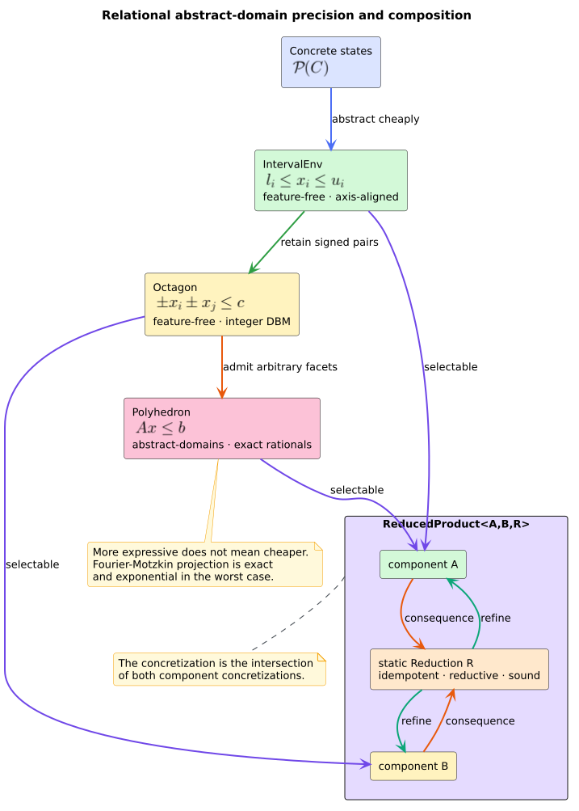

# ADR-0067: Compose stack-safe relational abstract domains

- **Status:** Accepted
- **Date:** 2026-08-24
- **Scope:** numerical abstract interpretation, octagons, exact rational
  polyhedra, reduced products, feature placement, stack safety

## Context

ADR-0009 supplies a generic monotone CFG solver and ADR-0011 supplies interval
ranges. Independent intervals cannot preserve relations such as
$`x-y\leq c`$, while program proofs and feasibility checks sometimes need
general linear facets. One maximal domain would either make every user pay for
arbitrary-precision arithmetic or force an inexact floating/template
representation on users who requested exact constraints.

The implementation must also compose at the existing `Lattice` seam, remain
deterministic, keep analysis results outside the CPG, reject malformed
serialized invariants, and never map variable, constraint, or CFG depth to
native recursion.

## Decision

1. Keep integer `Octagon` and generic `ReducedProduct<A,B,R>` feature-free.
   Octagons use a coherent, integer-tight DBM; a static `Reduction` policy
   exchanges facts after every product operation and real solver merge.
2. Put exact rational `Polyhedron` behind `abstract-domains`. The feature owns
   optional `num-bigint`, `num-rational`, and `num-traits` dependencies and is
   included by `full`.
3. Represent polyhedra as arbitrary-precision rational H-constraints. Use
   iterative Fourier--Motzkin elimination for feasibility, implication,
   redundancy, and projection. Compute exact closed convex hull by projecting a
   homogenized formulation.
4. Use standard facet/DBM widening followed by narrowing. Expose exact fallible
   polyhedron hull separately; the infallible lattice join conservatively maps
   an unrepresentable extended dimension to top.
5. Grow domains for admitted out-of-range sparse variable identifiers, return
   `false` for wrong-dimensional points, and keep bottom/top identities total
   across mixed explicit dimensions.
6. Validate serialized matrix widths and recanonicalize octagons/polyhedra
   before exposing them. Store every closure, projection, and reduction machine
   in heap collections and explicit loops.

*Figure -- accepted domain and feature boundary. Source:
[`diagrams/relational-domain-precision.puml`](../diagrams/relational-domain-precision.puml).*

## Consequences

Users can choose axis-aligned, octagonal, or general linear precision without
changing the CFG solver. Exact rational operations have no floating tolerance
and are deterministic, and reduced products exchange component facts without
dynamic dispatch.

The cost is explicit: polyhedral projection and redundancy elimination are
exponential in the worst case, coefficient bit length can grow, and widening
intentionally loses moving facets. `abstract-domains` increases compile/link
cost. Stack-safe heap machines prevent native-stack exhaustion but do not cap
heap growth; callers and integrations must apply resource policy.

## Alternatives considered

### Make polyhedra feature-free

Rejected. This would add arbitrary-precision dependencies and compile cost to
the dependency-minimal default even when intervals or octagons suffice.

### Use floating-point linear programming

Rejected for this domain. Tolerances and rounding would weaken exact equality,
subset, determinism, and serialization semantics. A future approximate domain
may be useful, but it must be named and documented as approximate.

### Use only fixed template directions

Rejected as the general domain because caller-supplied facets would be lost.
Octagons already occupy the useful fixed-template point in the cost/precision
space.

### Delegate recursion to a linear-programming or parser stack

Rejected. Fourier--Motzkin state is simple enough to express as iterative
partitions and work vectors. There is no mutually recursive semantic descent
that warrants a pushdown automaton.

### Replace reduced products with a second solver

Rejected. Static reduction is a closure on the product lattice and belongs at
construction and every lattice transformation. A second fixed point would add
ordering, convergence, and synchronization complexity without improving the
semantics.

## References

1. Cousot, P., Halbwachs, N. (1978). *Automatic Discovery of Linear
   Restraints Among Variables of a Program.* DOI:
   [10.1145/512760.512770](https://doi.org/10.1145/512760.512770).
2. Cousot, P., Cousot, R. (1979). *Systematic Design of Program Analysis
   Frameworks.* DOI:
   [10.1145/567752.567778](https://doi.org/10.1145/567752.567778).
3. Miné, A. (2006). *The Octagon Abstract Domain.* DOI:
   [10.1007/s10990-006-8609-1](https://doi.org/10.1007/s10990-006-8609-1).
