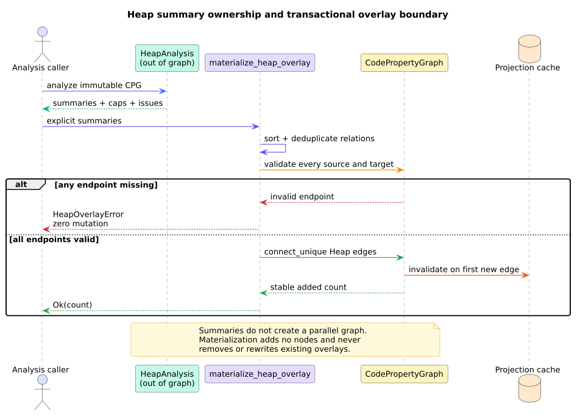

# ADR-0068: Compose stack-safe heap summaries over call SCCs

- **Status:** Accepted
- **Date:** 2026-08-24
- **Scope:** separation logic, bi-abduction, memory safety, Heap overlay,
  interprocedural composition, stack safety

## Context

libcpg already provides typed allocation metadata, dereference DFG edges,
resolved calls, canonical per-function CFGs, call-graph SCC decomposition, and
a bounded summary solver. FT.4 requires procedure-local heap pre/postconditions
and advisory null-dereference, use-after-free, and leak findings without
introducing a source parser, parallel graph, dependency-heavy theorem prover,
or input-shaped native recursion.

Full alias and shape precision would require a substantially larger points-to
and inductive-predicate system. The accepted boundary must remain useful and
truthful when that evidence is absent.

## Decision

1. Keep the analysis feature-free and reuse the existing validated IFDS/IDE
   solver over the call-graph condensation.
2. Represent symbolic cells as formal-parameter positions or allocation-site
   `NodeId` values. Keep summaries out of graph.
3. Seed origins only from typed parameters, `allocation_type`, and null
   literals; propagate them through definitions, AST values, and typed DFG
   evidence with bounded iterative fixed points.
4. Infer `Valid` anti-frame requirements at dereferences and `Invalid`
   postconditions at represented exits. Substitute parameter assertions through
   source-ordered actual arguments at resolved calls.
5. Run one finite may-lifetime worklist per relevant location over the canonical
   function CFG. Emit null dereference, use-after-free, and live-exit leak
   evidence in canonical order.
6. Do not consume a same-recursive-SCC must-invalidate postcondition as final.
   Retain evidence and mark the summary partial so an unsupported negative
   verdict is impossible.
7. Add `CpgEdgeKind::Heap(HeapEdgeKind)` as an append-only overlay over existing
   nodes. Validate all relation endpoints transactionally and use
   `connect_unique` for idempotency.
8. Append Heap to projection-cache and ML layer vocabularies and append six
   stable ML edge classes; do not renumber prior relation classes.
9. Store all graph/source-shaped state in explicit heap collections. Native
   recursion is prohibited for origin closure, SCC composition, lifetime flow,
   overlay construction, witnesses, serialization, and drop.

*Figure -- accepted ownership and mutation boundary. Source:
[`diagrams/heap-overlay-boundary.puml`](../diagrams/heap-overlay-boundary.puml).*

## Consequences

The feature-free core can compose common allocation/release/dereference
evidence without another solver or dependency. Stable node identities make
findings replayable, and every partial condition remains visible.

Precision is intentionally bounded. Allocation-site conflation, may-state
joins, unresolved calls, exceptional control flow, unmodeled releases,
field-sensitive aliasing, native code, and concurrency can create false
positives or false negatives. `HeapAnalysis::is_complete()` describes the
modeled computation, not the completeness of a frontend or runtime model.

The ML node schema grows by two appended degree columns and its edge schema by
six appended relation classes. Long-lived consumers must version that schema.

## Alternatives considered

### Build a second heap graph

Rejected. It would duplicate identity and violate the shared-node overlay
model. Allocation sites and parameters already provide stable abstract-object
anchors.

### Hand-roll a source parser for `malloc`, `free`, or `delete`

Rejected. Frontends and typed CPG evidence own syntax. Release policy operates
on reconstructed callee paths and is caller-extensible.

### Treat recursive release summaries as immediately definite

Rejected. Must facts are not safe at an intermediate monotone fixed point.
Explicit partial evidence is preferable to a false clean verdict.

### Add a general separation-logic prover dependency

Rejected for this tranche. The finite footprint fragment satisfies the current
API and evidence boundary without compile cost or a second IR. A future engine
must justify its format, soundness, resource model, and at least two consumers.

## References

1. Calcagno, C., Distefano, D., O'Hearn, P. W., Yang, H. (2011).
   DOI: [10.1145/2049697.2049700](https://doi.org/10.1145/2049697.2049700).
2. Calcagno, C., Distefano, D., O'Hearn, P. W., Yang, H. (2009).
   DOI: [10.1145/1480881.1480917](https://doi.org/10.1145/1480881.1480917).
