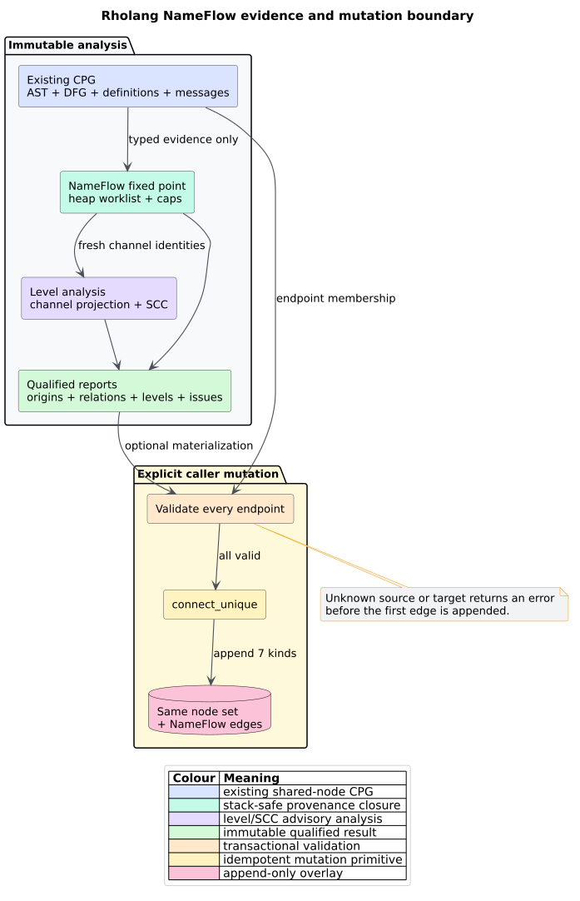

# ADR-0069: Normalize and propagate Rholang names with heap worklists

- **Status:** Accepted
- **Date:** 2026-08-24
- **Scope:** Rholang, rho-calculus, NameFlow, deadlock freedom, channel levels,
  strongly connected components, stack safety

## Context

Rholang fresh names can cross lexical scopes as message payloads and participate
in quote/drop reflection. Source spelling cannot represent their identity.
FT.5 needs a reusable provenance overlay and advisory Kobayashi-style
obligation/capability analysis without a hand-written parser, a parallel graph,
unbounded native recursion, or an unqualified negative verdict.

## Decision

1. Normalize `Restriction`, `FreshBinder`, `Quote`, and `Drop` once at the
   Rholang frontend boundary. Downstream analysis consumes typed CPG metadata
   and never inspects concrete source syntax.
2. Treat each fresh binder's stable `NodeId` as a name origin. Propagate origins
   only through explicit definition evidence and matched communication
   payload-to-binder transfers.
3. Compute the least fixed point with `VecDeque`, ordered maps/sets, explicit
   ancestor cursors, duplicate suppression, and caller-selectable `NameFlowCaps`.
   Every exhausted cap or malformed input becomes an issue and clears the
   completeness claim.
4. Represent receive-before-send ordering as a channel dependency edge from
   capability to obligation. Reuse the shared iterative SCC implementation for
   cycles and canonical longest-path ranks for an acyclic dependency graph.
5. Expose full qualified reports and a convenience witness projection. Document
   that an empty convenience result is advisory only.
6. Add `CpgEdgeKind::NameFlow(NameFlowEdgeKind)` as an append-only layer over
   existing nodes. Prevalidate every endpoint, then materialize idempotently.
7. Append the NameFlow projection-cache layer, two ML node-degree columns, and
   seven ML edge classes. Preserve every earlier edge-class identifier.
8. Prohibit source-shaped native recursion in frontend metadata handling,
   origin propagation, communication matching, SCC analysis, ranking,
   materialization, serialization, and destruction.

*Figure -- accepted evidence and mutation boundary. Source:
[`diagrams/name-flow-overlay-boundary.puml`](../diagrams/name-flow-overlay-boundary.puml).*

## Consequences

Name mobility and cyclic level constraints are deterministic and replayable at
existing syntax nodes. Scope extrusion can feed later communications without
reparsing or recursive descent. The finite worklist terminates because the
domain contains at most `fresh binders x CPG nodes` origin assignments plus
bounded event matches and relations.

Precision remains intentionally advisory. Ambiguous definitions, unresolved
channels, payload-arity mismatch, or a cap produce explicit partial evidence.
The modeled rank discipline is a useful Kobayashi-style constraint system, not
the complete original type system and not an operational lock-freedom proof.

The current ML schema grows from 71 to 73 node columns, 53 to 60 relation
classes, and ten to eleven coarse layers. Consumers must version their schema.

## Alternatives considered

### Hand-write a Rholang parser in the analyzer

Rejected. Tree-sitter and the frontend own syntax. A second parser would drift,
duplicate grammar behavior, and blur the typed-evidence trust boundary.

### Reuse names by source spelling

Rejected. Shadowing, restriction, alpha-renaming, reflection, and scope
extrusion require definition identity rather than text equality.

### Implement a new recursive cycle detector

Rejected. The shared SCC engine is iterative, tested, deterministic, and
already defines libcpg's cycle semantics.

### Encode the fixed point as recursive functions

Rejected. Logical program depth is hostile input. Heap worklists provide the
same monotone closure while keeping native call depth constant. A PDA is
reserved for genuinely nested continuation semantics, which this domain lacks.

## References

1. Kobayashi, N. (2006). DOI:
   [10.1007/11817949_16](https://doi.org/10.1007/11817949_16).
2. Kobayashi, N., Sangiorgi, D. (2010). DOI:
   [10.1145/1745312.1745313](https://doi.org/10.1145/1745312.1745313).
3. Meredith, L. G., Radestock, M. (2005). DOI:
   [10.1016/j.entcs.2005.05.016](https://doi.org/10.1016/j.entcs.2005.05.016).
