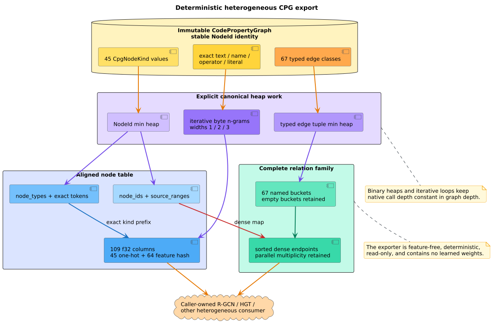
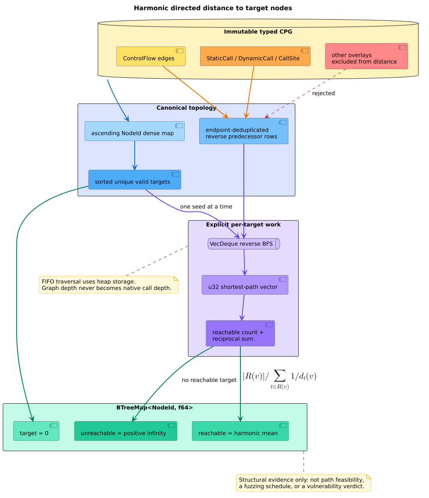

# ADR-0072: Export typed heterogeneous graphs and directed-fuzzing distance

- **Status:** Accepted
- **Date:** 2026-08-24
- **Scope:** feature-free heterogeneous-GNN interchange, directed-fuzzing
  distance, deterministic schemas, stack safety

## Context

ADR-0054 established a homogeneous PyTorch Geometric (PyG)-shaped table and
exact Abstract Syntax Tree (AST) path contexts. Relational graph neural
networks (GNNs), including Relational Graph Convolutional Networks (R-GCNs) and
Heterogeneous Graph Transformers (HGTs), instead benefit from one adjacency
bucket per semantic relation [[1]](#references), [[2]](#references). A caller
should not have to split one mixed edge table, guess absent relation classes,
or import an ML runtime merely to obtain that evidence.

Directed greybox fuzzers need a different read-only view: a stable distance
from every represented node to one or more target nodes. AFLGo popularized
target-directed scheduling from control-flow distance [[3]](#references).
libcpg can supply the graph distance, but it must not claim ownership of a
fuzzer, energy schedule, instrumentation runtime, or model training loop.

Both operations must preserve stable `NodeId` identity, typed CPG evidence,
feature-free compilation, insertion-order determinism, graph immutability, and
constant native call depth in graph depth.

## Decision

1. Add `export_heterogeneous_gnn(&CodePropertyGraph) -> HeteroGnnExport` to
   feature-free `analysis::ml`.
2. Canonicalize nodes by ascending `NodeId`. Align ids, source ranges, node
   classes, normalized tokens, and feature rows one-for-one.
3. Initialize every node with 109 columns: the exact 45-kind one-hot vector
   followed by a deterministic 64-column signed feature hash over UTF-8 token
   byte n-grams of widths one through three.
4. Reuse the token evidence order from `ast_paths`: non-empty retained text,
   semantic name, represented operator or literal, then stable kind name. The
   exporter does not parse source.
5. Freeze `EDGE_KIND_CLASS_NAMES` beside `edge_kind_class`. Emit exactly 67
   relation buckets in class order, including empty buckets. Sort dense
   endpoint pairs and preserve parallel-edge multiplicity.
6. Reuse the append-only edge-class contract. Classes 0--59 retain the
   original surface, 60--61 are `RewriteDep`, and 62--66 are
   `PlaceCapability`.
7. Add
   `distance_to_targets(&CodePropertyGraph, &[NodeId]) -> BTreeMap<NodeId,
   f64>` to feature-free `analysis`.
8. Define distance paths over stored-direction `ControlFlow`, `StaticCall`,
   `DynamicCall`, and `CallSite` edges. Other overlays cannot shorten a
   fuzzing distance.
9. Canonicalize and deduplicate targets. Ignore identifiers absent from the
   CPG. An empty or all-unknown target set maps every node to positive
   infinity.
10. Give every valid target distance zero. For any other node, return the
    harmonic mean of finite positive shortest-path lengths to reachable
    targets. Return positive infinity when no valid target is reachable.
11. Deduplicate distance adjacency by endpoint so parallel CFG/call evidence
    cannot change a topological shortest path. Heterogeneous export continues
    to preserve that multiplicity.
12. Use binary heaps for canonical ordering, ordered maps for stable identity,
    and a `VecDeque` reverse breadth-first search per target. Never recurse over
    graph depth.
13. Keep both results immutable and outside the CPG. Optional serde applies to
    heterogeneous export records; the distance map contains infinity and is
    intentionally not wrapped in a serializable record.

*Figure -- heterogeneous export boundary. Source:
[`diagrams/heterogeneous-export-pipeline.puml`](../diagrams/heterogeneous-export-pipeline.puml).*

*Figure -- directed-fuzzing distance flow. Source:
[`diagrams/directed-fuzzing-distance.puml`](../diagrams/directed-fuzzing-distance.puml).*

## Consequences

### Positive

- A relational consumer receives explicit empty/non-empty relation types
  without reconstructing the stable schema.
- Every node feature, typed endpoint, range, and distance maps back to a stable
  CPG node.
- Feature extraction is deterministic and requires no vocabulary, learned
  weight, Python runtime, PyTorch, PyG, `ndarray`, or optional `gnn` feature.
- Harmonic aggregation rewards nodes close to several targets without letting
  one distant target dominate an arithmetic mean.
- Graph and source depth reside in heap worklists rather than the native stack.

### Negative

- The dense 109-column rows and 67 owned relation records favor transparent
  interchange over minimum resident memory.
- A 64-bucket feature hash can collide; exact tokens remain in the export so a
  consumer can replace the embedding.
- Per-target breadth-first search costs one complete graph traversal for each
  valid unique target in the worst case.
- Ignoring unknown targets keeps the required infallible signature but means a
  caller that requires selector validation must validate ids first.
- Distance is structural evidence, not proof of runtime reachability or a
  complete AFLGo scheduling implementation.

## Alternatives considered

### Return only non-empty relation buckets

Rejected. Absence would become ambiguous between “this graph has no such
edge” and “this producer does not implement that relation.” A fixed complete
registry makes schema negotiation explicit.

### Learn token embeddings inside libcpg

Rejected. Learned vocabulary, corpus, dimension, optimizer, and weights belong
to the downstream experiment. A deterministic feature hash is a portable
initialization and exact token text remains available.

### Collapse CFG and call edges into an undirected graph

Rejected. Directed fuzzing asks whether execution can move from a node toward
a target. Reversing that semantics would assign finite distances to nodes that
only occur after a target.

### Use arithmetic minimum or mean across targets

Rejected. Minimum ignores all but one target; arithmetic mean lets a distant
target dominate. AFLGo's harmonic composition retains evidence from every
reachable target while emphasizing nearby targets [[3]](#references).

### Recursively search from each node

Rejected. It repeats work and makes native stack consumption depend on hostile
graph depth. Reverse breadth-first search computes all sources for one target
with an explicit FIFO queue.

## References

1. Schlichtkrull, M. et al. (2018). *Modeling Relational Data with Graph
   Convolutional Networks.* ESWC 2018. DOI:
   [10.1007/978-3-319-93417-4_38](https://doi.org/10.1007/978-3-319-93417-4_38).
2. Hu, Z., Dong, Y., Wang, K., Sun, Y. (2020). *Heterogeneous Graph
   Transformer.* WWW 2020. DOI:
   [10.1145/3366423.3380027](https://doi.org/10.1145/3366423.3380027).
3. Böhme, M., Pham, V.-T., Nguyen, M.-D., Roychoudhury, A. (2017). *Directed
   Greybox Fuzzing.* CCS 2017. DOI:
   [10.1145/3133956.3134020](https://doi.org/10.1145/3133956.3134020).
