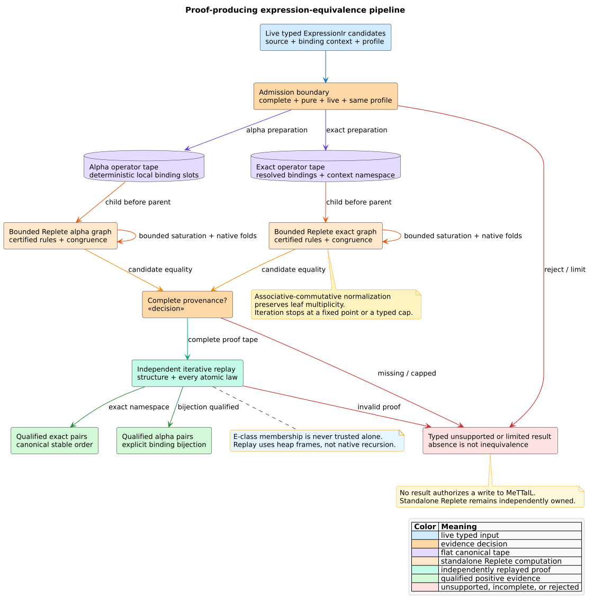

# ADR-0075: Produce bounded expression-equivalence proofs with Replete

- **Status:** Accepted
- **Date:** 2026-08-30
- **Scope:** pure-expression equivalence, qualified Type-4 clone evidence,
  equality saturation, proof replay, completion, determinism, and stack safety

## Context

ADR-0074 establishes when a live typed expression may participate in a
rewrite. libcpg also needs to determine whether several admitted expressions
belong to the same modeled equality class. A Boolean answer is insufficient:
the caller needs the semantic profile, binding boundary, completion state,
resource limits, and an independently replayable reason for every positive
pair.

An **e-graph** stores e-nodes in congruence-closed equivalence classes. It can
compactly retain many rewrite paths, but it treats each supplied equation as an
axiom. Therefore libcpg remains responsible for semantic admission and Replete
remains responsible for generic e-graph mechanics. Neither crate owns the
other's domain.



*Figure -- bounded expression-equivalence pipeline. Source:
[`expression-equivalence-pipeline.puml`](../diagrams/expression-equivalence-pipeline.puml).*

## Decision

1. `analyze_expression_equivalence` accepts only live, complete, pure
   `ExpressionIr` candidates whose declared source is the IR root and whose
   profile equals the request profile.
2. One exact pass includes the caller's binding-context identity in every
   binding operator. It compares only candidates from the same context.
3. A separate alpha pass replaces each candidate's distinct bindings with
   canonical encounter slots. It compares only different contexts and returns
   `AlphaRenamedType4Clone` with an explicit forward correspondence. It never
   labels that relation exact program-state equality.
4. Operators and literals use exact canonical bytes. Hashes may index those
   bytes but cannot define equality. Public ordering uses stable `NodeId`
   values, not e-class IDs or hash iteration.
5. Replete runs named commutativity, associativity, identity, and typed native
   constant-fold laws only when the semantic profile admits them.
6. Associative-commutative (AC) operators use Replete's canonical
   multiplicity-preserving AC constructor. Replay flattens both endpoint terms
   iteratively and accepts the edge only when their exact leaf multisets are
   equal.
7. Constant-fold replay iteratively evaluates the whole closed source proof
   term. This handles canonical nested representatives selected from an
   e-class while requiring the target to be exactly the resulting typed
   literal.
8. Every positive pair contains a Replete `ProofTape`. The libcpg verifier
   checks structural proof rules through Replete and checks every atomic law
   through libcpg's independent typed verifier.
9. Candidate, input-node, graph, work, match, iteration, pair, and proof limits
   remain distinct. Exhaustion becomes a typed completion state; it never
   becomes a negative equivalence answer.
10. The Code Property Graph (CPG) is borrowed immutably. Existing Type-1,
    Type-2, Type-3, structural Type-4, token, embedding, dataflow, and Datalog
    APIs are unchanged.

For admitted candidates $`x`$ and $`y`$, a public positive claim requires both
modeled equality $`E`$ and replayable proof $`P`$:

```math
\operatorname{Positive}(x,y)\Longrightarrow
\operatorname{Admitted}(x)\land\operatorname{Admitted}(y)
\land E(x,y)\land P(x,y).
```

A complete negative requires saturation and complete provenance:

```math
\operatorname{NotEquivalent}(x,y)\Longrightarrow
\operatorname{Saturated}\land\operatorname{ProvenanceComplete}
\land\neg E(x,y).
```

## Why canonical AC construction

Unrestricted positional commutativity and associativity produce many
syntactically different binary trees. Canonical AC construction instead
flattens, sorts by exact class key, and preserves repeated members. If
$`M(t)`$ is the multiset of leaves beneath one certified AC operator, replay
accepts normalization only when:

```math
M(t_{\mathrm{source}})=M(t_{\mathrm{target}}).
```

This equality preserves multiplicity: $`a+a+b`$ cannot prove equal to
$`a+b+b`$.

## Alternatives rejected

### Reuse structural `CloneType::Type4` as semantic proof

Rejected because structural program-dependence equivalence and typed
expression equality answer different questions. The new alpha result is an
additive, explicitly qualified evidence kind.

### Trust e-class membership without replay

Rejected because a faulty rule admission or corrupt proof would become a
positive claim. Replay is an independent trust boundary.

### Expand every AC positional rewrite

Rejected because it creates a combinatorial frontier while a canonical
multiset construction expresses the intended quotient directly.

### Restore proof authority through deserialization

Rejected because persistence cannot re-establish the live CPG, frontend facts,
profile, or rule admission. Proof reports serialize for audit output but do not
implement `Deserialize`.

### Embed Replete or modify MeTTaIL

Rejected. Replete is an independent top-level crate. MeTTaIL is read-only and
outside this campaign; its permission-gated migration remains a separate pgmcp
task.

## Consequences

- Positive results are deterministic, qualified, and replayable.
- Complete absence is meaningful only for the relevant complete pass.
- Alpha-renamed evidence can feed semantic Type-4 clone reporting without
  changing the legacy clone taxonomy.
- Native-stack use is constant with expression depth; heap and logical work
  remain explicitly bounded.
- The current unpublished Replete dependency uses a sibling path pinned to
  exact package version `0.1.0` and verified commit `1faddad`. A future remote
  transition must pin an immutable Git revision or registry checksum.

## Verification

The [formal plan](../verification/t4-2-expression-equivalence-formal-plan.md)
triangulates the contract with TLA+, Rocq, and Z3. Example, property,
parser-backed, adversarial, serialization, cap, and 100,000-depth tests are
cataloged in [Scientific validation 70](../scientific/70-expression-equivalence-validation.md).

## References

1. Nelson, G., Oppen, D. C. (1980). *Fast Decision Procedures Based on
   Congruence Closure.* JACM. DOI:
   [10.1145/322186.322198](https://doi.org/10.1145/322186.322198).
2. Tate, R., Stepp, M., Tatlock, Z., Lerner, S. (2009). *Equality Saturation: A
   New Approach to Optimization Phases.* POPL. DOI:
   [10.1145/1480881.1480915](https://doi.org/10.1145/1480881.1480915).
3. Willsey, M. et al. (2021). *egg: Fast and Extensible Equality Saturation.*
   POPL. DOI: [10.1145/3434304](https://doi.org/10.1145/3434304).
