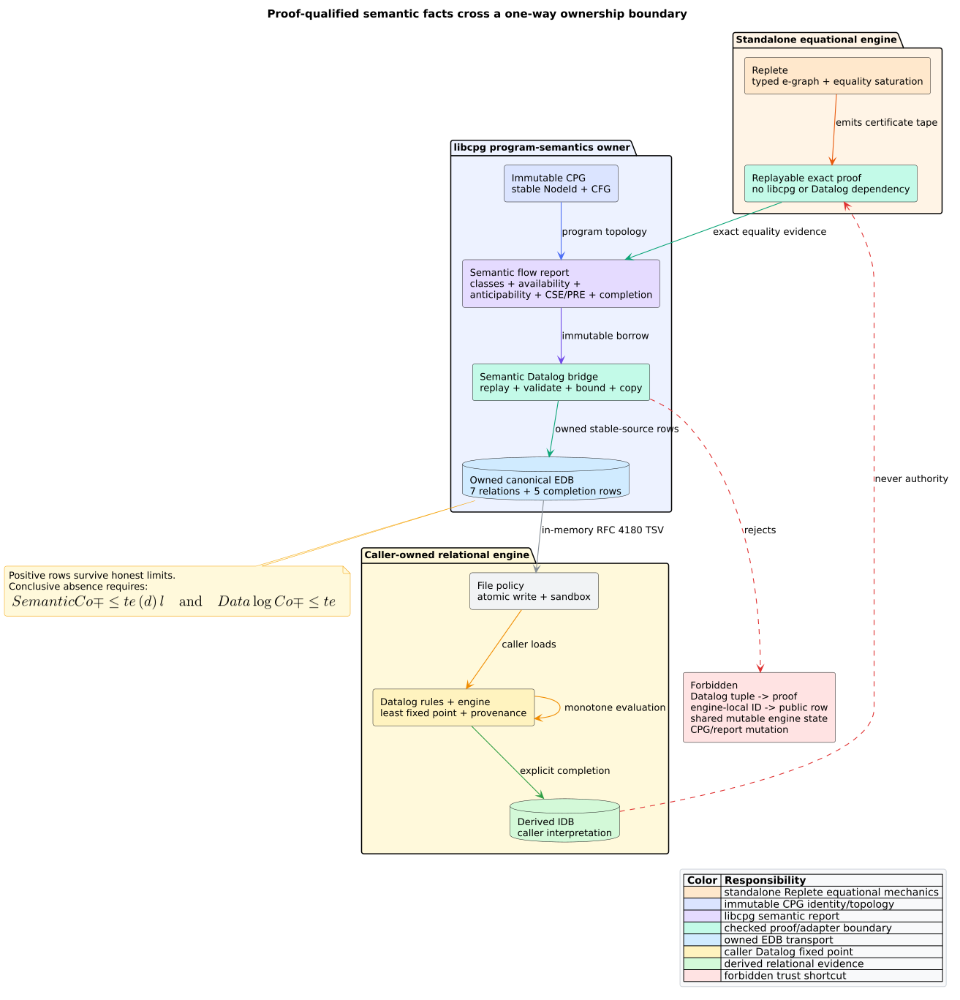

# ADR-0077: Export owned semantic evidence to Datalog

- **Status:** Accepted
- **Date:** 2026-08-31
- **Scope:** Replete/libcpg/Datalog ownership, semantic EDB schemas, proof replay,
  completion, and resource boundaries

## Context

libcpg has three deliberately different reasoning domains. Standalone
**Replete** is the typed e-graph and equality-saturation library. libcpg owns
language semantics, stable Code Property Graph (CPG) identities, proof
qualification, and control-flow analysis. A caller-owned **Datalog** engine
derives relational consequences from an **extensional database** (EDB), the
finite set of input tuples.

These systems all grow knowledge monotonically, but their judgments are not
interchangeable. Replete establishes term equality under admitted typed laws.
libcpg establishes program-specific flow and provenance. Datalog establishes
consequences of caller-owned rules. A Datalog tuple is not an equality proof,
and an e-class does not establish availability, dominance, or control flow.



*Figure -- responsibility and trust boundary. Source:
[`semantic-datalog-responsibility-boundary.puml`](../diagrams/semantic-datalog-responsibility-boundary.puml).*

## Decision

1. `export_semantic_datalog` borrows a completed or honestly limited
   `SemanticExpressionFlowReport` and returns owned `SemanticDatalogFacts`.
2. Public rows contain stable source `NodeId` values. Replete e-class, e-node,
   union-find, proof-arena, and worklist identifiers remain private.
3. Every exported proof edge is independently replayed. Every non-reflexive
   class membership is connected to its representative through replayed exact
   edges; representative self-membership uses equality reflexivity.
4. CSE proof indices must name the exact producer/use proof. PRE proof indices
   must remain inside and span the reported class. Malformed evidence fails
   closed with `SemanticDatalogError`.
5. Availability, anticipability, CSE, PRE, and exact equality retain separate
   completion rows. Caller-owned Datalog completion remains a second typed
   dimension.
6. Absence is conclusive only when both dimensions completed:

```math
\operatorname{ConclusiveAbsence}(d)
\iff
\operatorname{SemanticComplete}(d)\land
\operatorname{DatalogComplete}.
```

7. Positive proof-qualified rows survive later limits; a limit changes the
   meaning of absence, not already replayed evidence.
8. Relations are canonical ordered sets rendered as in-memory RFC 4180
   tab-separated Soufflé buffers. libcpg performs no file I/O and embeds no
   Datalog runtime.
9. Fact count and rendered bytes have typed limits and public hard ceilings.
   All traversals, rendering, cloning, serialization, and drop paths are flat
   or use explicit heap state.
10. The existing feature-free CPG EDB exporter remains independent and
    unchanged. The bridge retains no CPG, report, Replete, or Datalog-engine
    reference.
11. Replete remains an independent crate. MeTTaIL remains outside this
    campaign's write, build, format, branch, and commit scope.

## Canonical algorithm

```text
EXPORT_SEMANTIC_DATALOG(report, limits):
    validate limits before allocating output
        because zero and above-hard-ceiling policies are invalid
    validate canonical classes and map occurrences to representatives
        because public identity must be stable and unambiguous
    count output with checked arithmetic
        because heap growth must be explicit and bounded
    for each applicable exact pair:
        replay its proof independently
        append stable endpoints and the source-report index
    require replayed edges to connect every nontrivial class
        because an unchecked e-class label is not public authority
    validate and copy availability and anticipability
    validate CSE endpoint proofs and PRE spanning proofs
    append one completion row for each semantic dimension
    return owned canonical facts without retaining an input reference
```

For $`r`$ rows and $`b`$ rendered bytes, validation and rendering scan
$`O(r+b)`$ data around ordered-set insertion; each ordered insertion is
$`O(\log r)`$ in the worst case. Owned output is $`O(r+b)`$ and native call
depth is $`O(1)`$ in report size.

## Alternatives rejected

### Share one mutable graph between Replete and Datalog

Rejected because e-graph rebuild and relational fixed-point state have
different invariants, lifecycles, resource controls, and trust meanings.

### Store Replete e-class identifiers in Datalog

Rejected because e-class identifiers are engine-local and may change during
rebuild. Stable source identities are the public coordinate system.

### Treat derived Datalog equality as a Replete proof

Rejected because Datalog provenance proves rule derivation, not typed rewrite
soundness. The bridge direction is proof to tuple only.

### Embed Soufflé, egg, or egglog in libcpg

Rejected because Replete already owns generic typed e-graphs and callers own
relational policy. A second runtime would duplicate policy and resource
ownership.

## Consequences

- Callers can join semantic classes and flow candidates with ordinary CPG
  relations without changing the CPG.
- Persisted facts remain audit data but cannot recreate proof authority.
- Callers must preserve semantic and Datalog completion separately.
- Replacing the temporary local Replete path with an immutable Git revision or
  exact registry release does not change this adapter contract.

## Verification

The [formal plan](../verification/t4-4-responsibility-boundary-formal-plan.md)
maps fifteen invariants to TLA+, Rocq, Z3, Rust examples, properties,
corruption cases, dependency checks, and small-stack tests. Executable evidence
is cataloged in [Scientific validation 72](../scientific/72-semantic-datalog-boundary-validation.md).

## References

1. Nelson, G., Oppen, D. C. (1980). *Fast Decision Procedures Based on
   Congruence Closure.* DOI:
   [10.1145/322186.322198](https://doi.org/10.1145/322186.322198).
2. Tate, R., Stepp, M., Tatlock, Z., Lerner, S. (2009). *Equality Saturation: A
   New Approach to Optimization Phases.* DOI:
   [10.1145/1480881.1480915](https://doi.org/10.1145/1480881.1480915).
3. Jordan, H., Scholz, B., Subotić, P. (2016). *Soufflé: On Synthesis of
   Program Analyzers.* DOI:
   [10.1007/978-3-319-41540-6_23](https://doi.org/10.1007/978-3-319-41540-6_23).
