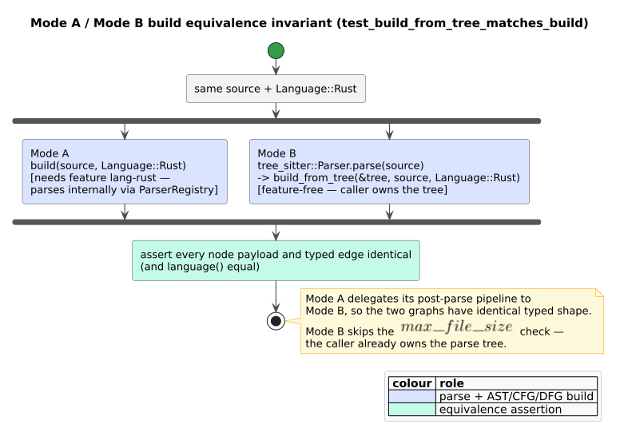

# Testing

`libcpg` is tested by **two complementary methods**, both run by `cargo test`:

- **Example-based tests** state *this input produces that output*. They are
  precise, readable, and are the right tool for a fixed contract — a mapping
  table, a specific control-flow edge, a named algorithm.
- **Property-based tests** (via [`proptest`](https://docs.rs/proptest)) state
  *this law holds for every input*, then let the framework search for a
  counterexample and **shrink** it to a minimal witness. They are the right tool
  for algebraic laws — round-trips, idempotency, ordering axioms, range bounds —
  where the space of inputs is far too large to enumerate.

The method is Claessen & Hughes' QuickCheck, adapted to Rust
(*"QuickCheck: a lightweight tool for random testing of Haskell programs"*,
ICFP 2000, DOI [10.1145/351240.351266](https://doi.org/10.1145/351240.351266)).
Its central insight is that a *specification* is more valuable than a list of
examples, because the specification is checked against inputs no author would
think to write down.

## The census

| Kind | Count | Where |
| --- | ---: | --- |
| Maximal-matrix library tests | 1,267 | inline `#[cfg(test)] mod …` next to the code; includes examples and properties |
| Public-API integration tests | 22 | `tests/integration.rs` |
| Malformed-input robustness tests | 5 | `tests/robustness.rs` |
| SCCP public/parser integration tests | 3 | `tests/sccp_integration.rs` |
| Interval public/parser integration tests | 4 | `tests/intervals_integration.rs` |
| Loop-induction public/parser integration tests | 4 | `tests/induction_integration.rs` |
| Complexity-evidence public/parser integration tests | 3 | `tests/complexity_evidence_integration.rs` |
| Condensation public/parser integration tests | 2 | `tests/condensation_integration.rs` |
| Layering public/serialization integration tests | 2 | `tests/layering_integration.rs` |
| DSM public/parser integration tests | 2 | `tests/dsm_integration.rs` |
| WL public/parser integration tests | 2 | `tests/wl_integration.rs` |
| WL deep/wide stack-safety tests | 1 | `tests/wl_stack_safety.rs` |
| Centrality public integration tests | 2 | `tests/centrality_integration.rs` |
| Community public/parser integration tests | 2 | `tests/community_integration.rs` |
| Cohesion public/parser integration tests | 2 | `tests/cohesion_integration.rs` |
| Spectral public/parser integration tests | 2 | `tests/spectral_integration.rs` |
| Cycle public/parser integration tests | 2 | `tests/cycles_integration.rs` |
| Motif public/parser integration tests | 2 | `tests/motifs_integration.rs` |
| GED public/parser integration tests | 2 | `tests/ged_integration.rs` |
| Function-clone public integration tests | 2 | `tests/clones_integration.rs` |
| Program-composition public integration tests | 3 | `tests/program_integration.rs` |
| IFDS/IDE public integration tests | 2 | `tests/ifds_integration.rs` |
| Effect-summary public integration tests | 3 | `tests/effects_integration.rs` |
| Taint/nullflow public integration tests | 3 | `tests/taint_integration.rs` |
| SDG-slicing public integration tests | 1 | `tests/sdg_integration.rs` |
| Martin public/parser integration tests | 2 | `tests/martin_integration.rs` |
| Reflexion public/serialization integration tests | 2 | `tests/reflexion_integration.rs` |
| Architectural-smell public/serialization integration tests | 2 | `tests/smells_integration.rs` |
| Field-access public/parser integration tests | 2 | `tests/field_access_integration.rs` |
| Code-metrics public/parser integration tests | 2 | `tests/metrics_integration.rs` |
| Channel-topology public/parser integration tests | 3 | `tests/concurrency_integration.rs` |
| Deadlock-candidate public/parser integration tests | 3 | `tests/deadlock_integration.rs` |
| MHP public/parser integration tests | 2 | `tests/mhp_integration.rs` |
| Session-sketch public/parser integration tests | 2 | `tests/session_integration.rs` |
| Typestate public/parser/stack integration tests | 3 | `tests/typestate_integration.rs` |
| Bug-detector public/parser/stack integration tests | 4 | `tests/bug_detectors_integration.rs` |
| Population-anomaly public/parser integration tests | 2 | `tests/population_bug_detectors_integration.rs` |
| Clone/feasibility public/parser integration tests | 2 | `tests/clone_feasibility_bug_detectors_integration.rs` |
| API-usage/temporal public/parser integration tests | 2 | `tests/api_usage_mining_integration.rs` |
| CWE-template public/parser integration tests | 2 | `tests/cwe_templates_integration.rs` |
| Crypto-misuse public/parser integration tests | 2 | `tests/crypto_misuse_integration.rs` |
| Virtual-call type-refinement public integration tests | 2 | `tests/devirtualization_integration.rs` |
| Virtual-call type-refinement stack-safety tests | 1 | `tests/devirtualization_stack_safety.rs` |
| Race/atomicity public integration tests | 1 | `tests/concurrency_bugs_integration.rs` |
| Race/atomicity stack-safety tests | 1 | `tests/concurrency_bugs_stack_safety.rs` |
| ML-export public integration tests | 1 | `tests/ml_export_integration.rs` |
| ML-export stack-safety tests | 1 | `tests/ml_export_stack_safety.rs` |
| CPG-diff public/parser integration tests | 2 | `tests/cpg_diff_integration.rs` |
| CPG-diff stack-safety tests | 1 | `tests/cpg_diff_stack_safety.rs` |
| **Executable test cases** | **1,420** | measured by the all-features test inventory: 1,267 library, 150 integration/robustness, and 3 rustdoc examples |
| `proptest!` blocks (subset of the library/robustness rows) | 100 | exact source-level macro count in `src/` and `tests/` |

The maximal-matrix library count is up from **99** inline tests and **zero**
property tests before this work.

Each property runs many generated cases (`ProptestConfig::with_cases(N)`, with
`N` tuned to the cost of the property: 256 for cheap structural laws, 192 for
induction arithmetic/permutation contracts, 128 or 96 for other mid-weight
ones, 64 for parser-backed ones, 32 for the heaviest), so the
property suites execute on the order of ten thousand distinct inputs per run.

### Not every test compiles under every build

Because whole modules are feature-gated, the number of tests that *run* depends
on the features enabled:

| Command | Lib tests | Notes |
| --- | ---: | --- |
| `cargo test` | 845 | `default = []`: the feature-free library surface, including deterministic ML export and CPG diff, concurrency candidates, type refinement, typestate, bug detectors, population anomaly inference, clone/feasibility advisories, API-usage/temporal mining, and declarative CWE templates |
| `cargo test --features "full rholang metta"` | 1,220 | the maximal library matrix, including serde ML export/CPG diff, the Mode-B mappers, session sketches, race/atomicity candidates, type refinement, typestate, bug detectors, population/clone/feasibility/API-usage/CWE advisories, named temporal properties, and evidence-aware complexity |

The feature-free 845 exercise the graph model, deterministic multi-file merge
and import linkage, exact dominator/post-dominator,
natural-loop, monotone data-flow, IFDS/IDE procedure summaries,
interprocedural effect/constant, taint, and maybe-null summaries, variable-liveness/dead-store,
available/very-busy-expression, SCCP, interval value-range, CFG/call-graph
SCC analyses, condensation-DAG analytics, DSM visibility/core–periphery, Martin
package metrics and stable-dependency witnesses, CK/LCOM1–5 and function code
metrics, architectural-smell detection, WL
structural-clone and Type-1 through Type-4 function-clone detection, centrality, community, cohesion/robustness,
spectral-connectivity classification, bounded simple cycles, directed motifs,
bipartite GED, typed channel/deadlock evidence, may-happen-in-parallel relations,
exact-location race and RMW atomicity candidates,
canonical graph tensors and exact AST path contexts,
deterministic aligned CPG edit scripts and represented-PDG classification,
finite-state typestate properties,
resource-leak, uninitialized-use, uncaught-exception, dead-catch,
missing-check, call-order, and return-check detection,
the CFG/DFG/PDG extractors, VF2, and similarity by building CPGs
**by hand** — no grammar required. This is what
the [`arb_well_formed_cpg`](#the-generators) generator exists for.

## Running the tests

```sh
# Feature-free surface (default = []).
cargo test

# The maximal run: every test, including the Mode-B rholang/metta mappers.
cargo test --features "full rholang metta"

# One language plus one analysis.
cargo test --features "lang-rust,design-patterns"

# Evidence-aware complexity: feature-only and real-parser public cases.
cargo test --no-default-features --features algorithm-detection \
  --test complexity_evidence_integration
cargo test --no-default-features --features "algorithm-detection lang-rust" \
  --test complexity_evidence_integration

# Scope to one module.
cargo test --features lang-rust builder::tree_sitter

# Just the property tests.
cargo test proptests

# Coverage (aliases defined in `.cargo/config.toml`).
cargo cov-text             # stable line/region summary
cargo cov                  # stable HTML report
cargo +nightly cov-branch  # nightly branch summary

# The complete local verification gate.
# Logs are captured below target/verification and cleaned.
./scripts/verify.sh
```

`.config/nextest.toml` sets a `slow-timeout` so a runaway property is killed
rather than hanging CI.

## The generators

Property tests are only as good as their generators. `libcpg`'s live in
`src/testutil.rs` (`#[cfg(test)] pub(crate)`), named `arb_*` by convention.
There are **two structural generators**, and the distinction between them is the
single most important thing to understand about this suite:

> `CodePropertyGraph::connect` wires only the petgraph edge. It does **not** set
> `node.parent` / `node.children` — the caller does. Every AST-ancestor analysis
> (DFG, PDG, metrics, algorithm detection) reads those pointers.

| Generator | Shape | Use for |
| --- | --- | --- |
| `arb_cpg_raw` | 1–8 nodes, random kinds, random edges (cycles possible) | analyses that read only node kinds and adjacency: serde, VF2, similarity, ids |
| `arb_well_formed_cpg` | `Function → Block → statements…`, with edges **and** parent pointers **and** child lists set, exactly as a real builder does | CFG/DFG/PDG/metrics/algorithm-detection properties, with no grammar needed |
| `arb_pdg_graph` | nodes joined by random control/data-dependence edges | program-slicing properties |
| `arb_rust_source` | a small, syntactically valid Rust function with bounded nesting | parser-backed properties (`build ≡ build_from_tree`, cyclomatic identity on real CFGs) |

Leaf generators (`arb_name`, `arb_source_range`, `arb_literal_kind`,
`arb_node_kind`, `arb_edge_kind`, …) compose into those four.

When a property fails, `proptest` writes the shrunk seed to a
`proptest-regressions/*.txt` file. **Those files are committed** — they replay
the known-bad input on every subsequent run, so a fixed bug cannot silently
return.

## What the properties assert

The invariants fall into complementary families.

| Family | Representative laws |
| --- | --- |
| **Round-trip / identity** | $`\mathit{deserialize} \circ \mathit{serialize} = \mathrm{id}`$ over the whole serializable surface; `NodeId`/`EdgeId`/`SourceRange` conversions; `Language` extension round-trip; $`\mathit{from\_kind} \circ \mathit{to\_cpg\_node\_kind} = \mathrm{id}`$ |
| **Structural** | `add_node` yields sequential ids; `connect` is defined iff both endpoints exist; `ast_children` preserves insertion order; $`M = E - N + 2`$ (`cyclomatic_complexity`); `ast_depth` is bounded by the node count |
| **Graph projections** | CSR nodes and adjacency are sorted; parallel-edge weights merge deterministically; transpose is an involution; all overlay constructors equal direct typed-edge traversal and do not mutate the CPG |
| **Exact-edge projection cache** | every outgoing/incoming/CFG/DFG/endpoint and overlay view equals direct exact-edge filtering over 256 generated multigraphs; another 256 cases require stable logical order across insertion permutations; examples pin invalidation, rejected non-mutations, clone/serde, maximum stable ids, exact-size cursors, and a 100,000-node/99,999-degree build and traversal on 256 KiB; parser integration repeats the oracle after call and PDG enrichment |
| **Session-protocol sketches** | a 128-case exact-dual generator preserves complete sketches under reversed node/edge insertion and keeps all evidence in graph; examples cover every concrete mismatch, explicit uncertainty, literal/named/definition-backed payload types, nested/cyclic AST boundaries, real Rholang normalization, serde, and graph non-mutation |
| **Typestate analysis** | three 256-case properties compare against an independent sequence oracle, reverse CFG/DFG insertion, and check cap monotonicity; examples cover policy invariants, legal/forbidden protocols, joins, aliases, call evidence, applicable caps, serde, parser-built Rust, graph immutability, and CFG depth 100,000 on 256 KiB |
| **Advisory bug detectors** | independent generated oracles check non-accepting leak terminals, empty scoped reaching-definition sets, and 256 exception-call chains; examples cover semantic exits, declaration/callee syntax exclusion, direct/interprocedural and subtype/catch-all dispatch, dead catches, every applicable cap/issue, serde, graph immutability, Rust/Java dual build modes, and 100,000 AST levels on 256 KiB |
| **Population anomaly detectors** | independent generated population oracles check exact missing-check and return-check fractions; examples cover 4/5 and 9/10 support, semantic check fingerprints, whole/call-neighborhood peers, call-order reachability, every identity/AST/CFG/value cap and issue, serde, graph immutability, parsed Rust PDG evidence, and 100,000-node paths on 256 KiB |
| **Clone/feasibility advisories** | independent generated alignment/insertion and exhaustive integer-domain oracles check exact rename/guard evidence and Boolean path partitions; examples cover Type-2/3 pair identity, `9/10` rename support, guard flips, SCCP/interval proof composition, equality/disequality/extrema, every AST/alignment/GED/condition cap and issue, serde, graph immutability, parsed Rust evidence, and 100,000 nodes on 64 KiB |
| **API-usage/temporal mining** | two 128-case generated oracles check exact strict-majority missing-following-call sites and report equality under CFG insertion permutations; examples cover 19/20 support, argument/receiver/control fragments, graph acyclicity, forbidden transitions, non-accepting exits, every call/identity/CFG/AUG/property boundary, serde, graph immutability, parsed Rust evidence, and 100,000 CFG nodes on 64 KiB |
| **Declarative CWE templates** | one 128-case property compares complete reports under template and graph-relation insertion permutations; examples cover all ten shipped CWE families and clean counterparts, contradictory integer types, structural caps, serde, graph immutability, parsed Rust vulnerable/sanitized SQL evidence, and 100,000 expression levels on 64 KiB |
| **Cryptographic API misuse** | one 128-case property requires complete-report determinism across local cap selections; examples cover MD5, ECB, fixed IV, literal-key taint, secure-random AES-GCM, forbidden post-finalization order, invalid rules, every local cap, serde, graph immutability, parsed Rust evidence, and 100,000 definition levels on 64 KiB |
| **Secret flow / access policy** | three 128-case properties require bounded entropy and complete-report determinism; paired examples cover high-entropy and binding-hinted flows, positional exclusion, exact 4/5 access-guard support, unrelated-guard rejection, invalid/capped evidence, serde, graph immutability, parsed Rust PDG evidence, and two 100,000-node flat machines on 64 KiB |
| **Vulnerability extrapolation** | a 256-case shared-WL campaign checks relabeling invariance and symmetry; a 128-case population campaign checks deterministic total rankings and bounded scores; examples cover the cross-graph rank-alias regression, a planted near duplicate, every invalid/capped issue, serde, immutable public/parser-built PDGs, the runnable example, and 100,000 AST nodes on 64 KiB |
| **Virtual-call type refinement** | a 128-case campaign checks hierarchy-edge insertion determinism and exact $`VTA\subseteq RTA\subseteq CHA`$ candidate sets; examples cover overrides, inherited/default methods, empty allocation sets, `TypeOf`, def-use assignments, ambiguous names, cyclic hierarchies, serde, JavaScript/TypeScript/Java allocations, immutable C1 integration, and 100,000 hierarchy levels on 256 KiB |
| **Function CFG scope** | the reachable CFG view is invariant under node, edge, and recorded-exit insertion permutations; call edges never enter the view; dense entry/exit identifiers map back to the same stable nodes |
| **CFG extraction machine** | one comprehensive fixture covers every typed continuation and all eight config combinations; three 192-case campaigns require exact edge-id/order/kind/label and entry/exit equality with the bounded former-recursive equations on well-formed and arbitrarily corrupted ASTs, plus exact invariance under reversed non-AST insertion; examples cover cycles, sharing, terminators, nested loop/try state, idempotency, and degenerate forms; a public parser-built depth-100,000 CFG completes on 256 KiB |
| **Dominance** | 4,165 rooted graphs equal an independent vertex-removal idom/dominance/frontier oracle; 4,164 exit-reachable CFGs and two 256-case campaigns equal petgraph/former-PDG oracles; two more 256-case campaigns preserve exact direct/post-dominator results under storage permutations; root self/backedges, irreducible/infinite regions, parser-backed PDG equality, and public 100,000-node deep-projection, wide-projection, exit-plus-infinite-region, and 99,999-exit function shapes on 256 KiB are pinned |
| **Natural loops** | insertion permutations preserve the forest; dominator-qualified back edges and reverse-closure bodies equal independent brute-force oracles through 24 nodes; every body lies in a cyclic SCC; child bodies are strict parent subsets; `LoopExit` exactly crosses AST loop scope and starts a basic block; a 25,000-node loop is stack-safe |
| **Loop invariants / induction variables** | every invariant use has non-empty `DefUse` evidence only from outside or already-invariant definitions; explicit recurrences are unique and dominate every latch; five 192-case campaigns cover insertion-order report equality, checked direction/comparison laws, exact differential equivalence of typed affine and signed-integer heap machines with bounded former-recursive specifications, and cached candidate-use equality with exact reachability on arbitrary eight-node cyclic multigraphs in both query orders; examples cover every supported update/range/affine shape, exact depth-three semantics, cycle/path restoration, duplicate/conditional updates, nested/irreducible loops, hoist dominance, symbolic/overflow outcomes, serde, invalid/foreign forests, graph non-mutation, a real Rust `for i in 0..x`, a 25,000-node region, and a parent-before-child public 100,000-operator step on 256 KiB; the malformed-graph property harness checks result references and subset laws |
| **CFG reachability** | iterative DFS equals `petgraph::visit::Bfs`; reachable and unreachable sets form a disjoint, exhaustive partition; insertion permutations preserve reports; adding an edge never shrinks reachability; generated post-terminator tails remain unreachable; parser wrappers and all-return branches preserve termination; a 25,000-node graph is stack-safe |
| **Basic-block CFGs** | insertion permutations preserve blocks, membership, typed edges, exits, and traversal orders; the blocks form a disjoint exhaustive projection partition; intra-block pairs have the required unique `Sequential` relation; every typed CFG edge is either an internal chain step or a block edge; parser, CFG-only, serde, invalid-selector, and non-mutation examples pass; a 25,000-block graph is stack-safe |
| **AST-ordered DFG reaching definitions** | 256 generated graphs through eight nodes prove the typed heap machine exactly matches the bounded former recursive equations for pair order, environment updates, conditional context, two-pass loops, lexical boundaries, and active-path cycles; exact examples cover latest-write wins, shadowing, loop-carried definitions, nested uses, lexical capture/isolation, malformed cycles, config families, parser composition, idempotence, and field/index resolution; a public 100,000-level definition-to-use path completes on a 256 KiB stack while preserving nodes and AST edges |
| **Monotone data flow** | union and intersection joins are idempotent, commutative, and associative; priority/RPO, FIFO, and LIFO worklists reach identical states over generated CFGs; forward/backward boundaries, typed edge transfer, header-only widening, visit-cap failure, narrowing/non-ascent, malformed public views, node replay, serde, and non-mutation examples pass; a private reaching-definitions instance equals the retired acyclic CFG fixpoint and covers core AST-ordered def-use edges on a cycle; public integration tests implement the traits downstream and extract canonical facts from parsed code; the malformed-graph property harness invokes both fact extraction and solving |
| **Variable liveness / dead stores** | production block states exactly equal an independent naive round-robin oracle on a diamond with a loop; node/edge insertion permutations and repeated runs produce identical reports; every reported definition is reachable, is not a parameter, and is absent from its node's `live_out`; examples cover assignment kinds, unused parameters, unreachable definitions, bodyless functions, invalid selectors, serde, and graph non-mutation |
| **Available / very-busy expressions** | exhaustive path enumeration over generated acyclic CFGs of up to 12 nodes exactly matches forward/backward Must maps; 96-case node/edge insertion permutations preserve reports; every redundant pair is available, dominating, and kill-free from first to second; every PRE placement dominates all evaluations; flat-key examples cover all operands, sharing, cycles, unsupported nodes, exact caps, malformed CEK1, and comparison/hash/round-trip laws; a 100,000-level mixed key lifecycle and a 100,000-expression public fact universe both run on 256 KiB stacks; bodyless/invalid/serde/non-mutation and malformed-graph harnesses exercise the public APIs |
| **SCC decomposition** | Every projected node occurs in exactly one component; the partition matches `petgraph::algo::tarjan_scc`; singleton cycles require a self-loop; the condensation graph is acyclic; a 50,000-node path does not overflow the native stack |
| **Call resolution** | resolution records and call edges are invariant under node/edge insertion permutations; duplicate names add zero call topology and preserve the SCC partition; repeated resolution is idempotent; candidate/call caps preserve the evidence boundary |
| **IFDS/IDE summaries** | generated call graphs equal an independent reachability oracle and preserve exact reports under reversed call insertion; summary joins satisfy semilattice laws; iteration/work/function/fact/depth caps are explicit and monotone; examples cover acyclic, self-recursive, mutually recursive, external, unresolved, malformed/stale-SCC, serde, public composition, and graph non-mutation behavior |
| **Effect summaries** | full summary joins satisfy idempotence, commutativity, associativity, and subsumption; six 256-case campaigns cover an independent transitive-purity DFS, bounded recursive specifications for both flat local machines, call/def-use insertion order, and local/SCC cap monotonicity; exact examples cover pure constants, global/field/parameter effects, actual-argument remapping, transitive definitions/constants/impurity, conflicting returns, mutual recursion, calls, cycles, missing nodes, terminal-cache equivalence, exact caps, 65-parameter truncation, 10,000-way joins, malformed topology, serde, crate-root composition, and graph non-mutation; a 100,000-level public expression completes on a 256 KiB stack |
| **Taint and maybe-null summaries** | both summary joins satisfy idempotence, commutativity, associativity, and subsumption; generated typed value-flow graphs match independent breadth-first reachability oracles and preserve exact reports under reversed insertion; catalog properties pin pattern specificity and caller-policy replacement; examples cover twelve source/sink/sanitizer/external/interprocedural scenarios, witness validity, 65-parameter truncation, caps, serde, crate-root composition, nullable-return and uninitialized-variable origins, and graph non-mutation |
| **Idempotency** | a second `CfgExtractor::extract` / `DfgExtractor::extract` / `PdgBuilder::build` adds no edges |
| **Slicing** | $`\lvert S\rvert \le \mathit{max\_nodes}`$; the criterion is in its own backward slice; $`\mathit{max\_nodes} = 0 \Rightarrow S = \varnothing`$; $`S`$ is monotone in $`\mathit{max\_nodes}`$; every sliced id is a real node |
| **System dependence slicing** | labeled summary edges are selective, append-only, idempotent, and conservative under cap/truncation; exact two-caller oracles prove both directions cross the intended call without a sibling return; 256-case generated multigraphs preserve exact slices under reversed edge insertion, prove node/depth cap monotonicity, and retain every legacy PDG-only predecessor; examples cover missing and multi-target summaries, zero caps, unknown criteria, serde, and the public effect-to-slice pipeline |
| **Matching, similarity, and GED** | VF2 embeddings are injective, kind-consistent, directed-edge-preserving non-induced monomorphisms; relaxed matching $`\supseteq`$ strict; 128 generated labelled multigraphs exactly match an independent iterative exhaustive-injection oracle, while the bounded recursive specification remains a second differential oracle; both graph insertion orders preserve the exact sequence, caps select monotone canonical prefixes, and adding a strictly incompatible isolated target node preserves results; generated dense-set operations and every successor query equal an independent `BTreeSet`; examples pin self-loops, parallel existential edges, extra reverse target edges, disconnected $`2\to3`$ injections, compact frames, invalid pushes, parser self-match, and exact undo; a 100,000-node public path completes on a 256 KiB stack without graph mutation; all four similarity metrics and GED retain their existing laws and exhaustive assignment oracles |
| **Deterministic parallel analysis** | four 128-case generated campaigns require exact serial/parallel CFG, DFG, PDG, and ordered VF2-batch sequences under all relevant configuration bits; public integration repeats whole-pipeline equality at 1/2/4/8/16/32 workers, checks serde-byte identity, parses 128 Rust functions, and runs a depth-100,000 AST through every parallel builder on 256 KiB worker stacks |
| **Deterministic CPG diff** | exact examples pin identical graphs, renumbered pure renames, added PDG guards, typed/labelled parallel-edge substitutions, translated embedded ids, canonical properties, malformed cached links, every cap, serde, and immutability; one 128-case property requires exact scripts under opposite storage orders; public feature-free/parser-PDG composition distinguishes rename from dependence edits; a depth-100,000 property plus 128-node alignment completes on 256 KiB |
| **Ordering & confidence** | `ComplexityClass::is_better_than` is a strict order (irreflexive, asymmetric, transitive); complexity is monotone in loop nesting; every detector's results are sorted by descending confidence and clear its `min_confidence` |
| **Complexity evidence** | fully counted reducible depth maps to the exact polynomial degree; opposite storage orders produce identical class/confidence/justification; every generated CFG-free function returns the exact legacy estimate; fixed examples decide unknown-trip and irreducible confidence precedence, provenance, recursion composition, public parsing, and graph non-mutation |
| **DSM visibility / architecture roles** | repeated-BFS VFO/VFI vectors and propagation cost equal an independent Floyd–Warshall closure; the largest multi-vertex SCC equals an independent mutual-reachability partition; reversed enumeration and duplicate edges preserve reports; examples cover chain/cycle/hub/isolates, equal-core ties, caps, malformed CSR/reverse data, cross-projection provenance, serde, public construction, parser integration, and graph non-mutation |
| **Martin package metrics / SDP** | an exact three-module oracle pins every $`C_a`$, $`C_e`$, $`I`$, $`A`$, and $`D`$ value plus the strict stable-dependency witness; 256 sparse generated graphs preserve assignments, metrics, and violations under pair/edge reversal and keep all scalars in $`[0,1]`$; examples cover nested/anonymous/root/source buckets, duplicate and invalid public values, weights/intra edges, serde, public/parser composition, robustness, and graph non-mutation |
| **CK, LCOM, and function metrics** | an exact hand-class oracle pins WMC/DIT/NOC/CBO/RFC and LCOM1–5 over real resolved method–field evidence; generated incidence graphs preserve complete reports under reversed insertion and keep LCOM laws; generated MI inputs remain finite/bounded; semantic-taxonomy examples cover every supported Halstead operator/operand and all literal classes; examples cover nested-control cognitive scoring, recursion, comments, scoped implementations, inheritance cycles, selectors, serde, public/parser composition, and graph non-mutation |
| **Reflexion-model conformance** | an exact layered oracle pins same-layer/allowed convergence, path-sorted divergences, uncovered edges, realized pairs, and absences; 256 generated dependency multisets preserve complete summaries under reversal and satisfy exhaustive classification; examples cover prefix precedence, empty/duplicate public values, serde, the feature-free crate-root boundary, and caller-input non-mutation |
| **Architectural layering** | an exact four-component oracle pins bottom-first reversal, cyclic-component and skip-layer witnesses, and one-step descent for every unflagged edge; a stale-level oracle covers lateral/upward edges; 256 generated DAGs require deterministic reports and the descent invariant; examples cover empty, out-of-domain, capped, impossible-level, duplicate-edge, invalid-cycle-flag, serde, public composition, and graph non-mutation behavior |
| **Architectural smells** | four isolated fixtures pin exact cycle, two-sided-hub, less-stable-share, and module-size-outlier evidence while a clean chain/self-loop emits none; 256 generated projections require insertion-order determinism, in-graph sorted nodes, finite evidence, and canonical result order; hostile tables cover every option/metric boundary, stale SCC, malformed CSR, partial assignment, duplicate/missing metrics, serde, public composition, and non-mutation |
| **WL labels / structural clones** | two 256-case campaigns compare exact production bits to an independent fresh-allocation predecessor, preserve logical partitions under isomorphic sparse-id relabeling and reversed/duplicate edge input, and prove repeat/permutation/self-similarity/symmetry/unit-interval laws; exact examples pin empty/singleton/path/ring/disconnected/repeated/self/parallel topology, mixer vectors, direction/weight semantics, the 16-round cap, malformed handling, class thresholds/order, feature-free/parser composition, and graph non-mutation; 100,000-node path/star lifecycles complete on a 256 KiB stack |
| **Projection centrality** | 128 generated topologies check exact repeat and input-permutation equality plus stable-id reversal equivalence for PageRank, personalized/reverse PageRank, eigenvector, Katz, distance, HITS, Burt, vertex Brandes, and edge Brandes; fixed ring/path/star/triangle/disconnected examples pin closed forms; petgraph PageRank and dominator differentials, naive simple-path Brandes, source-partition composition, malformed/budget/invalid-option behavior, public feature-free composition, and graph non-mutation cover independent boundaries |
| **Community detection** | generated weighted projections check exact repeat and reversed-input equality, canonical labels, independent generalized modularity, and the singleton score baseline; fixed planted cliques, complete/self-loop graphs, a ring-of-cliques multi-level witness, aggregation conservation, caps, numeric/CSR rejection, and byte-identical serde cover the Louvain boundary; generated arbitrary partitions prove every refined group connected and canonical; public/parser integration and the corruption harness prove alignment and non-mutation |
| **Cohesion and robustness** | 96 generated graphs through 20 vertices compare k-core to naïve threshold peeling; 96 simple graphs through 12 vertices compare k-truss to independent fixed-point triangle peeling, cuts to brute vertex/edge removal, and robust blocks to independent bridge-deletion BFS; 96 weighted graphs through 10 vertices compare Stoer–Wagner to exhaustive bipartitions; 64 attack cases compare every LCC/AUC step to independent BFS and bound assortativity; every order-insensitive family is repeated over reversed edge insertion; examples cover cliques, paths, triangles, bridges, weighted seams, degree-skew stars, deep stack-safe paths, exact caps, malformed CSR/numerics/orders, serde bytes, public/parser composition, and graph non-mutation |
| **Spectral connectivity** | 96 generated graphs through nine vertices compare algebraic connectivity to an independent dense symmetric Jacobi eigensolver, require exact repeat/reversed-input results, and verify norm/mean/sign/residual/cap invariants; examples cover complete/path/cycle closed forms, exact disconnected component contrasts, duplicate/reciprocal/loop topology, arbitrary weights, zero and excessive iterations, invalid tolerance/CSR, serde bytes, a 25,000-node stack-safe path, public/parser composition, and graph non-mutation |
| **Bounded simple cycles** | 96 generated directed graphs through eight vertices equal an independent exhaustive-permutation oracle and exact reversed-input repeats; another 96 random count caps equal the canonical sorted prefix and first omitted witness; examples cover self-loops, reciprocal pairs, opposite orientations, SCC pruning, zero/hard limits, malformed CSR, serde bytes, a 25,000-node ring, public/parser composition, and graph non-mutation |
| **Directed motif census** | all 64 labeled tricodes equal an independent vertex-permutation isomorphism oracle; 128 generated directed graphs through eight vertices equal an independent brute-force triad/graphlet census, conserve `C(n,3)`, and repeat exactly under reversed insertion; examples cover all sixteen named classes, both graphlets, reciprocal spokes, weights/loops, explicit 512/50 budgets, malformed CSR, serde bytes, public/parser composition, robustness composition, and graph non-mutation |

### Two invariants worth singling out

**Build equivalence.** The crate offers two construction paths — the
internal-parse `build` ("Mode A") and the caller-supplied-tree `build_from_tree`
("Mode B") — and `build` is implemented by *delegating* its post-parse pipeline
to `build_from_tree`. The two must therefore produce identical graphs.



*Figure — `build(source, Rust)` and `build_from_tree(&tree, source, Rust)` must
yield identical node payloads and typed edges as well as the same language. Source:
[`diagrams/build-equivalence.puml`](../diagrams/build-equivalence.puml).*

`test_build_from_tree_matches_build` pins it on one input; a property test pins
complete node payload and typed-edge identity on every source
`arb_rust_source` can generate. The same invariant is
analysed in
[`scientific/01-cpg-invariants-and-equivalence.md`](../scientific/01-cpg-invariants-and-equivalence.md).

**Robustness on malformed input.** `CodePropertyGraph` is an open data
structure: `add_node`, `connect`, and `node_mut` are all public, and `connect`
deliberately leaves `parent`/`children` to the caller. A consumer building a
graph by hand can therefore produce input no builder would — a parent pointer to
a node that does not exist, a cyclic `AstChild` chain, a call to a callee that
was never added. The contract for such input is **robustness, not correctness**:
an analysis may return a meaningless answer, but it must not panic, loop
forever, or overflow the stack.

`tests/robustness.rs` injects ten distinct corruptions into a plausible function
graph and drives *every* public analysis—including symbol construction and call
resolution—over each one, asserting termination plus the invariants that must
survive (slices stay within budget and contain only real nodes; confidences stay
finite and in $`[0,1]`$; extraction and resolution stay idempotent; the graph
still serializes). See
[`security/01-input-and-resource-hardening.md`](../security/01-input-and-resource-hardening.md).

## The mapping tables are executable specifications

The per-language `NodeMapper::map_*` tables are the widest single surface in the
crate, and every arm is a *claim about an external artifact*: "tree-sitter emits
`switch_statement` here". Such a claim rots silently when the grammar is
upgraded — the arm stops matching, the mapper falls through to `Unknown`, and
the CPG quietly loses a construct with no error anywhere.

`src/builder/node_mapper.rs` therefore states each language's table as test data
and checks every row against a snippet that exercises it:

```rust
// requires: features = ["lang-go"]  (shape of the shipped test)
let p = &mapped_kinds(SRC, Language::Go);
maps!(p,
    "source_file"                => CpgNodeKind::Root,
    "expression_switch_statement" => CpgNodeKind::Match,
    "type_switch_statement"       => CpgNodeKind::Match,
    "func_literal"                => CpgNodeKind::Lambda { .. },
    // …
);
```

`assert_maps` (behind the `maps!` macro) fails in **both** directions, which is
what makes it a drift detector rather than a spot check:

1. if the snippet contains no node of that tree-sitter kind, the arm is
   unreachable — the grammar or the snippet has drifted;
2. if it does but maps to something else, the mapping itself is wrong.

Writing these tables found six arms that could never fire against the pinned
grammars (see [below](#defects-found-by-this-suite)).

## Defects found by this suite

Property and robustness tests are worth their cost only if they find real bugs.
This suite found **nineteen**, each fixed at the source and frozen as a regression
test beside the fix:

| # | Defect | Consequence | Found by |
| --- | --- | --- | --- |
| 1 | `ast_depth` / `ast_descendants` / `ast_ancestors` recursed with no visited set | infinite loop or stack overflow on a cyclic `AstChild` graph | property |
| 2 | `CfgExtractor::process_node` and its handlers formed an input-depth recursive component | **stack overflow → process abort** on cyclic or sufficiently deep valid ASTs | exact recursive-oracle properties + 256 KiB integration |
| 3 | `visit_reaching` (DFG reaching-defs) recursed with no path guard | same | robustness |
| 4 | `ast_ancestors` returned ids absent from the graph | callers resolving an "ancestor" got `None` | robustness |
| 5 | `CfgExtractor` / DFG auxiliary edge builders were not idempotent | re-extraction silently duplicated edges | property |
| 6 | the former `ComplexityClass` rank collided (`Cubic == Polynomial(0)`) and placed some polynomials incorrectly | `is_better_than` was not a growth-faithful strict weak order | property |
| 7 | `Cosine` / `WeisfeilerLehman` similarity could return `1.0000000000000002` | documented $`[0,1]`$ range violated | robustness |
| 8 | VF2 did not verify pattern self-loops | unsound matches | property |
| 9 | VF2 relaxed matching was *stricter* than strict matching for several edge kinds | relaxed ⊉ strict | property |
| 10 | 7 GoF templates had fewer node constraints than their pattern CPG | `completeness` never reached $`1.0`$ | property |
| 11 | `--features design-patterns` did not compile (missing `dep:serde`) | the feature was unusable alone | feature-matrix build |
| 12 | 6 `NodeMapper` arms could never fire against the pinned grammars | constructs silently degraded to `Unknown` | mapping tables |
| 13 | every Rust method call was reported as `is_method: false` | tree-sitter-rust has no `method_call_expression`; `recv.m()` is a `call_expression` over a `field_expression`, so the flag has to be read off the callee | mapping tables |
| 14 | `async fn` was never detected as async (Rust, and latently Python) | tree-sitter-rust groups `async` under a `function_modifiers` node, so the direct-child check never saw it | mapping tables |
| 15 | a cyclic `idom` map from malformed serialized data made `dominators_of` unbounded | a consumer collecting the iterator could run indefinitely or exhaust memory | robustness review |
| 16 | callee-name reconstruction was depth-bounded but had no visited set | a cyclic malformed callee subtree could repeat nodes exponentially before reaching the depth cap | robustness review |
| 17 | a parser wrapper around `Return` hid the terminator from the former `process_block` equation | the return node was wired sequentially into source that must be unreachable | parser-backed integration test |
| 18 | anonymous tree-sitter keyword/operator tokens were retained as semantic CPG nodes outside Rholang | Rust `+` became a binary operand and `if` became the CFG condition, corrupting expression and branch semantics | parser-backed SCCP integration oracle |
| 19 | declarative field normalization was incomplete: Go emitted no `Field`, Java/C/C++ discarded its name, and TypeScript read JavaScript's `property` slot instead of its `name` slot | parsed member accesses could not resolve to declarations even when the source declared the field | Mode-A field fixture matrix |

Defects 2, 3 and 7 were found by generated input within seconds of the
robustness suite first running — none of them is reachable from any
example-based test that a person would think to write. Defects 12–14 were found
by turning the mapping tables into executable specifications: each is a claim
about a grammar that had quietly stopped being true.

The field-access campaign combines an exact six-edge hand oracle, receiver/
ambiguity counterexamples, a 256-case insertion-order property, a feature-free
public integration test, a parsed Rust integration test, and eleven real Mode-A
frontend fixtures. Its complete ledger is
[`scientific/23-member-field-flow-validation.md`](../scientific/23-member-field-flow-validation.md).

The CFG and DFG heap machines (2–3) use a **path** set rather than a global
visited set, so a node legitimately reachable from two disjoint branches is
still processed on each path; only a genuine cycle is cut. Both machines remove
source depth from the native call stack. Tree inputs are unaffected bit-for-bit,
which the example-based and bounded differential suites confirm.

## Coverage

Coverage is measured with
[`cargo-llvm-cov`](https://github.com/taiki-e/cargo-llvm-cov) over the **full**
feature matrix — measuring a `default = []` build would report on a fraction of
the crate and flatter the result.

```sh
cargo cov-text                      # line + region, stable toolchain
cargo +nightly cov-branch           # branch coverage needs nightly
```

| Metric | Coverage | Lowest file |
| --- | ---: | --- |
| Lines | **98.19 %** | 91.67 % (`language.rs`) |
| Regions | **98.06 %** | — |
| Functions | **98.38 %** | — |
| Branches | **87.01 %** | see below |

Every source file is above 90 % line coverage; twenty-two are at 100 %.
The `analysis/dominators.rs` module measures **97.50 %** line and
**81.25 %** branch coverage, above the epic's 90 % / 80 % thresholds.
The new `analysis/resolve.rs` module measures **98.99 %** line and
**87.96 %** branch coverage, above the same thresholds.
The new `analysis/cfg_scope.rs` module measures **97.31 %** line and
**92.31 %** branch coverage, above the same thresholds.
The new `analysis/loops.rs` module measures **99.04 %** line and
**93.18 %** branch coverage, above the same thresholds.
The new `analysis/reachability.rs` module measures **99.08 %** line and
**92.31 %** branch coverage, above the same thresholds.
The new `analysis/basic_blocks.rs` module measures **97.30 %** line and
**82.76 %** branch coverage, above the same thresholds.
The new `analysis/dataflow/facts.rs` module measures **99.61 %** line and
**83.33 %** branch coverage; `analysis/dataflow/mod.rs` measures **96.83 %**
line and **80.77 %** branch coverage. Both clear the same thresholds.
The new `analysis/dataflow/liveness.rs` module measures **99.26 %** line and
**100 %** branch coverage, above the same thresholds.
The new `analysis/dataflow/expressions.rs` module measures **99.45 %** line and
**91.67 %** branch coverage, above the same thresholds.
The new `analysis/dataflow/sccp.rs` module measures **98.58 %** line,
**98.67 %** region, **100 %** function, and **80.00 %** branch coverage, clearing
the epic's 90 % / 80 % thresholds. Its concrete interpreter, lattice laws,
parser integration, endpoint filtering, and malformed-graph cases are catalogued in
[`scientific/05-sccp-validation.md`](../scientific/05-sccp-validation.md).
The new `analysis/dataflow/intervals.rs` module measures **99.46 %** line,
**99.08 %** region, **100 %** function, and **95.95 %** branch coverage, clearing
the same thresholds. Its independent concrete interpreters, algebraic laws,
loop-convergence checks, SCCP cross-check, parser experiment, 96-case recursive
expression oracle, and exact 100,000-level 256 KiB public gate are catalogued
in [`scientific/06-interval-analysis-validation.md`](../scientific/06-interval-analysis-validation.md).
The new `analysis/metrics.rs` module measures **98.11 %** line,
**98.00 %** region, **100 %** function, and **80.00 %** branch coverage,
clearing the epic's 90 % / 80 % thresholds. Its exact class/formula oracles,
semantic taxonomy, insertion-order properties, parser integration, and
evidence-boundary counterexamples are catalogued in
[`scientific/24-code-metrics-validation.md`](../scientific/24-code-metrics-validation.md).
The new `pattern/clones.rs` module measures **95.28 %** line,
**93.37 %** region, **96.88 %** function, and **92.11 %** branch coverage,
clearing the same thresholds. Its Type-1 through Type-4 examples, mathematical
and resource boundaries, shared-DAG and malformed-graph cases, public API,
wire-format experiment, and identifier-permutation property are catalogued in
[`scientific/25-function-clone-validation.md`](../scientific/25-function-clone-validation.md).
The new `analysis/induction.rs` module measures **97.67 %** line,
**97.44 %** region, **97.26 %** function, and **84.44 %** branch coverage in
the recorded clean maximal matrix, clearing the same thresholds. Its DFG
invariant contracts, unique/dominating recurrence counterexamples,
affine/direction/differential expression oracles, insertion permutations,
parser experiment, corruption campaign, and two stack tests are catalogued in
[`scientific/07-induction-analysis-validation.md`](../scientific/07-induction-analysis-validation.md).
The extended `algorithms/detection/complexity.rs` module measures **97.36 %**
line, **97.32 %** region, **100.00 %** function, and **88.46 %** branch
coverage, clearing the same thresholds. Its counted/unknown/irreducible
examples, exact-fallback properties, storage permutations, public/parser
experiments, malformed-consumer path, and benchmark oracle are catalogued in
[`scientific/08-complexity-evidence-validation.md`](../scientific/08-complexity-evidence-validation.md).
The new `analysis/condensation.rs` module measures **97.29 %** line,
**98.11 %** region, **97.37 %** function, and **92.50 %** branch coverage,
clearing the same thresholds. Its exhaustive path/schedule oracles,
representative/edge-storage permutations, malformed-decomposition matrix,
whole-CPG robustness campaign, parser integration, and benchmark oracle are
catalogued in
[`scientific/09-condensation-validation.md`](../scientific/09-condensation-validation.md).
The new `analysis/dsm.rs` module measures **99.77 %** line, **99.42 %** region,
**97.62 %** function, and **90.38 %** branch coverage, clearing the same
thresholds. Its independent closure/core oracles, storage permutations,
fixed-role/cap/malformed-result examples, public/parser integration, and serde
experiment are catalogued in
[`scientific/10-dsm-validation.md`](../scientific/10-dsm-validation.md).
The new `analysis/wl.rs` module measures **100.00 %** line, region, function,
and branch coverage, clearing the same thresholds. Its relabeling property,
fixed mixer vectors, malformed-input matrix, public integration, and benchmark
oracles are catalogued in
[`scientific/11-wl-validation.md`](../scientific/11-wl-validation.md). H12 adds
an independent committed-predecessor oracle, a second 256-case similarity and
insertion-permutation campaign, parser composition, deep/wide 100,000-node
small-stack lifecycle, and allocation/timing experiments catalogued in
[`scientific/56-wl-buffer-reuse-validation.md`](../scientific/56-wl-buffer-reuse-validation.md).
The new `analysis/centrality.rs` module measures **98.32 %** line,
**97.47 %** region, **100.00 %** function, and **88.95 %** branch coverage,
clearing the same thresholds. Its analytic fixtures, independent PageRank and
Brandes oracles, input-permutation/relabeling campaign, public integration,
corruption matrix, and benchmark oracles are catalogued in
[`scientific/12-centrality-validation.md`](../scientific/12-centrality-validation.md).
The new `analysis/community.rs` module measures **97.58 %** line, **98.34 %**
region, **100.00 %** function, and **83.62 %** branch coverage. Its planted
partitions, independent modularity oracle, aggregation witness, byte-identical
serde, generated determinism/connectivity properties, malformed numeric/CSR
matrix, public/parser integration, and corruption campaign are catalogued in
[`scientific/13-community-validation.md`](../scientific/13-community-validation.md).
The new `analysis/cohesion.rs` module measures **99.82 %** line, **99.43 %**
region, **100.00 %** function, and **97.94 %** branch coverage. Its independent
core/truss peelers, brute deletion and bipartition oracles, attack BFS/AUC
comparison, malformed/cap matrix, stack-safety path, public/parser integration,
serde experiment, and benchmark oracles are catalogued in
[`scientific/14-cohesion-validation.md`](../scientific/14-cohesion-validation.md).
The spectral module is evaluated separately against dense Jacobi eigenvalues,
closed-form graph families, residual checks, an exact disconnected certificate,
the public/parser boundary, and six oracle-guarded benchmark cases; see
[`scientific/15-spectral-validation.md`](../scientific/15-spectral-validation.md).
It measures **100.00%** line, **100.00%** region, **100.00%** function, and
**95.45%** branch coverage in the clean maximal matrix.
The bounded-cycle module is evaluated against exhaustive directed permutations,
exact cap-prefix behavior, parser-built mutual recursion, malformed input,
stack safety, and six oracle-guarded benchmark cases; see
[`scientific/16-cycle-enumeration-validation.md`](../scientific/16-cycle-enumeration-validation.md).
It measures **100.00%** line, **100.00%** region, **100.00%** function, and
**100.00%** branch coverage in the clean maximal matrix.
The directed-motif module is evaluated against all 64 labeled tricodes, an
independent isomorphism partition, a generated brute-force census, exact
graphlet fixtures, public/parser boundaries, and six benchmark cases; see
[`scientific/17-motif-census-validation.md`](../scientific/17-motif-census-validation.md).
It measures **100.00%** line, **100.00%** region, **100.00%** function, and
**100.00%** branch coverage in the clean maximal matrix.
The GED module is evaluated against exhaustive assignment and exact-edit
oracles, named typed-edit/cap/numeric fixtures, public/parser boundaries, the
malformed-input harness, stable WL vectors, and six benchmark cases; see
[`scientific/18-ged-validation.md`](../scientific/18-ged-validation.md).
It measures **99.83%** line, **99.28%** region, **100.00%** function, and
**93.33%** branch coverage in the clean maximal matrix.
The CPG-diff module reuses that assignment substrate and is independently
evaluated against exact edit/classification examples, a 128-case storage-order
property, public/parser-PDG composition, serde, exact caps, graph immutability,
and a depth-100,000 property on 256 KiB; see
[`scientific/50-cpg-diff-validation.md`](../scientific/50-cpg-diff-validation.md).
No standalone coverage percentage is claimed until the next clean coverage
snapshot.
The Martin module is evaluated against a complete three-module arithmetic
oracle, 256 sparse assignment/topology permutations, hostile public values,
serde, the public/parser boundary, and whole-CPG corruption; see
[`scientific/19-martin-metrics-validation.md`](../scientific/19-martin-metrics-validation.md).
It measures **100.00%** line, **99.86%** region, **100.00%** function, and
**95.00%** branch coverage in the clean maximal matrix.
The reflexion module is evaluated against the complete layered oracle, 256
generated dependency multisets, prefix/duplicate/empty edge cases, serde, and
feature-free public integration; see
[`scientific/20-reflexion-model-validation.md`](../scientific/20-reflexion-model-validation.md).
It measures **100.00%** line, **100.00%** region, **100.00%** function, and
**100.00%** branch coverage in the clean maximal matrix.
The architectural-layering module is evaluated against exact reversal and
violation oracles, 256 generated DAGs, hostile public structs, serde, and
feature-free public integration; see
[`scientific/21-layering-validation.md`](../scientific/21-layering-validation.md).
Its clean maximal-matrix coverage is recorded in that validation page.
The architectural-smell module is evaluated against four isolated exact
detectors, a clean negative fixture, 256 generated order permutations, complete
option/metric boundary tables, stale/malformed evidence, serde, and feature-free
public integration; see
[`scientific/22-architectural-smells-validation.md`](../scientific/22-architectural-smells-validation.md).
It records 100% line, region, and function coverage; the final nightly branch
figure is recorded in that validation page.
The extended `builder/dfg.rs` module is evaluated by exact field/index edge
oracles, receiver/type/field rejection matrices, 256 insertion permutations,
parser/public integration, full idempotency, and Mode-A/Mode-B graph identity;
see
[`scientific/23-member-field-flow-validation.md`](../scientific/23-member-field-flow-validation.md).
It measures **97.95%** line, **97.89%** region, **94.57%** function, and
**81.16%** branch coverage, clearing the epic's 90% / 80% thresholds. The
changed mapper and shared builder-pipeline files measure **94.17%** and
**98.10%** line coverage respectively, while their new field declarations and
typed-edge paths are covered by all eleven frontend fixtures.
All figures come from clean maximal-matrix coverage runs; no focused-test
figure is substituted for the repository gate.

**On branch coverage.** `-Z coverage-options=branch` is nightly-only, and it
counts *condition outcomes* (`if`, `&&`, `||`, `while`) — not `match` arms,
which LLVM records as regions. Because `libcpg` is dispatch-heavy (the node
mappers alone are thousands of `match` arms), region coverage is the more
informative measure for this crate.

The branch figure is also *structurally capped* well below 100 %. Classifying
every not-fully-covered branch site shows that roughly a third of them cannot be
covered by any test:

| Category | Share | Why it cannot be covered |
| --- | ---: | --- |
| `assert!(A && B)` inside `#[cfg(test)]` modules | ~33 % | the false outcome fires only when the assertion itself fails |
| `if let Some(n) = cpg.node(id)` where `id` came from the graph | ~12 % | the `None` arm is dead by construction |
| indexed access guarded by a preceding emptiness check | ~7 % | ditto |

The remainder are genuine, and this suite drives them: the heuristic
vocabularies (every queue/stack/visited/memo/factory/observer keyword), the
configuration flags on each extractor, and the arity checks all have explicit
tests. Where a defensive path *is* reachable — every one that a malformed graph
can reach — `tests/robustness.rs` reaches it.

`ml-linfa` and `gpu` are excluded from the matrix: they pull heavy optional
dependencies and are not part of the `full` feature set.

## Additional verification surfaces

### AST parent-context performance regression

The unchanged `deep_and_wide_ast_builds_are_stack_safe_on_a_small_native_stack`
case parses 100,000 nested Rust parentheses, builds the CPG, then parses and
builds 50,000 sibling statements on a 256 KiB worker stack. It also checks
anti-vacuity and both graph sizes. The carried-parent repair is guarded by:

- the shallow recursive AST oracle, now including ownership metadata;
- generated Mode-A/Mode-B identity and parent/`AstChild` consistency;
- all Rust ownership and Rholang binder examples; and
- the 122-test Rust/Rholang builder matrix.

Run the formal prerequisite first, then the unchanged deep case:

```bash
scripts/verify-tree-parent-context-formal.sh
cargo test --lib \
  builder::tree_sitter::tests::deep_and_wide_ast_builds_are_stack_safe_on_a_small_native_stack \
  --features lang-rust -- --exact
```

### Typed expression-IR surface

The feature-free expression IR has a focused example/property suite and a
separate nine-frontend parser integration. With `serde`, compile-time trait
assertions forbid certificate deserialization, generated round trips revoke
authority, and a 100,000-level serialize/deserialize/drop lifecycle runs on a
256 KiB native stack. The formal gate precedes these tests:

```bash
scripts/verify-expression-ir-formal.sh all
cargo test --lib expression_ir::tests --features serde
cargo test --test expression_ir_integration \
  --features lang-rust,lang-c,lang-cpp,lang-go,lang-java,lang-python,lang-javascript,lang-typescript,lang-ruby
```

See [Scientific 69](../scientific/69-expression-ir-validation.md) for the
invariant-to-test ledger and [Security 32](../security/32-expression-rewrite-boundary.md)
for the interpretation boundary.

| Surface | State |
| --- | --- |
| Doctests | Three examples compile under both default and all-feature configurations with rustdoc warnings denied. The feature-free crate-root example executes against a real typed CPG; the two parser snippets are `no_run` because the empty default feature set intentionally has no built-in grammar. |
| Benchmarks | Thirty-three explicit Criterion targets cover construction, traversal, DFG, PDG, SCC, VF2, liveness, induction, graph metrics, clones, advisory/security analyses, exact call-resolution families, exports, CPG differencing, and controlled parallel scaling. Each active group asserts a deterministic oracle before timing. See [performance](03-performance.md) and the [optimization ledger](optimization-ledger.md). |
| `ml-linfa`, `gpu` | not exercised: optional heavy dependencies outside the `full` feature set. |

The feature-free [`population_anomalies`](../../examples/population_anomalies.rs)
example is compiled by the verification matrix and can be executed with
`cargo run --example population_anomalies --no-default-features`.
The feature-free
[`clone_feasibility_advisories`](../../examples/clone_feasibility_advisories.rs)
example is compiled by the same matrix and runs with
`cargo run --example clone_feasibility_advisories --no-default-features`.

The feature-free [`api_usage_protocols`](../../examples/api_usage_protocols.rs)
example asserts exact 19/20 usage support and a matching named temporal
violation. Run it with
`cargo run --example api_usage_protocols --no-default-features`.

The feature-free [`cwe_templates`](../../examples/cwe_templates.rs) example
asserts one qualified CWE-89 request-to-SQL flow through the complete shipped
registry. Run it with
`cargo run --example cwe_templates --no-default-features`.

The feature-free `resolve_calls` benchmark uses deterministic exact,
unresolved, ambiguous, and deep-scope fixtures. Its setup validates complete
symbol buckets, confidence classifications, candidate counts, idempotent
topology, and stable `NodeId` order before Criterion enters the timed loop.
Scientific validation 59 additionally records independent 100,000-name
exact/prefix/fuzzy oracles, insertion-order alternation, dependency release
correctness, 256 KiB construction/lookup/drop gates, and an RSS-limited
geometric long-query campaign. The rejected prototypes are not test-only
production code and do not appear in `Cargo.toml`.

## Related pages

- [Build and features](01-build-and-features.md) — the feature subsets used above.
- [Performance](03-performance.md) — current oracle-guarded targets and the remaining benchmarking gaps.
- [Optimization ledger](optimization-ledger.md) — the T9.0 timing, RSS,
  allocation, hardware-counter, and ranked-hot-path baseline.
- [`scientific/00-overview.md`](../scientific/00-overview.md) — how these tests
  are read as validation evidence.
- [`security/01-input-and-resource-hardening.md`](../security/01-input-and-resource-hardening.md)
  — the malformed-input contract the robustness suite pins.
