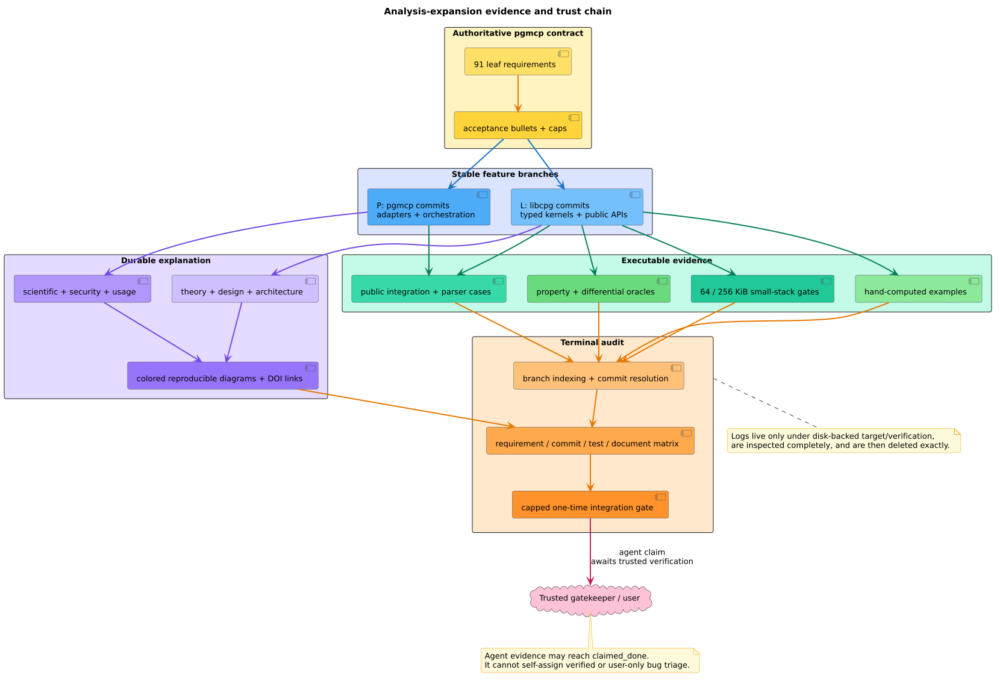

# Analysis-expansion terminal evidence ledger

This ledger maps every leaf of pgmcp epic `libcpg-ax-epic` to the stable
implementation commits, executable validation family, and durable
documentation that satisfy its contract. The authoritative requirement text
remains in pgmcp; this file supplies the cross-repository audit path required
by terminal task `libcpg-ax-t5-4`.

A **leaf** is a tracker item without descendants. An **evidence bundle** is the
named set of example-based tests, property/differential tests, public
integration tests, small-native-stack regressions, and documentation for one
analysis family. Repository key `L` means libcpg
`feature/libcpg-ax-epic`; `P` means pgmcp
`feature/libcpg-ax-epic`.

## Trust and interpretation

A stable commit plus passing agent-run tests supports **claimed completion**.
It does not create trusted verification. pgmcp deliberately reserves bug
triage for the user and reserves `verified` for trusted evidence. The nine
stack-safety bug leaves below therefore retain their live tracker
`triage` state even though their root-cause repairs, exact commits, deep
small-stack tests, and documents are present. The terminal gate must not erase
that distinction.

The matrix is complete over 91 leaves:

- 81 ordinary implementation leaves are `claimed_done`, including all eight
  frontier-track leaves;
- nine high-severity stack-safety bug leaves have complete implementation
  evidence and await user triage;
- `libcpg-ax-t5-4` is the self-referential terminal leaf whose own commit and
  final gate results must be recorded in pgmcp after they exist.

Commit links are explicit rather than inferred from subjects. The tracker
progress ledger retains the exact commands, property counts, small-stack sizes,
caps, diagram hashes, and non-code criteria. The bundle column below makes the
test and document side of every row explicit without duplicating those
scientific records.

## Leaf requirement matrix

| Leaf | Requirement | Stable evidence commits | Test/document bundle |
|---|---|---|---|
| `libcpg-ax-tree-sitter-builder-stack-machine` | Flatten tree-sitter CPG construction into an explicit traversal machine | L:`f984f55` | [STACK-BUILDER](#stack-builder) |
| `libcpg-ax-property-value-stack-safe-codec` | Replace recursive PropertyValue Serde with a flat PDA codec | L:`1132111` P:`52d0f83` | [STACK-PROPERTY](#stack-property) |
| `libcpg-ax-expression-facts-flat-arena` | Flatten recursive ExprKey and expression-fact lifecycle into an arena | L:`bd4bd34` | [STACK-EXPR](#stack-expr) |
| `libcpg-ax-effects-stack-machine` | Flatten effect dependency and constant evaluation into explicit stack machines | L:`3bf6d56` | [STACK-EFFECTS](#stack-effects) |
| `libcpg-ax-tp0-1` | T‑P0.1 — petgraph 0.6→0.7 bump (isolated PR) | L:`2da9457` | [SE-0](#se-0) |
| `libcpg-ax-tp1-1` | T‑P1.1 — GraphProjection dense-CSR substrate + AnalysisError + scc-helper promotion | L:`f97f82f` | [SE-0](#se-0) |
| `libcpg-ax-tp1-2` | T‑P1.2 — unified dominators/post-dominators + PdgBuilder refactor (shape-equivalence-critical) | L:`b58637f` | [SE-0](#se-0) |
| `libcpg-ax-tp2-1` | T‑P2.1 — C1 call-target resolution + scope symbol table + ADR-044 evidence boundary (THE GATE) | L:`10c1455` | [SE-0](#se-0) |
| `libcpg-ax-t1-1` | T1.1 — cfg_scope::FunctionCfgView shared CFG projection | L:`b7140dd` | [SE-1](#se-1) |
| `libcpg-ax-t1-2` | T1.2 — A2 natural loops + nesting forest + emit reserved CfgEdgeKind::LoopExit | L:`56a951a` | [SE-1](#se-1) |
| `libcpg-ax-t1-3` | T1.3 — A3 unreachable-code / dead-branch detection | L:`0385eba` | [SE-1](#se-1) |
| `libcpg-ax-t1-4` | T1.4 — A4 basic-block CFG projection | L:`d0f1268` | [SE-1](#se-1) |
| `libcpg-ax-t1-5` | T1.5 — B1 monotone dataflow framework (Lattice + worklist solver — KEYSTONE) | L:`68db76e` | [SE-1](#se-1) |
| `libcpg-ax-t1-6` | T1.6 — B2 liveness analysis → dead-store detection + bench | L:`8e2fb0d` | [SE-1](#se-1) |
| `libcpg-ax-t1-7` | T1.7 — B3 available / very-busy expressions (CSE/PRE candidates) | L:`d3ec7e7` | [SE-1](#se-1) |
| `libcpg-ax-t1-8` | T1.8 — B4 sparse conditional constant propagation (SCCP) | L:`8935733` | [SE-1](#se-1) |
| `libcpg-ax-t1-9` | T1.9 — B5 value-range / interval analysis (abstract interpretation) | L:`a00c9fb` | [SE-1](#se-1) |
| `libcpg-ax-t1-10` | T1.10 — B8 loop-invariant + induction-variable detection | L:`c54497f` | [SE-1](#se-1) |
| `libcpg-ax-t1-11` | T1.11 — B10 loop-bound complexity-evidence upgrade to ComplexityAnalyzer | L:`e198069` | [SE-1](#se-1) |
| `libcpg-ax-t2-1` | T2.1 — centrality family (D1–D9) + D20 dominators-over-projection + bench | L:`5c296d4` | [SE-2](#se-2) |
| `libcpg-ax-t2-2` | T2.2 — community detection (D10 Louvain + Leiden refinement, add multi-level) | L:`6760798` | [SE-2](#se-2) |
| `libcpg-ax-t2-3` | T2.3 — cohesion suite (D11 k-core, D12 k-truss, D13 articulation/bridges/2ecc, D14 min-cut, D21, D22) | L:`9ca8722` | [SE-2](#se-2) |
| `libcpg-ax-t2-4` | T2.4 — spectral analysis (D15 algebraic connectivity + Fiedler) | L:`5a1d033` | [SE-2](#se-2) |
| `libcpg-ax-t2-5` | T2.5 — Weisfeiler–Lehman structural clone classes (D16) | L:`1f9470d` | [SE-2](#se-2) |
| `libcpg-ax-t2-6` | T2.6 — bounded simple-cycle enumeration (D17) | L:`087a8bf` | [SE-2](#se-2) |
| `libcpg-ax-t2-7` | T2.7 — motif / graphlet census (D18, full 16-class fix) | L:`b0233a6` | [SE-2](#se-2) |
| `libcpg-ax-t2-8` | T2.8 — condensation-DAG analytics (D19: critical path, width, Coffman–Graham) | L:`c306302` | [SE-2](#se-2) |
| `libcpg-ax-t2-9` | T2.9 — true graph-edit-distance bound (D23) + SimilarityMetric::GraphEdit swap | L:`9f6a611` | [SE-2](#se-2) |
| `libcpg-ax-t2-10` | T2.10 — Martin package metrics (Ca/Ce/I/A/D) + SDP violations (E1) | L:`7be383c` | [SE-2](#se-2) |
| `libcpg-ax-t2-11` | T2.11 — DSM propagation cost + core-periphery (E2) | L:`1f9470d` L:`5e9e5ac` | [SE-2](#se-2) |
| `libcpg-ax-t2-12` | T2.12 — reflexion-model conformance (E3) | L:`bfd8c28` | [SE-2](#se-2) |
| `libcpg-ax-t2-13` | T2.13 — layering inference (E4) | L:`6a099ec` | [SE-2](#se-2) |
| `libcpg-ax-t2-14` | T2.14 — architecture smells (E5, Arcan family) | L:`847bb1d` | [SE-2](#se-2) |
| `libcpg-ax-t2-15` | T2.15 — builder change: emit DfgEdgeKind::FieldWrite/IndexWrite + member→Field Reference (E6 prereq) | L:`2b8a290` | [SE-2](#se-2) |
| `libcpg-ax-t2-16` | T2.16 — OO/complexity metrics engine (E6: CK, LCOM1–5, Halstead, cognitive, MI) | L:`492a0bf` | [SE-2](#se-2) |
| `libcpg-ax-t2-17` | T2.17 — clone-detection pass (E8: Type-1/2/3/4) | L:`dd14189` | [SE-2](#se-2) |
| `libcpg-ax-t3-1` | T3.1 — C2 multi-file CPG merge + import graph | L:`80a2f2e` | [SE-3](#se-3) |
| `libcpg-ax-t3-2` | T3.2 — C4 IFDS/IDE framework (KEYSTONE; ports taint_interproc.rs) | L:`cf4172b` | [SE-3](#se-3) |
| `libcpg-ax-t3-3` | T3.3 — taint / security track (flagship IFDS instantiation; advisory) | L:`2031003` | [SE-3](#se-3) |
| `libcpg-ax-t3-4` | T3.4 — C3 System Dependence Graph + interprocedural slicing | L:`d07cb25` | [SE-3](#se-3) |
| `libcpg-ax-t3-5` | T3.5 — C5 interprocedural constant/effect propagation | L:`182834e` | [SE-3](#se-3) |
| `libcpg-ax-t3-6` | T3.6 — F1/F4 channel topology + linearity (concurrency core) | L:`062d028` | [SE-3](#se-3) |
| `libcpg-ax-t3-7` | T3.7 — F3 communication-deadlock candidates | L:`b4ecf80` | [SE-3](#se-3) |
| `libcpg-ax-t3-8` | T3.8 — F2 may-happen-in-parallel | L:`bf3139c` | [SE-3](#se-3) |
| `libcpg-ax-t3-9` | T3.9 — F5 session-protocol conformance sketches (cfg rholang) | L:`cdc1f4e` | [SE-3](#se-3) |
| `libcpg-ax-t6-1` | T6.1 — I1 typestate / property-FSM engine (keystone for I2/J2) | L:`ee0781f` L:`1f101a0` | [SE-6](#se-6) |
| `libcpg-ax-t6-2` | T6.2 — I2 resource-leak + I4 uninitialized-use + I10 exception-flow | L:`3306f42` L:`8487e49` L:`cbe047f` L:`a2ee282` L:`0220285` L:`1f101a0` | [SE-6](#se-6) |
| `libcpg-ax-t6-3` | T6.3 — I6 missing-check (Chucky) + I7 deviant-behavior | L:`6663df2` L:`66b5291` L:`3010796` L:`7cb640c` L:`0220285` | [SE-6](#se-6) |
| `libcpg-ax-t6-4` | T6.4 — I8 inconsistent-clone bugs + I9 infeasible-path/contradiction | L:`2fe2e04` L:`65c702d` L:`37403cf` L:`474d10e` L:`7cb640c` | [SE-6](#se-6) |
| `libcpg-ax-t4-0` | T4.0 — M0: pgmcp libcpg_adapter.rs + bump path dep + adapter test | P:`f84cf3b` | [SE-4](#se-4) |
| `libcpg-ax-t6-5` | T6.5 — I12 API-usage-graph mining + temporal-property checks | L:`a8fdc85` L:`e7795ee` L:`a957780` L:`474d10e` | [SE-6](#se-6) |
| `libcpg-ax-t4-1` | T4.1 — M1: bit-identical / order-only algorithm swaps | P:`1ef92e1` P:`4bdc47b` P:`6fb14fb` P:`64360ab` P:`3f13562` P:`5ebdc39` P:`cefce31` P:`4b7611d` P:`b11cfdf` P:`45d5994` | [SE-4](#se-4) |
| `libcpg-ax-t4-2` | T4.2 — M2: float-tolerance algorithm swaps + re-baseline file_metrics | P:`9ec010f` P:`a560f8c` P:`8cf4df2` P:`6c3c529` P:`3c50d0f` P:`053c20d` P:`ea7cb87` P:`b2f8564` P:`dc5e4e0` | [SE-4](#se-4) |
| `libcpg-ax-t7-1` | T7.1 — J1 CWE query-template library (defensive) | L:`0648679` L:`9c27c65` L:`7b9586c` L:`a957780` | [SE-7](#se-7) |
| `libcpg-ax-t4-3` | T4.3 — M3: semantic-delta swaps + re-baseline (Louvain, k-truss, cycles, motif) | P:`22362d5` P:`749ff82` L:`28212ac` P:`4cc5394` P:`6cb59f6` | [SE-4](#se-4) |
| `libcpg-ax-t7-2` | T7.2 — J2 cryptographic API misuse (CrySL-style typestate) | L:`c8145fc` L:`d6573a9` L:`a755abd` L:`f813591` L:`7b9586c` | [SE-7](#se-7) |
| `libcpg-ax-t4-4` | T4.4 — M4: parallel Brandes on exported kernel + delete CompactGraph | P:`145eb6f` | [SE-4](#se-4) |
| `libcpg-ax-t7-3` | T7.3 — J3 secret/credential flow + J4 missing authN/authZ | L:`9842b01` L:`0e9eb6e` L:`eb6a5b1` L:`6b64980` | [SE-7](#se-7) |
| `libcpg-ax-t4-5` | T4.5 — M5: delete emptied pgmcp modules; thin delegators | P:`e46d01d` | [SE-4](#se-4) |
| `libcpg-ax-t7-4` | T7.4 — J5 vulnerability extrapolation | L:`8433d28` L:`4f2eefc` L:`9e86d2c` L:`75097c5` L:`6b64980` | [SE-7](#se-7) |
| `libcpg-ax-t4-6` | T4.6 — M6: live-CPG LCOM4/clone tooling + port taint_interproc.rs call sites | L:`1a6b70d` L:`2352775` L:`7fe28c2` P:`43ca2bf` P:`4030368` P:`44f3560` | [SE-4](#se-4) |
| `libcpg-ax-t8-1` | T8.1 — K5 devirtualization (CHA/RTA/VTA) | L:`f34eecc` L:`83daaf1` L:`80c86aa` L:`5f520b3` L:`75097c5` | [SE-8](#se-8) |
| `libcpg-ax-t8-2` | T8.2 — F6 static data-race + F7 atomicity/order violations | L:`b6b2eba` L:`1b58c3e` | [SE-8](#se-8) |
| `libcpg-ax-t8-3` | T8.3 — G6 AST-path + G8 line-level GNN feature/slice export | L:`5cd9eb0` L:`a91e8c8` | [SE-8](#se-8) |
| `libcpg-ax-t8-4` | T8.4 — M1 CPG structural diff + change classification | L:`2f61874` L:`8eef8fa` | [SE-8](#se-8) |
| `libcpg-ax-t9-0` | T9.0 — Phase 0: baseline + profile FIRST (NO source changes) | L:`22f3c72` L:`621bbd5` L:`70763cd` | [SE-9](#se-9) |
| `libcpg-ax-t5-2` | T5.2 — benchmark activation + verification substrate (pre-optimization) | L:`bbe963a` | [SE-5](#se-5) |
| `libcpg-ax-t5-1` | T5.1 — libcpg ADRs 0006/0007/0008 + theory-chapter updates | L:`ec96c5f` P:`676a37f` | [SE-5](#se-5) |
| `libcpg-ax-ft-1` | FT.1 — Datalog EDB export + Soufflé query surface (highest leverage-per-line) | L:`abf6a66` L:`48601ee` | [FT-1](#ft-1) |
| `libcpg-ax-ft-2` | FT.2 — PDG-based IFC / non-interference + constant-time checker | L:`b1026d9` L:`f513774` L:`262240b` L:`cc95974` | [FT-2](#ft-2) |
| `libcpg-ax-ft-3` | FT.3 — abstract-interpretation domain framework (octagon + polyhedra + reduced product) | L:`af34ac2` L:`4cf7916` L:`682e003` L:`4c36d57` | [FT-3](#ft-3) |
| `libcpg-ax-ft-4` | FT.4 — separation-logic bi-abduction memory-safety (Infer-style) | L:`ac525cb` L:`d5cddd2` L:`e150bd2` L:`3258dea` L:`68930c8` | [FT-4](#ft-4) |
| `libcpg-ax-ft-5` | FT.5 — ρ-calculus deadlock/lock-freedom (Kobayashi) + NameFlow overlay | L:`424708f` L:`c7a82bd` L:`67daa43` L:`89ec147` | [FT-5](#ft-5) |
| `libcpg-ax-ft-6` | FT.6 — MeTTa dependency-pair termination + critical-pair confluence | L:`81d84ef` L:`8504800` L:`b7cda9e` | [FT-6](#ft-6) |
| `libcpg-ax-ft-7` | FT.7 — Ownership / Place-Capability Graph overlay (Rust) | L:`1179a7b` L:`c6dcf40` L:`0e530b4` L:`67f8197` | [FT-7](#ft-7) |
| `libcpg-ax-ft-8` | FT.8 — heterogeneous-GNN typed export + directed-fuzzing Distance export | L:`e7a9f52` L:`f83d102` | [FT-8](#ft-8) |
| `libcpg-ax-t5-4` | T5.4 — Final campaign integration, evidence audit, and one-time verification | recorded after the terminal evidence commit | [TERMINAL](#terminal) |
| `libcpg-ax-cfg-extractor-stack-machine` | Flatten the recursive CFG extractor SCC | L:`6d55d4a` | [STACK-CFG](#stack-cfg) |
| `libcpg-ax-dfg-reach-stack-machine` | Flatten the recursive DFG reaching-definition walk | L:`6bde0bd` | [STACK-DFG](#stack-dfg) |
| `libcpg-ax-induction-expression-stack-machine` | Flatten induction expression evaluators | L:`56dbb44` | [STACK-INDUCTION](#stack-induction) |
| `libcpg-ax-vf2-stack-machine` | Flatten VF2 backtracking and canonicalize search order | L:`e3c0b98` | [STACK-VF2](#stack-vf2) |
| `libcpg-ax-ast-depth-stack-machine` | Flatten CodePropertyGraph AST-depth evaluation | L:`f05e711` | [STACK-AST-DEPTH](#stack-ast-depth) |
| `libcpg-ax-t9-2-h07` | H07 — Lazy deterministic exact-edge projection cache | L:`783eb18` | [SE-9](#se-9) |
| `libcpg-ax-t9-2-h08` | H08 — Stack-safe deterministic VF2 search optimization | L:`f251bff` | [SE-9](#se-9) |
| `libcpg-ax-t9-2-h09` | H09 — Stack-safe CHK dominators and PDG optimization | L:`082884d` | [SE-9](#se-9) |
| `libcpg-ax-t9-3-h10` | H10 — Deterministic stack-safe parallel analysis | L:`5197ca1` | [SE-9](#se-9) |
| `libcpg-ax-t9-3-h11` | H11 — Measured string interning and hash selection | L:`ab6556a` L:`5197ca1` | [SE-9](#se-9) |
| `libcpg-ax-t9-4-h13` | H13 — Sound content-keyed incremental function analysis | L:`5a81e29` | [SE-9](#se-9) |
| `libcpg-ax-t9-3-h12` | H12 — Deterministic WL hashing and buffer reuse | L:`089aeb3` | [SE-9](#se-9) |
| `libcpg-ax-t9-4-h14a` | H14A — Portable measured BitSetDomain SIMD | L:`e477b7b` L:`02aac83` | [SE-9](#se-9) |
| `libcpg-ax-t9-4-h14b` | H14B — Exact bounded resolver symbol index evaluation | L:`3ec72bf` L:`c28fae6` L:`8b8c42a` | [SE-9](#se-9) |

## Evidence bundles

Every bundle names executable tests first and the semantic/security/usage
documents second. The detailed example, property-case count, oracle, cap, and
small-stack results remain in the linked scientific reports and in the
append-only tracker progress ledger.

### STACK-BUILDER

Tests: `src/builder/tree_sitter.rs` unit/property oracles and
`tests/tree_sitter_stack_safety.rs`, including the public 100,000-depth and
50,000-width 256 KiB-stack cases. Direct raw-parent context is formally checked
and removes depth-dependent tree-sitter parent reconstruction without changing
the effective CPG parent (`79882fb`, `c8dfcb0`). Documents:
[builder API](../api/builder-reference.md),
[testing](02-testing.md), and
[parent-context formal plan](../verification/tree-parent-context-formal-plan.md).

### STACK-PROPERTY

Tests: `src/graph/property_value.rs` example/property/corruption matrix and
`tests/property_value_stack_safety.rs`, including the 100,000-level lifecycle,
codec, Serde, and drop gate. Documents:
[ADR-0040](../design/0040-flat-property-value-arena.md),
[Scientific 35](../scientific/35-property-value-validation.md),
[serialization usage](../usage/05-serialization.md), and
[input hardening](../security/01-input-and-resource-hardening.md).

### STACK-EXPR

Tests: `src/analysis/dataflow/expr_key.rs`,
`src/analysis/dataflow/facts.rs`, and the public data-flow integrations,
including canonical CEK1 corruption/cap properties and 100,000-level
construction/query/Serde/drop on 256 KiB. Documents:
[ADR-0041](../design/0041-shared-flat-expression-facts.md),
[Scientific 36](../scientific/36-expression-fact-arena-validation.md),
[expression analysis](../components/graph/expression-analysis.md), and
[serialization usage](../usage/05-serialization.md).

### STACK-EFFECTS

Tests: `src/analysis/effects/tests.rs` and
`tests/effects_integration.rs`, including bounded recursive differential
oracles, six property campaigns, wide joins, exact cap behavior, and
100,000-level 256 KiB-stack execution. Documents:
[effect summaries](../components/graph/effect-summaries.md),
[Scientific 28](../scientific/28-effect-summary-validation.md),
[effect usage](../usage/09-effect-summaries.md), and
[input hardening](../security/01-input-and-resource-hardening.md).

### STACK-CFG

Tests: CFG builder unit/property fixtures and the parser-backed public
100,000-depth 256 KiB-stack gate. Documents:
[ADR-0042](../design/0042-stack-safe-cfg-extraction.md),
[Scientific 37](../scientific/37-cfg-extraction-machine-validation.md),
[CFG builder](../components/builder/cfg.md), and [testing](02-testing.md).

### STACK-DFG

Tests: `src/builder/dfg.rs` bounded-recursive differential properties and
`tests/dfg_reaching_stack_safety.rs`, including malformed cycles, wide flow,
and public 100,000-depth execution on 256 KiB. Documents:
[ADR-0003](../design/0003-ast-ordered-reaching-defs.md),
[Scientific 02](../scientific/02-reaching-defs-validation.md),
[DFG builder](../components/builder/dfg.md), and [testing](02-testing.md).

### STACK-INDUCTION

Tests: `src/analysis/induction/tests.rs` and
`tests/induction_integration.rs`, including recursive-oracle properties,
overflow/cycle examples, and public 100,000-unary-operator execution on
256 KiB. Documents:
[ADR-0012](../design/0012-dfg-backed-loop-induction-evidence.md),
[Scientific 07](../scientific/07-induction-analysis-validation.md),
[induction analysis](../components/graph/induction-analysis.md), and
[testing](02-testing.md).

### STACK-VF2

Tests: `src/pattern/vf2.rs` example/property/differential suites and
`tests/vf2_stack_safety.rs`, including deterministic cap prefixes and a public
100,000-node match on 256 KiB. Documents:
[ADR-0004](../design/0004-relaxed-vf2-detection.md),
[ADR-0057](../design/0057-dense-stack-safe-vf2-state.md),
[Scientific 03](../scientific/03-vf2-completeness.md),
[Scientific 52](../scientific/52-dense-vf2-validation.md), and
[VF2 matching](../components/patterns/vf2-matching.md).

### STACK-AST-DEPTH

Tests: `src/graph/cpg.rs` example/property/differential cases and its public
100,000-node 256 KiB-stack case. Documents:
[graph API](../api/graph-reference.md),
[testing](02-testing.md), and
[input hardening](../security/01-input-and-resource-hardening.md).

### SE-0

Tests: projection, SCC, dominator/post-dominator, parser-shape, and call-target
resolution suites catalogued in [testing](02-testing.md). Documents:
[projections](../components/graph/projections.md),
[SCC](../components/graph/scc-analysis.md),
[dominators](../components/graph/dominator-analysis.md),
[call resolution](../components/graph/call-resolution.md), and
[Scientific 01](../scientific/01-cpg-invariants-and-equivalence.md).

### SE-1

Tests: function-CFG, loop, reachability, block, lattice/data-flow, liveness,
expression, SCCP, interval, induction, and complexity suites catalogued in
[testing](02-testing.md). Documents:
[graph components](../components/graph/overview.md),
[data-flow architecture](../architecture/data-flow.md), and
[Scientific 05–08](../scientific/00-overview.md).

### SE-2

Tests: centrality, community, cohesion, spectral, WL, cycle, motif,
condensation, graph-edit, architecture, member-flow, metric, and clone suites
catalogued in [testing](02-testing.md). Documents:
[graph components](../components/graph/overview.md),
[pattern components](../components/patterns/overview.md), and
[Scientific 09–25](../scientific/00-overview.md).

### SE-3

Tests: program composition, IFDS/IDE, taint, SDG slicing, effects, channel,
deadlock, MHP, and session suites catalogued in [testing](02-testing.md).
Documents: [data-flow architecture](../architecture/data-flow.md),
[Scientific 26–34](../scientific/00-overview.md), and
[security analyses](../security/00-threat-model.md).

### SE-4

Tests: pgmcp adapter, graph delegation, cache, live analysis, exact-order,
float-tolerance, semantic-delta, parallel Brandes, LCOM, clone, and taint
integration/property suites on the pgmcp feature branch. Documents:
`pgmcp/docs/quality/live-cpg-analysis.md`,
`pgmcp/docs/design/stack-safe-pushdown-flattening.md`, and libcpg's
[ownership matrix](analysis-expansion-matrix.md).

### SE-5

Tests: strict default/all-feature rustdoc and doctests; offline links/fragments;
DOI syntax/resolution; twice-rendered byte-identical PlantUML; documentation
structure, math, and source-policy checks. Documents:
[testing](02-testing.md), [performance](03-performance.md),
[diagram catalog](../diagrams/README.md), and this ledger.

### SE-6

Tests: typestate, resource, initialization, exception, anomaly, clone
inconsistency, feasibility, API-usage, and temporal-property suites catalogued
in [testing](02-testing.md). Documents:
[Scientific 38–42](../scientific/00-overview.md),
[security 08–12](../security/08-typestate-analysis.md), and
[usage 16–20](../usage/16-typestate-analysis.md).

### SE-7

Tests: CWE, cryptographic misuse, secret/access policy, and vulnerability
extrapolation example/property/integration suites catalogued in
[testing](02-testing.md). Documents:
[Scientific 43–46](../scientific/00-overview.md),
[security 13–16](../security/13-cwe-template-analysis.md), and
[usage 21–24](../usage/21-cwe-template-analysis.md).

### SE-8

Tests: devirtualization, concurrency bugs, homogeneous ML export, AST paths,
line slices, and structural diff example/property/integration suites catalogued
in [testing](02-testing.md). Documents:
[Scientific 47–50](../scientific/00-overview.md),
[security 17–20](../security/17-type-refinement-boundary.md), and
[usage 25–28](../usage/25-virtual-call-type-refinement.md).

### SE-9

Tests: deterministic benchmark oracles, baseline/profile ledger, dense
projection/VF2/dominator equivalence, parallel determinism, string/WL
experiments, incremental cache, portable SIMD, and indexed resolver suites.
Documents: [performance](03-performance.md),
[optimization ledger](optimization-ledger.md), and
[Scientific 51–59](../scientific/00-overview.md).

### FT-1

Tests: canonical EDB example/property/round-trip/integration suites.
Documents: [Datalog export](../components/graph/datalog-export.md),
[Scientific 60](../scientific/60-datalog-export-validation.md),
[security boundary](../security/23-datalog-export-boundary.md), and
[usage](../usage/33-datalog-export.md).

### FT-2

Tests: PDG/SDG IFC example/property/witness/parser/small-stack suites.
Documents: [IFC](../components/graph/information-flow-control.md),
[Scientific 61](../scientific/61-pdg-information-flow-validation.md),
[security boundary](../security/24-pdg-information-flow-boundary.md), and
[usage](../usage/34-pdg-information-flow.md).

### FT-3

Tests: interval/octagon/polyhedra/reduced-product exact and generated oracles.
Documents:
[relational domains](../components/graph/relational-abstract-domains.md),
[Scientific 62](../scientific/62-relational-abstract-domain-validation.md),
[security boundary](../security/25-relational-abstract-domain-boundary.md), and
[usage](../usage/35-relational-abstract-domains.md).

### FT-4

Tests: separation-logic heap/witness/summary/parser/property/small-stack suites.
Documents:
[heap analysis](../components/graph/compositional-heap-analysis.md),
[Scientific 63](../scientific/63-compositional-heap-validation.md),
[security boundary](../security/26-compositional-heap-boundary.md), and
[usage](../usage/36-compositional-heap-analysis.md).

### FT-5

Tests: Rholang NameFlow, level, deadlock, lock-freedom, overlay, property,
parser, and small-stack suites. Documents:
[NameFlow](../components/graph/rholang-name-flow.md),
[Scientific 64](../scientific/64-rholang-name-flow-validation.md),
[security boundary](../security/27-rholang-name-flow-boundary.md), and
[usage](../usage/37-rholang-name-flow-deadlock.md).

### FT-6

Tests: MeTTa dependency-pair, SCC, reduction-pair, critical-pair, overlay,
dictionary, property, parser, and small-stack suites. Documents:
[rewrite analysis](../components/graph/metta-rewriting-analysis.md),
[Scientific 65](../scientific/65-metta-rewriting-validation.md),
[security boundary](../security/28-metta-rewriting-boundary.md), and
[usage](../usage/38-metta-rewriting-analysis.md).

### FT-7

Tests: Rust place normalization, ownership reconstruction, advisory checker,
overlay, property, parser, Serde, and 100,000-depth 64 KiB-stack suites.
Documents:
[place capabilities](../components/graph/place-capability-analysis.md),
[Scientific 66](../scientific/66-place-capability-validation.md),
[security boundary](../security/29-place-capability-boundary.md), and
[usage](../usage/39-place-capability-analysis.md).

### FT-8

Tests: heterogeneous relation/node-feature and directed-distance
example/property/parser/Serde suites, including 100,000 nodes on a 64 KiB
stack. Documents:
[heterogeneous export](../components/graph/heterogeneous-export-and-distance.md),
[Scientific 67](../scientific/67-heterogeneous-export-distance-validation.md),
[security boundary](../security/30-heterogeneous-export-and-distance-boundary.md),
and [usage](../usage/40-heterogeneous-export-and-fuzzing-distance.md).

### TERMINAL

Tests: capped libcpg formatting, default, `full rholang metta`,
`--all-features`, examples, strict all-target Clippy, strict rustdoc,
documentation/link/DOI/diagram reproducibility, property and small-stack
regressions, clean-tree checks, plus pgmcp integration and its one permitted
full `./scripts/verify.sh`/bug gate. Documents: this terminal ledger,
[analysis-expansion matrix](analysis-expansion-matrix.md), and pgmcp's
`docs/quality/live-cpg-analysis.md`.
