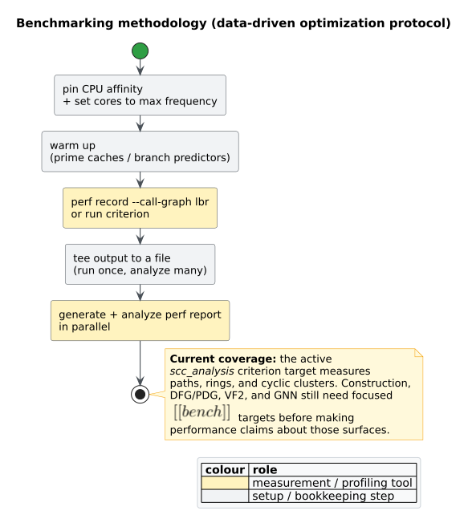

# Measurement methodology

`libcpg` ships thirty-three runnable Criterion targets. Their baseline groups are
feature-free; the `induction_analysis` target also registers an
`algorithm-detection`-gated complexity-evidence group. Each active group
asserts a deterministic correctness oracle **before** entering the timed loop.
Timing therefore measures an already-validated operation; a faster but
incorrect implementation fails before it can produce a result.

This page states the experimental protocol, the exact benchmark inventory, and
the scope of the evidence. It follows the central lesson of rigorous
benchmarking: environmental and layout effects can change a result even when
the source transformation under study does not [[1]](#references).



*Figure — the end-to-end measurement pipeline. Source:
[`diagrams/measurement-methodology.puml`](../diagrams/measurement-methodology.puml).*

## 1. Current evidence

All thirty-three targets use `harness = false`, which hands execution to Criterion
rather than Rust's test harness:

```toml
[dev-dependencies]
criterion = "0.5"

[[bench]]
name = "scc_analysis"
harness = false

[[bench]]
name = "condensation"
harness = false

[[bench]]
name = "cpg_construction"
harness = false

[[bench]]
name = "pattern_matching"
harness = false

[[bench]]
name = "dataflow_liveness"
harness = false

[[bench]]
name = "bitset_domain"
harness = false

[[bench]]
name = "induction_analysis"
harness = false

[[bench]]
name = "dsm"
harness = false

[[bench]]
name = "wl"
harness = false

[[bench]]
name = "centrality"
harness = false

[[bench]]
name = "community"
harness = false

[[bench]]
name = "cohesion"
harness = false

[[bench]]
name = "spectral"
harness = false

[[bench]]
name = "cycles"
harness = false

[[bench]]
name = "motifs"
harness = false

[[bench]]
name = "ged"
harness = false

[[bench]]
name = "clones"
harness = false

[[bench]]
name = "advisory_bugs"
harness = false

[[bench]]
name = "api_usage_mining"
harness = false

[[bench]]
name = "program_merge"
harness = false

[[bench]]
name = "ifds_summaries"
harness = false

[[bench]]
name = "ifds_taint"
harness = false
```

| Target | Public operation | Families and sizes | Pre-timing oracle |
|---|---|---|---|
| `scc_analysis` | `call_graph_sccs` | function paths, rings, and cyclic clusters at 1,000 and 10,000 nodes | exact component partition, cycle flags, and condensation edges |
| `condensation` | `condensation_metrics` with and without `coffman_graham` | component paths and eight independent chains at 1,024 and 8,192 components | exact source levels, weighted critical path, height, width, optional CG coverage, width, and downward precedence |
| `cpg_construction` | graph-arena construction | paths at 1,000 and 10,000 nodes | exact node/edge counts and identifiers |
| `pattern_matching` | bounded `Vf2Matcher::find_matches` | paths at 256 and 4,096 nodes | exact bounded embedding set |
| `parallel_analysis` | serial/parallel CFG, DFG, and PDG construction; serial/parallel ordered VF2 batches | 512 functions with 16 definition/use pairs each and 128 repeated patterns; worker counts 1/2/4/8/16/32 on 256 KiB stacks | exact edge-stream and match-sequence equality with the serial oracle before every worker-count timing |
| `dataflow_liveness` | `liveness` | chains at 512/4,096 nodes, diamond ladders at 64/512 rungs, nested loops at 128/1,024 nodes | exact per-node equality with an independent round-robin solver |
| `bitset_domain` | `BitSetDomain::{join, intersect_with, leq}` | 17 bit widths from 0 through 65,536, including 511/512/513 and 767/768/769 crossover triplets | exact full/striped union and intersection values plus true-subset control before timing |
| `induction_analysis` | `loop_induction` | single counted loops with 64/512/2,048 invariant definitions | exact IV, bound, intended-invariant, DFG-contract, subset, and non-mutation checks |
| `induction_analysis` with `algorithm-detection` | `ComplexityAnalyzer::estimate_time_complexity_with_evidence` | the same single counted loops at 64/512/2,048 invariant definitions | exact class/confidence, header/comparison/bound provenance, IV name, and non-mutation checks |
| `dsm` | `analyze_dsm`, `classify_core_periphery` | directed paths and rings at 256 and 1,024 vertices | exact visibility vectors, propagation cost, roles, completion, and cyclic core |
| `wl` | `wl_labels`, `structural_clone_classes` | four-round directed rings and outward stars at 1,024 and 8,192 vertices | exact label symmetry/distinction and exact ordered clone membership |
| `centrality` | PageRank, eigenvector, Brandes, and closeness | paths, rings, and clustered projections at 256/1,024 vertices for iterative kernels and 128/256 vertices for all-sources kernels | alignment, convergence/mass or finiteness/normalization, shape symmetry/order, canonical edge output, bridge maximality, and auxiliary HITS/harmonic/Burt checks |
| `community` | `louvain`, `try_refine_connected` | rings of eight-vertex cliques at 256/1,024 vertices; disconnected eight-vertex paths at 512/2,048 vertices | exact repeatability, canonical labels, positive independently recomputed modularity, expected component count, and independent induced-connectivity traversal |
| `cohesion` | core, truss, cut structure, two-edge components, minimum cut, assortativity, attack simulation | ring lattices at 1,024/8,192; clique chains at 512/2,048; weighted seams at 64/128; stars at 1,024/8,192, including truss under degree skew | exact repeatability plus analytic core, truss, bridge, component, cut-weight, endpoint-correlation, and fragmentation invariants |
| `spectral` | `try_algebraic_connectivity` | stars at 1,024/8,192 vertices, complete bipartite graphs at 64/128 vertices, and disconnected star pairs at 1,024/8,192 total vertices | closed-form connectivity, convergence/residual, alignment, sign, partition, exact disconnected certificate, and repeatability |
| `cycles` | `simple_cycles` | acyclic paths at 1,024/8,192 vertices, disjoint triangles at 1,023/8,190 vertices, and complete digraphs at 8/10 vertices | exact counts, edge closure, canonical starts, repeatability, caps, and first omitted witness |
| `motifs` | `motif_census` | paths and out-stars at 24/50 vertices; complete bidirected graphs at 16/30 vertices | exact class/graphlet binomial counts, conservation, and repeatability |
| `ged` | `ged_upper_bound` | identical paths, relabeled isolates, and retyped paths at 16/48 vertices | exact edit costs $`0`$, $`n`$, and $`n-1`$, uncapped result |
| `clones` | `detect_clones` | dense Type-1 equality, Type-3 insertion, and Type-4 reordering corpora at 16/64 functions | exact class taxonomy, complete membership, and similarity score |
| `advisory_bugs` | `analyze_inconsistent_clones` / `analyze_infeasible_paths` | Type-2 guard-divergence and contradictory-condition corpora at 8/32 functions | complete reports, nonempty typed clone findings, and exactly one contradiction per feasibility function |
| `api_usage_mining` | `analyze_api_usage_mining` | exact 19/20 release populations at 20/100 peers | complete report plus exactly one missing-following-call and one non-accepting temporal exit per twenty peers |
| `cwe_templates` | `analyze_builtin_cwes` | ten-template registry over 20/100 independent request-to-SQL endpoints | complete report plus exactly one CWE-89 candidate per endpoint and no cross-template candidates |
| `program_merge` | `merge_programs`, `build_import_graph` | 16/64 files with 16 statement nodes per file; represented import chains | summed counts, contiguous identities, embedded-reference totality, file scopes, exact resolutions, and dependency counts |
| `ifds_summaries` | `solve_summaries` | acyclic and recursive call graphs at 256/1,024 functions | exact first-function transitive closure, complete reports, and nonempty per-function summaries |
| `ifds_taint` | `analyze_taint_report` | call-graph paths, rings, and cyclic clusters at 32/128 workers | exact source-to-sink pair, valid witness endpoints, and complete reports before timing; SCC construction remains outside the timed closure |

The evidence is deliberately local: a result for one named family, size,
machine, toolchain, and environment is not a universal speed claim. DFG/PDG
construction and whole-corpus analysis have focused targets; GNN propagation
remains unbenchmarked.
Automated correctness tests do not assert elapsed time because wall-clock
thresholds are unstable across hosts.

## 2. Falsifiable optimization loop

Every optimization follows this literate procedure:

```text
control_environment()
fixture := build_outside_timed_loop()
expected := independent_oracle(fixture)
assert public_operation(fixture) = expected

baseline := measure_once_and_capture(fixture)
profile  := analyze_captured_baseline(baseline)
hypothesis := name_bottleneck_and_expected_complexity_change(profile)
candidate := implement_one_change(hypothesis)
assert public_operation(fixture) = expected
result := measure_once_and_capture(candidate)

keep candidate only if result supports hypothesis and all correctness gates pass
```

This separates four claims that are easy to conflate:

1. the fixture represents the named workload;
2. the implementation returns the correct result;
3. the measurement environment is controlled; and
4. the candidate changes the predicted cost.

## 3. Control the environment

Frequency scaling, scheduler migration, competing work, toolchain drift, and
thermal state all confound comparisons. `scripts/bench.sh` checks or records
the CPU governor, pins one CPU with `taskset`, runs the selected target, and
tees Criterion output to one timestamped log:

```sh
./scripts/bench.sh dataflow_liveness
./scripts/bench.sh dataflow_liveness --save-baseline before
./scripts/bench.sh dataflow_liveness --baseline before
./scripts/bench.sh bitset_domain --save-baseline scalar
./scripts/bench.sh bitset_domain --baseline scalar
./scripts/bench.sh condensation --save-baseline before
./scripts/bench.sh induction_analysis --save-baseline before
./scripts/bench.sh centrality --save-baseline before
./scripts/bench.sh community --save-baseline before
./scripts/bench.sh clones --save-baseline before
cargo bench --bench api_usage_mining --no-default-features
./scripts/bench.sh program_merge --save-baseline before
./scripts/bench.sh ifds_taint --save-baseline before
cargo bench --no-default-features --features algorithm-detection \
  --bench induction_analysis -- --test
```

For a reportable campaign, record:

- exact commit and dirty-tree state;
- `rustc --version --verbose` and Criterion version;
- CPU model, microcode, kernel, governor, pinned CPU, and simultaneous
  multithreading state;
- fixture family, size, seed, sample count, warm-up, and measurement duration;
- the single captured log and any profile derived from it.

Use a quiet or isolated core where practical. Keep the governor, affinity,
fixture, toolchain, and Criterion configuration identical across the
before/after pair. Georges, Buytaert, and Eeckhout explain why repeated
measurements and statistically principled summaries are necessary for managed
and noisy systems [[2]](#references); Criterion supplies warm-up, sampling,
outlier reporting, and baseline comparison for this Rust implementation.

## 4. Harness anatomy

The measured closure contains only the public operation. Fixture construction
and the oracle remain outside it, while `black_box` prevents the compiler from
eliding the result:

```rust
use criterion::{black_box, Criterion};
use libcpg::{liveness, CodePropertyGraph, LivenessResult, NodeId};

fn register(
    c: &mut Criterion,
    cpg: &CodePropertyGraph,
    function: NodeId,
    expected: &LivenessResult,
) {
    assert_eq!(&liveness(cpg, function).expect("liveness"), expected);

    c.bench_function("shape/size", |b| {
        b.iter(|| {
            black_box(
                liveness(black_box(cpg), black_box(function))
                    .expect("liveness during benchmark"),
            )
        });
    });
}
```

The caller supplies `expected` from a separate node-level Gauss–Seidel
round-robin implementation. Its scheduling and state representation differ
from the production block worklist, so exact agreement is meaningful
differential evidence.

## 5. Controlled liveness finding

On 2026-08-10, a diagnostic run pinned the liveness target to CPU 2 under the
`performance` governor. The initial node-state materializer invoked a
boundary-to-node replay independently for every node in a long basic block.
For the 4,096-node chain, Criterion measured about 445 ms.

If a block contains $`N`$ nodes and a state occupies $`W`$ machine words,
replaying prefixes separately performs

```math
W \sum_{i=1}^{N} i = W\frac{N(N+1)}{2} = O(N^2W)
```

state work. The profile and scaling therefore supported the hypothesis that
replay, not fixed-point convergence, was the bottleneck. One reverse pass per
block reduced the materialization term to $`O(NW)`$. In the same harness and
environment, the 4,096-node chain measured about 4.80 ms—approximately 92.6
times the throughput.

This is evidence for the stated algorithmic diagnosis on that controlled
fixture. It is not a claim that every program, graph shape, or machine improves
by the same factor.

## 6. Profile and analyze without re-measuring

Capture once and derive multiple views from the capture. Re-running to read a
different column creates a new experiment with new confounders.

```sh
taskset -c 2 perf record --call-graph lbr -- \
  target/release/deps/dataflow_liveness-<hash> --bench --profile-time 10
perf report --stdio
```

Choose the profiler by question:

- `perf record --call-graph lbr` attributes CPU samples to call paths;
- `valgrind --tool=massif` measures heap growth;
- an allocation profiler tests cloning or reservation hypotheses; and
- eBPF on/off-CPU tools distinguish computation from blocking when parallel
  execution is introduced.

Report generation and reading may proceed in parallel with unrelated work, but
measurements sharing the controlled core remain serialized.

## 7. Expected scaling and next measurements

Symbols are defined before use: $`V`$ is graph vertices, $`E`$ is graph edges,
$`C`$ is condensation components, $`M`$ is their total SCC members,
$`N`$ is reachable CFG nodes, $`B`$ is basic blocks, $`E_b`$ is block edges,
$`F`$ is variable facts, $`W = \lceil F/64 \rceil`$ is words per bit state,
$`H \le F`$ is lattice height, $`T`$ is CPG nodes, $`K`$ is module names, and
$`d`$ is embedding dimension.

| Operation | Analytical expectation | Evidence state |
|---|---|---|
| SCC decomposition | $`O(V + E)`$ after normalization | active path/ring/cluster target |
| condensation metrics | $`O(M + E\log E + (C+E)\log C)`$; CG comparison is worst-case $`O(C^2\log C)`$ | active path/eight-chain target with and without CG |
| CPG arena construction | $`O(V + E)`$ insertion work | active path target |
| bounded VF2 | factorial worst case; pruning-dependent [[3]](#references) | active bounded path target |
| variable liveness | $`O(H(B + E_b)W + NW)`$ conventional bound | active chain/diamond/nested-loop target |
| dense bit-set union/intersection/subset | $`O(W)`$ word work; retained AVX2 changes the constant for union/intersection at $`W\ge8`$ | active 17-width primitive target plus liveness end-to-end control |
| taint summaries | $`O(W+I(N_f+E_f)D_f\log D_f)`$ within shared/domain caps | active path/ring/clustered call-graph target |
| DSM visibility / classification | $`O(V(V+E))`$ visibility plus SCC and median classification | active path/ring target |
| Martin package metrics / SDP | $`O(E\log V+T\log K)`$ metrics plus $`O(E\log K)`$ SDP aggregation | benchmark deliberately deferred; exact oracle/property/integration validation is active |
| Reflexion-model conformance | $`O(RHP+R\log R+A\log A)`$ for observations, layers/prefixes, and allowed pairs | benchmark deliberately deferred; exact oracle/property/integration validation is active |
| Architectural layering | $`O(M+C+E\log E)`$ for SCC membership, components, and condensation edges | benchmark deliberately deferred; exact oracle/property/integration validation is active |
| Architectural smells | $`O((V+E)\log(V+K)+R\log R\cdot L)`$ including validation, SCC recomputation, one-pass detector evidence, and canonical output ordering | benchmark deliberately deferred; four exact oracles, a 256-case determinism property, hostile boundaries, and public integration are active |
| projection WL labels / clones | $`O(q(V\log V+E+\sum_v d(v)\log d(v)))`$ for $`q\le16`$, plus clone sorting | active four-round ring/star target |
| multi-level Louvain | $`O(h[p(V+E\log V)+E\log E])`$ for $`p\le50`$ and $`h\le10`$ | active ring-of-cliques target |
| connected-community refinement | $`O(V+E)`$ after validation | active disconnected-path target |
| k-core | $`O(V+E)`$ | active ring-lattice target |
| k-truss | $`O(E^{3/2})`$ simple-graph neighborhood work | active clique-chain target |
| cut structure / two-edge components | $`O(V+E)`$ | active clique-chain target |
| global minimum cut | $`O(V^3)`$ time and $`O(V^2)`$ space | active weighted-seam target |
| assortativity | $`O(V+E)`$ | active star target |
| attack simulation | $`O(s(V+E))`$ for $`s\le10{,}000`$ | active center-first star target |
| algebraic connectivity | $`O(sc(V+E))`$ for at most eight starts and 1,000 iterations | active star/complete-bipartite/disconnected target |
| bounded simple cycles | output-sensitive exponential worst case after linear SCC preprocessing | active acyclic/triangle/dense target with explicit output cap |
| directed motif census | $`O(V^3+V^4)`$ within 512/50-node family caps | active path/out-star/bidirected-clique target |
| bipartite GED upper bound | $`O(N^3+E_1+E_2)`$ for $`N=V_1+V_2`$ | active identical/relabel/retype target within 512 nodes per input |
| function clone detection | $`O(P+q(V+E)+I\cdot\operatorname{VF2})`$ for $`P`$ size-qualified pairs, $`q`$ WL rounds, and $`I`$ bounded verifier calls | active equality/insertion/reordering target with 16/64 functions |
| inconsistent-clone advisories | $`O(P(A_LA_R+G))`$ inside pair/tape/alignment/GED caps | active Type-2 guard-divergence target with 8/32 functions |
| infeasible-path advisories | per-function SCCP + intervals + bounded condition-arena state/step work | active contradictory-condition target with 8/32 functions |
| serial/parallel CFG/DFG/PDG construction and ordered VF2 batches | analysis-specific plan/emission work; parallel scaling is bounded by serial emission and scheduling overhead | active exact-oracle 1/2/4/8/16/32-worker target |
| GNN propagation | $`O(\text{layers}\cdot(V+E)\cdot d)`$ | benchmark gap |

Scaling that departs materially from the expected class is itself a finding and
must be investigated before reporting a constant-factor comparison.

## 8. Reproduction gate

Before accepting a performance change:

1. run the target's independent oracle;
2. capture a same-environment before/after Criterion pair;
3. run the complete example, property, integration, and robustness suites;
4. run strict formatting, lint, rustdoc, documentation-link, and diagram gates;
5. retain the experimental record while reviewing it, then remove disposable
   temporary logs when the work item is complete.

See [Engineering performance](../engineering/03-performance.md) for data
structures and active commands, [Testing](../engineering/02-testing.md) for the
correctness matrix, and [Variable liveness and dead
stores](../components/graph/liveness-analysis.md) for the analyzed transfer
function and oracle.

## References

1. Mytkowicz, T., Diwan, A., Hauswirth, M., Sweeney, P. F. (2009). *Producing
   Wrong Data Without Doing Anything Obviously Wrong!* ASPLOS. DOI:
   [10.1145/1508244.1508275](https://doi.org/10.1145/1508244.1508275)
2. Georges, A., Buytaert, D., Eeckhout, L. (2007). *Statistically Rigorous Java
   Performance Evaluation.* OOPSLA. DOI:
   [10.1145/1297027.1297033](https://doi.org/10.1145/1297027.1297033)
3. Cordella, L. P., Foggia, P., Sansone, C., Vento, M. (2004). *A (Sub)graph
   Isomorphism Algorithm for Matching Large Graphs.* IEEE TPAMI 26(10). DOI:
   [10.1109/TPAMI.2004.75](https://doi.org/10.1109/TPAMI.2004.75)
