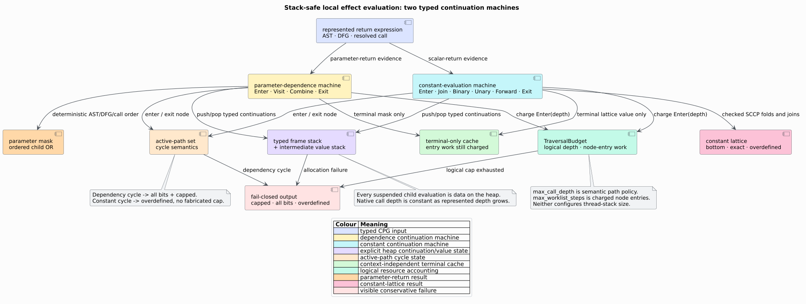

# Scientific validation 28 — Interprocedural effect summaries

This page states the falsifiable claims behind `analysis::effects` and the
experiments that test them. A passing test is evidence for the named claim, not
a claim about source semantics absent from the CPG.



## Hypotheses and oracles

| Hypothesis | Discriminating experiment | Oracle |
|---|---|---|
| A leaf with no observable write is pure | literal-return leaf | exact empty place sets and `Pure` |
| Typed access evidence is preserved | global read/write, parameter write, field read/write | exact `BTreeSet<Place>` |
| Parameter effects compose through calls | callee writes `Param(0)`, caller passes global | caller must write that global |
| Purity is transitive | caller reaches throwing or unresolved callee | exact `Impure` result |
| Constant returns compose | local checked binary expression and returned call | exact `ConstValue` |
| Disagreement is irreversible | two distinct return literals, then another join | flat-lattice overdefined state |
| Recursive summaries terminate | mutual call SCC | complete bounded fixed point |
| Caps remain visible | zero shared work and zero domain depth | exact cap evidence and incomplete result |
| Input values are trusted only after validation | wrong SCC projection | ordered issue, no evaluation, no mutation |
| Serialization preserves evidence | serde JSON round trip | structural equality |
| Explicit machines preserve the recursive specification | generated shallow unary/binary/definition expressions | exact dependence, constant, work, and cap equality with a test-only bounded recursive oracle |
| Caching is semantically invisible | one shared terminal used twice | cached and uncached values, work, and cap evidence are equal; only cache-hit telemetry differs |
| Local caps are monotone and exact | generated low/high caps plus hand-computed exact boundaries | a complete low-cap value stays equal at higher caps; exact cap passes and one-smaller cap widens |
| Def-use insertion order is irrelevant | generated reaching-definition joins in forward and reverse order | complete `EffectAnalysis` values are equal |
| Source depth does not consume native stack | 100,000 unary nodes on a 256 KiB thread stack | public analysis completes with the parameter bit and no domain cap |
| Frontier width does not consume native stack | 10,000 reaching definitions in both edge orders | exact constant join and identical summaries |

## Generated experiments

One `proptest!` block contains six 256-case campaigns:

1. independently generated summary coordinates satisfy commutativity,
   associativity, idempotence, and upper-bound subsumption;
2. generated directed call graphs through six functions compare transitive
   purity with an independent depth-first reachability oracle, then reverse
   call insertion and require the entire `EffectAnalysis` to remain equal;
3. generated recursive rings verify that raising the SCC-iteration cap cannot
   invalidate a result already established complete;
4. generated shallow unary/binary trees ending in a literal or parameter
   compare both production machines with retained test-only recursive
   specifications, including exact work and cap accounting;
5. generated logical-depth and work limits prove that raising local machine
   caps cannot invalidate a complete result; and
6. generated reaching-definition value sets produce identical complete joins
   when their edges are inserted in reverse order.

The graph oracle does not invoke the production summary solver. It computes
the reachable function set directly and classifies a caller `Impure` exactly
when that set contains a planted direct impure operation.

## Public integration boundary

`tests/effects_integration.rs` imports only crate-root exports. One test checks
the completeness-preserving `analyze_effects` and map-only
`effect_summaries` paths on a constant leaf. The second constructs a callee
parameter write and proves public call-argument remapping reaches a caller
global. The third runs a 100,000-level expression whose leaf reaches a formal
parameter through `call_graph_sccs` and `analyze_effects` on a 256 KiB thread
stack. Its anti-vacuity oracle requires a complete result, exactly parameter
bit zero, an overdefined constant, and no domain cap.

## Coverage matrix

| Dimension | Evidence |
|---|---|
| normal | pure leaf, constants, transitive calls |
| boundary | no return, 65 parameters, recursive SCC |
| malformed | stale/wrong SCC projection, graph non-mutation |
| capped | shared scheduler work, local expression depth |
| stack-safe | 100,000-deep public expression on 256 KiB; 10,000-definition join |
| algebraic | product lattice and cap-monotonicity properties |
| oracle | both flat machines equal bounded recursive specifications |
| deterministic | full output equality under reversed call and def-use insertion |
| integration | three feature-free crate-root tests |
| serialization | one serde-gated round trip |

The focused feature-free module has 20 tests; the Serde matrix has 21. Six
properties each execute 256 generated cases. The 100,000-level public gate
completed in 1.43 seconds in the debug profile on the recorded development
host; this is a regression datum, not a portable benchmark claim.

## Machine-state and failure oracle

The test-only recursive evaluators are intentionally bounded and shallow. They
retain the pre-flattening equations but are never used by the library. For each
generated fixture, the oracle compares this tuple exactly:

```math
(M, C, W_M, K_M, W_C, K_C),
```

where $`M`$ is the parameter mask, $`C`$ the constant lattice value, each
$`W`$ the charged node-entry count, and each $`K`$ the cap flag. Equality of
only final values would miss order/accounting regressions.

Cycle examples distinguish the two intended conservative outcomes: a
dependency cycle yields every bit and sets the cap, whereas a constant cycle
yields overdefined without fabricating a cap event. Missing nodes, transitive
formal definitions, variable initializers, resolved/external calls, and exact
depth/work boundaries exercise the remaining enter/exit paths. Required
machine-state allocation failure has no deterministic exhaustion harness; its
branch is simple and shares the same fail-closed values asserted by the cap
tests. Optional cache reservation failure simply takes the separately tested
uncached path.

## Limitations and future falsifiers

- Alias and heap effects are only as precise as represented DFG/reference
  evidence. Future points-to analysis should add cross-check fixtures.
- The constant evaluator covers the scalar SCCP vocabulary; aggregate constants
  intentionally remain overdefined.
- A 64-bit parameter-return mask exposes, rather than hides, wider signatures.
- `effect_summaries` omits completeness metadata by design; verdict-making code
  must test `EffectAnalysis::is_complete()`.
- A future T3.3 taint instantiation should test that effect-derived external
  refinement never removes a flow when effect evidence is incomplete.

## Reproduction

```sh
cargo test --no-default-features analysis::effects::tests
cargo test --no-default-features --test effects_integration
cargo test --no-default-features --features serde analysis::effects::tests
cargo test --test effects_integration \
  public_effect_evaluators_handle_depth_100_000_on_a_small_stack -- --exact
cargo clippy --lib --tests --features serde -- -D warnings
RUSTDOCFLAGS='-D warnings' cargo doc --no-deps --features serde
```

## References

1. Reps, Horwitz, Sagiv (1995), DOI
   [10.1145/199448.199462](https://doi.org/10.1145/199448.199462).
2. Wegman, Zadeck (1991), DOI
   [10.1145/103135.103136](https://doi.org/10.1145/103135.103136).
3. Reynolds, J. C. (1972). *Definitional Interpreters for Higher-Order
   Programming Languages.* DOI:
   [10.1145/800194.805852](https://doi.org/10.1145/800194.805852).
