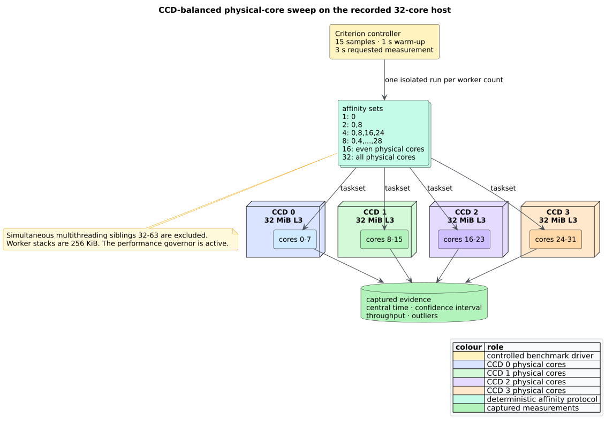

# Scientific validation 54 — Deterministic parallel analysis

## Claims under test

The H10 hypothesis is that independent per-function control-flow graph (CFG),
data-flow graph (DFG), and program-dependence graph (PDG) planning—and
independent per-pattern VF2 matching—can use Rayon workers while preserving the
exact serial result. The experiment tests six claims:

1. every worker count produces the same ordered graph or match batch as serial
   execution;
2. planning reads one immutable Code Property Graph (CPG) and does not clone or
   lock it;
3. CFG, DFG, and PDG throughput improves on a many-function workload;
4. ordered VF2 batches improve when a batch contains sufficient independent
   patterns;
5. parallel wrappers preserve the existing heap-machine stack bound; and
6. resource costs and scaling limits are measured rather than hidden.

The experiment does **not** claim that every input benefits. A one-function
file exposes no function-level parallelism, tiny batches may not amortize
scheduler overhead, and ordered emission remains serial.

## Experimental design

The deterministic fixture contains 512 functions. Each function has one flat
block with 16 variable-definition/use pairs: 17,408 nodes total before CFG/DFG
enrichment. Criterion excludes fixture cloning from the timed interval, checks
the complete ordered edge oracle before sampling, warms each case for one
second, requests three seconds of measurement, and collects 15 samples. The
host is the documented AMD Ryzen Threadripper PRO 5975WX: 32 physical Zen 3
cores arranged in four core-complex dies (CCDs), each with 32 MiB L3 cache. The
performance governor was active.

Each worker count ran in a separate process. `taskset` excluded simultaneous
multithreading siblings and balanced physical cores across CCDs:

| Workers | Affinity set |
|---:|---|
| 1 | `0` |
| 2 | `0,8` |
| 4 | `0,8,16,24` |
| 8 | `0,4,8,12,16,20,24,28` |
| 16 | even physical cores `0` through `30` |
| 32 | physical cores `0-31` |

*Figure — controlled affinity protocol. Source:
[`diagrams/parallel-affinity-sweep.puml`](../diagrams/parallel-affinity-sweep.puml).*

All Rayon pools used 256 KiB worker stacks. The benchmark target is
`benches/parallel_analysis.rs`; the reproducible profiling workloads are
`parallel_analysis_serial` and `parallel_analysis_parallel` in
`benches/profile_workloads.rs`. General measurement rules are in
[scientific validation 04](04-measurement-methodology.md).

## Pipeline scaling result

The timed pipeline performs CFG extraction, DFG extraction, and all-function
PDG construction. “Speedup” is $`S_p=T_s/T_p`$, where $`T_s`$ is the serial
central estimate and $`T_p`$ is the estimate for $`p`$ Rayon workers.
“Efficiency” is $`E_p=S_p/p`$.

| Execution | Criterion time | Throughput | Speedup | Efficiency |
|---|---:|---:|---:|---:|
| serial | 144.27 ms | 120.66 Knode/s | 1.00× | 100.0% |
| 1 worker | 144.78 ms | 120.23 Knode/s | 1.00× | 99.7% |
| 2 workers | 77.87 ms | 223.56 Knode/s | 1.85× | 92.6% |
| 4 workers | 46.43 ms | 374.97 Knode/s | 3.11× | 77.7% |
| 8 workers | 27.63 ms | 629.95 Knode/s | 5.22× | 65.3% |
| 16 workers | 19.00 ms | 916.42 Knode/s | 7.59× | 47.5% |
| 32 workers | 12.35 ms | 1.4094 Mnode/s | 11.68× | 36.5% |

The 95% Criterion intervals were 144.09–144.44 ms for serial and
12.127–12.595 ms for 32 workers; they do not overlap. One worker is 0.4% slower
than serial, quantifying the dispatch cost that motivates opt-in configuration.
Efficiency falls with worker count because ordered emission, uneven
per-function work, cache coherence, and scheduling remain. The 32-worker case
still improves central time by 91.4% on this fixture.

## Ordered VF2 batch scaling

The VF2 experiment matches an ordered batch of 128 strict, capped patterns
against the enriched target. Every case returns the same pattern order,
embedding order, and mapping sequence.

| Execution | Criterion time | Pattern throughput | Speedup |
|---|---:|---:|---:|
| serial | 1.1150 ms | 114.80 Kpattern/s | 1.00× |
| 1 worker | 1.1070 ms | 115.63 Kpattern/s | 1.01× |
| 2 workers | 593.36 µs | 215.72 Kpattern/s | 1.88× |
| 4 workers | 408.83 µs | 313.09 Kpattern/s | 2.73× |
| 8 workers | 265.20 µs | 482.66 Kpattern/s | 4.20× |
| 16 workers | 199.97 µs | 640.11 Kpattern/s | 5.58× |
| 32 workers | 178.71 µs | 716.23 Kpattern/s | 6.24× |

The batch continues improving through 32 workers on this run, but its marginal
gain falls from 1.88× at two workers to 6.24× at 32. The caller therefore still
owns the pool choice: a different batch size, pattern cost, or co-tenant load
can move the useful worker-count boundary.

## Root-cause experiment: fair serial PDG construction

The first attempted sweep measured 767.59 ms for serial and 143.76 ms for a
single Rayon worker. This impossible “parallel” gain at one worker falsified the
comparison. Inspection found that `PdgBuilder::build_all` called
`PdgBuilder::build` once per function; each call rescanned the complete graph to
snapshot existing PDG edges. The parallel path planned all functions and took
one snapshot.

The root fix made serial `build_all` collect plans and share the same one-
snapshot ordered emitter. The invalid Criterion baselines were deleted and the
sweep restarted. The final corrected 144.27 ms serial versus 144.78 ms one-worker
result isolates concurrency rather than an algorithm mismatch. No special-case
shortcut or benchmark-only path was retained.

## Headless allocation, memory, and counter profile

`scripts/profile.sh` captured each workload once and derived `/usr/bin/time`,
`perf stat -r 3`, DWARF call-graph, DHAT, and Massif views without opening a GUI.
Serial was pinned to CPU 0; parallel used 32 workers on CPUs 0–31. The profile
includes one template construction and graph clone, so its wall-time speedup is
smaller than Criterion's analysis-only result.

| Measure | Serial | 32 workers | Change |
|---|---:|---:|---:|
| elapsed time | 159.92 ms | 32.32 ms | -79.8% (4.95×) |
| maximum resident set size | 15,448 KiB | 15,096 KiB | -2.3% |
| DHAT total allocated bytes | 49,646,322 | 49,959,334 | +0.63% |
| DHAT allocation blocks | 278,622 | 279,242 | +0.22% |
| DHAT peak live bytes | 16,351,200 | 16,598,538 | +1.51% |
| cycles | 649,218,066 | 832,000,785 | +28.2% |
| retired instructions | 2,405,389,367 | 2,500,570,692 | +4.0% |
| cache references | 118,010,044 | 118,275,487 | +0.22% |
| cache misses | 4,728,346 | 5,823,634 | +23.2% |
| page faults | 3,530 | 4,167 | +18.0% |
| dTLB loads | 1,339,665 | 1,496,614 | +11.7% |
| dTLB load misses | 34,949 | 281,325 | +705% |

The dTLB-miss estimate has high run-to-run variation (26.96% serial and 42.83%
parallel) and is secondary evidence, not a precise causal estimate. More total
cycles with much lower wall time is expected parallel work: the host spends
more aggregate CPU to shorten the critical path.

Massif ran with `--pages-as-heap=yes`. Under Valgrind, the 32 worker threads
reserve approximately 2.16 GiB of virtual mappings through `pthread_create`, so
its 2.03 GiB chart peak is not a resident-heap measurement. The 15,096 KiB RSS
and 16.60 MB DHAT live-heap peak establish the physical/allocator boundary.
This distinction prevents a virtual stack reservation from being mislabeled as
resident memory. Intel VTune's command-line collectors were unavailable because
host `ptrace_scope` denied collection; no heaptrack or GUI process was started.

The sampled parallel hot paths remain substantive work: exact-edge projection
rows, function CFG scope, DFG planning, graph projection, and PDG planning.
Rayon cold waiting accounts for 1.73% of samples. No lock or graph-clone hot path
appears.

## Semantic, property, and integration oracles

Four independent 128-case properties compare serial and parallel output:

- generated multi-function CFGs vary every extractor configuration bit and
  require identical edge, entry, and exit sequences;
- generated DFG fixtures vary field, parameter, return, and alias settings and
  require the complete edge stream to match;
- generated CFG/DFG graphs require serial and parallel all-function PDGs to
  match exactly; and
- generated VF2 batches vary size, strictness, and caps and require identical
  ordered mapping sequences.

The public integration target repeats CFG/DFG/PDG and VF2 comparisons at
1/2/4/8/16/32 workers. Under the `serde` feature it also requires
`serde_json::to_vec` of the complete graphs to be byte-identical. A parser-backed
Rust example compares `CpgBuilderConfig::with_parallel_analysis(true)` with the
serial builder on 128 branch-bearing functions.

## Stack-safety experiment

A public integration test builds one function with an AST chain of depth
100,000. A four-worker Rayon pool with 256 KiB stacks runs parallel CFG, DFG,
and PDG construction and verifies all 100,001 CFG edges plus the function entry.
The test completes without mapping input depth to native call frames. Existing
CFG, DFG, dominator, and VF2 continuation machines remain heap-resident; H10
adds only dispatch and owned-plan vectors around them.

## Feature and gate matrix

| Command family | Evidence |
|---|---|
| `cargo test --lib --all-features prop_parallel_` | 512 generated differential cases across CFG, DFG, PDG, and VF2 |
| `cargo test --all-features --test parallel_analysis_integration` | all worker counts, parser configuration, exact serde bytes, and depth 100,000 |
| `cargo bench --bench parallel_analysis` | checked pipeline and VF2 1/2/4/8/16/32 sweep |
| `scripts/profile.sh parallel_analysis_{serial,parallel}` | headless time, RSS, counters, call graph, DHAT, and Massif |
| `cargo clippy --all-targets --all-features -- -D warnings` | warning-free complete target surface |
| `./scripts/verify.sh` | format, feature matrices, tests, examples, rustdoc, docs, diagrams, and diff hygiene |

## Falsification boundaries

The exactness proof and tests assume each plan reads only evidence that exists
before the phase. A future analyzer that consumes another function's newly
emitted same-phase edge must either restore a dependency order or define a
different fixed point; placing it in this parallel map without proving
independence would be unsound. The benchmarks establish scaling on one
many-function and one pattern-batch shape, not on all source distributions.
Ordered emission and memory bandwidth bound eventual speedup. Applications
must bound untrusted function/pattern counts and select a pool appropriate to
their resource budget.

## References

1. Blumofe, R. D., and Leiserson, C. E. (1999). *Scheduling Multithreaded
   Computations by Work Stealing.* Journal of the ACM 46(5), 720–748. DOI:
   [10.1145/324133.324234](https://doi.org/10.1145/324133.324234).
2. Amdahl, G. M. (1967). *Validity of the Single Processor Approach to Achieving
   Large Scale Computing Capabilities.* AFIPS Conference Proceedings. DOI:
   [10.1145/1465482.1465560](https://doi.org/10.1145/1465482.1465560).
3. Cordella, L. P., Foggia, P., Sansone, C., and Vento, M. (2004). *A (Sub)Graph
   Isomorphism Algorithm for Matching Large Graphs.* IEEE TPAMI 26(10),
   1367–1372. DOI:
   [10.1109/TPAMI.2004.75](https://doi.org/10.1109/TPAMI.2004.75).
