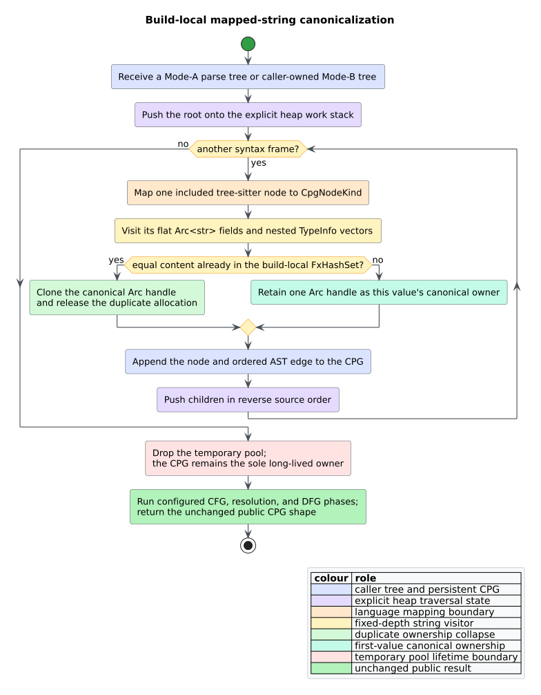

# Scientific validation 55 — Build-local mapped-string storage

## Claims under test

H11 tests whether equal strings produced by one tree-sitter CPG build can share
one `Arc<str>` allocation without changing public semantics. An **allocation**
is identified here by `Arc::as_ptr`; an **occurrence** is one string-bearing
field. The experiment tests seven claims:

1. real source graphs contain enough repeated mapped text to justify
   canonicalization;
2. one build retains exactly one allocation per distinct mapped value;
3. string contents, Unicode, large strings, cloning, node/edge order, debug
   data, and Serde bytes remain unchanged;
4. canonicalization reduces live ownership without a parser-time regression;
5. `FxHash` is preferable to `AHash` for both string and integer-key cases;
6. graph/source depth does not increase native call-stack use; and
7. no global interner, lock, leaked lifetime, or hidden cross-graph ownership is
   required.

The experiment does not claim that every workload has the same duplication
ratio, that total allocation traffic vanishes, or that two separately built or
deserialized graphs share pointers.

## Experimental design

The inventory parses three committed Rust modules with
`TreeSitterCpgBuilder`: `src/builder/node_mapper.rs`, `src/graph/node.rs`, and
`src/analysis/scc.rs`. All three graphs remain alive while the probe records
content, occurrence count, byte length, and distinct `Arc` data pointers for
every string-bearing node kind, method signature, type, optional text, and
allocation type.

For a content value $`v`$, let $`a_v`$ be its distinct allocation count and
$`|v|`$ its UTF-8 byte length. Reported reclaimable payload is:

```math
R=\sum_v |v|(a_v-1)
```

This deliberately excludes allocator metadata and the `Arc` strong/weak-count
header, so it understates total retained-memory savings. The probe is an
experiment artifact and is removed from the committed product after its result
is recorded here.

Timing uses Criterion 0.5.1 with 20 samples, a one-second warm-up, three-second
measurement, the `performance` governor, and affinity to CPUs 0–1 on the
documented AMD Ryzen Threadripper PRO 5975WX host. Headless profiles execute ten
repetitions through the same pre/post `profile_workloads` binary under
`/usr/bin/time -v`, `perf stat -r 3`, DHAT, and Massif. All artifacts live under
`target/verification`; no heaptrack, GUI, or `/tmp` build path is used. General
interpretation rules are in [scientific validation 04](04-measurement-methodology.md).



*Figure — measured ownership boundary. Source:
[`diagrams/build-local-string-pool.puml`](../diagrams/build-local-string-pool.puml).*

## Retained-allocation result

Before H11, every occurrence had a separate allocation. After H11, each
individual graph has exactly one allocation per distinct content. The aggregate
still has 416 duplicate allocations because three intentionally isolated pools
may contain the same spelling.

| Corpus | Nodes | Occurrences | Distinct values | Allocations before | Allocations after | Payload before | Payload after |
|---|---:|---:|---:|---:|---:|---:|---:|
| `node_mapper.rs` | 19,691 | 17,827 | 1,210 | 17,827 | 1,210 | 189,456 B | 24,477 B |
| `node.rs` | 7,240 | 6,817 | 579 | 6,817 | 579 | 67,713 B | 7,499 B |
| `scc.rs` | 4,379 | 3,866 | 437 | 3,866 | 437 | 38,751 B | 5,791 B |
| all three alive | 31,310 | 28,510 | 1,810 | 28,510 | 2,226 | 295,920 B | 37,767 B |

The aggregate reduction is 26,284 retained allocations (92.2%) and 258,153
payload bytes (87.2%). Per-file duplicate allocations fall to zero. The
aggregate result proves pool isolation rather than a leak across builds.

## Controlled construction timing

The linear graph constructor does not call the parser pool and serves as a
control. The “change” column is Criterion's central bootstrap estimate against
the saved committed-H10 baseline.

| Case | Before H11 | H11 | Central time change |
|---|---:|---:|---:|
| linear AST, 1,000 nodes | 53.878 µs | 54.382 µs | +1.23% |
| linear AST, 10,000 nodes | 638.69 µs | 638.01 µs | +0.03% (no change detected) |
| parser Rust, 49 lines | 334.22 µs | 326.98 µs | -1.85% |
| parser Rust, 514 lines | 6.0021 ms | 5.9759 ms | -0.39% |

Both parser intervals improve despite the extra hash lookup. The 1,000-node
non-parser control moved 1.23%; because it executes none of the new code, that
movement is treated as environmental noise rather than an H11 cost.

## Hasher comparison

The temporary Criterion experiment models the observed 28,510/1,810
occurrence/unique ratio and separately inserts then reads 100,000 mixed `u32`
keys. Each group uses 30 samples, one second of warm-up, and four seconds of
measurement on CPUs 0–1.

| Key workload | `FxHash` | `AHash` | Fx advantage |
|---|---:|---:|---:|
| repeated `Arc<str>` set | 266.76 µs | 309.83 µs | 13.9% |
| 100,000-key `u32` map | 1.7035 ms | 2.0340 ms | 16.2% |

`FxHash` wins both relevant key classes, so H11 retains `rustc-hash`, removes
the unused `ahash` dependency, and removes the temporary benchmark. The result
does not claim collision resistance; `FxHash` remains suitable only behind the
documented input-size boundary.

## Headless live-memory and allocation profile

DHAT **total** bytes/blocks count all allocation traffic during ten repetitions.
DHAT **peak** values count simultaneously live ownership. The mapper still
creates each candidate `Arc` before a duplicate is released, so total traffic is
expected to stay nearly flat while the live set shrinks.

| Workload / measure | Before H11 | H11 | Change |
|---|---:|---:|---:|
| construction DHAT total bytes | 31,295,497 | 31,470,176 | +0.56% |
| construction DHAT total blocks | 168,216 | 168,296 | +0.05% |
| construction DHAT peak bytes | 1,445,764 | 1,392,604 | -3.68% |
| construction DHAT peak blocks | 6,569 | 4,832 | -26.44% |
| construction RSS | 24,948 KiB | 24,464 KiB | -1.94% |
| construction Massif page peak | 11,804,672 B | 11,673,600 B | -1.11% |
| whole-corpus DHAT total bytes | 503,160,665 | 504,120,104 | +0.19% |
| whole-corpus DHAT total blocks | 2,814,086 | 2,814,466 | +0.01% |
| whole-corpus DHAT peak bytes | 16,944,079 | 16,447,263 | -2.93% |
| whole-corpus DHAT peak blocks | 79,253 | 62,636 | -20.97% |
| whole-corpus RSS | 25,200 KiB | 24,612 KiB | -2.33% |
| whole-corpus Massif page peak | 30,945,280 B | 30,035,968 B | -2.94% |

This is the intended signature: materially fewer live blocks and lower live
bytes/RSS, with almost unchanged aggregate allocation traffic. Every process
ends with the same 696 bytes in two runtime blocks.

## Hardware-counter controls

The three-run perf counter comparison is secondary evidence because the
workloads are short and some event variation is large.

| Workload / measure | Before H11 | H11 | Change |
|---|---:|---:|---:|
| construction cycles | 257,165,997 | 262,977,649 | +2.26% |
| construction instructions | 577,476,714 | 570,136,832 | -1.27% |
| construction cache misses | 596,825 | 534,159 | -10.50% |
| construction page faults | 704 | 696 | -1.14% |
| construction elapsed | 64.221 ms | 65.014 ms | +1.24% |
| whole-corpus cycles | 4,294,930,246 | 4,302,124,594 | +0.17% |
| whole-corpus instructions | 9,593,082,228 | 9,585,140,609 | -0.08% |
| whole-corpus cache misses | 20,618,565 | 20,662,229 | +0.21% |
| whole-corpus page faults | 5,032 | 5,536 | +10.02% |
| whole-corpus elapsed | 1.02513 s | 1.02707 s | +0.19% |

Construction cache misses had 16.10% variation after H11, and data-TLB miss
variation reached 40.06%; neither is used causally. The longer Criterion
parser runs are the timing decision boundary. They show improvement while the
complete allocator profiles establish the live-memory result.

## Semantic, property, integration, and stack oracles

The private pool tests run 256 generated sequences of arbitrary Rust `String`
values. They require equal contents to share a pointer, unequal contents to
remain byte-exact, and input order/content to survive. Focused examples cover:

- Unicode across a variable name, type, generic, node text, and allocation type;
- 32 copies of a 229,376-byte UTF-8 string without truncation;
- public Rust parsing with one Unicode spelling across declarations, types, and
  identifiers;
- graph clone ownership and content equality;
- exact Serde bytes across independent builds and a clone, plus semantic
  round-trip equality; and
- Mode-A/Mode-B generated equivalence already exercised by 64 parser properties.

The existing public parser gate builds source depth 100,000 on a 256 KiB native
stack, constructs the complete CFG, checks parent/edge invariants, and now also
requires all 100,000 `parenthesized_expression` labels to share one allocation.
The fixed-depth visitor adds no recursive call edge. The separate deep-and-wide
unit gate covers depth 100,000 and width 50,000 under the same stack budget.

## Dependency and lifecycle audit

Repository-wide source search found no production use of `ahash` or
`string_cache`; removing them deletes 55 lockfile lines and their now-unneeded
transitive packages. Source inspection of `string_cache` 0.8.9 also showed that
dynamic atoms use process-global synchronized storage. No prototype using that
representation is retained.

The committed implementation contains one private pool type, one exhaustive
flat visitor, and one call before node insertion. There is no global variable,
mutex, leaked allocation, unsafe code, or public API addition. Dropping one CPG
releases its ownership independently of every other build.

## Feature and gate matrix

| Command family | Evidence |
|---|---|
| `cargo test --features lang-rust builder::string_pool` | Unicode/large examples and 256 generated ownership cases |
| `cargo test --features lang-rust,serde --test tree_sitter_stack_safety` | public content/clone/Serde determinism and depth-100,000/256 KiB |
| `cargo bench --bench cpg_construction --features lang-rust` | parser timing against committed H10, plus non-parser controls |
| temporary `h11_hasher` Criterion target | independent Fx/AHash string and `u32` decision; removed after measurement |
| headless profile driver | RSS, perf counters, DHAT, and Massif for construction and whole corpus |
| `cargo clippy --all-targets --all-features -- -D warnings` | warning-free complete target surface |
| `./scripts/verify.sh` | format, feature matrices, tests, examples, rustdoc, docs, diagrams, and diff hygiene |

## Falsification boundaries

The measured corpus is duplication-heavy source code; generated files with
mostly unique long identifiers can pay pool buckets without comparable retained
savings. The current parser cases did not regress, but applications should
remeasure materially different grammars and distributions. The pool is local to
one `build`/`build_from_tree`; `merge_from`, manual graph construction, and
deserialization preserve contents but do not canonicalize cross-graph storage.
Pointer equality is never a supported substitute for string equality.

The expected hash-table bound assumes ordinary non-adversarial Fx hashes. Mode-A
source size and Mode-B caller limits remain the security boundary. A future
front-end that attaches strings inside properties must explicitly extend the
visitor or justify why those properties have a different ownership lifecycle.

## References

1. Rust Project Developers. [`std::sync::Arc`](https://doc.rust-lang.org/std/sync/struct.Arc.html), Rust standard-library documentation.
2. Rust Project Developers. [`std::collections::HashSet`](https://doc.rust-lang.org/std/collections/struct.HashSet.html), Rust standard-library documentation.
3. Knuth, D. E. (1984). *Literate Programming.* The Computer Journal 27(2),
   97–111. DOI: [10.1093/comjnl/27.2.97](https://doi.org/10.1093/comjnl/27.2.97).
