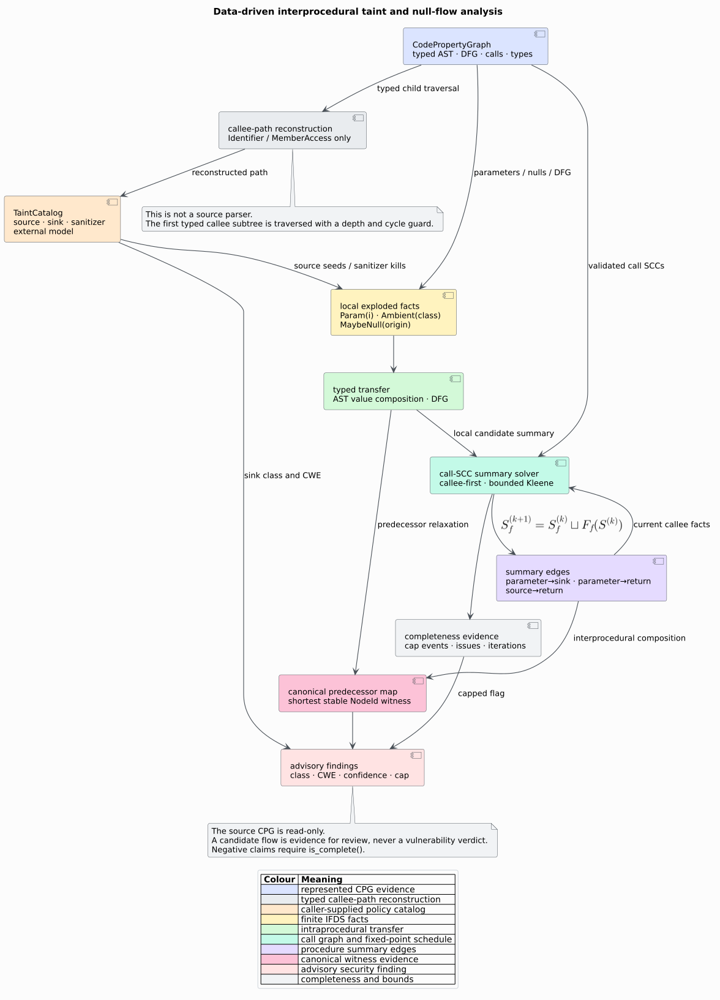

# Security interpretation of taint and null-flow results

This page defines the security boundary for libcpg's defensive taint and
maybe-null analyses. The analyses help maintainers find code that merits
review. They do not decide vulnerability, exploitability, authorization,
sanitizer correctness, or memory safety.



## 1. Assets and actors

| Actor or asset | Security role |
|---|---|
| Application maintainer | chooses catalogs, caps, and remediation policy |
| CPG frontend | supplies typed AST, DFG, call, and type evidence |
| `TaintCatalog` | declares project trust assumptions about APIs |
| IFDS summary solver | composes finite represented may-flow evidence |
| `TaintAnalysis` / `NullAnalysis` | immutable advisory evidence for review |
| Untrusted analyzed repository | may contain malformed, adversarial, or extremely large graph shapes |

The analyzed program and any consumer-provided catalog are inputs, not trusted
proofs. libcpg validates graph/SCC structure and bounds work, but it cannot
prove that a catalog rule accurately describes the runtime API.

## 2. Threats and controls

| Threat | Control | Residual risk |
|---|---|---|
| Source text crafted to confuse a second parser | analysis never parses source; it consumes typed CPG nodes | a faulty frontend can still emit faulty nodes |
| Catastrophic regex behavior | catalog has only literal exact/segment/suffix/substring forms | broad substrings can still over-classify |
| Recursive call graph causes nontermination | SCC iteration and shared work caps | capped output may omit flows |
| Fact explosion consumes memory | per-node fact and function caps | retained prefix may have false negatives |
| Wide signature silently drops data | explicit `param_mask_truncated` and incomplete report | callers must check completeness |
| Unknown wrapper hides flow | default low-confidence passthrough | return semantics may still differ |
| Unknown call invents vulnerability | unknown calls are not sinks by default | an unmodeled real sink can be missed |
| Sanitizer suppresses a real flow | sanitizers are explicit catalog policy and documented assumptions | incorrect policy causes false negatives |
| Nondeterminism changes triage order | ordered containers and canonical witnesses | upstream CPG identity changes can legitimately change paths |
| CWE label is treated as proof | findings are explicitly advisory | downstream presentation can still misuse metadata |

## 3. Safe result handling

Use the report API and require completeness before making a negative claim:

```rust
use libcpg::TaintAnalysis;

fn no_represented_flows(result: &TaintAnalysis) -> bool {
    result.is_complete() && result.flows.is_empty()
}
```

Even `true` means only “no flow exists under this catalog and represented CPG
transfer relation.” It does not mean the program is secure. Conversely, a
finding means “review this path”; it does not justify public disclosure,
automatic patching, or an exploitability claim.

For every positive finding, reviewers should inspect:

1. whether the source class is attacker-controlled in the deployment;
2. whether the sink argument reaches a dangerous runtime role;
3. whether the witness omits a path condition or alias refinement;
4. whether a sanitizer is present but absent from the catalog;
5. whether the reported CWE matches the actual operation; and
6. whether `capped`, `issues`, or low confidence qualify the evidence.

## 4. Catalog hardening

- Prefer `Exact` or `Segment` over broad `Substring` rules when an API has a
  stable qualified path.
- Keep sanitizer rules narrow and review them like security-sensitive code.
- Use `ExternalModel::Havoc` only when the result is known independent of all
  tainted arguments; it intentionally drops taint.
- Use `ExternalModel::Sink` only for APIs whose relevant arguments are
  security-sensitive. The model treats every tainted argument as reaching the
  sink.
- Retain the built-in catalog as a starting point, not an exhaustive language
  or framework security specification.
- Version project catalogs with the code that consumes them so findings remain
  reproducible.

## 5. Confidence is ranking, not probability

Path confidence is the minimum evidence score along the witness. Exact catalog
matches rank above segment, suffix, substring, and default opaque passthrough;
call-resolution tiers also contribute. The value is deterministic ordinal
evidence. It is not statistically calibrated and must not be displayed as a
probability of vulnerability.

## 6. Resource exhaustion and incomplete results

`IfdsCaps` bounds function count, recursive rounds, facts per node, total work,
and call/path traversal depth. A breached bound sets cap evidence and makes
`is_complete()` false. The retained output is a deterministic under-approximate
prefix of a may-analysis: it may omit real candidate flows.

Never interpret an empty capped result as safe. Raising caps and reproducing
under controlled resource limits is the first response. If the result remains
capped, partition the analysis at an evidence-preserving program boundary or
improve the frontend; do not suppress the flag.

## 7. Null-flow limitations

`NullFlow` reports typed maybe-null origins reaching represented dereferences.
It does not model every language's nullability, ownership, lifetime, exception,
or path-feasibility semantics. An explicit non-null check may make the path
infeasible even when both DFG endpoints remain connected. Treat the finding as
input to review or a later path-sensitive analysis.

## 8. Disclosure and defensive use

This facility is intended for maintainers analyzing code they are authorized
to inspect. Findings can contain source locations and API names. Apply the same
access control, retention, and disclosure policy used for other vulnerability
reports. CWE metadata helps categorize remediation; it does not grant authority
to test a live system.

## References

1. Yamaguchi, F., Golde, N., Arp, D., Rieck, K. (2014). *Modeling and
   Discovering Vulnerabilities with Code Property Graphs.* DOI:
   [10.1109/SP.2014.44](https://doi.org/10.1109/SP.2014.44).
2. Reps, T., Horwitz, S., Sagiv, M. (1995). *Precise Interprocedural Dataflow
   Analysis via Graph Reachability.* DOI:
   [10.1145/199448.199462](https://doi.org/10.1145/199448.199462).
