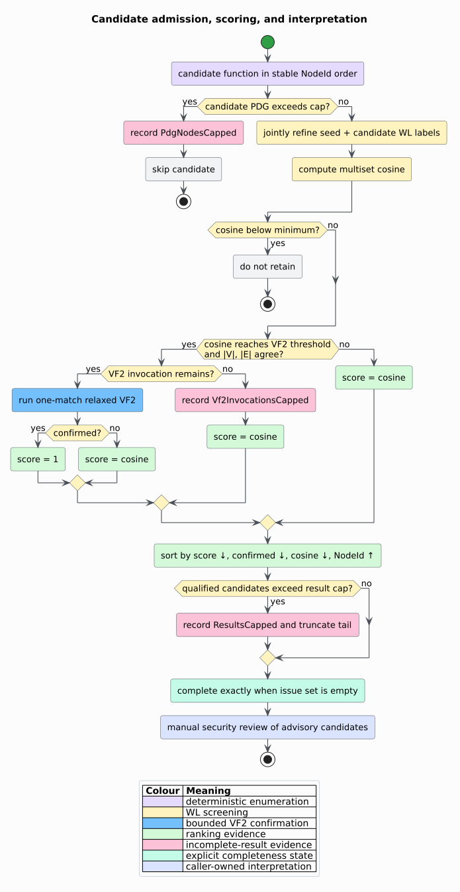

# Vulnerability-extrapolation security boundary

Vulnerability extrapolation accepts a caller-labeled seed and ranks other
functions by represented Program Dependence Graph (PDG) structure. It is an
advisory discovery aid. It must not authorize code changes, suppress security
review, or declare a repository free of related vulnerabilities.

## 1. Assets and trust boundaries

- The input Code Property Graph (CPG), its source-derived payloads, and seed
  label may be sensitive and attacker influenced.
- CFG, DFG, PDG, and call-resolution completeness are upstream evidence, not
  guarantees made by this component.
- Thresholds and capacities are caller policy. Serialized reports should retain
  the policy/version that produced them.
- Candidate identifiers and scores can reveal structural relationships even
  though source text is not copied into findings.
- WL and VF2 implementations are trusted to preserve their documented graph
  relations, not program behavior.

## 2. Threats and controls

### Similarity mistaken for vulnerability

Two functions can share dependence topology while differing in validation,
constants, types, environment, or runtime behavior. Conversely, semantically
related defects can have dissimilar graphs.

**Control:** label every result advisory. Review the actual vulnerable
operation and its protections. Do not interpret scores as probability,
severity, exploitability, or behavioral equivalence.

### Untrusted or poisoned seed

The API does not establish that the seed is vulnerable. A bad seed can direct
review toward irrelevant functions or expose a chosen structural neighborhood.

**Control:** accept seeds only from an authorized review or validated finding,
record provenance, and separate seed selection from the ranking service.

### Incomplete graph mistaken for absence

Missing dependence edges, unresolved calls, parser recovery, function/PDG
caps, VF2 exhaustion, or result truncation can omit or reorder useful leads.

**Control:** preserve `ExtrapolationAnalysis`, inspect every typed issue, and
require `is_complete()` before any bounded negative statement. Even a complete
empty result means only that this policy found no represented structural lead.

### WL collision or structural indistinguishability

One-dimensional Weisfeiler--Lehman (WL) refinement is not a complete
isomorphism test. The fixed 64-bit digest also has a finite collision
probability. Isolated function roots are indistinguishable.

**Control:** use WL as screening evidence. VF2 confirmation is displayed
separately and remains relaxed topology evidence; neither stage is a security
verdict.

### Resource exhaustion and stack overflow

Hostile graphs may contain many functions, broad PDGs, deep syntax, cycles, or
symmetric regions that cause expensive VF2 search.

**Control:** validate compile-time ceilings; apply explicit function, PDG,
invocation, result, and WL-round limits; run one-match VF2 only after WL and
equal-size gates; store traversal/search continuations in heap worklists and
defunctionalized frames. Native recursion never scales with input depth.

### Ranking manipulation

Generated wrappers, duplicated dead code, missing edges, or deliberately
crafted regular graphs can crowd the retained prefix.

**Control:** retain graph-build provenance and cap issues, review multiple
signals, deduplicate generated code by an external declared policy, and never
automate remediation from rank alone.

### Report disclosure

Ranked function identifiers can identify valuable attack surfaces, and the CPG
can contain literal/source payloads even though candidates do not.

**Control:** protect reports and graph artifacts at repository-equivalent
confidentiality, minimize downstream enrichment, and resolve `NodeId`s only in
the authorized environment.



## 3. Safe review procedure

```text
REVIEW-EXTRAPOLATION(report, seed_provenance, graph_provenance):
    verify the seed label and graph-build configuration;
    record thresholds, capacities, and library revision;
    if report is incomplete:
        inspect each issue and characterize omitted evidence;
        do not publish a clean result;

    for candidate in report order:
        distinguish WL-only evidence from relaxed VF2 confirmation;
        inspect the concrete vulnerability cause and candidate protections;
        confirm through appropriate tests or authorized analysis;

    report only reviewed defects as vulnerabilities;
    describe unreviewed entries as structural candidates.
```

## 4. Non-goals

The component does not prove exploitability, reachability, behavioral
equivalence, vulnerability absence, complete mediation, seed correctness,
model fairness, or runtime path feasibility. It does not parse source, train a
GNN, mutate the CPG, patch code, open tickets, or gate deployment.

See [ADR-0051](../design/0051-evidence-bounded-vulnerability-extrapolation.md),
[Theory 41](../theory/41-vulnerability-extrapolation.md), and
[Usage 24](../usage/24-vulnerability-extrapolation.md).

## References

1. Yamaguchi, F., Lindner, F., Rieck, K. (2011). *Vulnerability Extrapolation:
   Assisted Discovery of Vulnerabilities Using Machine Learning.*
   [USENIX WOOT '11](https://www.usenix.org/conference/woot11/vulnerability-extrapolation-assisted-discovery-vulnerabilities-using-machine).
2. Yamaguchi, F., Lottmann, M., Rieck, K. (2012). *Generalized Vulnerability
   Extrapolation using Abstract Syntax Trees.* DOI:
   [10.1145/2420950.2421003](https://doi.org/10.1145/2420950.2421003).
