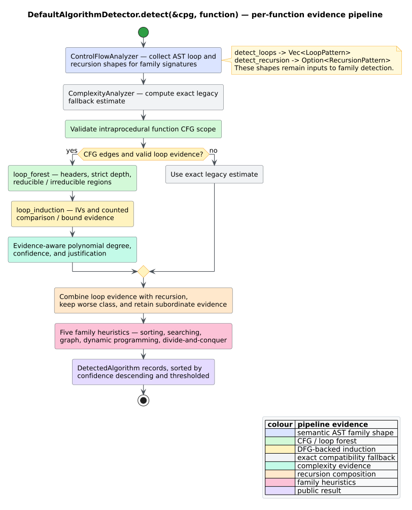
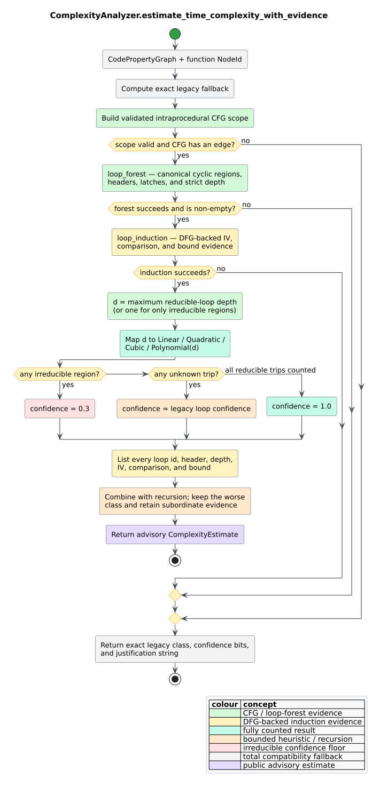
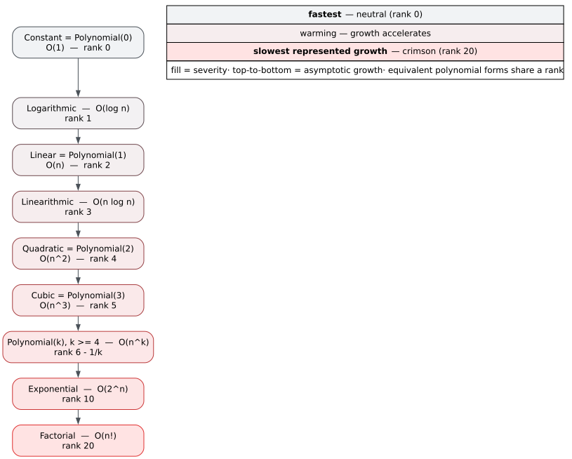
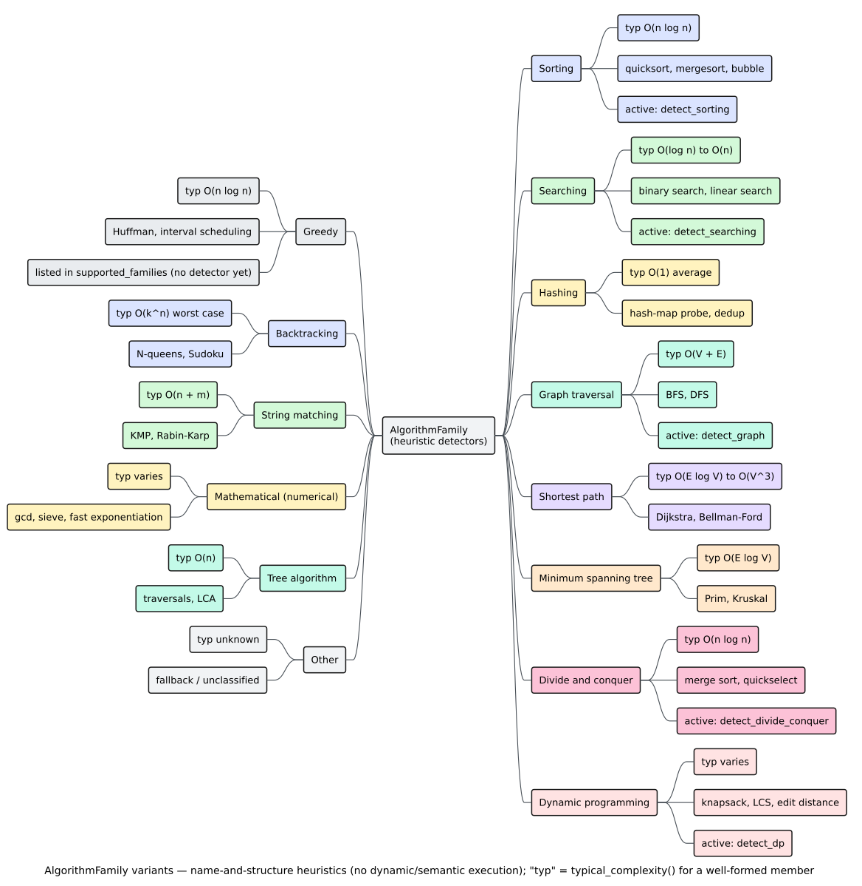

# Algorithm and Complexity Analysis

> Theory pillar · file 08. Uses the control‑flow structure of [file 02](02-control-flow-and-complexity.md) and the CPG traversal of [file 01](01-code-property-graphs.md); a heuristic sibling to the pattern work of files [05](05-subgraph-isomorphism-vf2.md)–[07](07-design-pattern-detection.md).

Given a function, two questions recur in code understanding: *what kind of
algorithm is this?* (sorting, searching, a graph traversal, dynamic
programming…) and *how expensive is it?* ($`O(n)`$? $`O(n^2)`$?
$`O(2^n)`$?). `libcpg` answers both statically from the shape of the
[Code Property Graph](../GLOSSARY.md#code-property-graph-cpg). Validated
Control Flow Graph (CFG), natural-loop, and Data Flow Graph (DFG)-backed
induction evidence drive the default [complexity
class](../GLOSSARY.md#complexity-class--big-o) estimate; structural signatures
still name an [algorithm family](../GLOSSARY.md#algorithm-family). This is
recognition by evidence and shape, not proof of behavior—the results remain
advisory.

The analysis lives in the `algorithms` module, gated behind the `algorithm-detection` feature. Its entry point is per‑function:

```rust
// requires: features = ["algorithm-detection"]
use libcpg::CodePropertyGraph;
use libcpg::algorithms::AlgorithmDetector;                  // trait: detect(&cpg, fn)
use libcpg::algorithms::detection::DefaultAlgorithmDetector;

let detector = DefaultAlgorithmDetector::new()              // default min_confidence = 0.5
    .with_min_confidence(0.5);

// detect() takes ONE function NodeId; iterate the functions you care about.
let functions: Vec<_> = cpg.functions().map(|n| n.id).collect();
for func in functions {
    for algo in detector.detect(&cpg, func) {              // Vec<DetectedAlgorithm>, sorted desc
        let cx = algo.signature.time_complexity.as_ref()
            .map(|c| c.class.as_str())                      // e.g. "O(n²)"
            .unwrap_or("Unknown");
        println!("{} ~ {} (confidence {:.2})", algo.family, cx, algo.confidence);
    }
}
```



*Figure — the per-function evidence pipeline. Source:
[`diagrams/algorithm-detection-pipeline.puml`](../diagrams/algorithm-detection-pipeline.puml).*

---

## 1. The detection pipeline

`DefaultAlgorithmDetector::detect(&cpg, function)` runs three phases and returns a `Vec<DetectedAlgorithm>` sorted by confidence, descending, filtered at the detector's `min_confidence` (default $`0.5`$ — **not** the $`0.7`$ of the GoF detector in [file 07](07-design-pattern-detection.md)):

1. **Control‑flow analysis** (`ControlFlowAnalyzer`) extracts the function's loops and any recursion.
2. **Complexity estimation**
   (`ComplexityAnalyzer::estimate_time_complexity_with_evidence`) validates the
   function CFG, loop forest, and induction report, then composes that evidence
   with recursion. It falls back exactly to
   `estimate_time_complexity` when graph evidence is unavailable.
3. **Family detection** runs five `detect_*` routines (sorting, searching, graph, dynamic programming, divide‑and‑conquer); each emits a `DetectedAlgorithm` when its structural signature is present and its confidence clears the threshold.

A `DetectedAlgorithm` bundles the `AlgorithmFamily`, an optional specific `name` (e.g. `"Binary Search"`), the containing `function`, key nodes, an `AlgorithmSignature` (loop structure, recursion pattern, time/space `ComplexityEstimate`), and a `confidence`.

---

## 2. Legacy loop shape and family signatures

`ControlFlowAnalyzer::detect_loops` walks the function's semantic Abstract
Syntax Tree (AST) descendants and records a `LoopPattern` for each loop node,
capturing its **kind**, its **nesting depth**, and whether it appears
**counted**:

- **Kind** (`LoopKind`): `For`, `While`, `Infinite` (a Rust `loop`), plus `DoWhile` and `Iterator` for the shapes some front‑ends emit.
- **Depth**: computed by counting loop ancestors — a loop with two enclosing loops has depth $`3`$.
- **Counted**: a `For` over a range‑like expression, or a `While` carrying both a comparison *and* an increment, is treated as bounded; an `Infinite` or iterator loop is not. Counted‑ness raises the confidence of the resulting estimate but not its class.

These patterns remain inputs to the five family signatures and to the exact
compatibility fallback. The legacy estimator maps maximum syntactic nesting
straight onto the polynomial ladder:

| Max loop depth | `ComplexityClass` | Big‑O |
|---|---|---|
| 0 (no loops) | `Constant` | $`O(1)`$ |
| 1 | `Linear` | $`O(n)`$ |
| 2 | `Quadratic` | $`O(n^2)`$ |
| 3 | `Cubic` | $`O(n^3)`$ |
| $`d \ge 4`$ | `Polynomial(d)` | $`O(n^d)`$ |

This is a structural upper-bound heuristic. It assumes each nested loop
multiplies the iteration count by $`n`$ and can over-estimate a constant-bound
inner loop. The default detector now replaces this loop signal with the
evidence model below whenever the required CFG/DFG relations exist.

---

## 3. CFG/DFG-backed loop evidence

A **natural loop** is induced by a CFG back edge whose target dominates its
source. Its header, latches, body, exits, and strict nesting depth form a
`LoopForest`. A cyclic strongly connected region without one dominating header
is **irreducible**. An **induction variable** (IV) is a value updated by a
regular additive step; `TripEvidence::Counted` means the IV is compared in a
direction compatible with its step against an invariant bound. It does not
prove termination or compute a numeric trip count.

The default complexity consumer composes
[`loop_forest`](../components/graph/loop-analysis.md) with the DFG-backed
[`loop_induction`](../components/graph/induction-analysis.md). If the selected
function has no CFG edge, if scope/forest/induction validation fails, or if the
forest is empty, the exact legacy estimate is returned. No parser or source
scanner exists in this analysis layer.

Let $`\mathcal{L}_r`$ be the reducible loops and define

```math
d =
\begin{cases}
\max_{L \in \mathcal{L}_r} \operatorname{depth}(L)
  & \text{if } \mathcal{L}_r \ne \varnothing,\\
1 & \text{if every cyclic region is irreducible}.
\end{cases}
```

The loop class is $`O(n^d)`$, represented by the dedicated `Linear`,
`Quadratic`, and `Cubic` variants for $`d \in \{1,2,3\}`$ and
`Polynomial(d)` thereafter. Confidence is bounded by the weakest evidence:

```math
c =
\begin{cases}
0.3 & \text{if an irreducible region exists},\\
c_h & \text{if a trip remains unknown},\\
1.0 & \text{if every reducible trip is counted},
\end{cases}
```

where $`c_h`$ is the legacy loop-heuristic confidence. The canonical
justification lists every loop header, IV, comparison, and bound, so the result
is reproducible and reviewable rather than an opaque score.



*Figure — evidence-aware complexity semantics. Source:
[`diagrams/complexity-evidence.puml`](../diagrams/complexity-evidence.puml).*

---

## 4. Recursion structure

`ControlFlowAnalyzer::detect_recursion` finds call sites inside a function that target the function itself (direct recursion), classifies **tail** position, and gathers **base cases** (guarded `Return`s that contain no recursive call). It yields a `RecursionPattern { kind, base_cases, recursive_calls }` whose `kind` is one of `Direct`, `Indirect`, or `Tail`.

The number of recursive calls, together with a **divide‑and‑conquer** test, drives the recursion → complexity mapping (`analyze_recursion_complexity`):

| Recursion shape | `ComplexityClass` | Big‑O |
|---|---|---|
| Tail recursion | `Linear` | $`O(n)`$ |
| Divide‑and‑conquer, 1 recursive call | `Logarithmic` | $`O(\log n)`$ |
| Divide‑and‑conquer, 2 recursive calls | `Linearithmic` | $`O(n \log n)`$ |
| Divide‑and‑conquer, $`k \ge 3`$ calls | `Polynomial(k)` | $`O(n^k)`$ |
| Non‑D&C, 1 recursive call | `Linear` | $`O(n)`$ |
| Non‑D&C, $`\ge 2`$ recursive calls | `Exponential` | $`O(2^n)`$ |

The **divide‑and‑conquer** test (`is_divide_and_conquer`) is itself a heuristic: it looks for the input being halved — a division or right‑shift by $`2`$, or an identifier named `mid`, `middle`, `pivot`, or `…half…` — before the recursive calls. Its presence is what separates $`O(n \log n)`$ merge‑sort‑like recursion from $`O(2^n)`$ naïve‑Fibonacci‑like recursion at the same call count.

When a function has both loops and recursion, the estimator keeps the
asymptotically worse class using `ComplexityClass::is_better_than` (Section 6)
and retains the subordinate evidence in the justification.

> **Honesty — recursion coverage.** `RecursionKind::Indirect` exists in the type but the shipped analyzer emits only `Direct` or `Tail`: mutual (indirect) recursion between two functions is modelled but not detected. The divide‑and‑conquer test is name‑ and operator‑based, so it can be fooled by unconventional variable names or by halving expressed indirectly.

---

## 5. The Master Theorem

The two‑call divide‑and‑conquer heuristic is grounded in the **Master Theorem** for divide‑and‑conquer recurrences (CLRS [[1]](#references)). A function that splits its input of size $`n`$ into $`a`$ subproblems of size $`n/b`$, with $`f(n)`$ non‑recursive work per level, satisfies

```math
T(n) = a\,T(n/b) + f(n), \qquad a \ge 1,\ b > 1,
```

whose solution compares $`f(n)`$ against $`n^{\log_b a}`$:

```math
T(n) =
\begin{cases}
\Theta\!\left(n^{\log_b a}\right) & \text{if } f(n) = O\!\left(n^{\log_b a - \varepsilon}\right), \\[4pt]
\Theta\!\left(n^{\log_b a}\log n\right) & \text{if } f(n) = \Theta\!\left(n^{\log_b a}\right), \\[4pt]
\Theta\!\left(f(n)\right) & \text{if } f(n) = \Omega\!\left(n^{\log_b a + \varepsilon}\right)\ \text{(with regularity)}.
\end{cases}
```

Merge sort is the canonical case: $`a = 2`$ subproblems, each of size $`n/2`$ ($`b = 2`$), with linear merge work $`f(n) = \Theta(n)`$. Since $`\log_b a = 1`$ and $`f(n) = \Theta(n^1)`$, the middle case gives $`T(n) = \Theta(n \log n)`$ — exactly the `Linearithmic` class the analyzer assigns to *two* recursive calls with halving. A single halving call ($`a = 1, b = 2`$, $`f(n) = O(1)`$) gives $`\Theta(\log n)`$, the binary‑search case. The heuristic is a structural shorthand for these Master‑Theorem outcomes; it does not solve the recurrence, so it reads $`a`$ and the halving directly from the CPG rather than deriving $`b`$ and $`f`$.

---

## 6. The complexity ladder

`ComplexityClass::is_better_than` exposes a strict weak order from cheaper to
more expensive growth. Its private rank gives equivalent encodings the same
growth position:

| `ComplexityClass` | `as_str()` | Private rank |
|---|---|---|
| `Constant` | `O(1)` | 0 |
| `Logarithmic` | `O(log n)` | 1 |
| `Linear` | `O(n)` | 2 |
| `Linearithmic` | `O(n log n)` | 3 |
| `Quadratic` | `O(n²)` | 4 |
| `Cubic` | `O(n³)` | 5 |
| `Polynomial(0)` | `O(n^k)` | 0 (equivalent to `Constant`) |
| `Polynomial(1)` | `O(n^k)` | 2 (equivalent to `Linear`) |
| `Polynomial(2)` | `O(n^k)` | 4 (equivalent to `Quadratic`) |
| `Polynomial(3)` | `O(n^k)` | 5 (equivalent to `Cubic`) |
| `Polynomial(k)`, $`k \ge 4`$ | `O(n^k)` | $`6 - 1/k`$ |
| `Exponential` | `O(2^n)` | 10 |
| `Factorial` | `O(n!)` | 20 |
| `Unknown` | `Unknown` | 1000 |

Every finite polynomial rank is below `Exponential`, and equal growth forms
compare equivalent. The ladder makes the loop and recursion estimates
comparable without exposing a misleading integer ordinal as API.



*Figure — the `ComplexityClass` ladder ordered by asymptotic growth. Source:
[`diagrams/complexity-ladder.dot`](../diagrams/complexity-ladder.dot).*

> **Honesty — the analyzer never emits `Factorial`.** `O(n!)` is a rung on the
> public ladder, but both time estimators cap non-divide-and-conquer recursion
> at `Exponential`. `Factorial` can appear in a caller-constructed
> `ComplexityEstimate`; it cannot appear from `ComplexityAnalyzer`.

### Worked examples

- **`factorial(n)`** — one recursive call, no halving ⇒ **`Linear`, $`O(n)`$**. Note the analyzer classifies the *recursion structure* (linear depth), not the mathematical function's value; it is *not* `Factorial`. This is the sharpest illustration of "shape, not behaviour".
- **`merge_sort(a)`** — two recursive calls with a midpoint split ⇒ **`Linearithmic`, $`O(n \log n)`$**, matching the Master‑Theorem derivation of Section 4.
- **naïve `fib(n)`** — two recursive calls, *no* halving ⇒ **`Exponential`, $`O(2^n)`$**, the non‑D&C branch.

---

## 7. Algorithm families as structural signatures

Beyond cost, `libcpg` names an [algorithm family](../GLOSSARY.md#algorithm-family) from a *structural signature* — a combination of control‑flow shape and telltale operations. `AlgorithmFamily` enumerates **14** categories, each with a `typical_complexity()` string:

| `AlgorithmFamily` | Typical complexity | Detector? |
|---|---|---|
| `Sorting` | `O(n log n)` | ✅ `detect_sorting` |
| `Searching` | `O(log n)`–`O(n)` | ✅ `detect_searching` |
| `GraphTraversal` | `O(V + E)` | ✅ `detect_graph` |
| `DynamicProgramming` | Varies | ✅ `detect_dp` |
| `DivideAndConquer` | `O(n log n)` | ✅ `detect_divide_conquer` |
| `Greedy` | `O(n log n)` | ⚠️ advertised, **no detector** |
| `ShortestPath` | `O(E log V)`–`O(V³)` | ❌ none |
| `MinimumSpanningTree` | `O(E log V)` | ❌ none |
| `Backtracking` | `O(k^n)` worst case | ❌ none |
| `StringMatching` | `O(n + m)` | ❌ none |
| `TreeAlgorithm` | `O(n)` | ❌ none |
| `Hashing` | `O(1)` average | ❌ none |
| `Mathematical` | Varies | ❌ none |
| `Other` | Unknown | ❌ none |

The **five implemented** detectors recognise their families by these signatures:

- **`Sorting`** — loops present, comparison operations, and swaps (three‑plus assignments or a `swap`‑named call); adjacent‑index swaps hint at bubble sort, otherwise selection/insertion at $`O(n^2)`$.
- **`Searching`** — comparisons plus either a midpoint calculation / recursion (→ `"Binary Search"` at $`O(\log n)`$) or a single loop with an early return (→ `"Linear Search"` at $`O(n)`$).
- **`GraphTraversal`** — a *visited/seen* set together with queue operations (→ `"BFS"`) or stack / `while` structure (→ `"DFS"`).
- **`DynamicProgramming`** — a memoization table (a variable named `memo`, `dp`, `cache`, `table`, …), stronger when combined with nested loops.
- **`DivideAndConquer`** — recursion with a $`O(\log n)`$/$`O(n \log n)`$ estimate and one or two recursive calls.



*Figure — the `AlgorithmFamily` taxonomy and the structural signatures behind the implemented detectors. Source: [`diagrams/algorithm-family-taxonomy.puml`](../diagrams/algorithm-family-taxonomy.puml).*

> **Honesty — partial coverage.** `supported_families()` advertises six families (the five above **plus `Greedy`**), yet there is **no `Greedy` detector** — it is never produced. The remaining eight families (`ShortestPath`, `MinimumSpanningTree`, `Backtracking`, `StringMatching`, `TreeAlgorithm`, `Hashing`, `Mathematical`, `Other`) exist in the enum for completeness but have neither a detector nor advertisement. All detection is signature‑based and name‑sensitive (it keys on identifiers like `visited`, `mid`, `queue`, `dp`), so renaming can defeat it and coincidental names can trip it. Read family labels as hints, and confirm with the source.

---

## 8. Where this sits

Complexity and family analysis reuse the control-flow theory of [file
02](02-control-flow-and-complexity.md), the CPG traversal of [file
01](01-code-property-graphs.md), and the natural-loop/DFG evidence documented in
the graph components. McCabe's cyclomatic complexity counts linearly
independent CFG paths [[2]](#references); it is exact for the modeled CFG but is
not an input-size Big-O estimate. The evidence-aware analyzer instead composes
validated loop depth and trip evidence, while family labels remain heuristic.
The runnable API lives in
[`components/algorithms/complexity.md`](../components/algorithms/complexity.md).

---

## References

1. Cormen, Leiserson, Rivest, Stein (2009). *Introduction to Algorithms* (3rd ed.). MIT Press. ISBN 978-0262033848 (no DOI). *(Master Theorem.)*
2. McCabe, T. J. (1976). *A Complexity Measure.* IEEE Transactions on Software
   Engineering SE-2(4), 308–320. DOI:
   [10.1109/TSE.1976.233837](https://doi.org/10.1109/TSE.1976.233837)
