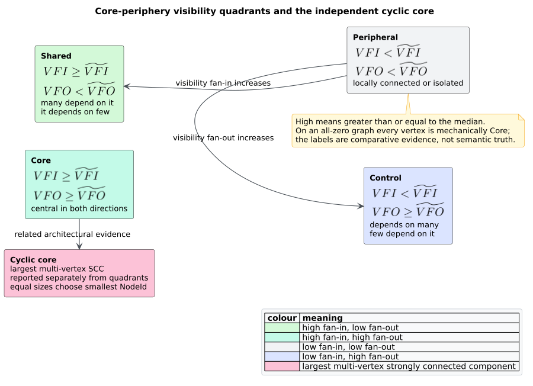

# Theory 10 — Design Structure Matrices, visibility, and architectural cores

This chapter develops the graph theory behind libcpg's [Design Structure
Matrix (DSM)](../GLOSSARY.md#design-structure-matrix-dsm) analysis. The
[component guide](../components/graph/dsm-analysis.md) specifies the Rust API;
this page explains why direct adjacency is insufficient, how transitive
visibility becomes propagation cost, and why median quadrants and strongly
connected components answer different architectural questions.

## 1. A matrix and a directed graph are equivalent views

Let $`G=(V,E)`$ be a finite directed graph with $`n=|V|`$ and a fixed ordering
$`V=(v_0,\ldots,v_{n-1})`$. Its adjacency DSM $`A\in\{0,1\}^{n\times n}`$ is

```math
A_{ij}=1 \iff (v_i,v_j)\in E.
```

Reordering vertices permutes rows and columns together. It can reveal visual
structure, but it does not change reachability, visibility counts, SCCs, or
propagation cost. MacCormack, Rusnak, and Baldwin used DSM-derived dependency
metrics to compare software structures [[1]](#references); Baldwin,
MacCormack, and Rusnak later developed a directed-network methodology centered
on indirect dependencies and cyclic groups [[2]](#references).

libcpg stores this relation as a sparse [`GraphProjection`](../GLOSSARY.md#graph-projection)
rather than a dense matrix. That representation is lossless for topology and
avoids $`n^2`$ adjacency storage when $`|E|\ll n^2`$.

## 2. Direct coupling is not total architectural exposure

Suppose module `front_end` depends on `service`, and `service` depends on
`database`. A direct-degree metric sees one outgoing edge from `front_end`; a
change propagated along dependencies may nevertheless reach both downstream
vertices. Architectural visibility therefore uses the non-reflexive transitive
closure:

```math
R_{ij}=1
\iff
i\ne j\ \land\ \exists k\ge1,\
(u_0,\ldots,u_k):u_0=v_i,\ u_k=v_j,\ (u_t,u_{t+1})\in E.
```

The condition $`i\ne j`$ removes the diagonal even when a directed cycle makes
a vertex reachable from itself by a positive-length path. This is a counting
convention, not a statement that cycles are harmless; cycles are measured
separately by SCC decomposition.

For each row and column of $`R`$:

```math
VFO(i)=\sum_jR_{ij},
\qquad
VFI(j)=\sum_iR_{ij}.
```

VFO is the size of the forward reachable set; VFI is the size of the reverse
reachable set. Their names are directional and must be interpreted using the
projection's edge convention. In libcpg's caller-to-callee call graph, high
VFO means a caller can reach many downstream callees; high VFI means many
callers can transitively reach that function.

## 3. Propagation cost is closure density

The number of visible ordered pairs is

```math
P=\sum_{i,j}R_{ij}=\sum_iVFO(i)=\sum_jVFI(j).
```

The equality of the row and column totals is both a theorem and a useful test
invariant. Propagation cost normalizes this count by the whole DSM area:

```math
PC=\frac{P}{n^2}\quad(n>0),
\qquad PC=0\quad(n=0).
```

Because the diagonal is zero, $`P\le n(n-1)`$ and the finite nonempty maximum
is $`1-1/n`$. A cycle containing every vertex reaches that maximum even if it
has only $`n`$ direct edges: closure density measures indirect coupling, not
raw edge density.

Propagation cost is comparable only when graph boundary and edge semantics are
held constant. Adding isolated vertices changes the denominator; improving
call resolution can add true edges and increase the measured value even when
the source architecture did not change. The metric is therefore evidence about
the analyzed projection, not an intrinsic scalar property of a repository.

## 4. Why repeated BFS is the selected algorithm

Three standard closure strategies are relevant:

| Strategy | Time | Extra storage | Fit for libcpg |
|---|---:|---:|---|
| Dense Floyd–Warshall | $`O(n^3)`$ | $`O(n^2)`$ | Excellent small-graph oracle; unsuitable production storage. |
| Boolean matrix multiplication | algebra-dependent | $`O(n^2)`$ or more | Useful for dense/specialized systems; conflicts with sparse feature-free substrate. |
| One graph search per source | $`O(n(n+m))`$ | $`O(n)`$ for visibility alone | Directly consumes CSR and never materializes closure. |

The repeated-search algorithm returns exactly the row and column sums needed by
the public API. A reusable visited vector and queue bound temporary memory. The
50,000-vertex cap does not make the worst case cheap; it makes the accepted
domain explicit and prevents accidental unbounded input. Operators should
still apply tighter project-specific limits when latency matters.

The test oracle deliberately uses Floyd–Warshall on graphs of at most nine
vertices. Its distinct recurrence makes correlated production/oracle defects
less likely:

```text
FLOYD_WARSHALL_CLOSURE(A):
    reachable := A
    for intermediate k:
        for source i:
            for target j:
                reachable[i,j] := reachable[i,j]
                                  or (reachable[i,k] and reachable[k,j])
    clear every reachable[i,i]
    return reachable
```

## 5. Visibility quadrants are relative classifications

Let $`\widetilde{VFI}`$ and $`\widetilde{VFO}`$ be the medians of the two
visibility vectors. libcpg declares an axis high when its value is greater than
or equal to the median. This produces four comparative regions:

```math
class(i)=
\begin{cases}
Core, & VFI(i)\ge\widetilde{VFI}\ \land\ VFO(i)\ge\widetilde{VFO},\\
Shared, & VFI(i)\ge\widetilde{VFI}\ \land\ VFO(i)<\widetilde{VFO},\\
Control, & VFI(i)<\widetilde{VFI}\ \land\ VFO(i)\ge\widetilde{VFO},\\
Peripheral, & VFI(i)<\widetilde{VFI}\ \land\ VFO(i)<\widetilde{VFO}.
\end{cases}
```



*Figure — median quadrants and the independent cyclic core. Source:
[`diagrams/dsm-core-periphery.puml`](../diagrams/dsm-core-periphery.puml).*

This median rule is a deterministic implementation policy, not a theorem from
the cited literature. It has useful robustness to scale and outliers, but its
labels are distribution-relative. With all counts zero, both medians are zero
and inclusive comparison labels every vertex `Core`. A consumer should retain
the thresholds and raw counts, and should not translate `Core` directly into
importance, ownership, or remediation priority.

## 6. Cyclic core is an equivalence-class question

Mutual reachability defines an equivalence relation:

```math
u\sim v \iff u=v\ \lor\ (u\leadsto v\ \land\ v\leadsto u).
```

Its equivalence classes are the SCCs. Contracting them yields a directed
acyclic graph. The 2014 methodology identifies the dominant cyclic group as a
key core–periphery signal [[2]](#references). libcpg selects the largest SCC
with at least two members, using the smallest stable `NodeId` to resolve an
equal-size tie. A singleton self-loop remains cyclic under general SCC theory
but is not a multi-component architectural group, so DSM classification
excludes it from `cyclic_core`.

Median `Core` and cyclic core need not coincide:

- an acyclic hub can be high on both visibility axes but belong to no cyclic
  group;
- a small isolated cycle can be the largest cyclic group while falling below a
  global visibility median; and
- every member of one SCC has identical reachability outside that SCC, yet
  median thresholds can be dominated by the rest of the graph.

Reporting the two results separately preserves these meanings.

## 7. Determinism and stable identity

The mathematical quantities are invariant under vertex renaming and edge
enumeration. A software API must also choose deterministic result order.
`GraphProjection` sorts stable `NodeId` values, sorts and deduplicates each CSR
slice, and merges parallel edges. BFS visits sources and successors in that
canonical order; sums are integer until the final propagation-cost division.
The shared iterative Tarjan engine sorts SCC members and components. Equal-size
cyclic groups select the lower stable representative.

Consequently, reversing input edges, adding duplicate instances of every edge,
or changing hash-map enumeration does not change VFI, VFO, propagation cost,
classes, thresholds, or cyclic-core membership. The implementation's property
test asserts exact result equality across those storage forms.

## 8. What the theory does and does not establish

For a valid finite directed projection, the analysis computes exact
reachability counts, exact closure density, deterministic median classes, and
the exact largest multi-vertex SCC. It does not establish whether an edge is
semantically correct. That claim belongs to the projection builder and, for a
call graph, to call resolution. Nor does reachability establish that a source
change will in fact modify every visible target. The result is architectural
coupling evidence whose interpretation must remain tied to the graph model.

## References

1. MacCormack, A., Rusnak, J., Baldwin, C. Y. (2006). *Exploring the Structure
   of Complex Software Designs: An Empirical Study of Open Source and
   Proprietary Code.* Management Science 52(7), 1015–1030. DOI:
   [10.1287/mnsc.1060.0552](https://doi.org/10.1287/mnsc.1060.0552)
2. Baldwin, C. Y., MacCormack, A., Rusnak, J. (2014). *Hidden Structure: Using
   Network Methods to Map System Architecture.* Research Policy 43(8),
   1381–1397. DOI:
   [10.1016/j.respol.2014.05.004](https://doi.org/10.1016/j.respol.2014.05.004)
