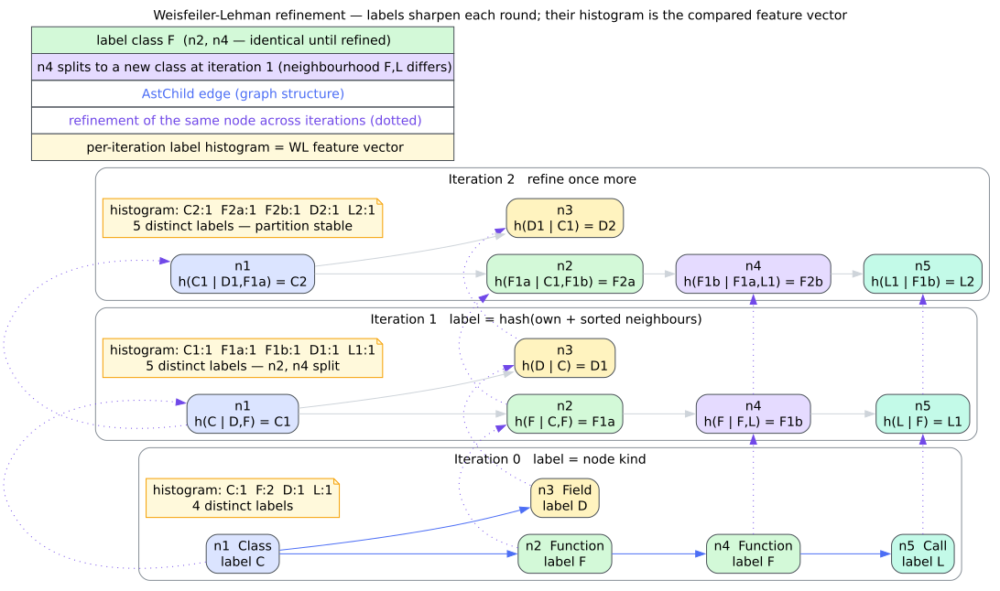

# Theory 11 — Weisfeiler–Lehman refinement and structural clones

The Weisfeiler–Lehman (WL) color-refinement procedure converts local graph
structure into successively sharper equivalence classes. It is attractive for
code-property-graph analysis because it is deterministic, sparse, iterative,
and much cheaper than enumerating exact graph isomorphisms. This chapter
develops the mathematics behind libcpg's projection-level labels and states the
limits of what an equal label establishes.

## 1. From directed degree to equitable refinement

Let $`G=(V,E)`$ be a finite directed graph. An initial coloring
$`\ell_0:V\rightarrow\mathbb{N}`$ partitions vertices by directed degree:

```math
\ell_0(u)=\ell_0(v)
\quad\Longleftrightarrow\quad
(d^-(u),d^+(u))=(d^-(v),d^+(v)),
```

subject to the fixed digest's collision probability. At round $`t+1`$, the
old color and incident-neighbor color multiset define a signature:

```math
\sigma_{t+1}(v)=\left(\ell_t(v),
\operatorname{bag}\!\left(\ell_t(u)\mid (v,u)\in E\right)\uplus
\operatorname{bag}\!\left(\ell_t(u)\mid (u,v)\in E\right)\right).
```

Equal signatures receive equal new colors and unequal signatures receive
different colors unless the finite digest collides. Sorting the multiset makes
the signature independent of adjacency enumeration. Sorting all raw signatures
before rank compression makes the numeric colors independent of vertex
enumeration.

The partition only refines: two vertices already assigned different current
colors cannot merge through a full injective signature encoding. libcpg uses a
64-bit digest rather than retaining arbitrary-length signatures, so this is a
probabilistic engineering approximation to exact color refinement. Exact
fixed vectors guard the digest definition; collision resistance is not claimed.

## 2. Isomorphism invariance

An **isomorphism** $`\varphi:V_G\rightarrow V_H`$ is a bijection that preserves
directed adjacency. Because it preserves incoming and outgoing degrees, it
preserves $`\ell_0`$. If it preserves colors at round $`t`$, it maps each
incident-neighbor multiset to an equal multiset, so it also preserves round
$`t+1`$. Induction gives

```math
\ell_t(v)=\ell_t(\varphi(v))
\qquad\text{for every }v\in V_G\text{ and }t\ge 0.
```

Consequently, isomorphic relabelings have equal label multisets and equivalent
clone partitions. The converse is false: one-dimensional WL is not a complete
graph-isomorphism test. Regular graphs and other symmetric constructions can
remain indistinguishable despite not being isomorphic [[1]](#references).



*Figure 1 — color refinement on one graph. The pictured similarity pipeline
uses node-kind seeds; libcpg's projection clone API uses directed-degree seeds.
Source: [`diagrams/wl-kernel.dot`](../diagrams/wl-kernel.dot).*

## 3. Structural clone equivalence

For a fixed round count $`k`$, libcpg defines

```math
u\equiv_k v\quad\Longleftrightarrow\quad\ell_k(u)=\ell_k(v).
```

Equality of integers is reflexive, symmetric, and transitive, so
$`\equiv_k`$ partitions the projection into label classes. Classes of size at
least two are **structural clone candidates**. Raising the requested minimum
filters small classes but does not change labels or class membership.

This equivalence captures bounded local topology under libcpg's chosen seed and
incident-direction policy. It does not compare source text, node kinds, edge
weights, data values, control predicates, names, or behavior. In particular,
two unrelated leaf functions in a call projection can be structural clones
because both have the same bounded topological context.

## 4. Why incident refinement follows a directed seed

Three policies are possible for a directed graph:

1. discard direction everywhere;
2. maintain separate incoming and outgoing multisets every round; or
3. distinguish direction in the seed, then refine over the combined incident
   multiset.

libcpg ports the third policy. It permanently separates different initial
in/out degree pairs, while allowing one sorted multiset and compatibility with
the pgmcp structural-clone kernel. Because the current label participates in
every later signature, source and sink colors cannot merge after round zero.
The policy should nevertheless be understood precisely: after seeding, it does
not distinguish which side contributed a particular neighbor label.

## 5. Canonical ranks and stable hashing

Rust's `DefaultHasher` is unsuitable for a reproducible graph-analysis output
because its algorithm is not a cross-release API contract. libcpg uses a fixed
wrapping mixer and pins its outputs. A raw digest still should not be assigned
a class number on first encounter: an isomorphic relabeling may visit an
otherwise identical signature first at a different stable `NodeId`.

The canonicalization step instead computes every raw digest, sorts the distinct
values, and uses each value's sorted rank. The resulting labels are stable
under node and edge storage permutations. They are scoped to one graph and one
round count; applications should persist stable `NodeId` membership rather
than interpret the numeric rank globally.

## 6. Bounded refinement and convergence

Exact color refinement can stop when its partition no longer changes and must
stabilize after at most $`|V|-1`$ strict splits. libcpg accepts an explicit
round count for reproducible bounded neighborhoods and clamps it at 16. This
ensures a hostile request cannot multiply sorting work without bound. The
selected result is therefore the partition after
$`\min(k,16)`$ rounds, not necessarily the coarsest equitable partition.

For $`m=|E|`$, one round reads $`2m`$ incident entries, sorts each local
multiset, and canonicalizes $`n`$ raw labels. Its time is

```math
O\!\left(n\log n+m+\sum_{v\in V}d(v)\log d(v)\right),
```

and its reusable auxiliary storage is $`O(n+d_{\max})`$. The implementation is
iterative and never materializes a dense adjacency matrix.

## 7. Proper use of clone candidates

WL is a screening method. A sound exact-clone workflow can use it as follows:

```text
label the selected projection with a fixed round count
retain deterministic classes above the chosen support threshold
enrich candidates with node and edge semantics required by the application
run exact labeled subgraph isomorphism where proof is required
report WL equality as candidate evidence, never behavioral equivalence
```

This division of labor follows the graph-kernel intuition developed by
Shervashidze and colleagues [[2]](#references): refinement efficiently exposes
neighborhood structure, while the downstream task determines how those
features are interpreted.

## References

1. Weisfeiler, B. Yu., and Leman, A. A. (1968). *The Reduction of a Graph to
   Canonical Form and the Algebra Which Appears Therein.* Nauchno-Technicheskaya
   Informatsia, Series 2, 9, 12–16. English translation in NISTIR 7315 (2006).
2. Shervashidze, N., Schweitzer, P., van Leeuwen, E. J., Mehlhorn, K., and
   Borgwardt, K. M. (2011). *Weisfeiler-Lehman Graph Kernels.* Journal of
   Machine Learning Research 12(77), 2539–2561.
   [JMLR article and PDF](https://jmlr.org/papers/v12/shervashidze11a.html).
