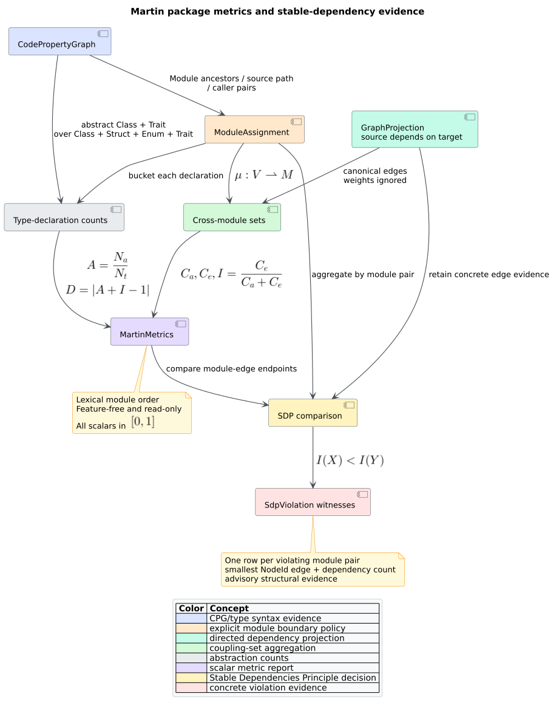

# Theory 18 — Martin package metrics and stable dependencies

Robert C. Martin's package metrics relate **coupling direction** to **type
abstraction**. They ask two complementary questions: how many outside program
elements depend on a module, and how many outside elements the module itself
depends on? The resulting instability and abstractness coordinates place the
module relative to a proposed “main sequence” of balanced designs [[1]](#references).

The [component guide](../components/graph/martin-metrics.md) specifies libcpg's
Rust API. This chapter develops the model, explains its projection-dependent
interpretation, and states where the metrics stop being evidence.



*Figure 1 — the complete feature-free Martin-metrics pipeline. Source:
[`diagrams/martin-metrics-pipeline.puml`](../diagrams/martin-metrics-pipeline.puml).*

## 1. Module boundaries are an explicit input

Let $`G=(V,E)`$ be a directed dependency graph and let
$`\mu:V\rightharpoonup M`$ be a partial assignment from projection vertices to
named modules. An edge $`u\to v`$ means that $`u`$ depends on $`v`$. The
assignment is deliberately separate from the graph: the same call, import,
reference, or caller-defined projection can be analyzed by source file, nested
language module, package, crate, service, or another architectural boundary.

libcpg supplies two policies:

- `ModuleAssignment::by_module_nodes` uses the nearest enclosing
  `CpgNodeKind::Module`; nested names are qualified with `::`, and declarations
  outside any module belong to `<root>`; and
- `ModuleAssignment::by_source_path` assigns a single-file CPG to its recorded
  source path, using `<unknown-source>` when no path was retained.

`ModuleAssignment::from_pairs` is the caller-supplied path. Names are sorted and
deduplicated, and a repeated node deterministically chooses the
lexicographically smallest name. Consequently the boundary policy is visible,
serializable, and reproducible rather than inferred inside a metric.

## 2. Afferent and efferent coupling are sets

For a module $`X\in M`$, define its vertex set
$`V_X=\{v\in V\mid\mu(v)=X\}`$. **Afferent coupling** $`C_a`$ counts distinct
outside vertices that depend on the module. **Efferent coupling** $`C_e`$
counts distinct outside vertices on which the module depends:

```math
C_a(X)=
\left|\left\{u\in V\setminus V_X\mid
\exists v\in V_X:(u,v)\in E\right\}\right|,
```

```math
C_e(X)=
\left|\left\{v\in V\setminus V_X\mid
\exists u\in V_X:(u,v)\in E\right\}\right|.
```

These are distinct-neighbor counts, not weighted edge sums. A self-loop and an
edge inside one module affect neither value. Projection weights are therefore
inert. When projection vertices are classes, the equations match Martin's
class-level definition. When vertices are files or functions, the same
mathematics becomes a file- or function-level architectural interpretation.
Changing that granularity changes the value and must be reported with it.

## 3. Instability is coupling direction normalized

Instability $`I`$ normalizes outward coupling by all direct external coupling:

```math
I(X)=
\begin{cases}
0, & C_a(X)+C_e(X)=0,\\
\dfrac{C_e(X)}{C_a(X)+C_e(X)}, & \text{otherwise}.
\end{cases}
```

Thus $`0\le I\le1`$. A value near zero is structurally **stable**: many outside
vertices depend on the module relative to the dependencies it exports. A value
near one is **unstable**: the module depends outward much more than others
depend inward. “Stable” does not mean correct, unchanging, or desirable in
isolation; it describes the direction of the admitted dependency edges.

The zero-coupling convention $`I=0`$ makes an isolated module stable. Its main-
sequence distance can still be large if it contains no abstractions. Consumers
should retain the raw $`C_a`$ and $`C_e`$ values so that isolation is not
mistaken for heavily depended-on stability.

## 4. Abstractness comes from CPG type declarations

The pgmcp implementation from which the coupling calculation is ported once
used `abstractness = 0.0` as a placeholder. libcpg has enough syntax evidence
to compute the actual ratio. Let $`N_a(X)`$ count abstract classes and traits,
and let $`N_t(X)`$ count classes, structs, enums, and traits assigned to $`X`$:

```math
A(X)=
\begin{cases}
0, & N_t(X)=0,\\
\dfrac{N_a(X)}{N_t(X)}, & \text{otherwise}.
\end{cases}
```

Every `Trait` is abstract. A `Class` contributes to $`N_a`$ only when its
`is_abstract` field is true. `Struct` and `Enum` declarations are concrete.
All four contribute to $`N_t`$. This is deliberately language-agnostic at the
analysis layer: language frontends map their interface/trait and concrete type
syntax into the shared node taxonomy before the metric runs.

## 5. Main sequence and distance

Martin's proposed balance line is

```math
A+I=1.
```

libcpg reports the normalized vertical/Manhattan-style distance used in
Martin's metric suite:

```math
D(X)=|A(X)+I(X)-1|.
```

It lies in $`[0,1]`$. A stable, concrete module has $`(A,I)=(0,0)`$ and
$`D=1`$; an unstable, entirely abstract module has $`(1,1)`$ and also $`D=1`$.
Points on the line have $`D=0`$. The value is a conformance measurement against
the chosen model, not a proof that a module should be refactored. Martin's own
report explicitly presents the metrics as an empirical design standard to be
examined rather than an unconditional law [[1]](#references).

## 6. Stable Dependencies Principle

The **Stable Dependencies Principle (SDP)** says dependency direction should
move toward stability. For a module edge $`X\to Y`$, libcpg reports a violation
exactly when

```math
I(X)<I(Y).
```

In words, a more stable source depends on a less stable target. Equal
instability is not a violation. Multiple projection edges between the same
module pair become one `SdpViolation` with a count and the lexicographically
smallest stable `NodeId` edge as evidence. This makes the result compact without
discarding its concrete topology witness.

An SDP result is advisory. A deliberate inversion boundary, generated adapter,
runtime plugin, or migration seam may justify the dependency. Conversely, a
clean result can reflect an incomplete projection or coarse module assignment.

## 7. Worked three-module example

Consider module edges `A -> B`, `A -> C`, `B -> C`, and `C -> A`, with one
projection vertex per module. Suppose `A` contains one trait, `B` one concrete
class, and `C` one abstract class plus one struct.

| Module | $`C_a`$ | $`C_e`$ | $`I`$ | $`A`$ | $`D`$ |
|---|---:|---:|---:|---:|---:|
| `A` | 1 | 2 | $`2/3`$ | 1 | $`2/3`$ |
| `B` | 1 | 1 | $`1/2`$ | 0 | $`1/2`$ |
| `C` | 2 | 1 | $`1/3`$ | $`1/2`$ | $`1/6`$ |

Only `C -> A` violates SDP because $`1/3<2/3`$. The other edges point from an
equally or more unstable source toward a more stable target.

## 8. Algorithm and complexity

The calculation is a pair of linear passes after projection validation:

```text
MARTIN_METRICS(cpg, assignment, projection):
    initialize one incoming set and outgoing set per unique module name

    for each canonical projection edge source -> target:
        X := assignment[source]
        Y := assignment[target]
        if X and Y exist and X != Y:
            outgoing[X].insert(target)
            incoming[Y].insert(source)

    for each CPG node with an assigned module:
        update that module's abstract and total type counters

    for each module in lexical order:
        Ca := size(incoming[module])
        Ce := size(outgoing[module])
        compute I, A, and D from the equations above
```

For $`n=|V|`$, $`m=|E|`$, and $`t`$ CPG nodes, the metric pass takes
$`O(m\log n+t\log |M|)`$ time with deterministic ordered sets and
$`O(n+|M|)`$ auxiliary space. SDP aggregation is another $`O(m\log |M|)`$
pass. No parser, parallel graph, optional dependency, or CPG mutation is
involved.

## References

1. Martin, R. C. (1994). *OO Design Quality Metrics: An Analysis of
   Dependencies.* Technical report, Object Mentor. [Archived report
   PDF](https://condor.depaul.edu/dmumaugh/OOT/Design-Principles/oodmetrc.pdf).
   No DOI assigned.
2. Martin, R. C. (2003). *Agile Software Development: Principles, Patterns,
   and Practices.* Prentice Hall/Pearson. ISBN 978-0-13-597444-5.
   [Publisher record](https://www.informit.com/store/agile-software-development-principles-patterns-and-9780135974445).
