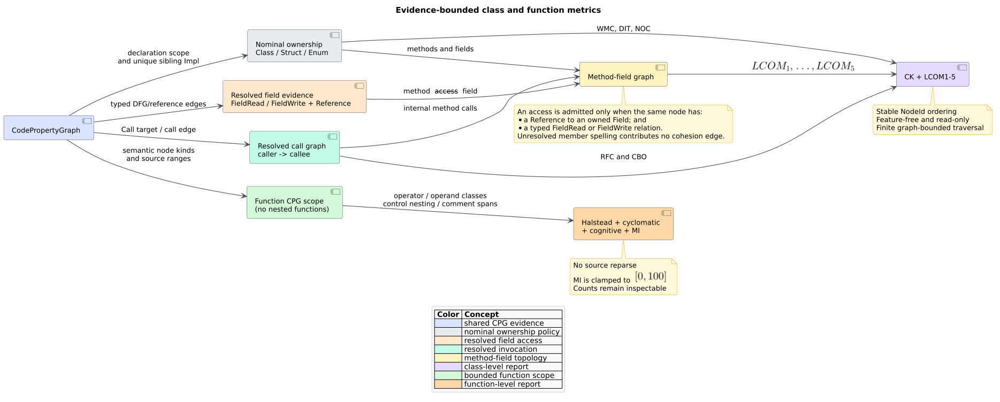

# Theory 22 — Object-Oriented and Function Metrics

Software metrics turn selected program structures into numbers. Their value is
not that a number can replace design judgment; it is that a precisely defined
number makes two structural snapshots comparable. This chapter develops the
theory behind `libcpg`'s CK, LCOM, Halstead, cyclomatic, cognitive, and
maintainability metrics and explains why resolved graph evidence matters.

## 1. Three measurement scales

The implemented metrics observe three distinct scales:

| Scale | Question | Evidence |
|---|---|---|
| Method | How many structured decisions and nesting burdens occur? | Function AST/CFG semantics and resolved self-calls. |
| Class | Do methods share state, invoke one another, inherit, or call other types? | Nominal ownership, field DFG/reference edges, inheritance, and resolved calls. |
| Composite | How do volume, path count, line span, and comments combine into one comparative index? | Halstead counts, cyclomatic complexity, source ranges, and comment nodes. |

Keeping the scales separate prevents a common category error. LCOM does not
measure method control-flow complexity; cyclomatic complexity does not measure
whether a class has one responsibility; and the maintainability index does not
prove how long a future change will take.

## 2. From spelling to incidence

Suppose two methods contain the text `x`. Text alone cannot establish that they
share state: one `x` might be a local, an unrelated receiver's field, or a field
of another same-named class. The right abstraction is an **incidence relation**
between declarations.

Let $`M`$ be the methods of one class, $`F`$ its fields, and $`A`$ its access
expressions. Define two relations:

```math
R_{MA}\subseteq M\times A
```

```math
R_{AF}\subseteq A\times F
```

An incidence $`(m,f)`$ exists only if some $`a`$ satisfies
$`(m,a)\in R_{MA}`$ and $`(a,f)\in R_{AF}`$. In the CPG, the first fact comes
from function scope plus typed `FieldRead`/`FieldWrite`; the second is a
`Reference` to the declaration. This retained witness distinguishes a real
method-field topology from a name-matching approximation.



*Figure 1 — evidence is resolved before it is counted. Source:
[`code-metrics-pipeline.puml`](../diagrams/code-metrics-pipeline.puml).*

## 3. CK as set and path measurements

Chidamber and Kemerer proposed six object-oriented measures in their 1991
conference paper and 1994 journal treatment. `libcpg` implements five class
fields directly and expands the sixth, lack of cohesion, into LCOM1–5.

### 3.1 Weighted methods per class

Weighted Methods per Class (WMC) is a sum, not necessarily a method count. If
$`c(m)`$ is a chosen method weight, then:

```math
\operatorname{WMC}(C)=\sum_{m\in M_C}c(m)
```

`libcpg` selects McCabe cyclomatic complexity as $`c`$. A straight-line method
therefore contributes one, while structured decisions contribute additional
independent paths. This preserves the intuition that many simple methods and a
few deeply branching methods are different class shapes even when their method
counts match.

### 3.2 Inheritance depth and children

Treat `child -> parent` inheritance edges as a directed graph. Depth of
Inheritance Tree (DIT) is the longest parent path from a class to a root;
Number of Children (NOC) is immediate reverse degree. Real or malformed input
can contain an inheritance cycle, for which an unrestricted longest walk is
undefined. `libcpg` first condenses every strongly connected component (SCC),
then computes longest paths on the resulting directed acyclic graph. Every
member of one cyclic SCC receives the same finite depth.

### 3.3 Coupling and response

Coupling Between Object classes (CBO) is a distinct-neighbor count. The
implemented static evidence is symmetric: a resolved incoming/outgoing call or
a CPG type edge couples the two nominal owners. Duplicate calls do not increase
CBO.

Response For a Class (RFC) is instead a set of callable functions:

```math
\operatorname{RFC}(C)=\left|M_C\cup\bigcup_{m\in M_C}R(m)\right|
```

Only direct resolved callees are included. A transitive call closure would
measure a different, potentially much larger property and would make RFC depend
on arbitrary search depth. The call graph can improve without changing this
definition: each newly resolved call supplies one more real edge to consider.

## 4. LCOM is a family, not one number

“LCOM” has referred to several incompatible formulae. A report must name the
variant. Let $`F(m)`$ be the fields accessed by method $`m`$.

LCOM1 counts unordered method pairs with disjoint field sets. LCOM2 subtracts
the number of sharing pairs and floors at zero. Their scale grows with the
number of methods, which makes raw values unsuitable for comparing differently
sized classes without context.

Li and Henry recast cohesion as connected sets of methods; Hitz and Montazeri
gave the graph-theoretic form and added internal calls. With one method per
vertex:

- LCOM3 counts connected components formed by shared-field edges;
- LCOM4 counts components after resolved internal call edges are added.

This distinction handles an accessor-mediated design. If method `report`
calls `get_x` and only `get_x` directly reads `x`, LCOM3 keeps them separate;
LCOM4 joins them through the call. Neither result is universally “better”—they
answer different evidence questions.

Henderson-Sellers LCOM5 normalizes average field use. For $`m`$ methods,
$`a`$ fields, and $`\mu(f)`$ methods touching field $`f`$:

```math
\operatorname{LCOM}_5=
\frac{m-\frac{1}{a}\sum_f\mu(f)}{m-1}
```

The extreme values have useful interpretations:

- if every method touches every field, average usage is $`m`$ and LCOM5 is zero;
- if every field is touched by exactly one method, average usage is one and
  LCOM5 is one.

Classes with fewer than two methods or no fields make the denominator or field
average degenerate. `libcpg` defines their LCOM5 as zero and exposes the method
and field vectors so the caller can recognize the degenerate case.

## 5. Function complexity

### 5.1 Cyclomatic complexity

McCabe defined cyclomatic complexity from control-flow topology. For a connected
control-flow graph with $`E`$ edges and $`N`$ vertices, one familiar form is:

```math
v(G)=E-N+2
```

For structured control constructs, the equivalent practical form is one plus
the number of decisions. `libcpg` uses that form over normalized CPG kinds so a
function with no decisions remains one. Short-circuit Boolean operations are
decisions because one operand can prevent evaluation of the next.

### 5.2 Cognitive complexity

Cyclomatic complexity treats a top-level `if` and an `if` nested inside three
loops as one decision each. Cognitive complexity distinguishes them. A
structure at nesting depth $`n`$ contributes $`1+n`$; breaks of linear flow,
logical sequences, and recursion contribute one. Campbell's metric was designed
to model understandability more directly than path count, but it remains a
heuristic. `libcpg` publishes the exact subset of normalized constructs it
counts so the result can be reproduced.

## 6. Halstead as vocabulary measurement

Halstead partitions a program representation into operators and operands. Four
primitive counts determine the implemented derived measures:

| Symbol | Definition |
|---|---|
| $`\eta_1`$ | distinct operators |
| $`\eta_2`$ | distinct operands |
| $`N_1`$ | total operator occurrences |
| $`N_2`$ | total operand occurrences |

Vocabulary is $`\eta=\eta_1+\eta_2`$ and length is $`N=N_1+N_2`$. Volume,
difficulty, and effort are:

```math
V=N\log_2\eta
```

```math
D=\frac{\eta_1}{2}\frac{N_2}{\eta_2}
```

```math
E=DV
```

The formulas do not determine how a language is tokenized. `libcpg` deliberately
uses semantic CPG categories: an `If` is an operator, an identifier spelling is
an operand, and discarded delimiters do not exist. This gives one common
cross-language measurement vocabulary while making the evidence independent of
retained source. It also means the result should not be equated with a
token-level tool unless both classifiers are aligned first.

## 7. Maintainability index as a composite

Oman and Hagemeister proposed combining existing measures into a maintainability
index; Coleman and colleagues later described its practical use. The
pgmcp-compatible variant combines Halstead volume $`V`$, cyclomatic complexity
$`v(G)`$, inclusive source-line span $`L`$, and comment lines $`C`$:

```math
171-5.2\ln V-0.23v(G)-16.2\ln L+50\sin\sqrt{2.4C/L}
```

`libcpg` floors logarithm inputs at one and clamps the raw result to
$`[0,100]`. The comment term is not monotone over every mathematically possible
ratio because it contains a sine; normal source inputs keep $`C/L`$ within the
represented function span. This is one reason MI should be compared as a
documented composite rather than interpreted causally.

## 8. What a metric can and cannot say

A metric is exact relative to its definition and input evidence. That does not
make its quality interpretation exact.

The implemented computations can establish statements such as “three resolved
methods form two field-sharing components” or “this semantic vocabulary has
volume $`V`$.” They cannot establish that a class violates the Single
Responsibility Principle, that a function is hard for a particular maintainer,
or that a change will cause a defect. Those are hypotheses for review or
empirical study.

The safest workflow retains an evidence chain:

```text
source + frontend policy
    -> CPG node/edge snapshot
    -> resolver and DFG configuration
    -> metric options and scalar report
    -> human interpretation in project context
```

See the [component contract](../components/graph/code-metrics.md), the
[design decision](../design/0029-evidence-bounded-code-metrics.md), and the
[validation ledger](../scientific/24-code-metrics-validation.md).

## References

1. McCabe, T. J. (1976). *A Complexity Measure*. DOI:
   [10.1109/TSE.1976.233837](https://doi.org/10.1109/TSE.1976.233837).
2. Chidamber, S. R., and Kemerer, C. F. (1991). *Towards a Metrics Suite for
   Object Oriented Design*. DOI:
   [10.1145/117954.117970](https://doi.org/10.1145/117954.117970).
3. Chidamber, S. R., and Kemerer, C. F. (1994). *A Metrics Suite for Object
   Oriented Design*. DOI:
   [10.1109/32.295895](https://doi.org/10.1109/32.295895).
4. Li, W., and Henry, S. (1993). *Object-Oriented Metrics that Predict
   Maintainability*. DOI:
   [10.1016/0164-1212(93)90077-B](https://doi.org/10.1016/0164-1212(93)90077-B).
5. Hitz, M., and Montazeri, B. (1995). *Measuring Coupling and Cohesion in
   Object-Oriented Systems*. [Author-hosted paper](https://www.isys.uni-klu.ac.at/PDF/1995-0043-MHBM.pdf).
   No DOI was assigned.
6. Henderson-Sellers, B. (1996). *Object-Oriented Metrics: Measures of
   Complexity*. Prentice Hall PTR. ISBN 0-13-239872-9. No DOI was assigned.
7. Halstead, M. H. (1977). *Elements of Software Science*. Elsevier/North-Holland.
   ISBN 0-444-00205-7. No DOI was assigned.
8. Campbell, G. A. (2018). *Cognitive Complexity: An Overview and Evaluation*.
   DOI: [10.1145/3194164.3194186](https://doi.org/10.1145/3194164.3194186).
9. Oman, P., and Hagemeister, J. (1992). *Metrics for Assessing a Software
   System's Maintainability*. DOI:
   [10.1109/ICSM.1992.242525](https://doi.org/10.1109/ICSM.1992.242525).
10. Coleman, D., Ash, D., Lowther, B., and Oman, P. (1994). *Using Metrics to
    Evaluate Software System Maintainability*. DOI:
    [10.1109/2.303623](https://doi.org/10.1109/2.303623).
