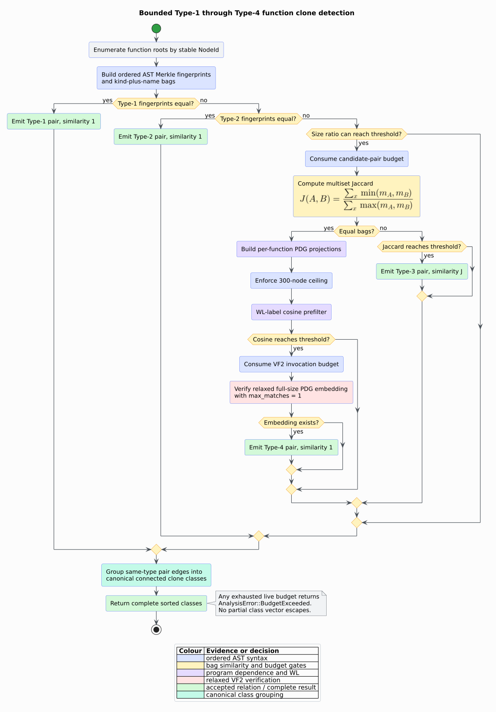

# Theory 23 — Function clone detection

A **code clone** is a pair or family of program regions that agree under a
chosen syntactic or semantic relation. The word “clone” is not one universal
equivalence: Type-1 through Type-4 progressively relax what must agree. libcpg
applies that taxonomy to function-rooted CPG regions and reports the strongest
relation established for each pair.

## 1. Taxonomy and evidence

| Type | Required agreement | libcpg evidence |
|---|---|---|
| Type-1 | retained syntax after ignoring locations and comments | ordered AST Merkle fingerprint including names, operators, literals, and terminal text |
| Type-2 | syntax after systematic token abstraction | ordered AST Merkle fingerprint of `NodeKindTag` values |
| Type-3 | syntax with inserted, deleted, or changed statements | multiset Jaccard similarity of kind-and-name features |
| Type-4 | dependence structure despite syntactic reordering | PDG WL-label cosine prefilter followed by relaxed VF2 isomorphism |

Type-1 here is *CPG-semantic Type-1*. A CPG intentionally discards trivia, so
it cannot distinguish whitespace variants and treats comments as irrelevant.
If terminal text is retained, it contributes to the fingerprint; names,
operators, and literal payloads contribute even without retained source.



*Figure 1 — strongest-first function-clone classification. Source:
[`clone-detection-pipeline.puml`](../diagrams/clone-detection-pipeline.puml).*

## 2. Ordered Merkle fingerprints

For function root $`r`$, let $`T_r`$ be its AST subtree with nested functions
and comments removed. Let $`c_1,\ldots,c_k`$ be a node's children in source
order. A bottom-up Merkle fingerprint is

```math
H_t(v)=\operatorname{mix}\left(s_t(v),
  \operatorname{mix}(b,H_t(c_1)),\ldots,
  \operatorname{mix}(b,H_t(c_k))\right),
```

where $`t\in\{1,2\}`$ selects the clone type, $`b`$ is a fixed child-boundary
word, and `mix` is the same fixed SplitMix-style 64-bit combiner used by
libcpg's WL analysis. For Type-1, $`s_1`$ contains the kind tag plus retained
lexical payload. For Type-2, $`s_2`$ contains only the kind tag. Child order is
essential: exchanging unlike statements changes both ordered fingerprints.

The implementation uses an explicit postorder stack. A visited set prevents a
malformed cyclic AST from recursing forever, and a fixed sentinel represents a
back edge. `NodeId`, source location, hash-map order, and Rust's
`DefaultHasher` never enter the digest.

## 3. Type-3 multiset similarity

Each non-comment node contributes one pair `(kind tag, name)` to a multiset.
Unnamed nodes use the empty name. If $`m_A(x)`$ and $`m_B(x)`$ are the
multiplicities of feature $`x`$, multiset Jaccard similarity is

```math
J(A,B)=
\frac{\sum_x\min(m_A(x),m_B(x))}
     {\sum_x\max(m_A(x),m_B(x))}.
```

The empty/empty value is one. Because
$`J(A,B)\le\min(|A|,|B|)/\max(|A|,|B|)`$, exact size buckets eliminate pairs
whose size ratio is below `type3_threshold` without false negatives. The
default threshold is $`0.8`$.

The `max_pairs` option limits all size-qualified candidate pairs before their
strongest relation is classified. Reaching the limit
does not return a partial result: the first required comparison beyond it
returns `AnalysisError::BudgetExceeded`.

## 4. Type-4 dependence verification

A **program dependence graph** (PDG) contains control- and data-dependence
edges. It abstracts away source ordering when two statements are independent.
For two equal feature bags whose ordered Type-2 fingerprints differ, libcpg:

1. constructs each function's `pdg_projection`;
2. rejects unequal vertex or edge counts;
3. computes bounded Weisfeiler–Lehman (WL) label multisets by jointly
   canonicalizing both PDGs' raw signatures into one comparison vocabulary;
4. compares those multisets by cosine similarity; and
5. invokes the existing relaxed `Vf2Matcher` with one-match termination.

For count vectors $`a`$ and $`b`$, the prefilter is

```math
\operatorname{cos}(a,b)=
\frac{a\cdot b}{\lVert a\rVert_2\lVert b\rVert_2}.
```

WL equality is only a necessary structural screen; one-dimensional WL is not a
complete isomorphism test. VF2 supplies the final full-size embedding check.
Equal graph sizes turn that injective embedding into a bijection. Relaxed node
categories let renamed expression nodes align, while the pure PDG copy prevents
AST order or unrelated overlays from contaminating semantic verification.

## 5. Classification and clone classes

The pair classifier is deliberately strongest-first:

```text
for each stable function pair (a, b):
    if Type-1 fingerprints agree: relate(a, b, Type-1, 1)
    else if Type-2 fingerprints agree: relate(a, b, Type-2, 1)
    else if the size ratio admits the pair:
        consume one candidate-pair budget unit
        j = multiset_jaccard(a, b)
        if j = 1 and bounded_PDG_VF2(a, b): relate(a, b, Type-4, 1)
        else if j reaches the threshold: relate(a, b, Type-3, j)

for each clone type:
    form connected components of that pair relation
    sort member function roots
    report the minimum joining-edge similarity
```

Testing Type-4 before Type-3 only when the bags are equal separates reordered
independent statements (Type-4) from statement insertion (Type-3). A function
can participate in classes of different types through different pair
relations. Connected components give the conventional clone-family closure;
the reported minimum is relation-edge evidence, not a claim that every
non-adjacent pair independently passed the detector.

## 6. Bounds and complexity

For total AST size $`N`$, the two Merkle fingerprints and bags take $`O(N)`$
expected time and $`O(N)`$ storage. Let $`P`$ be the number of size-qualified
pairs, bounded by 100,000. Ordered-map Jaccard work is linear in the two feature
vocabularies. Type-4 admits at most 300 PDG vertices per side and a configured
number of VF2 invocations. VF2 remains exponential in the worst case, which is
why WL, size equality, the 300-node ceiling, one-match termination, and the
invocation budget all precede or bound it.

No cap silently truncates output. Invalid thresholds and requests above hard
ceilings are `InvalidInput`; exhausted work budgets are `BudgetExceeded`.

## 7. Interpretation limits

- Fingerprint equality has a finite 64-bit collision probability; it is not a
  cryptographic identity proof.
- Type-3 is a bag comparison and discards statement order and topology.
- Type-4 establishes relaxed PDG-graph isomorphism, not behavioral equivalence.
- Missing PDG edges mean missing semantic evidence; callers should construct
  the PDG before relying on Type-4 findings.
- Clone findings are advisory. Repetition can be intentional, generated, or
  safer than a premature abstraction.

## References

1. Bellon, S., Koschke, R., Antoniol, G., Krinke, J., and Merlo, E. (2007).
   *Comparison and Evaluation of Clone Detection Tools.* IEEE Transactions on
   Software Engineering 33(9), 577–591.
   [DOI 10.1109/TSE.2007.70725](https://doi.org/10.1109/TSE.2007.70725).
2. Baxter, I. D., Yahin, A., Moura, L., Sant'Anna, M., and Bier, L. (1998).
   *Clone Detection Using Abstract Syntax Trees.* ICSM 1998, 368–377.
   [DOI 10.1109/ICSM.1998.738528](https://doi.org/10.1109/ICSM.1998.738528).
3. Zou, Y., Ban, B., Xue, Y., and Xu, Y. (2020). *CCGraph: A PDG-Based Code
   Clone Detector with Approximate Graph Matching.* ASE 2020.
   [DOI 10.1145/3324884.3416541](https://doi.org/10.1145/3324884.3416541).
4. Komondoor, R., and Horwitz, S. (2001). *Using Slicing to Identify
   Duplication in Source Code.* SAS 2001, 40–56.
   [DOI 10.1007/3-540-47764-0_33](https://doi.org/10.1007/3-540-47764-0_33).
