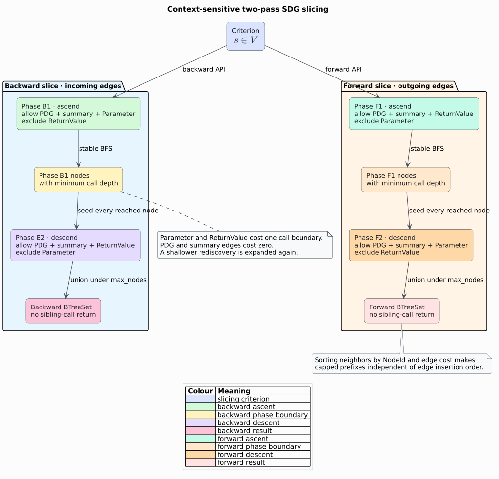

# Theory 28 — System dependence and context-sensitive slicing

A **System Dependence Graph (SDG)** extends the per-procedure Program
Dependence Graph (PDG) with explicit parameter flow, return flow, and
caller-local summary edges. It supports an interprocedural slice without
accepting paths that enter through one call site and return through another.
libcpg follows the two-pass construction of Horwitz, Reps, and Binkley
[[1]](#references) over the PDG foundation of Ferrante, Ottenstein, and Warren
[[2]](#references).

The SDG is not a second graph. It is a typed edge overlay on the existing
`CodePropertyGraph` node set.


## 1. Edge model

Let $`G=(V,E)`$ be a Code Property Graph (CPG), where $`V`$ is the shared node
set. Define four relevant edge subsets:

- $`E_P`$: `ControlDependence` and `DataDependence` PDG edges;
- $`E_I`$: actual-to-formal `DfgEdgeKind::Parameter` edges;
- $`E_O`$: returned-expression-to-call `DfgEdgeKind::ReturnValue` edges; and
- $`E_S`$: `DataDependence` edges labeled `summary`.

The represented SDG is the overlay

```math
G_S=(V,E_P\cup E_I\cup E_O\cup E_S).
```

All four families point in value-influence order. `Parameter` points from a
caller argument to a callee formal. `ReturnValue` points from a callee return
expression to the caller's call node. A summary edge points from an actual
argument directly to that call node.

## 2. Summary-edge construction

For a resolved call site $`c`$ invoking function $`f`$, let $`a_i`$ be actual
argument $`i`$. `EffectSummary::param_to_return` is a bit mask $`M_f`$ whose
bit $`i`$ states that formal $`i`$ may influence the return. libcpg emits

```math
(a_i,c)\in E_S \quad\Longleftrightarrow\quad
(M_f\mathbin{\&}2^i)\ne 0.
```

For several resolved dynamic targets, the relation is the union of their
masks. A capped effect summary conservatively connects every argument. A
truncated mask conservatively connects positions beyond bit 63. The builder
sorts and deduplicates candidate endpoint pairs, then uses labeled unique
connection. Repeating it adds zero edges and never adds or removes nodes.

Summary edges encode a transitive fact: an argument can affect the call result
through the callee. They let phase one step over a call while deliberately not
entering it.

## 3. Why ordinary reachability is context-insensitive

Suppose calls $`c_1`$ and $`c_2`$ both invoke `identity`. Both arguments point
to the same formal, and the same return expression points to both call nodes.
An unrestricted reverse traversal from $`c_1`$ can enter the callee through
its return and then follow the other incoming parameter edge to the argument
of $`c_2`$. That path is graph-reachable but not realizable by one call stack.

The summary edge at $`c_1`$ captures the caller-local dependence directly.
The two phases then separate upward and downward call-boundary traversal so
the slice cannot switch call sites.

## 4. Backward two-pass slice

For a slicing criterion $`s\in V`$, phase one walks edges backward through
$`E_P\cup E_S\cup E_I`$ and excludes $`E_O`$. In reverse orientation,
`Parameter` ascends from a callee formal into its callers. Summary edges step
over calls without entering callees.

Phase two starts from every phase-one node and walks backward through
$`E_P\cup E_S\cup E_O`$ while excluding $`E_I`$. `ReturnValue` now descends
from a call into its callee, but excluding `Parameter` prevents a later ascent
through a sibling call.



The following literate pseudocode states the algorithm. `Traverse` is a stable
breadth-first search (BFS) that records the minimum call depth per node.

```text
BackwardSDGSlice(G, criterion, caps):
    # Ascend and step over calls, but never enter a callee by its return.
    reached, phase1_depth = Traverse(
        G, {(criterion, 0)}, incoming,
        allow={PDG, summary, Parameter}, caps)

    # Descend from every relevant caller context, but never ascend again.
    reached, _ = Traverse(
        G, phase1_depth, incoming,
        allow={PDG, summary, ReturnValue}, caps,
        accumulator=reached)
    return reached
```

This is the Horwitz–Reps–Binkley (HRB) context discipline adapted to libcpg's
existing value-flow directions [[1]](#references).

## 5. Forward direction

Forward slicing is the direction dual. An outgoing `ReturnValue` edge ascends
from a callee return into callers, whereas outgoing `Parameter` descends from
an actual into a callee. Therefore forward phase one excludes `Parameter`, and
phase two excludes `ReturnValue`:

```text
ForwardSDGSlice(G, criterion, caps):
    reached, phase1_depth = Traverse(
        G, {(criterion, 0)}, outgoing,
        allow={PDG, summary, ReturnValue}, caps)
    reached, _ = Traverse(
        G, phase1_depth, outgoing,
        allow={PDG, summary, Parameter}, caps,
        accumulator=reached)
    return reached
```

Using the same masks as backward traversal would reverse the meaning of
“ascend” and “descend” and admit the very paths the two-phase method removes.

## 6. Determinism and explicit bounds

`SliceCaps` defines:

- `max_nodes`: maximum distinct nodes in the returned `BTreeSet`; and
- `max_call_depth`: maximum number of `Parameter` or `ReturnValue` boundaries
  crossed along a represented traversal path.

PDG and summary edges have call-depth cost zero; the two interprocedural DFG
families have cost one. The traversal retains the smallest observed depth for
each node. A shallower rediscovery is expanded again because it may reach
nodes that a deeper path cannot reach under the cap.

Neighbors are sorted by `(NodeId, edge_cost)` before relaxation, phase-two
seeds are an ordered map, and the result is a `BTreeSet`. Thus edge insertion
order cannot change either an uncapped result or the deterministic prefix
selected by `max_nodes`.

For $`n`$ returned nodes and $`m`$ inspected admitted edges, time is
$`O(n+m)`$ apart from per-frontier sorting; retained state is $`O(n)`$. A zero
node cap or a criterion outside the CPG returns the empty set.

## 7. Evidence boundary

The slice is exact for the represented edge relation and the selected caps; it
is not a whole-language semantic proof. Missing call targets, imprecise effect
summaries, absent aliases, exceptions, reflection, and infeasible control paths
can change the relationship between graph reachability and runtime behavior.
A capped slice is a deterministic partial result and can omit relevant nodes.

Summary-edge construction is conservative when its input effect summary is
marked capped. Consumers must preserve that provenance when making claims
about completeness.

## References

1. Horwitz, S., Reps, T., Binkley, D. (1990). *Interprocedural Slicing Using
   Dependence Graphs.* ACM Transactions on Programming Languages and Systems
   12(1), 26–60. DOI:
   [10.1145/77606.77608](https://doi.org/10.1145/77606.77608).
2. Ferrante, J., Ottenstein, K. J., Warren, J. D. (1987). *The Program
   Dependence Graph and Its Use in Optimization.* ACM Transactions on
   Programming Languages and Systems 9(3), 319–349. DOI:
   [10.1145/24039.24041](https://doi.org/10.1145/24039.24041).
