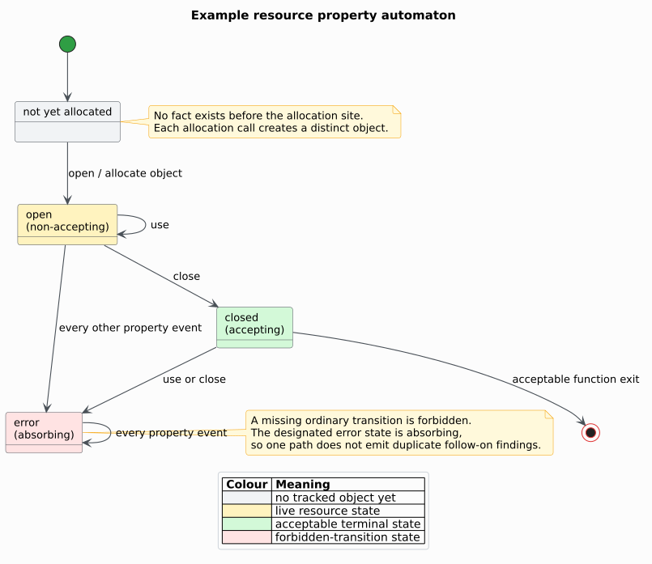

# Theory 33 — Finite-state typestate properties

A **typestate** associates an object's permitted operations with its current
abstract state. Unlike an ordinary type, which usually remains fixed, typestate
changes after events such as allocation, initialization, locking, closing, or
consumption. Strom and Yemini introduced this idea as a reliability discipline
for operation sequences [[1]](#references). libcpg implements a finite,
advisory may-analysis over represented Code Property Graph (CPG) evidence.



## 1. Property vocabulary

A **property automaton** is the tuple:

```math
P=(Q,\Sigma,\delta,\alpha,A,q_{\mathrm{err}}).
```

The symbols are defined before use:

| Symbol | Definition |
|---|---|
| $`Q`$ | finite set of property states |
| $`\Sigma`$ | finite alphabet of call events |
| $`\delta:Q\times\Sigma\rightharpoonup Q`$ | partial deterministic ordinary transition function |
| $`\alpha:\Sigma\rightharpoonup Q`$ | allocation event to initial post-allocation state |
| $`A\subseteq Q`$ | accepting states allowed by a client's terminal policy |
| $`q_{\mathrm{err}}\in Q`$ | designated absorbing error state |

An allocation event does not transition an existing object. It creates a fresh
abstract object keyed by that allocation call site and seeds it in
$`\alpha(a)`$. Therefore two syntactically distinct calls to `open` remain two
objects even if their results share a variable name later.

The implementation completes the partial ordinary transition function with an
error result:

```math
\delta^{\bot}(q,a)=
\begin{cases}
q_{\mathrm{err}} & q=q_{\mathrm{err}},\\
\delta(q,a) & (q,a)\in\operatorname{dom}(\delta),\\
q_{\mathrm{err}} & \text{otherwise}.
\end{cases}
```

The third case is a **forbidden transition**. Entering the absorbing state means
the first invalid event is reported without producing a cascade of duplicate
findings for later events on that same erroneous path.

## 2. Abstract objects and evidence

Let $`O`$ be the finite set of allocation call-site identifiers. libcpg starts
from each allocation call and propagates its identity through represented DFG
(Data Flow Graph), reference, definition, and alias edges. It does not infer
identity from source spelling. A call event affects object $`o\in O`$ only when
the event's receiver or argument subtree carries $`o`$ through this typed
evidence.

Allocation-site abstraction is finite and deterministic, but it can merge
runtime instances created by one call inside a loop. This is a standard static
abstraction trade-off, not a claim that one call executes only once. Fink et al.
show why alias precision is central to effective typestate verification
[[2]](#references); libcpg responds conservatively to the evidence it has rather
than claiming a whole-program points-to analysis.

## 3. CFG may-fact equations

For CFG program point $`n`$, the fact set $`F_n\subseteq O\times Q`$ records
possible object states before local transfer. The join at a control-flow merge
is union:

```math
F_n=\bigcup_{p\in\operatorname{pred}(n)}\operatorname{transfer}_p(F_p).
```

Union makes this a **may-analysis**: if one branch closes an object and another
leaves it open, both `(object, closed)` and `(object, open)` reach the join. A
later `use` reports the forbidden closed-state path while retaining the legal
open-state path. The analysis does not call that branch feasible; it says the
represented CFG has not ruled it out.

At an allocation occurrence for $`o`$, the local fact for $`o`$ is reset to
$`\alpha(a)`$. At an ordinary event $`a`$ carrying $`o`$, its state becomes
$`\delta^{\bot}(q,a)`$. Events outside $`\Sigma`$ preserve every property fact.

Terminal states at function exits are accumulated by object. `accepting` does
not redefine a forbidden transition: it is a separate client policy for states
that are acceptable when the represented function exits.

## 4. Literate worklist algorithm

The algorithm follows the evidence story a reviewer needs to reproduce:

```text
Validate the complete finite-state property.
Enumerate represented functions in canonical NodeId order.
For each function:
    Enumerate calls by source range and stable NodeId.
    Reconstruct each event from typed callee or represented target evidence.
    Create one abstract object for each allocation event.
    Propagate object identities over typed value-flow edges with a heap worklist.
    Construct the canonical intraprocedural CFG projection.
    Place allocation and ordinary event occurrences at enclosing CFG points.
    Seed ordered facts at allocation points.
    While the ordered fact worklist is non-empty:
        Remove the shortest, then lexicographically smallest pending fact.
        Apply source-ordered local occurrences.
        On a missing transition, retain the predecessor witness and enter error.
        Join the resulting fact into every canonical CFG successor.
        Record possible states at exit-like points.
Return ordered findings, terminal states, issues, caps, and work evidence.
```

All graph-depth state is stored on the heap. The predecessor chain is also
reconstructed iteratively. Ordered maps and sets replace input-sized native-
stack sorting in the production path.

## 5. Termination, bounds, and complexity

The abstract domain is finite: at most $`|O||Q|`$ facts can occur at one program
point before a configured cap intervenes. Each fact is admitted once per point,
so propagation terminates even when the CFG has cycles.

Let $`N`$ and $`E`$ be the canonical CFG point and edge counts, $`V_d`$ and
$`E_d`$ the object-flow node and edge counts, and $`K\le |O||Q|`$ the admitted
facts per CFG point. Ignoring ordered-container logarithms, the upper-bound
shape is:

```math
O(V_d+E_d+KN+KE)
```

time and $`O(V_d|O|+KN)`$ retained fact/trace space. `IfdsCaps` separately
bounds functions, facts per node, total worklist steps, and callee-path depth.
The solver uses no recursive SCC iteration; its finite per-node fact worklist
makes `max_scc_iters` inapplicable.

## 6. Advisory interpretation

A `TypestateViolation` is evidence that one represented control/data-flow path
attempts an absent property transition. It is not proof that the path executes,
that two allocation-site instances are the same runtime object, or that a
security vulnerability exists. Conversely, an empty findings vector supports a
negative claim only when `TypestateAnalysis::is_complete()` is true.

## References

1. Strom, R. E., Yemini, S. (1986). *Typestate: A Programming Language Concept
   for Enhancing Software Reliability.* DOI:
   [10.1109/TSE.1986.6312929](https://doi.org/10.1109/TSE.1986.6312929).
2. Fink, S. J., Yahav, E., Dor, N., Ramalingam, G., Geay, E. (2008). *Effective
   Typestate Verification in the Presence of Aliasing.* DOI:
   [10.1145/1348250.1348255](https://doi.org/10.1145/1348250.1348255).
