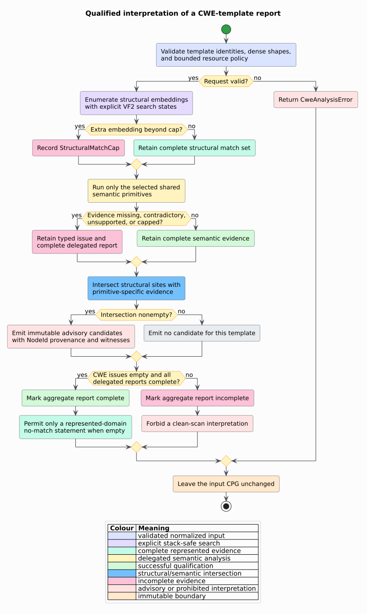

# Theory 38 — Declarative CWE-query semantics

This chapter defines the represented-domain semantics of libcpg's Common
Weakness Enumeration (CWE) templates. A **template** is a finite declarative
query. A **structural embedding** maps its graph shape into the target Code
Property Graph (CPG). A **semantic primitive** supplies data-flow, nullness,
typestate, numeric, or literal evidence. A **candidate** is the conjunction of
those relations and remains an advisory, not a vulnerability verdict.

## 1. Template domain

Let the target CPG be a finite typed multigraph:

```math
G = (V,E,\lambda_V,\lambda_E)
```

Here $`V`$ is the represented node set, $`E \subseteq V\times V`$ is the edge
multiset, and the labeling functions assign CPG node and edge kinds. A template
$`t`$ is:

```math
t=(i,c,h,r_o,r_n,r_s,\mathcal P,p)
```

where $`i`$ is a stable identifier, $`c`$ is a positive CWE number, $`h`$ is a
title, $`r_o`$, $`r_n`$, and $`r_s`$ are origin, neutralizer, and sensitive-use
roles, $`\mathcal P`$ is a nonempty finite set of structural alternatives, and
$`p`$ selects one semantic primitive.

A role contains named predicates over reconstructed callee paths, typed
identifiers/members, or normalized operators. These predicates consume graph
semantics already produced by a frontend; they do not scan source text.

## 2. Structural embedding

Each structural alternative is a finite pattern graph
$`Q=(V_Q,E_Q,\lambda_Q)`$ and a designated sink vertex $`q_s\in V_Q`$. A VF2
embedding is an injective mapping $`m:V_Q\rightarrow V`$ such that node labels
match and every pattern edge is preserved under libcpg's typed edge-class
relation:

```math
(u,v)\in E_Q
\Longrightarrow
(m(u),m(v))\in E
```

The mapped structural site is $`m(q_s)`$. The retained site set for template
$`t`$ is:

```math
P_t=\bigcup_{Q\in\mathcal P_t}
\{m(q_s)\mid m\text{ is a retained embedding of }Q\text{ in }G\}
```

The matcher asks for one extra result beyond the configured cap. Observing that
extra embedding records `StructuralMatchCap`; it does not pretend the retained
prefix is exhaustive.

## 3. Source–neutralizer–sink flow

For taint-backed templates, roles are compiled into one shared `TaintCatalog`.
Let $`O_t`$ be origin calls, $`N_t`$ neutralizer calls, and $`K_t`$ sensitive
calls for template $`t`$. The summary-based IFDS-style solver propagates
origin-sensitive facts through represented intra- and interprocedural data-flow
relations. A neutralizer kills the matching fact.

The qualified taint candidates are:

```math
C_t^{\mathrm{taint}} =
\{(o,s,w)\mid o\in O_t \land s\in K_t \cap P_t
\land o\leadsto_{\mathrm{df}}s
\land w\text{ contains no killing }n\in N_t\}
```

The witness $`w`$ is a canonical vector of represented `NodeId` values. The
relation supports CWE-22, CWE-78, CWE-79, CWE-89, and CWE-502. It is a may-flow
relation over represented dependence and summaries, so it is intentionally
advisory.

## 4. Maybe-null flow

The CWE-476 primitive reuses the null-flow specialization of the shared solver.
Let $`D`$ be typed dereference sites and $`M`$ be origins whose abstract value
may be null. Its candidates are:

```math
C_{476}=P_{476}\cap
\{d\in D\mid \exists o\in M:\;o\leadsto_{\mathrm{df}}d\}
```

Each result retains the null-origin class and any represented sink parameter.
No result implies non-null safety only when the CWE report and the delegated
null analysis are both complete.

## 5. Typestate flow

The CWE-416 primitive uses a finite-state machine (FSM). An FSM has a finite
state set $`Q`$, event alphabet $`\Sigma`$, partial transition function
$`\delta:Q\times\Sigma\rightharpoonup Q`$, allocation states, and an error
state. Allocation calls create object facts; Data Flow Graph (DFG) and reference
relations associate later events with the abstract object.

The shipped property enters an allocated state, moves to a freed state on
`free`, and intentionally has no transition for represented use/read/write or
dereference events from the freed state. A candidate exists only for one of
those named forbidden events whose site also lies in $`P_{416}`$. The full
typestate report is retained so path joins, caps, and witnesses remain visible.

## 6. Interval-backed arithmetic

An interval is an abstract set:

```math
I=[\ell,h]=\{x\in\mathbb Z\mid \ell\leq x\leq h\}
```

with finite or infinite bounds. The shared interval solver computes a may-range
for selected expression roots in their nearest represented Control Flow Graph
(CFG) state. The adapter finds that state with a breadth-first AST-parent walk;
equally near malformed multi-parent contexts are joined by the interval hull.

For a represented fixed-width integer type $`\tau`$, let $`D_\tau`$ be its
exact legal domain. CWE-190 reports an arithmetic site $`s`$ exactly when:

```math
s\in P_{190}\land I_s\nsubseteq D_\tau
```

For an array length $`L`$, the legal index domain is:

```math
D_L=[0,L-1]
```

CWE-787 reports a represented index-write site when
$`I_{\mathrm{index}}\nsubseteq D_L`$. Missing, contradictory, or unsupported
type/length evidence produces a typed issue rather than a candidate or a clean
result.

## 7. Literal provenance without secret disclosure

CWE-798 requires an assignment-shaped embedding, a credential-role match on
the typed target, and a typed string literal as the represented value. The
candidate retains the literal node identifier and role name but excludes the
literal contents. This is a provenance relation:

```math
C_{798}=\{(l,a)\mid a\in P_{798}\land
l\text{ is a typed string literal assigned at }a\land
\operatorname{role}(a)\text{ denotes a credential}\}
```

The omission of the value is deliberate data minimization, not loss of graph
traceability.

## 8. Qualification lattice

The observable result has three interpretations:

1. **candidate present** — the represented structural and semantic predicates
   hold;
2. **candidate absent, complete report** — no represented evidence satisfies
   the requested templates under the validated model;
3. **candidate absent or present, incomplete report** — one or more represented
   evidence domains were missing, contradictory, unsupported, or capped.

The third state cannot be reduced to either “clean” or “vulnerable.” Formally,
if $`I`$ is the CWE issue set and $`A_j`$ are delegated reports:

```math
\operatorname{complete}(R)
=
(I=\varnothing)\land\bigwedge_j\operatorname{complete}(A_j)
```



## 9. Determinism and stack safety

Stable template identifiers order templates. `BTreeMap` and `BTreeSet` values
order sites, issues, and joins. Candidate keys include template, CWE, site,
origin, evidence rank, and witness. Graph relation insertion order therefore
does not determine public result order.

Every input-shaped traversal uses a heap worklist or explicit search state:

- VF2 embeddings use the shared explicit backtracking machine;
- reachable blocks and array origins use `VecDeque`;
- AST-parent discovery uses ordered breadth-first frontiers;
- taint, null flow, typestate, and intervals use their existing heap worklists;
- expression evaluation uses the shared flat expression machine.

Thus native-stack usage is constant with respect to target depth and search
depth, subject only to fixed function-call overhead.

## 10. Literate algorithm

The algorithm is best read as a proof-producing pipeline:

```text
ANALYZE-CWE-TEMPLATES(cpg, resolution, templates, config):
    Validate every cap and every dense template shape.
    Canonically order templates by their unique stable identifier.

    For each structural alternative:
        Build its finite typed pattern graph.
        Enumerate at most cap + 1 VF2 embeddings with explicit search states.
        Retain the canonical prefix; record an issue if the extra match exists.
        Add each designated mapped sink to the template's qualified site set.

    Compile all taint-backed roles into one catalog and run one shared solver.
    Run shared null flow only when requested.
    Run each complete typestate property only when requested.
    Group interval queries by represented containing function and solve once.

    For each template in canonical order:
        Intersect its qualified structural sites with primitive evidence.
        Preserve origin, witness, interval/type/state, and delegated reports.
        Record missing, ambiguous, unsupported, or capped evidence as issues.

    Canonically deduplicate candidates without changing the CPG.
    Return the report; permit a negative claim only when it is complete.
```

See [ADR-0048](../design/0048-declarative-qualified-cwe-templates.md), the
[component contract](../components/graph/cwe-template-analysis.md), and
[Usage 21](../usage/21-cwe-template-analysis.md).

## References

1. Yamaguchi, F., Golde, N., Arp, D., Rieck, K. (2014). *Modeling and
   Discovering Vulnerabilities with Code Property Graphs.* DOI:
   [10.1109/SP.2014.44](https://doi.org/10.1109/SP.2014.44).
2. Li, P., Yao, S., Korich, J. S., Luo, C., Yu, J., Cao, Y., Yang, J. (2025).
   *Neuro-symbolic Static Analysis with LLM-generated Vulnerability Patterns.*
   DOI: [10.48550/arXiv.2504.16057](https://doi.org/10.48550/arXiv.2504.16057).
3. Lekssays, A., Mouhcine, H., Tran, K., Yu, T., Khalil, I. (2025).
   *LLMxCPG: Context-Aware Vulnerability Detection Through Code Property
   Graph-Guided Large Language Models.* DOI:
   [10.48550/arXiv.2507.16585](https://doi.org/10.48550/arXiv.2507.16585).
