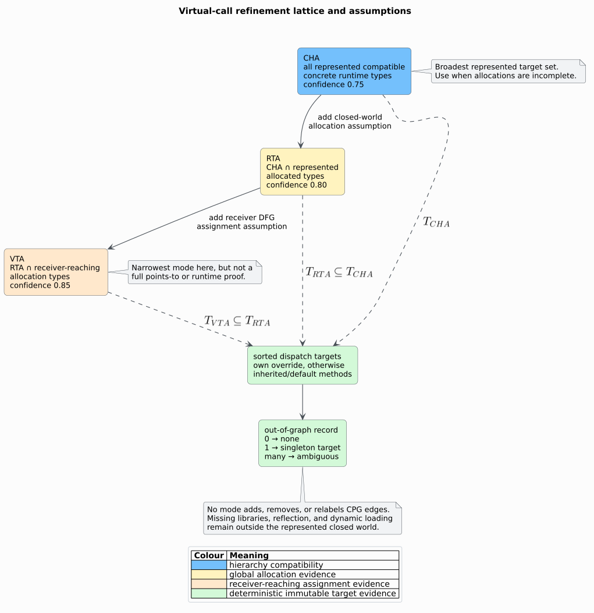

# Theory 42 — Closed-world virtual-call type refinement

Virtual dispatch selects a method from the runtime type of a receiver. Static
analysis sees only a finite representation of possible types, allocations, and
assignments, so a useful result is an explicitly qualified target set rather
than an unqualified “resolved” edge.

## 1. Represented evidence

Let $`G=(N,E)`$ be a finite Code Property Graph (CPG). The nominal type set
$`K\subseteq N`$ contains represented classes, structures, enumerations, and
traits/interfaces. Two typed edge relations define the direct hierarchy:

```math
H=\{(k_s,k_p)\mid (k_s,k_p)\in E_{Inherits}\cup E_{Implements}\}.
```

The edge direction is subtype or implementor $`k_s`$ to supertype or interface
$`k_p`$. Let $`K_c\subseteq K`$ be concrete runtime types: non-abstract
classes, structures, and enumerations. Traits and abstract classes constrain
compatibility but are not instantiated runtime members by themselves.

Each non-static method $`m`$ has a nominal owner $`owner(m)\in K`$ and a name
$`name(m)`$. Each constructor expression may carry normalized
`allocation_type` metadata. A nominal name denotes evidence only when it maps
to exactly one member of $`K`$.

## 2. CHA compatibility

Class-hierarchy analysis (CHA) starts from the declared receiver types
$`D(c)\subseteq K`$ of call $`c`$. These come from variable, parameter, field,
return, allocation, or explicit `TypeOf` evidence. The reflexive descendant
closure is

```math
Desc(D)=\mu X.\;D\cup\{k_s\mid(k_s,k_p)\in H\land k_p\in X\}.
```

Here $`\mu`$ denotes the least fixed point. The represented CHA runtime set is

```math
T_{CHA}(c)=Desc(D(c))\cap K_c.
```

Abstract declared types therefore admit represented concrete descendants; a
concrete declared base admits itself as well.

## 3. Dispatch propagation

For method name $`q`$, let

```math
Own_q(k)=\{m\mid owner(m)=k\land name(m)=q\}.
```

libcpg computes a conservative dispatch fixed point:

```math
Dispatch_q(k)=
\begin{cases}
Own_q(k) & Own_q(k)\ne\varnothing,\\
\displaystyle\bigcup_{(k,p)\in H}Dispatch_q(p) & \text{otherwise}.
\end{cases}
```

An override stops propagation through that type. With multiple parents, all
remaining inherited/default candidates are retained. This union is conservative
where a language has additional linearization or conflict rules that the CPG
does not represent.

For any runtime-type set $`T`$, its call targets are

```math
Targets_q(T)=\bigcup_{k\in T}Dispatch_q(k).
```

## 4. RTA allocation filtering

Rapid-type analysis (RTA) uses the represented allocated-type set

```math
A=\{k\in K_c\mid \exists n\in N.\;allocation\_type(n)=name(k)\}.
```

libcpg's RTA refinement is

```math
T_{RTA}(c)=T_{CHA}(c)\cap A.
```

This is a closed-world allocation filter. Classical RTA also couples reachable
methods and newly discovered allocations to a whole-program fixed point
[[2]](#references). libcpg does not claim that stronger reachability semantics:
it consumes the already represented CPG and all normalized allocations in it.

## 5. VTA assignment filtering

Variable-type analysis (VTA) adds receiver-local assignment evidence. Let
$`R(c)`$ include the receiver definition, incoming `DefUse`/`ReachingDef`
sources, and outgoing `UseDef` targets. Let $`Subtree(r)`$ be the iterative AST
closure below $`r`$, excluding nested function bodies. Then

```math
V(c)=\{k\in K_c\mid
\exists r\in R(c),\exists n\in Subtree(r).\;
allocation\_type(n)=name(k)\}.
```

The refined runtime set is

```math
T_{VTA}(c)=T_{RTA}(c)\cap V(c).
```



Intersection immediately gives

```math
T_{VTA}(c)\subseteq T_{RTA}(c)\subseteq T_{CHA}(c),
```

and monotonicity of union gives

```math
Targets_q(T_{VTA})\subseteq
Targets_q(T_{RTA})\subseteq
Targets_q(T_{CHA}).
```

## 6. Evidence and confidence

CHA, RTA, and VTA produce `ClassHierarchy`, `RapidType`, and `VariableType`
confidence respectively. Their scores, 0.75, 0.80, and 0.85, order increasing
represented precision; they are not probabilities. Exact lexical/import/binding
evidence stays above them, while a unique bare name stays below them.

If one target remains, the record exposes it as a closed-world singleton. If
zero remain, the represented model has no target in that mode. If many remain,
no unique target is fabricated. Because the function borrows `&CodePropertyGraph`,
all three cases remain out of graph.

## 7. Determinism and termination

Node identifiers, names, hierarchy edges, methods, and result candidates are
stored or canonicalized in sorted order. Duplicate hierarchy edges collapse.
The algorithm uses three explicit machines:

```text
INDEX(cpg):
    sort node identifiers
    index unique nominal names and concrete types
    sort and deduplicate valid hierarchy edges
    attach non-static methods to nearest valid owners
    collect normalized allocation types

DISPATCH(name):
    seed queue with types declaring name
    while queue is not empty:
        pop parent
        for each sorted child without an override:
            union parent's targets into child
            enqueue child only when its set grows

REFINE(call, mode):
    find typed member receiver or copy the C1 record
    compute CHA closure with a queue and visited set
    intersect allocations for RTA
    traverse reaching definitions with an explicit AST worklist for VTA
    union dispatch sets, sort targets, and classify zero/one/many
```

Every propagated target can enter a finite type's set at most once. Visited and
queued sets terminate hierarchy and AST cycles. Native call depth is constant
with respect to hierarchy and source depth.

## 8. Complexity

Let $`k=|K|`$, $`h=|H|`$, $`m_q`$ be the methods named $`q`$, and $`a_c`$ the
AST/DFG evidence traversed for call $`c`$. Indexing and subtype closure are
sparse graph operations. Dispatch propagation is output sensitive because a
candidate method may cross multiple hierarchy edges:

```math
O(k\log k+h\log h+h\,m_q+a_c\log a_c)
```

is a conservative ordered-container bound for one method name. Storage is
$`O(k+h+k\,m_q+a_c)`$ in the worst case. A single-inheritance chain with one
inherited method propagates in linear sparse work.

## 9. Interpretation limits

- Closed-world results say nothing about unrepresented libraries or runtime
  loading.
- Missing allocations can make RTA and VTA under-approximate real executions.
- Imprecise DFG edges can broaden or narrow VTA.
- Reflection, function pointers, dynamic proxies, and foreign dispatch require
  separate models.
- Generic and qualified names currently need normalized exact nominal identity.
- Candidate refinement is not a path-feasibility or points-to proof.

These limits are why the graph remains immutable and why callers must preserve
the selected mode with any downstream result.

## References

1. Dean, J., Grove, D., Chambers, C. (1995). *Optimization of Object-Oriented
   Programs Using Static Class Hierarchy Analysis.* DOI:
   [10.1007/3-540-49538-X_5](https://doi.org/10.1007/3-540-49538-X_5).
2. Bacon, D. F., Sweeney, P. F. (1996). *Fast Static Analysis of C++ Virtual
   Function Calls.* DOI:
   [10.1145/236337.236371](https://doi.org/10.1145/236337.236371).
3. Sundaresan, V., Hendren, L., Razafimahefa, C., Vallée-Rai, R., Lam, P.,
   Gagnon, E., Godin, C. (2000). *Practical Virtual Method Call Resolution for
   Java.* DOI:
   [10.1145/353171.353189](https://doi.org/10.1145/353171.353189).
