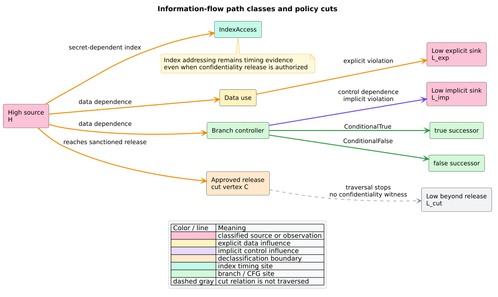

# Theory 49 -- PDG information flow and constant-time evidence

Information-flow control (IFC) asks whether information classified as secret
can influence an observation classified as public. This chapter defines the
finite relation checked by libcpg, shows how explicit and implicit paths are
separated, and explains why the result is evidence rather than a complete
language- or machine-level proof.

## 1. Security labels and represented influence

Let a completed code property graph have finite node set $`V`$. A caller
supplies three finite subsets:

- $`H\subseteq V`$: High, or confidential, sources;
- $`L\subseteq V`$: Low, or public, observations;
- $`C\subseteq V`$: sanctioned declassification cut vertices.

The represented influence relation is

```math
R = R_D \cup R_S \cup R_C,
```

where $`R_D`$ is ordinary data dependence, $`R_S`$ is an exactly labeled
caller-local system-dependence summary, and $`R_C`$ is control dependence.
The last relation represents an **implicit flow**: execution of a dependent
node reveals information about the controller even when no value is copied.

A declassifier removes itself from the admitted domain. With
$`U=V\setminus C`$, the cut relation is

```math
R\restriction_U = R\cap(U\times U).
```

This hard cut applies equally when a labeled source or sink is itself in
$`C`$. Labels naming nodes outside $`V`$ are ignored, making the query total
over caller-owned policy sets.



*Figure -- the path classes and cut boundary. Source:
[`diagrams/ifc-policy-paths.puml`](../diagrams/ifc-policy-paths.puml).*

## 2. Non-interference as product-graph reachability

For represented PDG evidence, the policy is violated when some High source can
reach some Low observation in the reflexive transitive closure of the cut
relation:

```math
\exists h\in H\cap U,\;\ell\in L\cap U:\;(h,\ell)\in
(R\restriction_U)^*.
```

A plain visited-node set cannot tell whether two paths to the same node used a
control-dependence edge. libcpg therefore searches the product state

```math
Q=U\times\{0,1\},
```

where bit zero means no control-dependence step has occurred and bit one means
at least one has occurred. For an edge $`u\mathrel{R_k}v`$ of kind $`k`$, the
transition is

```math
(u,b)\longrightarrow
\left(v,\;b\lor[k=\mathsf{ControlDependence}]\right).
```

Reachability of $`(\ell,0)`$ produces an explicit witness; reachability of
$`(\ell,1)`$ produces an implicit witness. Reaching both yields
`ExplicitAndImplicit` and retains one canonical shortest witness of each
class. If one node is deliberately both High and Low, the zero-length explicit
witness makes that policy contradiction visible.

The literate algorithm is:

```text
NONINTERFERENCE(cpg, labels):
    project represented dependence edges into stable dense rows
    remove every represented declassifier from the admitted domain
    for each represented High source in stable identity order:
        breadth-first search states (node, has_control_step)
        remember the first parent under stable target-and-kind order
        for each represented Low sink in stable identity order:
            reconstruct the explicit state when reached
            reconstruct the implicit state when reached
            emit one classified source/sink finding when either exists
    return every finding in canonical order
```

## 3. Constant-time warning relation

System-level constant-time non-interference compares observations of two
executions that agree on public inputs and may differ on secrets. libcpg does
not construct that relational product program. It exposes a conservative
static warning relation over represented influence.

Let $`T_B`$ contain the source node of every represented
`ConditionalTrue` or `ConditionalFalse` CFG edge, retaining each target and
edge kind as a separate observable mechanism. Let $`T_I`$ contain every node
whose kind is `IndexAccess`. For supplied secret nodes $`S`$, libcpg reports

```math
\{(s,t)\mid s\in S\cap V,\;t\in T_B\cup T_I,\;(s,t)\in R^*\}.
```

The reflexive closure is intentional: a caller may label the already-derived
branch controller or index expression as secret, producing an empty path to
the timing site. Declassification does not change this relation because an
authorized release does not make control flow or memory addressing independent
of the secret.

```text
CONSTANT_TIME(cpg, secrets):
    project represented dependence edges into stable dense rows
    collect every conditional CFG edge and every IndexAccess site
    for each represented secret in stable identity order:
        breadth-first search the influence relation
        for each reachable timing site in stable order:
            reconstruct its canonical shortest influence witness
            emit every distinct branch-edge or index mechanism at the site
    return every finding without truncation
```

## 4. Relational composition and category theory

The exact dependence relations are morphisms in **Rel**, the category of sets
and binary relations. Consecutive influence steps compose by existential join,
identity supplies zero-length reachability, union supplies alternative edge
families, and transitive closure supplies paths. Associativity explains why an
exact SDG summary relation can replace its exact internal composition at a call
boundary.

This categorical interpretation is useful only while the relation is exact
for the represented model. A truncated search, mismatched raw parameter/return
edge, or absent frontend fact cannot be reassociated as though it were a
complete morphism. libcpg consequently admits only caller-local summary edges
whose label identifies their established composition.

## 5. Determinism, stack safety, and cost

Stable node sorting and per-row `(target, edge class)` sorting give a unique
breadth-first tie break. The queue, two-state visited bits, parent arrays, and
witness vectors are heap owned; graph depth never becomes native call depth.

For $`n=|V|`$, $`m=|R|`$, $`h=|H\cap V|`$, and total emitted witness length
$`w`$, non-interference costs
$`O(n\log n+m\log m+h(n+m)+w)`$ in the worst case. Constant-time has the same
form with represented secret count in place of $`h`$. The product search uses
two states per node; the simple timing search uses one.

No semantic result cap is applied. That preserves the meaning of an empty
result and prevents a canonical prefix from being mistaken for exhaustive
security evidence. The caller remains responsible for bounding admitted graph
size and downstream storage.

## 6. Interpretation boundary

A finding is exact for the supplied labels and represented PDG/SDG. It may be a
policy false positive when the graph over-approximates infeasible paths. A
missing finding may be a semantic false negative when the graph omits aliases,
dynamic calls, exceptions, reflection, native code, concurrency, speculative
execution, caches, or other timing state.

Accordingly, `noninterference` does not prove language-level non-interference,
and `constant_time` does not certify machine-level constant-time execution.
They identify canonical evidence for review and for composition with stronger
frontends and verification systems.

## References

1. Hammer, C., Snelting, G. (2009). *Flow-sensitive, context-sensitive, and
   object-sensitive information flow control based on program dependence
   graphs.* International Journal of Information Security 8(6), 399--422.
   DOI: [10.1007/s10207-009-0086-1](https://doi.org/10.1007/s10207-009-0086-1).
2. Barthe, G., Betarte, G., Campo, J. D., Luna, C., Pichardie, D. (2014).
   *System-level non-interference for constant-time cryptography.* CCS 2014,
   1267--1279. DOI:
   [10.1145/2660267.2660283](https://doi.org/10.1145/2660267.2660283).
3. Ferrante, J., Ottenstein, K. J., Warren, J. D. (1987). *The Program
   Dependence Graph and Its Use in Optimization.* ACM TOPLAS 9(3). DOI:
   [10.1145/24039.24041](https://doi.org/10.1145/24039.24041).
