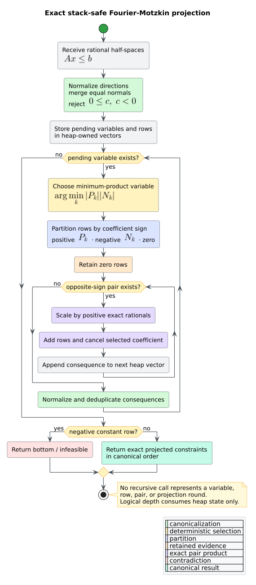

# Theory 50 -- relational abstract domains

Abstract interpretation replaces an unbounded concrete state space with a
finite or convergent **abstract domain** whose elements safely describe sets of
concrete states. This chapter develops libcpg's interval, integer-octagon, exact
rational-polyhedron, and reduced-product domains from their common lattice
contract. It also explains where precision is gained, where convergence is
forced, and why every implementation path has constant native call depth.

## 1. Order, concretization, and soundness

Let $`C`$ be the set of concrete program states and $`A`$ an abstract domain.
The concretization function $`\gamma:A\to\mathcal{P}(C)`$ maps an abstract
element to the concrete states it represents. libcpg orders abstract elements
by precision:

```math
a\sqsubseteq b \quad\Longleftrightarrow\quad
\gamma(a)\subseteq\gamma(b).
```

Thus bottom $`\bot`$ represents no state, top $`\top`$ represents every state,
and join $`a\sqcup b`$ is the least available abstraction containing both
operands. A transfer is sound when every concrete successor of a represented
state remains in the abstract successor. Precision may be lost; concrete
behavior must never be excluded.


*Figure -- the expressiveness and composition map. Source:
[`diagrams/relational-domain-precision.puml`](../diagrams/relational-domain-precision.puml).*

## 2. Three numerical geometries

### 2.1 Intervals

An interval environment assigns each variable $`x_i`$ independent bounds
$`l_i\leq x_i\leq u_i`$. Its geometry is an axis-aligned box. Intervals are
cheap, but they cannot retain a relation such as $`x-y\leq 3`$ when the
individual ranges of $`x`$ and $`y`$ are both unbounded.

### 2.2 Integer octagons

An **octagon** is a conjunction of constraints

```math
s_i x_i+s_j x_j\leq c,
\qquad s_i,s_j\in\{-1,+1\},\quad c\in\mathbb{Z},
```

including unary constraints as a special case. libcpg stores two signed forms
$`x_i^+=x_i`$ and $`x_i^-=-x_i`$ per variable in a difference-bound matrix
(DBM). A matrix entry $`M_{pq}`$ means $`x_p-x_q\leq M_{pq}`$. Iterative
Floyd--Warshall closure, coherence, and integer tightening recover all
represented octagonal consequences.

Octagons retain pairwise signed relations with polynomial closure cost, but
cannot state a general facet such as $`2x+3y-z\leq 7`$.

### 2.3 Exact rational convex polyhedra

A rational convex polyhedron uses an H-representation: a finite conjunction of
closed half-spaces

```math
P=\{x\in\mathbb{Q}^n\mid Ax\leq b\}.
```

Each row of $`A`$ is a sparse `LinearConstraint`; internal rows are dense and
use arbitrary-precision rational coefficients. No floating-point tolerance,
template direction, or coefficient rounding participates in feasibility,
containment, subset, intersection, or closed convex hull.

This expressiveness is expensive. Fourier--Motzkin elimination can generate a
quadratic number of inequalities per eliminated variable and therefore has
exponential worst-case time and space. The optional `abstract-domains` feature
makes that cost and its big-integer dependencies explicit.

## 3. Exact iterative projection

To eliminate variable $`x_k`$, partition the constraints into positive,
negative, and zero coefficient sets. Every positive row supplies an upper
bound, every negative row a lower bound, and each positive/negative pair yields
one consequence without $`x_k`$. Zero rows pass through unchanged.

```text
ELIMINATE(system, variables):
    normalize equal directions and reject an impossible constant row
    keep variables in a heap-owned pending vector
    while pending is not empty and the system is feasible:
        choose the variable minimizing positive_count * negative_count
        partition rows by the sign of that coefficient
        retain zero rows
        for each positive row and each negative row:
            scale both by positive rational factors
            add them so the selected coefficient cancels exactly
            append the consequence row
        normalize the new system
    return the projected constraints or infeasible
```

The minimum-product choice changes work, not semantics. Sorted variable
identities and canonical rational normalization make the representation
deterministic. All pending variables, partitions, generated rows, and
coefficients live on the heap; eliminated dimension never becomes native call
depth.



*Figure -- the stack-safe exact projection lifecycle. Source:
[`diagrams/polyhedron-projection-machine.puml`](../diagrams/polyhedron-projection-machine.puml).*

Feasibility eliminates every variable and checks for a row $`0\leq c`$ with
$`c<0`$. To maximize $`d^Tx`$, libcpg adds an auxiliary variable $`t=d^Tx`$,
projects the original variables, and reads the least exact upper bound on
$`t`$. A polyhedron $`P`$ implies $`d^Tx\leq e`$ exactly when that maximum is
finite and at most $`e`$; infeasible $`P`$ implies every constraint.

## 4. Meet, closed convex hull, and dimension

Intersection is conjunction, so meet appends both H-representations and removes
redundant facets. Join is the exact **closed convex hull**. For
$`P=\{p\mid Ap\leq b\}`$ and $`Q=\{q\mid Cq\leq d\}`$, libcpg projects the
homogenized formulation

```math
x=y+z,\qquad Ay\leq\lambda b,\qquad
Cz\leq(1-\lambda)d,\qquad 0\leq\lambda\leq1.
```

The projected $`x`$ rows describe the least closed convex polyhedron containing
both inputs, including their recession directions. A smaller explicit
dimension is expanded with unconstrained coordinates before lattice operations.
Sparse variable identifiers outside the current dimension therefore grow the
domain rather than indexing an invalid row; concrete points with the wrong
dimension return `false`.

## 5. Widening and narrowing

Ascending chains of rational polyhedra have infinite height. Cousot--Halbwachs
widening keeps an old facet only when the incoming polyhedron still implies it;
moving facets become unconstrained. Since each widening step can only discard
one of the old finite facets, repetition stabilizes after finitely many such
losses. Narrowing then intersects with a descending incoming element to recover
sound precision.

Octagon widening follows the analogous DBM rule: retain an old bound only when
the incoming bound did not move outward. The shared Kildall solver decides
where widening occurs; the domains provide the operators.

## 6. Reduced products as communicating abstractions

The direct product $`A\times B`$ represents
$`\gamma_A(a)\cap\gamma_B(b)`$. A **reduction** is a deterministic, idempotent,
reductive closure that exchanges consequences without changing that concrete
intersection. `ReducedProduct<A, B, R>` invokes its static policy $`R`$ after
construction, transfer, join, widening, and narrowing.

`IntervalOctagonReduction` injects finite interval endpoints into the DBM and
projects tight unary DBM consequences back into intervals. It can therefore
turn the relation $`x=y`$ and interval $`x\in[0,4]`$ into
$`y\in[0,4]`$ at a real CFG merge.


*Figure -- reduced-product invariant restoration. Source:
[`diagrams/reduced-product-cycle.puml`](../diagrams/reduced-product-cycle.puml).*

Categorically, products and monotone maps provide a useful compositional
vocabulary: component transfers combine pointwise, and a reduction is an
idempotent endomorphism on the product order. libcpg relies on the concrete
lattice laws rather than requiring a category-theory API; the categorical view
clarifies composition but does not replace soundness proofs or tests.

## 7. Interpretation and resource boundary

These domains are exact for their stated number system and represented
constraints. They do not prove that a frontend captured every program
operation, that an integer machine has rational semantics, or that a chosen
widening preserved all useful facts. Exact arithmetic prevents numerical
unsoundness; it does not prevent exponential work or coefficient growth.

libcpg uses no recursive traversal in closure, projection, implication,
canonicalization, hull construction, or reduction. A pushdown automaton is not
needed because these algorithms have no mutually recursive semantic descent;
explicit worklists and loop state are the simpler stack-safe machines. Callers
must still bound admitted dimension, constraints, coefficient size, solver
visits, time, and memory.

## References

1. Cousot, P., Cousot, R. (1977). *Abstract Interpretation: A Unified Lattice
   Model for Static Analysis of Programs by Construction or Approximation of
   Fixpoints.* DOI:
   [10.1145/512950.512973](https://doi.org/10.1145/512950.512973).
2. Cousot, P., Halbwachs, N. (1978). *Automatic Discovery of Linear
   Restraints Among Variables of a Program.* DOI:
   [10.1145/512760.512770](https://doi.org/10.1145/512760.512770).
3. Cousot, P., Cousot, R. (1979). *Systematic Design of Program Analysis
   Frameworks.* DOI:
   [10.1145/567752.567778](https://doi.org/10.1145/567752.567778).
4. Miné, A. (2006). *The Octagon Abstract Domain.* DOI:
   [10.1007/s10990-006-8609-1](https://doi.org/10.1007/s10990-006-8609-1).
