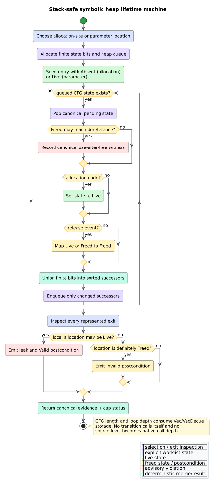

# Theory 51 -- compositional heap analysis

A heap analysis reasons about dynamically allocated cells, the values that may
designate them, and operations that dereference or invalidate them. libcpg's
FT.4 analysis uses a finite separation-logic footprint per procedure and
composes those footprints over the existing call-graph condensation. The
result is advisory evidence for null dereferences, use-after-free behavior, and
leaks; it is not a proof of concrete memory safety.

## 1. Spatial conjunction and footprints

In separation logic, $`x\mapsto v`$ states that address $`x`$ owns one heap
cell containing $`v`$. **Spatial conjunction** $`P * Q`$ means that $`P`$ and
$`Q`$ hold over disjoint heap regions. A procedure's **footprint** is the
smallest represented heap fragment needed to execute its modeled operations.

The frame rule explains local reasoning. If command $`C`$ transforms $`P`$ to
$`Q`$ without touching a disjoint frame $`R`$, then:

```math
\frac{\{P\}\ C\ \{Q\}}{\{P * R\}\ C\ \{Q * R\}}.
```

libcpg does not store arbitrary symbolic formulas. It uses two finite symbolic
locations:

- `HeapLocation::Parameter(i)` names formal parameter $`i`$;
- `HeapLocation::Allocation(n)` names the allocation-site abstraction at CPG
  node $`n`$.

`Valid` means the represented cell is live; `Invalid` means a modeled release
has invalidated it. Allocation sites are a may-alias abstraction: concrete
allocations produced by the same site are deliberately conflated.

## 2. Bi-abduction and the anti-frame

**Bi-abduction** solves for missing and preserved heap fragments. Given a
caller state $`H`$ and callee requirement $`P`$, it seeks an **anti-frame**
$`A`$ and frame $`F`$ satisfying:

```math
H * A \vdash P * F.
```

The anti-frame is what the caller must additionally provide. In libcpg, a
typed dereference of parameter $`i`$ synthesizes the assertion
`Valid(Parameter(i))`. At a call site that assertion is substituted through
source-ordered actual arguments:

- a caller parameter becomes a caller anti-frame requirement;
- a local allocation becomes a local dereference event;
- a represented null origin becomes a null-dereference finding.

A callee postcondition `Invalid(Parameter(i))` similarly becomes a release of
the corresponding caller location. This is a deliberately small, auditable
fragment of compositional separation logic rather than a general theorem
prover.


*Figure -- compositional summary flow. Source:
[`diagrams/biabduction-summary-flow.puml`](../diagrams/biabduction-summary-flow.puml).*

## 3. Callees-first composition

Let the call graph's strongly connected components (SCCs) be contracted into a
condensation directed acyclic graph. The shared IFDS/IDE solver validates that
decomposition and visits it in reverse topological order, so an acyclic caller
observes completed callee summaries. A cyclic SCC uses bounded monotone Kleene
iteration.

Preconditions are may-facts and compose monotonically. A must-invalidate
postcondition inside the same recursive SCC cannot safely be consumed before a
greatest fixed point is known. libcpg therefore retains the advisory evidence
but marks the affected summary partial. A caller must require
`HeapAnalysis::is_complete()` before using absence of findings as evidence.

This qualification is essential: treating an intermediate recursive release
as definite could hide a leak; treating it as absent could hide a
use-after-free path.

## 4. Heap-origin closure

The local origin environment maps each CPG value node to a bounded set of
parameter, allocation, or null origins. Seeds come only from typed evidence:

1. formal `Parameter` nodes;
2. nodes carrying `allocation_type`; and
3. `LiteralKind::Null` nodes.

Identifiers copy explicit and reaching definitions. Assignments copy their
right-hand values. Other non-call syntax copies child origins, and typed DFG
edges propagate origins between represented values. Calls do not absorb
argument origins into their return value. The implementation repeats ordered
passes to a finite fixed point under `IfdsCaps`; every pass and descendant walk
uses heap collections.

## 5. Lifetime product machine

For each relevant symbolic location, local control flow carries the finite
may-state set $`\{\mathsf{Absent},\mathsf{Live},\mathsf{Freed}\}`$. An
allocation maps its object to `Live`; a modeled release maps `Live` or `Freed`
to `Freed`; joins take set union. A dereference with `Freed` in its incoming
set yields use-after-free evidence. A local allocation with `Live` at a
represented exit yields leak evidence.

```text
LIFETIME(location, cfg):
    initialize a heap queue with the function entry
    while the queue is nonempty and work remains:
        pop the least pending CFG state
        inspect dereference evidence before the node's release transfer
        apply allocation/release transfer to the finite state bits
        union the result into each canonical successor
        enqueue a successor only when its bits grow
    inspect every represented exit
    emit invalid postconditions, UAF witnesses, and live-exit leaks
```



*Figure -- stack-safe lifetime state machine. Source:
[`diagrams/heap-lifetime-machine.puml`](../diagrams/heap-lifetime-machine.puml).*

The native call depth is constant. AST depth, SCC depth, CFG length, facts,
events, and witnesses occupy `Vec`, `VecDeque`, `BTreeMap`, and `BTreeSet`
storage. A pushdown automaton is unnecessary here because there is no mutually
recursive semantic descent; explicit fixed-point and lifetime worklists are
the direct stack-safe machines.

## 6. Heap overlay and interpretation

Summaries remain out of graph. `materialize_heap_overlay` optionally appends
typed `HeapEdgeKind` relations between existing function, parameter,
allocation, dereference, and release nodes. It creates no parallel node graph.
All relation endpoints are validated before mutation, so malformed summaries
fail transactionally.

The analysis can miss behavior absent from the CPG: unresolved calls, native
code, unmodeled release APIs, pointer arithmetic, field-sensitive aliasing,
concurrency, exceptional exits, and frontend omissions. Conversely,
allocation-site conflation and may-state joins can report infeasible behavior.
The right interpretation is “a modeled path warrants review,” never “the
program is safe” unless the modeled boundary is complete and the report is
uncapped.

## References

1. Calcagno, C., Distefano, D., O'Hearn, P. W., Yang, H. (2011).
   *Compositional Shape Analysis by Means of Bi-Abduction.* DOI:
   [10.1145/2049697.2049700](https://doi.org/10.1145/2049697.2049700).
2. Calcagno, C., Distefano, D., O'Hearn, P. W., Yang, H. (2009).
   *Compositional Shape Analysis by Means of Bi-Abduction.* DOI:
   [10.1145/1480881.1480917](https://doi.org/10.1145/1480881.1480917).
