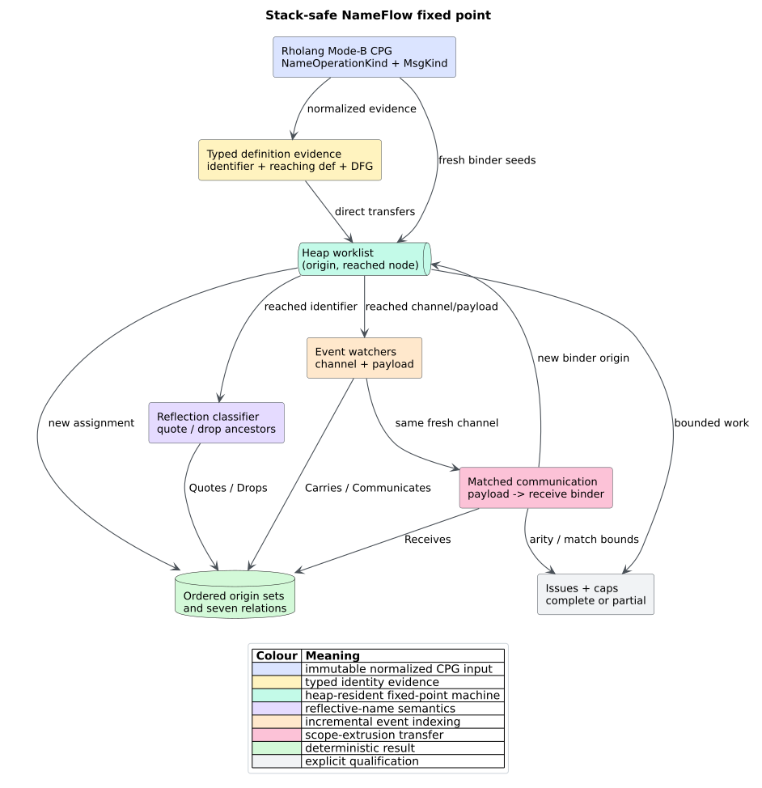
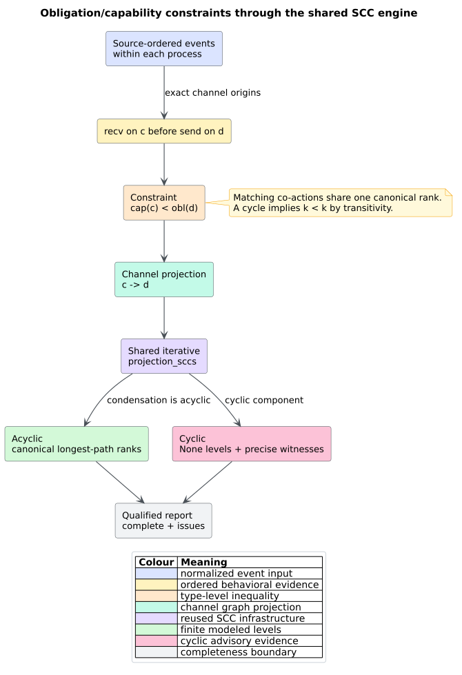

# Theory 52 -- Rholang name flow and level-based deadlock freedom

Rholang is based on the reflective higher-order rho-calculus, where names can
be created, quoted, dropped back into processes, and transmitted as message
payloads. A channel analysis must therefore follow semantic name identity, not
source spelling. libcpg's FT.5 analysis computes a finite **NameFlow**
provenance relation and then checks a Kobayashi-style system of channel
capability and obligation constraints. Both results are advisory and explicitly
qualified when evidence or resource bounds are incomplete.

## 1. Fresh-name identity

A restriction such as Rholang `new x in P` introduces a fresh binder whose
`NodeId` is its stable abstract identity. The frontend records the normalized
operations `Restriction`, `FreshBinder`, `Quote`, and `Drop`; the analyzer never
parses source text. For a fresh origin $`a`$ and represented node $`n`$, the
relation $`a \leadsto n`$ means that the name created at $`a`$ may reach $`n`$.

The finite transfer rules are:

```math
\frac{\operatorname{def}(u)=d \quad a\leadsto d}{a\leadsto u}
\qquad
\frac{a\leadsto p \quad p\text{ is sent on }c \quad b\text{ receives from }c}
     {a\leadsto b}.
```

The first rule uses only typed identifier, reaching-definition, Reference, or
Data Flow Graph (DFG) evidence. The second is the scope-extrusion rule: a name
carried as a payload becomes an origin of the matched receive binder and can
continue through later communications.



*Figure -- NameFlow fixed point. Source:
[`diagrams/name-flow-fixed-point.puml`](../diagrams/name-flow-fixed-point.puml).*

The seven optional overlay relations are `Creates`, `References`, `Quotes`,
`Drops`, `Carries`, `Receives`, and `Communicates`. Every relation starts at a
fresh-binder node and ends at an existing CPG node; materialization never
creates a second node universe.

## 2. Capability and obligation levels

Kobayashi distinguishes a channel's **capability**—the level at which a
matching co-action is available—from its **obligation**—the level at which the
process promises to perform its own action. In the finite libcpg model, a
process that first receives on channel $`c`$ and later sends on channel $`d`$
induces the strict constraint

```math
\operatorname{cap}(c) < \operatorname{obl}(d).
```

Matching co-actions use one canonical rank per channel, so libcpg sets
$`\operatorname{cap}(c)=\operatorname{obl}(c)`$. The resulting channel
dependency graph has an edge $`c\to d`$ for every represented receive-before-
send constraint. A topological longest-path rank satisfies all constraints
exactly when that graph is acyclic. A directed cycle would require a strict
inequality $`k<k`$ after transitivity and is therefore unsatisfiable.



*Figure -- level constraints and strongly connected components (SCCs). Source:
[`diagrams/obligation-capability-scc.puml`](../diagrams/obligation-capability-scc.puml).*

For an acyclic graph, `ChannelUsageLevel` stores equal canonical capability and
obligation ranks. For a cyclic graph, participating channels carry `None` and
the analysis returns statement-precise `ObligationCapability` witnesses. It
reuses `projection_sccs`; no second cycle detector is embedded in the Rholang
module.

## 3. Heap-resident fixed point

```text
NAME_FLOW(cpg, caps):
    seed (fresh binder, binder) pairs in a heap queue
    while the queue is nonempty and work remains:
        remove one canonical origin assignment
        propagate through typed definitions and registered payload transfers
        register channel events and pair matching producers with receivers
        install each new payload-to-binder transfer
        enqueue only origin assignments not seen before
    return sorted origins, relations, match count, and issues
```

The logical depth of an Abstract Syntax Tree (AST), definition chain, payload
chain, or channel graph never becomes native call depth. Queues, maps, sets,
ancestor cursors, SCC state, witnesses, serialization values, and explicit
drops live on the heap. The implementation uses a finite-state worklist rather
than a pushdown automaton (PDA) because these transfer rules do not require an
unbounded semantic call/return stack. If a future rule does require nested
continuations, it must encode them as explicit PDA state rather than Rust
recursion.

## 4. Interpretation boundary

An empty `deadlock_freedom` vector means only that no cyclic constraint was
found in the represented model. Completeness-sensitive consumers must retain
`DeadlockFreedomAnalysis` and require `complete`. Even a complete acyclic
result does not model reduction, guards, pattern success, fairness, external
producers, all higher-order behavior, or every Rholang type rule. Conversely,
may-matching and source-order abstraction can retain infeasible constraints.

The analysis is useful because each result is deterministic, bounded,
source-replayable, and honest about missing evidence. It is not a substitute
for an operational semantics or a full Kobayashi type checker.

## References

1. Kobayashi, N. (2006). *A New Type System for Deadlock-Free Processes.* DOI:
   [10.1007/11817949_16](https://doi.org/10.1007/11817949_16).
2. Kobayashi, N., Sangiorgi, D. (2010). *A Hybrid Type System for Lock-Freedom
   of Mobile Processes.* DOI:
   [10.1145/1745312.1745313](https://doi.org/10.1145/1745312.1745313).
3. Meredith, L. G., Radestock, M. (2005). *A Reflective Higher-order Calculus.*
   DOI: [10.1016/j.entcs.2005.05.016](https://doi.org/10.1016/j.entcs.2005.05.016).
