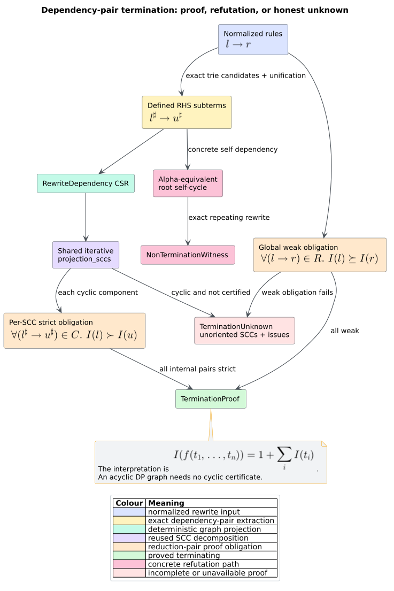
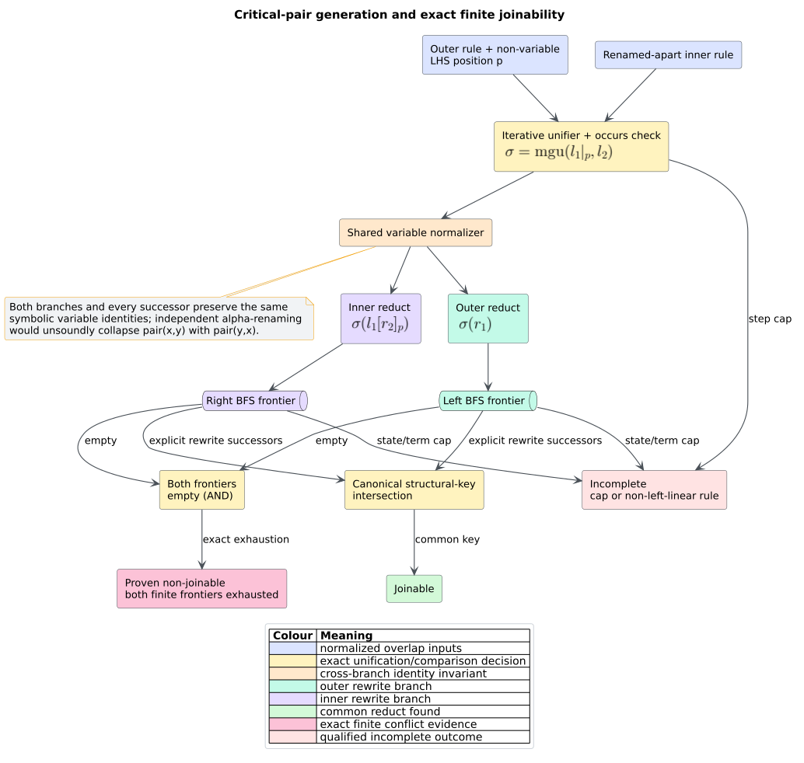

# Theory 53 -- Dependency pairs and critical-pair confluence

A **term rewriting system** (TRS) is a finite set of directed equations
$`l \to r`$ over terms and variables. One rewrite replaces an instance of
$`l`$ at some term position with the corresponding instance of $`r`$.
**Termination** means that no infinite rewrite sequence exists.
**Confluence** means that whenever one term rewrites to two branches, those
branches can rewrite to a common term. libcpg analyzes the finite first-order
TRS represented by normalized MeTTa rule functions.

## 1. Flat semantic terms

A term is an atom or an application $`f(t_1,\ldots,t_n)`$. libcpg stores its
preorder traversal in a flat arena. Node $`i`$ records arity and an exclusive
subtree boundary $`e_i`$, so its subterm is the contiguous interval
$`[i,e_i)`$. Child roots are found by advancing over those boundaries.

```text
FLATTEN(cpg_root):
    push Enter(cpg_root) on a heap task stack
    while a task exists:
        Enter(node):
            append symbol, source, arity, and an unfinished subtree boundary
            push Exit(index), then children in reverse source order
        Exit(index):
            set boundary[index] to the current arena length
    return the preorder arena
```

The algorithm is a pushdown automaton (PDA) implementation: the logical
continuation stack exists, but it is an explicit heap vector rather than the
native Rust call stack. The same discipline applies to unification,
instantiation, matching, and rewriting.

## 2. Dependency pairs

A root symbol is **defined** when it occurs at the root of some rule LHS. For
each rule $`l \to r`$ and each RHS subterm $`u`$ whose root is defined, the
dependency-pair framework introduces a marked pair

```math
l^\sharp \to u^\sharp.
```

An edge connects the source rule to every rule whose LHS unifies with $`u`$.
The resulting **dependency-pair graph** (DP graph) over-approximates possible
infinite chains. Exact root-symbol lookup uses a double-array trie; variable
roots use a separate wildcard set. Both lanes still invoke exact first-order
unification, so the index changes cost, not semantics [[1]](#references).



*Figure -- termination proof/refutation/unknown flow. Source:
[`diagrams/dependency-pair-reduction-proof.puml`](../diagrams/dependency-pair-reduction-proof.puml).*

An infinite chain must eventually remain in a cyclic strongly connected
component (SCC). libcpg therefore reuses `projection_sccs` and examines each
cyclic component independently. An acyclic DP graph proves termination without
a cyclic certificate.

## 3. The fixed polynomial reduction pair

A **reduction pair** consists of a stable monotone preorder $`\succeq`$ and a
compatible well-founded strict order $`\succ`$. libcpg uses one intentionally
simple linear polynomial interpretation:

```math
I(x)=x,
\qquad
I\!\left(f(t_1,\ldots,t_n)\right)=1+\sum_{i=1}^{n} I(t_i).
```

The implementation represents $`I(t)`$ by a constant $`c_t`$ and one
coefficient $`m_t(x)`$ for every variable. A rule $`l\to r`$ is weakly
oriented when

```math
c_l\ge c_r
\quad\land\quad
\forall x.\;m_l(x)\ge m_r(x).
```

A dependency pair is strictly oriented when the coefficient condition holds
and $`c_l>c_u`$. A libcpg certificate requires **all** original rules to be
weakly oriented and **every** pair internal to the reported cyclic SCC to be
strictly oriented. The global weak obligation matters because ordinary
rewrites may occur between dependency-pair steps [[1]](#references).

Failure to satisfy this fixed interpretation is not evidence of
nontermination. The result is `Unknown`; a more expressive recursive path
ordering or synthesized polynomial could succeed later.

## 4. Concrete nontermination

A graph cycle alone is insufficient to refute termination. libcpg currently
emits `DoesNotTerminate` only when one dependency self-edge points from a rule
to an RHS call alpha-equivalent to that rule's LHS. **Alpha-equivalence** means
that the terms are identical after a bijective renaming of variables. The
reported rule cycle repeats its first rule at the end and retains the exact RHS
call-site `NodeId`.

This witness realizes an infinite root sequence immediately. Other cyclic but
unoriented systems remain `Unknown` rather than being mislabeled.

## 5. Critical pairs and local confluence

A **critical overlap** places a renamed-apart copy of rule
$`l_2\to r_2`$ at a non-variable position $`p`$ in $`l_1`$ and computes a
most-general unifier $`\sigma`$ of $`l_1|_p`$ and $`l_2`$. It produces the
peak

```math
\sigma(r_1)
\;\longleftarrow\;
\sigma(l_1)
\;\longrightarrow\;
\sigma\!\left(l_1[r_2]_p\right).
```

The two reducts are **joinable** when they have a common descendant. libcpg
performs symmetric breadth-first search (BFS), treating variables as shared
symbolic identities. The search returns joinable at the first intersection,
non-joinable only when both finite reachable graphs are exhausted, and
incomplete when a state, term-node, or unification cap is reached.



*Figure -- critical overlap and bounded exact joinability. Source:
[`diagrams/critical-pair-joinability.puml`](../diagrams/critical-pair-joinability.puml).*

The implementation analyzes non-variable overlaps. A **left-linear** rule uses
each LHS variable once; then variable-position peaks need no additional
critical pair. A repeated LHS variable yields `NonLeftLinearRule` and clears
completeness, preventing the omitted variable-overlap case from supporting a
local-confluence claim.

For an admitted left-linear TRS, a complete empty critical-pair report supports
local confluence. Newman's Lemma states that a terminating, locally confluent
relation is confluent [[3]](#references). Therefore a caller may compose:

1. `TerminationVerdict::Terminates`;
2. `CriticalPairAnalysis { complete: true, pairs: [] }`; and
3. the represented first-order/left-linear trust conditions

into a confluence argument. `critical_pairs(cpg)` alone is only a positive
conflict projection; an empty vector discards the qualifications and proves
nothing.

## 6. Determinism, limits, and complexity

Stable IDs, ordered sets/maps, heap sorting, canonical structural tapes, shared
variable normalization, and deterministic SCC rows fix output order.
`RewriteAnalysisCaps` bounds rules, aggregate extracted term nodes, dependency
pairs, aggregate unification steps, retained critical conflicts, and aggregate
joinability states.

Let $`R`$ be the number of rules, $`N`$ extracted term nodes, $`P`$ candidate
dependency pairs, $`O`$ non-variable overlap sites, and $`J`$ admitted
joinability states. Extraction is $`O(N)`$ before ordered-container costs. The
proof/search work is bounded by the explicit candidate, unification, and state
caps; no hidden recursion changes native stack complexity. Heap safety is not
resident-memory safety, so service hosts must enforce process memory and time
limits independently.

## References

1. Arts, T., Giesl, J. (2000). *Termination of Term Rewriting Using Dependency
   Pairs.* DOI:
   [10.1016/S0304-3975(99)00207-8](https://doi.org/10.1016/S0304-3975(99)00207-8).
2. Giesl, J. et al. (2017). *Analyzing Program Termination and Complexity
   Automatically with AProVE.* DOI:
   [10.1007/s10817-016-9388-y](https://doi.org/10.1007/s10817-016-9388-y).
3. Newman, M. H. A. (1942). *On Theories with a Combinatorial Definition of
   Equivalence.* DOI: [10.2307/1968867](https://doi.org/10.2307/1968867).
4. Robinson, J. A. (1965). *A Machine-Oriented Logic Based on the Resolution
   Principle.* DOI:
   [10.1145/321250.321253](https://doi.org/10.1145/321250.321253).
5. Aoe, J. (1989). *An Efficient Digital Search Algorithm by Using a
   Double-Array Structure.* DOI:
   [10.1109/32.31365](https://doi.org/10.1109/32.31365).
