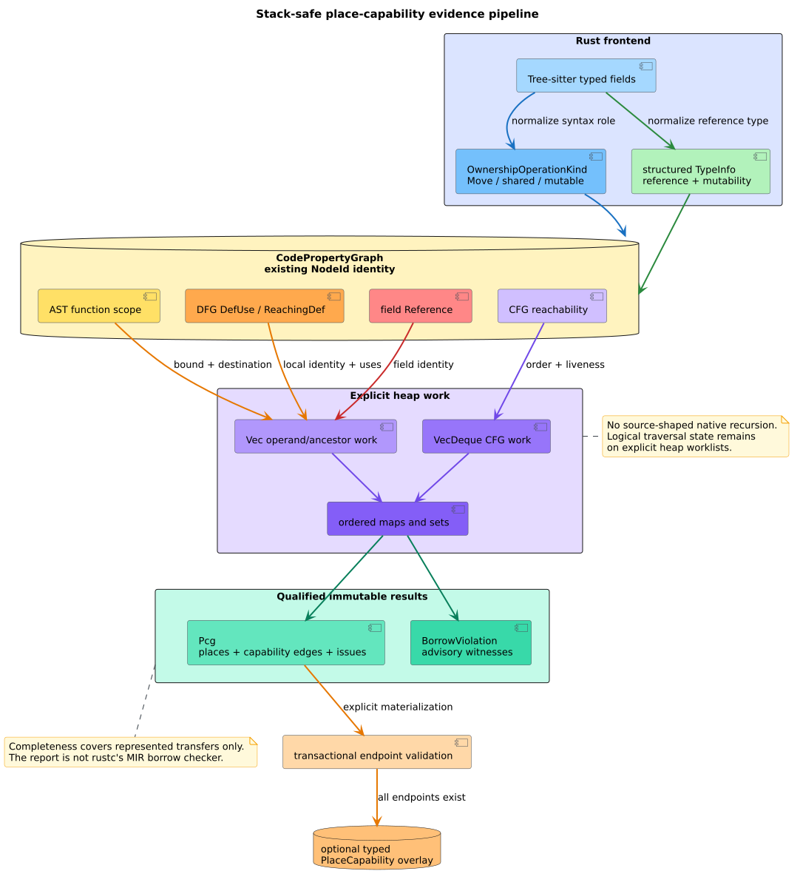
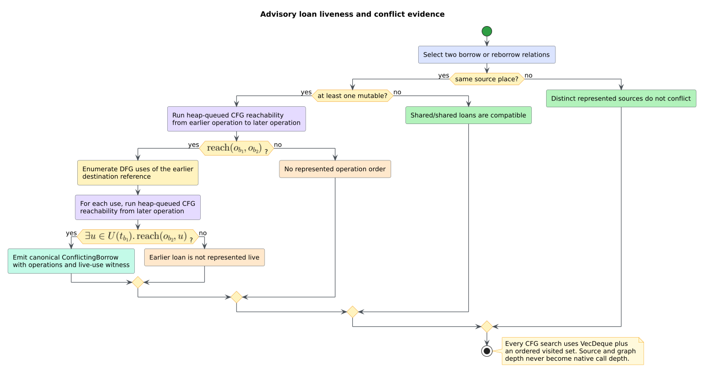

# Theory 54 -- Place capabilities, ownership, and borrowing

A **Code Property Graph** (CPG) merges syntax, control flow, data flow, and
other program relations over one node set. A **place** is represented storage:
a parameter, local, field, assignment result, or temporary. A **capability** is
permission to own or access a place. A **move** transfers ownership; a
**borrow** temporarily transfers access. A shared borrow permits reads, a
mutable borrow permits exclusive mutation, and a **reborrow** borrows through
an existing reference.

libcpg derives an advisory **place-capability graph** (PCG) from typed CPG
evidence. It follows the organizing insight of place capability graphs [[1]](#references),
but it is not rustc's compiler-derived PCG: libcpg operates on Tree-sitter CPG
nodes rather than MIR and borrow-checker facts.

## 1. Graph model

Let $`V`$ be the existing CPG node set and let $`P \subseteq V`$ be the
represented places. Let the capability-kind set be

```math
K = \{\mathsf{Move},\mathsf{SharedBorrow},\mathsf{MutableBorrow},
     \mathsf{SharedReborrow},\mathsf{MutableReborrow}\}.
```

The derived capability relation is

```math
E_{\mathrm{pc}} \subseteq P \times K \times P.
```

Every tuple also carries an operation node and evidence. A local source must
have a DFG `DefUse` or `ReachingDef` pair. A field source must have an operand
to field-declaration `Reference` pair. Both retain the enclosing function.
This lets a caller replay the analysis against the authoritative graph.



*Figure -- typed evidence composition. Source:
[`diagrams/place-capability-analysis-pipeline.puml`](../diagrams/place-capability-analysis-pipeline.puml).*

## 2. Stack-safe reconstruction

Operations are ordered by source range and stable `NodeId`. Operand discovery
walks the operation's AST subtree but does not enter a nested ownership
operation: the nested operation owns its own transfer. Moves stop descending
once a place-bearing operand is found; borrows retain all represented operands.

```text
RECONSTRUCT(function):
    scope := iterative AST scope of function
    operations := stable-sort nodes with ownership metadata
    relations := ordered set
    for operation in operations:
        work := heap vector containing operation
        while work is not empty:
            node := pop(work)
            if node is a nested ownership operation: continue
            if node has DFG or field Reference evidence:
                collect node as an operand
                if operation is Move: continue
            push AST children in reverse source order
        target := iterative ancestor walk to Variable or Assignment
        append exact witnessed relations to relations
    return canonical places, relations, and issues
```

The algorithm is a pushdown-automaton-style flattening: the logical traversal
stack exists as a heap vector rather than native recursion. Destination lookup
is likewise an iterative parent walk with cycle detection.

## 3. Copy qualification

Rust moves only values that do not implement `Copy`. libcpg can decide this
from represented type evidence for primitive scalars, raw pointers, shared
references, mutable references, and selected standard owning containers.
Nominal user types require trait resolution that the CPG does not yet carry.

Accordingly, a transfer from a known `Copy` place produces no move edge; a
known owning value produces a move edge; and an unknown nominal type produces
the move edge plus `UnknownCopySemantics`. This keeps possible ownership loss
visible while qualifying downstream conclusions.

## 4. Move-after-use

Let $`o_m`$ be a move operation, $`s_m`$ its source place, and $`U(s_m)`$ the
represented DFG uses of that place. A use-after-move candidate exists when

```math
\exists u \in U(s_m).\;
u \notin \operatorname{subtree}(o_m)
\land \operatorname{reach}_{\mathrm{cfg}}(o_m,u).
```

The subtree exclusion prevents the move's own operand from being reported as
a later use. Unknown copy semantics marks the result `qualified`; it does not
silently suppress the evidence.

## 5. Loan liveness and conflicts

A **loan extent** is the region in which a borrowed capability remains needed.
For a borrow relation $`b`$, let $`o_b`$ be its operation and $`t_b`$ its
destination reference. At candidate point $`c`$, libcpg models liveness as

```math
\operatorname{live}(b,c)
=
\operatorname{reach}_{\mathrm{cfg}}(o_b,c)
\land
\exists u \in U(t_b).\;\operatorname{reach}_{\mathrm{cfg}}(c,u).
```

Two source-identical loans conflict when one is mutable and the earlier loan
is live at the later operation:

```math
s_{b_1}=s_{b_2}
\land
(\operatorname{mut}(b_1)\lor\operatorname{mut}(b_2))
\land
\operatorname{live}(b_1,o_{b_2}).
```

Shared/shared loans do not conflict. This graph-backed model resembles NLL by
ending a loan after its last represented use, but it lacks rustc's full path,
projection, region, and trait facts.



*Figure -- advisory loan-liveness predicate. Source:
[`diagrams/place-capability-loan-liveness.puml`](../diagrams/place-capability-loan-liveness.puml).*

## 6. Determinism and complexity

Ordered maps/sets, stable source keys, deduplication, and FIFO CFG worklists
make reports independent of edge insertion order. If $`B`$ is the number of
borrow relations, $`V_f`$ and $`E_f`$ are function-scope CFG sizes, and $`U`$
is the number of represented uses, repeated reachability checks have a
conservative worst-case bound of $`O(B^2(V_f+E_f)+U(V_f+E_f))`$. Stored graph
and worklist state is $`O(V_f+E_f+B+U)`$ apart from report output.

Native stack consumption is $`O(1)`$ in source and graph depth. This is a
stack-safety claim, not a resident-memory bound; process-level resource limits
remain necessary.

## References

1. Grannan, D. et al. (2026). *Place Capability Graphs: A General-Purpose
   Abstraction for the Rust Borrow Checker.* DOI:
   [10.1145/3763122](https://doi.org/10.1145/3763122); preprint:
   [arXiv:2503.21691](https://arxiv.org/abs/2503.21691).
2. Matsushita, Y. et al. (2020). *RustHorn: CHC-Based Verification for Rust
   Programs.* DOI:
   [10.1007/978-3-030-44914-8_18](https://doi.org/10.1007/978-3-030-44914-8_18).
3. Crichton, W. et al. (2022). *Flowistry: An IDE Plugin for Rust to Focus on
   Relevant Code.* DOI:
   [10.1145/3519939.3523445](https://doi.org/10.1145/3519939.3523445).
