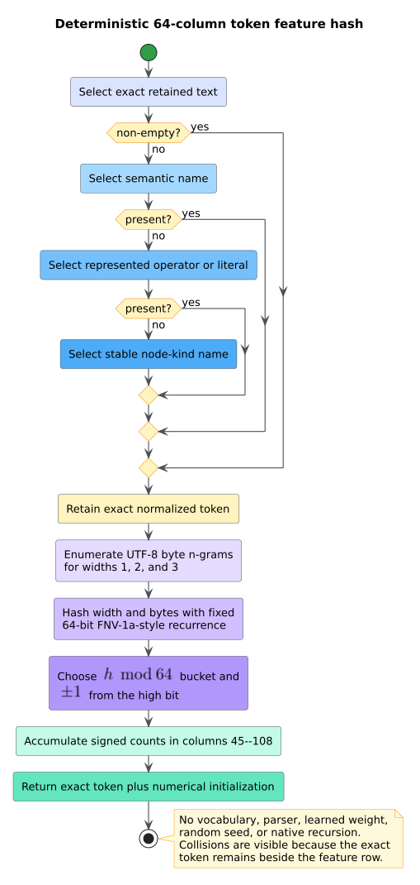

# Theory 55 -- Heterogeneous graphs and directed-fuzzing distance

A **heterogeneous graph** has more than one node or edge type. A Code Property
Graph (CPG) is heterogeneous by construction: Abstract Syntax Tree (AST),
Control Flow Graph (CFG), Data Flow Graph (DFG), call, type, reference, heap,
name-flow, rewrite, and ownership relations share one node set. A
**directed-fuzzing distance** measures how many represented CFG/call steps
separate a node from one or more selected targets.

libcpg exposes both views without selecting a graph neural network (GNN), a
training framework, or a fuzzing scheduler. R-GCN and HGT motivate preserving
relation types [[1]](#references), [[2]](#references); AFLGo motivates
harmonic target distance [[3]](#references).


## 1. Typed relation family

Let $`G=(V,E,\kappa_V,\kappa_E,\rho,\tau)`$ be a finite CPG, where:

- $`V`$ is the node set;
- $`E`$ is an edge multiset, so parallel edges are distinct;
- $`\kappa_V:V\to K_V`$ assigns one of 45 node kinds;
- $`\kappa_E:E\to K_E`$ assigns one of 67 edge relations;
- $`\rho:V\to R`$ assigns source ranges; and
- $`\tau:V\to\Sigma^*`$ assigns normalized token strings.

Ascending stable `NodeId` defines a bijection
$`d:V\to\{0,\ldots,|V|-1\}`$. For relation class $`r`$, the exported dense
multiset is

```math
A_r=\bigl[\bigl(d(u),d(v)\bigr)\mid
e=(u,v)\in E\land c_E(\kappa_E(e))=r\bigr].
```

The notation $`[\cdot]`$ denotes a multiset rather than a set. Equal parallel
edges therefore remain equal repeated coordinates. Each $`A_r`$ is ordered
lexicographically, and the outer vector contains every
$`r\in\{0,\ldots,66\}`$, even when $`A_r`$ is empty. This fixed family is
directly consumable by relation-specific message passing.

## 2. Deterministic node initialization

For node $`v`$, the 109-column feature row is

```math
x(v)=\left[
\operatorname{onehot}_{45}(\kappa_V(v)),
\phi_{64}(\tau(v))
\right].
```

The first term is exact. The second term $`\phi_{64}`$ is a signed feature
hash, not a learned embedding. Token bytes contribute every contiguous n-gram
of width one, two, and three. For gram $`g`$ and width $`w`$, libcpg computes a
fixed FNV-1a-style 64-bit hash $`h(w,g)`$, chooses bucket
$`h(w,g)\bmod 64`$, and adds either $`+1`$ or $`-1`$ from the high hash bit.



Feature hashing bounds the coordinate space without maintaining a vocabulary.
Collisions are expected and can cancel; `HeteroGnnExport::tokens` preserves the
exact normalized token so consumers can audit or replace this initialization.
The token precedence is retained source text, semantic name, represented
operator/literal, then node-kind name. None of those stages reparses source.

## 3. Relation-specific message passing

An R-GCN-style layer can consume the export as

```math
h_v^{(\ell+1)}=\sigma\left(
W_0^{(\ell)}h_v^{(\ell)}+
\sum_{r=0}^{66}\sum_{u\in N_r(v)}
\frac{1}{c_{v,r}}W_r^{(\ell)}h_u^{(\ell)}
\right),
```

where $`N_r(v)`$ is the relation-$`r`$ neighborhood, $`W_r`$ is a
consumer-owned relation transform, $`c_{v,r}`$ is a consumer-owned
normalization, and $`\sigma`$ is a consumer-owned activation. libcpg supplies
$`h_v^{(0)}=x(v)`$ and $`N_r(v)`$; it does not supply or train the weights.
HGT-style consumers may instead use relation-aware attention over the same
typed buckets [[2]](#references).

## 4. Directed distance to a target family

Let $`E_D\subseteq E`$ contain only `ControlFlow`, `StaticCall`,
`DynamicCall`, and `CallSite` edges. Endpoint duplicates are collapsed for
distance because multiplicity cannot shorten an unweighted path. For valid
target $`t`$, define stored-direction shortest-path length

```math
d_t(v)=\min\bigl\{|\pi|\mid
\pi\text{ is a path from }v\text{ to }t\text{ in }(V,E_D)\bigr\},
```

with $`d_t(v)=\infty`$ when no such path exists. For a non-target node, define
the reachable positive target family

```math
R(v)=\bigl\{t\mid 0<d_t(v)<\infty\bigr\}.
```

The exported distance is

```math
D(v)=
\begin{cases}
0, & v\text{ is a valid target},\\
\dfrac{|R(v)|}{\sum_{t\in R(v)}1/d_t(v)}, & R(v)\neq\varnothing,\\
\infty, & R(v)=\varnothing.
\end{cases}
```

For path lengths two and three, the harmonic result is
$`2/(1/2+1/3)=12/5`$. A target remains zero even if it can also reach another
target. Unknown target ids contribute no seed; duplicate ids contribute once.


The result generalizes AFLGo's distance intuition to libcpg's typed CFG/call
topology. It is not an assertion that CPG nodes equal compiler basic blocks or
that libcpg reproduces AFLGo's instrumentation and power schedule.

## 5. Literate algorithms

The heterogeneous export first makes identity stable, then materializes typed
evidence:

```text
HETEROGENEOUS-EXPORT(CPG):
    Drain all NodeIds from a min-order heap into node_ids.
    Build stable-id -> dense-id and 67 named empty relation buckets.
    For every typed edge with represented endpoints:
        Push (relation class, source dense id, target dense id) into a min heap.
    Drain the edge heap into its class bucket, retaining equal tuples.
    For each dense node:
        Copy its range and exact kind class.
        Select its normalized token without parsing source.
        Write the 45-kind one-hot prefix.
        Iteratively hash every width-1/2/3 token byte n-gram into 64 columns.
    Return all aligned node tables and all 67 relation buckets.
```

Distance reverses edges so one target traversal computes all possible sources:

```text
DISTANCE-TO-TARGETS(CPG, requested targets):
    Drain NodeIds into canonical dense order.
    Scan only CFG and call edges into a min-order (target, source) heap.
    Drain and endpoint-deduplicate that heap into predecessor rows.
    Canonicalize, validate, and deduplicate target ids.
    For each valid target in ascending order:
        Reset a heap distance vector and seed a FIFO queue at the target.
        Run reverse breadth-first search to obtain every finite d_target(node).
        Accumulate reachable-target count and reciprocal positive distance.
    Emit zero for targets, count/reciprocal-sum for reachable non-targets,
    and positive infinity otherwise.
```

Both algorithms keep graph-sized state on the heap. Native call depth is
constant in source, graph, target, and token length.

## 6. Complexity and interpretation

Let $`n=|V|`$, $`m=|E|`$, and $`q`$ be the number of valid unique targets.
The current heterogeneous exporter costs $`O((n+m)\log(n+m)+B)`$, where $`B`$
is the total token-byte n-gram count, and stores $`O(n+m)`$ structural state
plus the $`109n`$ feature output. Directed distance costs
$`O((n+m)\log(n+m)+q(n+m))`$ time and $`O(n+m)`$ reusable work memory plus its
result.

These are finite structural computations, not memory caps. A service accepting
hostile graphs must still bound graph size, target count, wall time, resident
memory, swap, and tasks. Positive infinity is evidence of no represented path,
not proof that runtime execution cannot reach the target through missing or
unmodeled behavior.

## References

1. Schlichtkrull, M. et al. (2018). *Modeling Relational Data with Graph
   Convolutional Networks.* DOI:
   [10.1007/978-3-319-93417-4_38](https://doi.org/10.1007/978-3-319-93417-4_38).
2. Hu, Z., Dong, Y., Wang, K., Sun, Y. (2020). *Heterogeneous Graph
   Transformer.* DOI:
   [10.1145/3366423.3380027](https://doi.org/10.1145/3366423.3380027).
3. Böhme, M., Pham, V.-T., Nguyen, M.-D., Roychoudhury, A. (2017). *Directed
   Greybox Fuzzing.* DOI:
   [10.1145/3133956.3134020](https://doi.org/10.1145/3133956.3134020).
