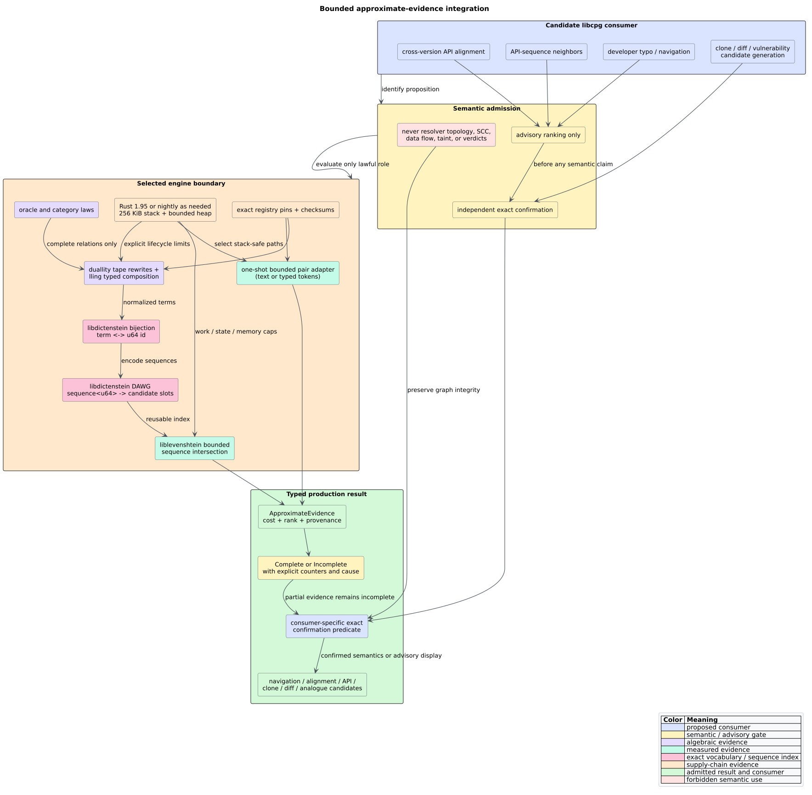

# Theory 56 -- weighted relations and approximate matching

Approximate matching asks for candidates near a query under an explicitly
chosen edit model. Weighted finite-state transducers (WFSTs) add composition:
one machine can rewrite labels, another can score the rewritten labels, and a
third can restrict them to a dictionary. Category theory explains why that
composition can be lawful; metric theory explains when a distance can support
metric indexing; operational evidence explains when a lawful mathematical
relation is still unsafe to enumerate.

This chapter defines those three layers before applying them to libcpg.



*Figure -- the semantic and operational separation. Source:
[`diagrams/approximate-automata-adoption.puml`](../diagrams/approximate-automata-adoption.puml).*

## 1. Strings, edits, and distances

Let $`\Sigma`$ be an alphabet and $`\Sigma^*`$ the set of finite strings over
that alphabet. An **edit operation** consumes a finite source segment, consumes
a finite target segment, and has a nonnegative cost. Standard Levenshtein
distance permits insertion, deletion, and substitution at unit cost, with
equal-character alignment at zero cost. Its distance is the least path cost
through the finite alignment grid:

```math
d_{\mathrm{lev}}(x,y)=min_{p:x\Rightarrow y}\operatorname{cost}(p).
```

Standard Levenshtein distance is a **metric**: for all strings $`x,y,z`$ it is
nonnegative, separates identity, is symmetric, and satisfies the triangle
inequality:

```math
d(x,y)\ge 0,\qquad
d(x,y)=0\Leftrightarrow x=y,\qquad
d(x,y)=d(y,x),\qquad
d(x,z)\le d(x,y)+d(y,z).
```

Optimal string alignment (OSA) adds an adjacent transposition but forbids a
substring from being edited more than once. It remains nonnegative, separating,
and symmetric, but it is not a metric. The executable witness is

```math
d_{\mathrm{osa}}(\mathtt{CA},\mathtt{ABC})=3
>d_{\mathrm{osa}}(\mathtt{CA},\mathtt{AC})
 +d_{\mathrm{osa}}(\mathtt{AC},\mathtt{ABC})=2.
```

A **pseudometric** relaxes identity separation while retaining symmetry and the
triangle inequality. OSA is not a pseudometric because the triangle inequality
fails. A caller-defined generalized edit system may also be asymmetric, so it
is not automatically a metric or pseudometric merely because every operation
has a nonnegative cost.

## 2. Lawvere distance

A **Lawvere metric** permits asymmetry and distinct points at zero distance. It
retains only reflexivity and the triangle inequality:

```math
d(x,x)=0,\qquad d(x,z)\le d(x,y)+d(y,z).
```

Categorically, this is a category enriched over the ordered additive monoid of
extended nonnegative reals. The value $`d(x,y)`$ is the enriched hom-object;
identity gives reflexivity and composition gives the triangle inequality.
This perspective is useful for directional rewrite costs such as “migration
from old API to new API,” where the reverse transformation can legitimately
cost something different.

It does not classify every generalized edit system automatically. Zero-cost
length-changing cycles can collapse unrelated strings, negative cycles can make
an optimum undefined, and a restricted operational algorithm can violate the
intended closure under composition. The operation grammar, cost domain, and
shortest-path semantics must establish the laws.

## 3. Semirings provide path algebra

A **semiring** $`K=(K,\oplus,\otimes,\mathbf{0},\mathbf{1})`$ has an additive
commutative monoid, a multiplicative monoid, distributivity, and an absorbing
additive identity. WFSTs use $`\otimes`$ to combine weights along one path and
$`\oplus`$ to combine alternative paths.

The tropical semiring used by the evaluated WFSTs is

```math
K=\mathbb{R}\cup\{+\infty\},\qquad
a\oplus b=\min(a,b),\qquad
a\otimes b=a+b,\qquad
\mathbf{0}=+\infty,\qquad
\mathbf{1}=0.
```

Thus path composition adds edit costs, while alternative accepting paths keep
their least cost. The names “zero” and “one” refer to algebraic identities, not
the underlying floating-point values: tropical zero is positive infinity and
tropical one is numeric zero.

The isolated adoption experiment tests associativity, distributivity, additive
commutativity, identities, and absorption over a finite nonnegative domain. A
floating-point implementation still needs boundary policy for not-a-number,
infinities, and any negative weights; algebraic genericity does not supply an
operational shortest-path guarantee.

## 4. WFSTs as weighted relations

For label domains $`A`$ and $`B`$, a $`K`$-weighted relation is a function

```math
R:A^*\times B^*\to K.
```

The value $`R(a,b)`$ is the best weight with which the transducer relates input
$`a`$ to output $`b`$. A finite-state representation denotes a **rational
weighted relation**. Given $`R:A^*\to B^*`$ and $`S:B^*\to C^*`$, composition
eliminates the intermediate string:

```math
(S\circ R)(a,c)=\bigoplus_{b\in B^*}R(a,b)\otimes S(b,c).
```

The identity relation copies a string at multiplicative identity and assigns
additive zero to every different pair:

```math
I_A(a,a)=\mathbf{1},\qquad I_A(a,a')=\mathbf{0}\ \text{when}\ a\ne a'.
```

Under the usual convergence conditions, weighted relations form a category:
composition is associative and $`I_A`$ is a left and right identity. This gives
three practical benefits.

1. **Stage typing.** Distinct object types can distinguish source identifiers,
   normalized identifiers, API events, and dictionary terms. A composition is
   admitted only when the output object of one stage equals the input object of
   the next. Reusing bare `char` for every stage loses that semantic check.
2. **Refactoring laws.** Re-parenthesizing a complete composition cannot change
   its extensional weighted relation. Identity adapters can be added or removed
   without changing results.
3. **Local reasoning.** Each arrow states one relation; composition explains how
   the end-to-end relation follows without merging implementation internals.

The T0.6 experiment materializes complete finite one-step relations and checks
left identity, right identity, and associativity extensionally. It compares
input/output strings and best tropical weights, not implementation state IDs,
cache contents, traversal order, or allocation history.

## 5. The operational layer is not the category

A mathematical relation and an iterator that attempts to enumerate it are
different objects. A cyclic WFST can denote a meaningful weighted relation
while exposing infinitely many accepting paths. A zero-cost cycle is especially
dangerous because a best-first heap can keep generating equal-priority paths.

Likewise, a work cap $`L`$ does not yield ordinary composition. Define
$`\operatorname{run}_L(R)`$ as a traversal stopped after $`L`$ work items. Its
partial output generally does not preserve identity or associativity:

```math
\operatorname{run}_L(S\circ R)
\ne
\operatorname{run}_L\bigl(S\circ\operatorname{run}_L(R)\bigr).
```

The right-hand expression is not even type-correct unless a partial observation
is falsely treated as the original arrow. The lawful boundary is an effectful,
typed observation:

```text
RUN_BOUNDED(relation, limits):
    initialize an explicit heap worklist
    while work remains and every limit permits progress:
        expand one canonical configuration
        merge its best known weight
    if the worklist is empty:
        return Complete(extensional_relation)
    otherwise:
        return Incomplete(partial_relation, first_limit, counters)
```

Only `Complete` values participate in extensional category-law assertions.
`Incomplete` is evidence about an observation attempt, not a smaller equivalent
relation. The experiment's `Completion::{Complete, StateLimit, WorkLimit}`
demonstrates this separation around duallity's traversal.

## 6. Stack safety and heap safety are independent

A pushdown automaton (PDA) makes the control stack explicit in heap memory.
More generally, an iterative state machine stores continuations in a `Vec`,
queue, arena, or indexed tape. This bounds native call depth, but it does not
bound how much heap state the algorithm retains.

For the evaluated positional transition table, query length $`q`$ determines a
power-of-two stride

```math
s(q)=2^{\lceil\log_2(q+1)\rceil}.
```

Appending that full stride for $`g(q)=O(q)`$ generated states consumes
$`O(q^2)`$ cells. Conversely, the generalized WFST's recursive
multi-character dictionary traversal consumes $`O(r)`$ native frames for an
operation consuming $`r`$ characters even when its heap is small. A safe
implementation must discharge both obligations:

```math
\operatorname{native\_depth}(n)=O(1)
\quad\land\quad
\operatorname{retained\_heap}(n)\le B(n)
```

for a documented, enforced bound $`B`$ over the entire admitted domain.

## 7. What composition would mean for libcpg

Category theory benefits libcpg when independently meaningful program relations
compose. Existing examples include typed graph-edge relations, Datalog joins,
data-flow transfer, call-summary composition, and append-only overlays. For an
approximate layer, a possible chain would be

```text
source spelling
    -> normalized advisory spelling
    -> dictionary candidate
    -> typed CPG identity confirmation
    -> human-facing ranking
```

The first two arrows may be approximate; the identity-confirmation arrow is
exact and may reject every candidate. The composite remains advisory because
composition cannot strengthen the weakest proposition by itself.

ADR-0073 introduces those objects explicitly. A consumer selects a typed input
tape, normalization and edit policy, work and memory limits, and an independent
confirmation predicate. The approximate engine returns ranked evidence plus a
completion report; it never mutates the CPG. This makes the weighted relation a
useful production component while preserving the exact semantic boundary.

For clone and vulnerability-analogue discovery, the approximate arrow reduces
the pair space before an AST, program-dependence graph (PDG), Weisfeiler--Lehman
(WL), or VF2 check. For revision alignment, it proposes counterparts before
scope and typed-signature confirmation. For API sequences, it compares typed
event tapes before exact temporal-property evaluation. The common compositional
shape is therefore

```text
immutable typed projection
    -> optional exact normalization
    -> bounded approximate relation
    -> deterministic candidate evidence
    -> consumer-specific exact confirmation
```

The last arrow may reject every candidate. Composition organizes the stages; it
does not upgrade an approximate proposition into an exact one.

## 8. Relation to Datalog and e-graphs

Datalog computes least fixed points of monotone relations; it is well suited to
recursive graph queries whose facts are exact. An e-graph represents congruence
classes and performs equality saturation; it is well suited to applying many
equational rewrites before extraction. A WFST represents weighted string
relations; it is well suited to finite-state rewriting and ranking.

All three compose relations, but they solve different propositions. Approximate
spelling is not an equality proof for an e-graph, and equality saturation is not
a metric index. Datalog can consume an already authorized advisory candidate
relation, but its fixed point does not make approximate facts exact. Category
theory helps state these interfaces and laws; it does not erase their semantic
boundaries.

## 9. Exact vocabularies and sequence languages

Approximate matching over program structure must compare token equality, not
the textual accident of concatenating tokens. A token may contain any Unicode
text, delimiter, or sentinel-like value. The reusable structural index uses two
exact dictionaries.

First, a bijection $`\nu`$ assigns each vocabulary term a reversible integer
identifier:

```math
\nu:V\leftrightarrow\{1,\ldots,|V|\}.
```

Second, a finite dictionary recognizes a language of identifier sequences and
maps each accepted sequence to all stable candidate slots represented by it:

```math
D:\nu(V)^*\to\mathcal{P}_{\mathrm{fin}}(C).
```

This factorization has four useful properties.

1. **Type independence.** A vocabulary term can represent an identifier,
   operator, node kind, API event, n-gram, or another caller-defined structure.
2. **Reversibility.** Evidence can decode an integer back to the exact term;
   hashes are accelerators rather than semantic identities.
3. **Sequence preservation.** Boundaries are structural. Tokens `ab,c` and
   `a,bc` cannot collide through concatenation.
4. **Multiplicity preservation.** Identical sequences belonging to different
   stable candidates remain different candidates.

Unknown query terms are assigned fresh query-local identifiers greater than
the corpus range. The encoding function is equality-reflecting within the
query:

```math
q_i=q_j\Longleftrightarrow\widehat{\nu}(q_i)=\widehat{\nu}(q_j).
```

Consequently a bijective renaming of every token leaves every edit distance
and public ranking unchanged. The property suite checks this metamorphic law
against an independent two-row dynamic-programming oracle.

The directed acyclic word graph (DAWG) is a compact recognizer for the finite
sequence language. Intersecting a bounded edit transducer with that recognizer
searches many sequences without flattening their terms into characters. The
representation is an indexed capability, not an unconditional performance
claim: for one ad hoc query, index construction can dominate the search. The
measured API therefore separates a one-shot pair adapter from an explicitly
owned reusable index.

## 10. Division of algebraic responsibilities

Four libraries participate in approximate tape processing, while Replete has a
separate equational role.

| Component | Mathematical object | libcpg responsibility |
|---|---|---|
| `duallity` | weighted finite-state tape rewrite | optional lexical/domain rewrites |
| `lling-llang` | typed weighted-relation composition | valid intermediate tape and semiring connection |
| `libdictenstein` | exact finite vocabulary and sequence language | reversible IDs and reusable corpus index |
| `liblevenshtein` | edit relation and bounded traversal | cost semantics and accepted neighborhood |
| Replete | congruence-closed equivalence classes | later pure-expression equality saturation and extraction |

A tape rewrite does not prove an equation between program expressions. An
e-graph equation does not define an edit metric. Their outputs may meet only at
an explicit adapter: approximate search proposes stable candidates, and an
exact semantic analysis may confirm them or reject them. This keeps category
composition useful without erasing the proposition each category represents.

## References

1. Schulz, K. U., Mihov, S. (2002). *Fast String Correction with Levenshtein
   Automata.* International Journal on Document Analysis and Recognition 5,
   67--85. DOI:
   [10.1007/s10032-002-0082-8](https://doi.org/10.1007/s10032-002-0082-8).
2. Damerau, F. J. (1964). *A Technique for Computer Detection and Correction of
   Spelling Errors.* Communications of the ACM 7(3), 171--176. DOI:
   [10.1145/363958.363994](https://doi.org/10.1145/363958.363994).
3. Mohri, M. (1997). *Finite-State Transducers in Language and Speech
   Processing.* Computational Linguistics 23(2), 269--311.
   [ACL Anthology J97-2003](https://aclanthology.org/J97-2003/).
4. Lawvere, F. W. (1973/2002). *Metric Spaces, Generalized Logic, and Closed
   Categories.* Reprints in Theory and Applications of Categories 1, 1--37.
   [TAC reprint](http://www.tac.mta.ca/tac/reprints/articles/1/tr1.pdf).
5. Knuth, D. E. (1984). *Literate Programming.* The Computer Journal 27(2),
   97--111. DOI:
   [10.1093/comjnl/27.2.97](https://doi.org/10.1093/comjnl/27.2.97).
