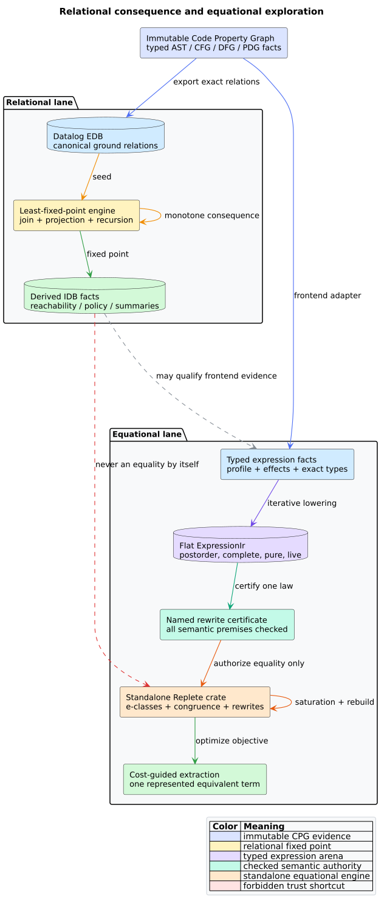

# Datalog, e-graphs, and typed expression semantics

This chapter explains why libcpg uses both relational reasoning and a typed
equational boundary, but assigns them different jobs. **Datalog** derives facts
from relations. An **e-graph** compactly represents expressions and asserted
equalities under congruence. **Equality saturation** repeatedly adds valid
equations to an e-graph and then extracts one represented expression according
to a cost objective. None of these mechanisms establishes language semantics
by itself.



*Figure -- Datalog and standalone Replete consume different projections and
produce different evidence. Source:
[`relational-equational-reasoning.puml`](../diagrams/relational-equational-reasoning.puml).*

## 1. Datalog computes relational consequence

An **extensional database** (EDB) is the finite input relation set. An
**intensional database** (IDB) contains relations derived by rules. For EDB
facts $`E`$ and immediate-consequence operator $`T_P`$ for program $`P`$, the
positive Datalog meaning is the least fixed point:

```math
\operatorname{lfp}(T_P)=\bigcup_{i\geq 0}T_P^i(E).
```

Monotonicity means $`X\subseteq Y`$ implies
$`T_P(X)\subseteq T_P(Y)`$. Semi-naive evaluation avoids repeatedly deriving
the same consequences by joining each rule with the delta produced in the
previous round.

This model excels when the question is relational:

- which definitions may reach a use;
- which nodes are transitively reachable;
- which call paths satisfy a policy;
- which facts participate in points-to, taint, or dependency relations; and
- which recursive graph patterns hold at a least fixed point.

libcpg exports canonical typed EDB facts and leaves rule parsing, IDB storage,
and fixed-point execution to a caller-owned engine. That keeps the graph model
exact and avoids embedding one Datalog runtime as policy.

### Datalog strengths

- Rules are compact, declarative, and naturally recursive.
- Joins, projection, selection, and fixed-point planning are highly optimized.
- Provenance can explain which ground facts supported a derived tuple.
- Independent rule sets can query the same EDB without changing the CPG.
- The least-fixed-point semantics is well suited to monotone may-analyses.

### Datalog costs and limits

- Large joins and recursive relations can consume substantial memory.
- Negation, aggregation, and non-monotone constructs require stratification or
  other explicit semantics.
- A tuple such as `equivalent(a,b)` is still only as sound as the rule that
  emitted it; the Datalog engine does not create a congruence proof.
- Datalog does not compactly retain a large family of alternative expression
  trees for global cost-based extraction.

## 2. E-graphs compute congruence closure

An **e-node** is an operator applied to child e-classes. An **e-class** groups
e-nodes known equal. An e-graph represents a congruence relation $`\equiv`$:

```math
(a_1\equiv b_1)\land\cdots\land(a_n\equiv b_n)
\Longrightarrow
f(a_1,\ldots,a_n)\equiv f(b_1,\ldots,b_n).
```

This is the congruence-closure principle studied by Nelson and Oppen. Equality
saturation adds the right-hand side of every matching valid rewrite without
deleting the left-hand side. Rebuilding restores canonical e-class invariants
after batches of additions. Extraction then minimizes a cost function over the
represented alternatives. Tate et al. introduced this organization to avoid
destructive compiler phase ordering; `egg` made it practical through deferred
rebuilding and e-class analyses.

E-graphs excel when the question is equational:

- which expression shapes are equivalent under an admitted rule set;
- how many rewrite orders can be represented without choosing early;
- which equivalent expression minimizes latency, size, energy, or another
  explicit objective; and
- how an analysis value should be maintained modulo equivalence.

### E-graph strengths

- Non-destructive rewriting mitigates phase-ordering problems.
- Congruence shares equivalent substructure compactly.
- Extraction makes global profitability separate from rewrite discovery.
- E-class analyses can attach constants, types, intervals, or domain metadata
  modulo equality.

### E-graph costs and limits

- Saturation can grow rapidly; node, class, iteration, time, and memory limits
  remain essential.
- A rewrite is an axiom from the engine's point of view. If its semantic
  precondition is false, saturation efficiently propagates an unsound equality.
- Binding, effects, floating point, undefined behavior, memory, and exceptions
  require typed domain policy; syntactic patterns are insufficient.
- A limited run is not saturated, and a cheapest represented term need not be
  globally optimal outside the represented search space.

## 3. Similarities without conflation

| Property | Datalog | E-graph / equality saturation |
|---|---|---|
| Core state | set of ground tuples | congruence-closed e-classes/e-nodes |
| Growth | add derived facts | add terms and equalities |
| Iteration | least fixed point of rules | saturation/rebuild iterations |
| Sharing | relation indexes and common tuples | congruent subexpressions |
| Query result | derived relation/provenance | equality class or extracted term |
| Natural recursion | paths and recursive predicates | nested term rewrites through e-matching |
| Primary optimizer | join ordering/index selection | rewrite scheduling, rebuilding, extraction |
| Main failure risk | relation explosion or unsound rule | e-graph explosion or unsound equality |
| Negative result | meaningful only after complete fixed point | meaningful only relative to complete search/rules |

Both systems are monotone in a useful operational sense: ordinary positive
Datalog adds facts, while equality saturation adds represented equalities and
terms. Both benefit from batching, indexes, canonical identities, and explicit
resource bounds. The similarity explains systems such as egglog, but it does
not make a relational tuple interchangeable with an equality certificate.

## 4. Why the typed expression IR is necessary

Let $`G`$ be an immutable CPG, $`F`$ a frontend fact table, $`P`$ a semantic
profile, $`t`$ a lowered subtree, and $`r`$ a named rewrite law. libcpg admits
the law only when:

```math
\operatorname{admit}(G,F,P,t,r)=
\operatorname{matches}(G,F,t)\land
\operatorname{complete}(t)\land
\operatorname{total}(P)\land
\operatorname{pure}(t,P)\land
\operatorname{precondition}(r,t,P)\land
\operatorname{live}(t).
```

The flat `ExpressionIr` is the executable witness for the structural part of
this predicate. The private `RewriteCertificate` witnesses one successful law
check. Replete may add an equality only after receiving such evidence through
its later adapter. Replete remains a standalone generic crate; it must not
depend on libcpg, and libcpg must not absorb its e-graph implementation.

This division of labor is deliberate:

- libcpg knows program identity, types, effects, source topology, and frontend
  completeness;
- Replete knows generic e-class invariants, matching, rebuilding, saturation,
  analysis, and extraction; and
- the adapter knows how a certified libcpg node becomes one typed Replete term
  and how an extracted term maps back without losing source evidence.

## 5. When to use each mechanism

Use Datalog for transitive call reachability, points-to relations, taint and
policy paths, recursive dependency queries, and cross-cutting graph facts. Use
an e-graph for pure typed expression alternatives, algebraic normalization,
instruction-selection exploration, and multi-objective extraction. Use both
when relational analysis establishes a rewrite premise and a separately
checked certificate admits that premise to equational exploration.

Do not use either system to replace exact source identity, parser semantics,
or formal rule validation. Approximate matching can rank candidate duplicates
or similar structures, but a small distance is neither a Datalog fact nor an
equality proof.

## 6. Applied category theory

Category theory is useful here as a language for composition laws, not as a
requirement to wrap every Rust type in categorical interfaces.

The category **Rel** has sets as objects and binary relations as morphisms.
Relational composition is:

```math
(S\circ R)(a,c)\iff\exists b.\;R(a,b)\land S(b,c).
```

Datalog joins and paths are naturally described through this composition.
Identity relations and associativity provide strong property-test oracles for
export and adapter layers.

An e-graph instead presents a quotient of a term algebra by generated
equations. A syntax-preserving adapter can be viewed as a homomorphism when it
preserves operators and ordered operands. Extraction is not generally an
inverse: it chooses one representative of an equivalence class according to a
cost algebra. Therefore the practical laws are:

1. identity adapters preserve exact terms;
2. composition of total adapters is associative extensionally;
3. lowering preserves ordered operation structure;
4. certified equations map to equal e-classes; and
5. extraction returns a represented member, not a newly asserted equality.

These laws benefit libcpg by clarifying ownership and generating tests. A
category-theory abstraction should enter production only when it removes
duplication or makes an executable law impossible to violate. The diagrams,
formal models, and property tests may use the theory immediately without
forcing runtime indirection.

## References

1. Nelson, G., Oppen, D. C. (1980). *Fast Decision Procedures Based on
   Congruence Closure.* JACM. DOI:
   [10.1145/322186.322198](https://doi.org/10.1145/322186.322198).
2. Tate, R., Stepp, M., Tatlock, Z., Lerner, S. (2009). *Equality Saturation: A
   New Approach to Optimization Phases.* POPL. DOI:
   [10.1145/1480881.1480915](https://doi.org/10.1145/1480881.1480915).
3. Willsey, M. et al. (2021). *egg: Fast and Extensible Equality Saturation.*
   POPL. DOI: [10.1145/3434304](https://doi.org/10.1145/3434304).
4. Jordan, H., Scholz, B., Subotić, P. (2016). *Soufflé: On Synthesis of Program
   Analyzers.* CC. DOI:
   [10.1007/978-3-319-41540-6_23](https://doi.org/10.1007/978-3-319-41540-6_23).
5. Bravenboer, M., Smaragdakis, Y. (2009). *Strictly Declarative Specification
   of Sophisticated Points-to Analyses.* OOPSLA. DOI:
   [10.1145/1640089.1640108](https://doi.org/10.1145/1640089.1640108).
