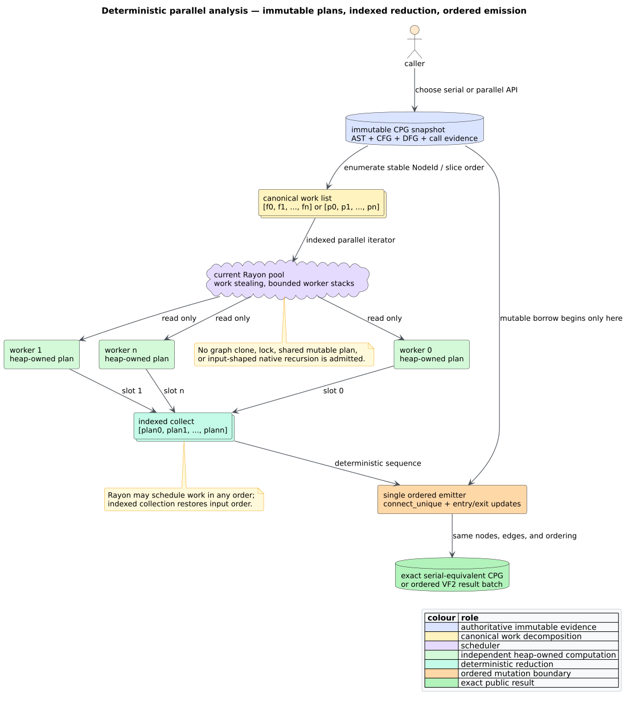

# Parallel CFG, DFG, PDG, and VF2 analysis

libcpg can compute independent per-function graph plans and independent
per-pattern VF2 matches on a caller-selected Rayon thread pool. Parallel APIs
preserve serial node, edge, entry/exit, pattern, and embedding order; they do
not expose schedule order in the result.

Use parallel analysis when one graph contains many non-trivial functions or
one query contains many patterns. Keep the serial default for small files and
single-pattern calls, where scheduler dispatch may cost more than it saves.



*Figure — deterministic plan/emit flow. Source:
[`diagrams/parallel-plan-emit.puml`](../diagrams/parallel-plan-emit.puml).*

## Enable it in tree-sitter construction

`parallel_analysis` defaults to `false`. The fluent setting makes the normal
tree-sitter pipeline use parallel CFG and DFG planning:

```rust
// requires: features = ["lang-rust"]
use libcpg::{CpgBuilder, CpgBuilderConfig, Language, TreeSitterCpgBuilder};

let source = r#"
fn first(x: i32) -> i32 { x + 1 }
fn second(x: i32) -> i32 { x * 2 }
"#;

let builder = TreeSitterCpgBuilder::with_config(
    CpgBuilderConfig::default().with_parallel_analysis(true),
);
let cpg = builder.build(source, Language::Rust)?;
assert_eq!(cpg.functions().count(), 2);
# Ok::<(), libcpg::Error>(())
```

The builder uses the current Rayon pool. Calling it outside
`ThreadPool::install` uses Rayon's global pool.

## Own the worker count and stack budget

Install a local pool when the application must control scheduling. This does
not modify Rayon's global configuration:

```rust
use libcpg::{CfgExtractor, CodePropertyGraph, DfgExtractor, PdgBuilder};

fn enrich_in_pool(cpg: &mut CodePropertyGraph) {
    let pool = rayon::ThreadPoolBuilder::new()
        .num_threads(8)
        .stack_size(256 * 1024)
        .build()
        .expect("valid Rayon pool");

    pool.install(|| {
        CfgExtractor::new().extract_parallel(cpg);
        DfgExtractor::new().extract_parallel(cpg);
        PdgBuilder::new().build_all_parallel(cpg);
    });
}
```

Run the phases in that order. DFG may consume CFG and call-resolution evidence;
PDG consumes both CFG and DFG evidence. Parallelism exists *within* a phase, not
across dependent phases.

## Match an ordered pattern batch

`find_matches_many_parallel` returns one result vector for each input pattern,
in input order. Each result vector retains the ordinary VF2 match order and the
match cap configured on the matcher.

```rust
use libcpg::pattern::Vf2Matcher;
use libcpg::CodePropertyGraph;

fn match_batch(
    patterns: &[CodePropertyGraph],
    target: &CodePropertyGraph,
) -> Vec<Vec<libcpg::PatternMatch>> {
    Vf2Matcher::new()
        .with_strict_kinds(true)
        .with_strict_edges(true)
        .with_max_matches(64)
        .find_matches_many_parallel(patterns, target)
}
```

For one pattern, continue to use `find_matches`; constructing a parallel batch
of length one adds dispatch without independent work.

## Select a worker count

Start with the number of available physical cores, then measure the actual
workload. The controlled 512-function experiment improved through 32 workers;
the 128-pattern VF2 batch also improved through 32, but with sharply declining
efficiency. More workers can increase cache/TLB pressure and virtual stack
reservation even when resident heap stays flat. Production services should
also reserve cores for request handling and other tenants.

The measured scaling table, affinity protocol, allocation profile, and
falsification boundaries are in
[scientific validation 54](../scientific/54-parallel-analysis-validation.md).

## Determinism and idempotency

Workers never mutate the graph. Each produces a heap-owned plan; indexed
collection restores function or pattern order; one serial emitter applies
graph updates with the existing uniqueness rules. Re-running an extractor or
PDG builder therefore retains its established idempotency. Under `serde`, tests
require serial and parallel CPG encodings to be byte-identical across
1/2/4/8/16/32 workers.

## Resource and trust boundary

Parallelism is not an input-admission limit. Before analyzing untrusted input,
bound source bytes, graph nodes/edges, function count, pattern count, and match
caps. A 256 KiB worker stack is sufficient for the public 100,000-depth gate
because CFG, DFG, dominator, and VF2 continuations live on the heap; applications
may select a larger stack for their own code that runs inside the same pool.

The design rationale and rejected shared-mutation/graph-clone alternatives are
recorded in [ADR-0059](../design/0059-deterministic-parallel-plan-emission.md).

## References

1. Blumofe, R. D., and Leiserson, C. E. (1999). *Scheduling Multithreaded
   Computations by Work Stealing.* Journal of the ACM 46(5), 720–748. DOI:
   [10.1145/324133.324234](https://doi.org/10.1145/324133.324234).
2. Cordella, L. P., Foggia, P., Sansone, C., and Vento, M. (2004). *A (Sub)Graph
   Isomorphism Algorithm for Matching Large Graphs.* IEEE TPAMI 26(10),
   1367–1372. DOI:
   [10.1109/TPAMI.2004.75](https://doi.org/10.1109/TPAMI.2004.75).
