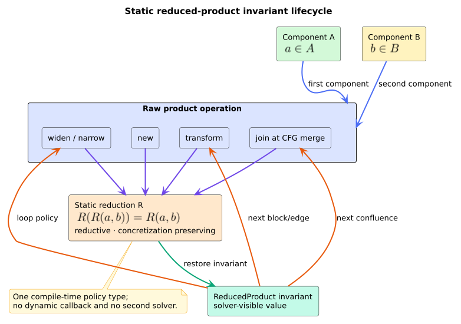

# Using relational abstract domains

Choose the least costly domain that can state the property you need. Intervals
answer independent range questions, octagons retain signed two-variable
relations, and exact polyhedra retain arbitrary rational linear constraints.

## Select a domain

| Required fact | Recommended domain |
|---|---|
| $`0\leq x\leq 10`$ | `IntervalEnv` |
| $`x-y\leq 3`$ or $`x+y\leq 7`$ | `Octagon` |
| $`2x+3y-z\leq 7`$ | `Polyhedron` with `abstract-domains` |
| cheap ranges plus pairwise propagation | `ReducedProduct<IntervalEnv, Octagon, IntervalOctagonReduction>` |

`Polyhedron` is exact, not automatically preferable. Its projection and
redundancy work is exponential in the worst case.

## Model a relational branch

```rust
use libcpg::{Octagon, OctagonConstraint, OctagonTerm};

let mut state = Octagon::top(2);
state.assume(OctagonConstraint::binary(
    OctagonTerm::positive(0),
    OctagonTerm::negative(1),
    0,
))?; // x <= y

assert!(state.contains(&[2, 3]));
assert!(!state.contains(&[3, 2]));
# Ok::<(), libcpg::OctagonError>(())
```

Use `assume_all` when several constraints enter together; it closes the DBM
once. `interval(variable)` projects the strongest unary interval represented by
the closed octagon. It returns `None` for bottom and top for an unadmitted
variable.

## Build and join exact polyhedra

```rust
// requires: features = ["abstract-domains"]
use libcpg::{Lattice, LinearConstraint, Polyhedron};

let region = Polyhedron::from_constraints(
    2,
    [
        LinearConstraint::from_integers([(0, -1)], 0),
        LinearConstraint::from_integers([(1, -1)], 0),
        LinearConstraint::from_integers([(0, 2), (1, 3)], 12),
    ],
)?;
assert!(region.contains_integers(&[3, 2]));
assert!(!region.contains_integers(&[4, 2]));

let mut joined = Polyhedron::integer_point(&[0, 0])?;
let endpoint = Polyhedron::integer_point(&[4, 4])?;
joined.join(&endpoint);
assert!(joined.contains_integers(&[2, 2]));
assert!(!joined.contains_integers(&[2, 1]));
# Ok::<(), libcpg::PolyhedronError>(())
```

Prefer `closed_convex_hull` when a caller must observe
`PolyhedronError::DimensionOverflow`. `Lattice::join` is infallible and remains
sound by returning top if an extended dimension cannot be represented.

## Reduce at CFG confluence

Define a data-flow domain as a reduced product; the existing `solve` function
will call its `join` at block merges.

```rust
use libcpg::{
    IntervalEnv, IntervalOctagonReduction, Octagon, ReducedProduct,
};

type RelationalState =
    ReducedProduct<IntervalEnv, Octagon, IntervalOctagonReduction>;

fn bottom() -> RelationalState {
    RelationalState::new(IntervalEnv::bottom(), Octagon::bottom(2))
}
```

After a transfer that changes only one component, call
`ReducedProduct::transform`; it runs the operation and restores the reduction
invariant. Use `widen_with` and `narrow_with` to supply each component's
operator, then reduce once.



*Figure -- reduced-product use in a solver. Source:
[`diagrams/reduced-product-cycle.puml`](../diagrams/reduced-product-cycle.puml).*

## Handle limits deliberately

- Admit a bounded variable set and bounded input constraint count.
- Bound coefficient bit length when constraints originate outside your trust
  boundary.
- Apply solver visit, wall-clock, RSS, and output limits around exact
  polyhedral analyses.
- Treat widening as a sound loss of precision, not an exact hull.
- Interpret a result only against the CPG operations modeled by your transfer.
- Do not silently truncate constraints: truncation can exclude concrete states
  and become unsound.

All libcpg domain algorithms are iterative and stack-safe. Deep CFGs and large
dimensions still consume time and heap memory, so stack safety is not a reason
to omit resource policy.

## References

1. Cousot, P., Cousot, R. (1977). *Abstract Interpretation: A Unified Lattice
   Model for Static Analysis of Programs by Construction or Approximation of
   Fixpoints.* DOI:
   [10.1145/512950.512973](https://doi.org/10.1145/512950.512973).
2. Miné, A. (2006). *The Octagon Abstract Domain.* DOI:
   [10.1007/s10990-006-8609-1](https://doi.org/10.1007/s10990-006-8609-1).
