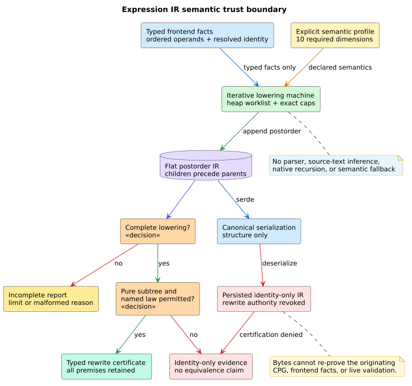

# T4.1 expression IR: formal plan and implementation obligations

## Decision and safety boundary

The pure-expression intermediate representation (IR) is a language-neutral,
flat, postorder arena derived from typed Code Property Graph (CPG) facts. It is
not a parser and it does not infer semantics from source spelling. A frontend
semantic profile explicitly states the rules that make a transformation valid.
The public boundary is fail-closed: a missing fact can preserve source identity,
but cannot justify equivalence, absence of a defect, or an optimization.

This boundary follows the same proof obligation as verified translation: the
transformation must preserve the source semantics actually selected by the
frontend, rather than a convenient language approximation. Leroy's CompCert
account is the motivating compiler-correctness reference
([DOI 10.1145/1538788.1538814](https://doi.org/10.1145/1538788.1538814)).
Equality saturation supplies compact equivalence representation, but it does
not make a rewrite true; each rewrite still needs semantic premises
([DOI 10.1145/3434304](https://doi.org/10.1145/3434304)). Floating-point
profiles must preserve IEEE 754 exceptional values and signed zero unless an
explicit frontend mode authorizes weaker identities
([IEEE 754-2019](https://standards.ieee.org/ieee/754/6210/),
[DOI 10.1109/IEEESTD.2019.8766229](https://doi.org/10.1109/IEEESTD.2019.8766229)).

## Semantic vocabulary

A *fact* is typed frontend evidence for one expression node and its ordered
operands. A *profile dimension* is one declared part of language behavior:
effects and purity, evaluation order, integer width and overflow, floating-point
mode, exceptions, short-circuiting, aliasing and memory reads, calls, volatile
and atomic access, or binding and scope. A *named rewrite law* is a closed IR
identifier such as additive identity or Boolean short-circuiting. A *rewrite
certificate* is an unforgeable successful check of all premises for one law.
*Live provenance* means that the in-memory artifact was produced by the
validated lowerer during the current process. Persistence preserves structural
evidence for inspection, but deliberately revokes rewrite authority because
bytes alone cannot re-prove the originating CPG and frontend facts.

For profile $`p`$, subtree $`t`$, law $`r`$, and lowering result $`q`$, public
eligibility is defined by:

~~~math
\operatorname{eligible}(p,t,r,q) =
\operatorname{complete}(q) \land
\operatorname{total}(p) \land
\operatorname{pure}(t,p) \land
\operatorname{permits}(p,r,t) \land
\operatorname{live}(q).
~~~

The conjunction is intentional. No finite hash, operator string, language
default, or e-class membership substitutes for a premise.

## Model decomposition

| Model | Scope | Checked claim |
|---|---|---|
| TLA+ / TLC | bounded operational lowerer | explicit heap worklist terminates in Complete, a named limit, or malformed-cycle rejection; mapped children precede parents; incomplete and persisted states expose no rewrite |
| Rocq | universally quantified certificate logic | eligibility implies live provenance, complete lowering, total profile, pure mode, and named-law permission; identity-only, unknown, and persisted modes deny rewrites; flat append preserves backward references |
| Z3 | independent Boolean and bit-vector abstraction | no assignment can make eligibility true while any semantic or live-provenance prerequisite is false; integer descriptors, masked shifts, checked shifts, and finite-reassociation literals obey their exact boundary conditions |

The [official TLA+ documentation](https://docs.tlapl.us/using%3Atlc%3Astart)
describes TLC's explicit-state role; the
[Rocq reference manual](https://rocq-prover.org/) describes the deductive
kernel. The proof ledger states the boundary between the models and the Rust
refinement rather than presenting finite model checking as an unbounded proof.

## Lowering algorithm

The production lowerer must refine this literate work-machine pseudocode:

~~~text
LOWER(root, facts, profile, limits):
    pending := [Enter(root)]
    active := empty set
    mapped := empty source-to-IR map
    tape := empty postorder arena

    while pending is not empty:
        charge exactly one work step or return WorkLimited
        frame := pop_front(pending)
        if frame is Enter(source):
            if source is active: return MalformedCycle
            if source is mapped: continue
            validate the typed fact and ordered operands
            mark source active
            prepend Enter(operand) in source order, then Exit(source)
        else frame is Exit(source):
            reserve exactly one node or return NodeLimited
            require every child to have an earlier mapped IR identifier
            append the node, remove source from active, and propagate evidence

    expose rewrite certificates only after returning Complete with live provenance
    on deserialization, preserve structure but revoke rewrite authority
~~~

The pending list, active set, and arena are heap-owned. Logical expression depth
therefore changes heap work memory, not native call-stack depth.

## Exhaustive invariant-to-test ledger

| ID | Invariant extracted from the models | Required implementation evidence |
|---|---|---|
| IR-01 | every operand IR identifier is smaller than its parent identifier | examples for unary/binary/DAG shapes; generated arbitrary acyclic facts; malformed forward-reference rejection |
| IR-02 | a shared source fact maps to one deterministic IR node | diamond example; insertion-order and repeated-operand properties |
| IR-03 | an active-source revisit is a typed malformed-cycle result | self-cycle and multi-node cycle examples; generated cyclic graphs |
| IR-04 | work and node caps are exact, monotone, and fail closed | boundary examples at zero, one, exact, and one-short limits; cap-monotonicity property |
| IR-05 | only Complete with live lowering provenance can expose a rewrite certificate | exhaustive completion/provenance examples and properties |
| IR-06 | identity-only, impure, and unknown evidence never exposes a rewrite | assignment, call, memory, volatile, atomic, await, yield, and unsupported-node examples |
| IR-07 | every certificate names one law and retains its checked premises | one positive and one denied example per law; certificate/profile mismatch property |
| IR-08 | every profile dimension participates in totality | independently erase each dimension and prove all laws denied |
| IR-09 | integer identities respect valid widths, signedness, overflow mode, and shift-count mode | invalid public descriptors plus wrapping, checked, saturating, unbounded, undefined-overflow, division-by-zero, negative masked-shift, and checked shift-bound examples |
| IR-10 | floating identities respect NaN, infinities, rounding, and signed zero; finite-reassociation claims reject contradictory literals | exact-bit examples for NaN payloads, both zeros, infinities, finite-mode validation, and reassociation denial |
| IR-11 | evaluation and short-circuit order are ordered semantic data | left-to-right, unspecified-order, eager Boolean, and short-circuit examples |
| IR-12 | exceptions, calls, memory reads, aliases, volatile, and atomic operations propagate non-purity | isolated and nested examples plus generated subtree propagation |
| IR-13 | binding identity includes resolved scope, not identifier spelling alone | shadowing, unresolved binding, and alpha-renamed resolved-binding examples |
| IR-14 | equivalent fact input yields byte-identical public order; persistence preserves structure but revokes authority | repeated execution, node-storage permutation, structural serialization round-trip, forged-certificate rejection, and post-deserialization denial properties |
| IR-15 | source text is neither read nor parsed by the IR layer | API review, dependency/source scan, and parser-built integration through existing frontends only |
| IR-16 | lowering, queries, clone, equality, hash, debug, persistence, and drop are input-depth stack safe | 100,000-level lifecycle and at least 20,000-level semantic operations on a 256 KiB native stack |
| IR-17 | malformed facts never yield a negative or optimization claim | missing node, wrong arity, invalid type, invalid operator, foreign root, and cap examples |
| IR-18 | CPG input is immutable | graph snapshot equality before and after every public lowering entry point |

## Pre-implementation verification gate

Production Rust may begin only after scripts/verify-expression-ir-formal.sh
reports all TLA+ invariants, all Rocq theorems, and all five independent Z3
refutations successful. If implementation work reveals a missing semantic
case, the model and this ledger change first, are reverified, and only then is
production code updated.

## MeTTaIL exclusion

This plan changes only standalone libcpg artifacts. MeTTaIL is an immutable
upstream reference for this campaign: no MeTTaIL source, task, manifest,
worktree, or commit is modified or required by T4.1.
